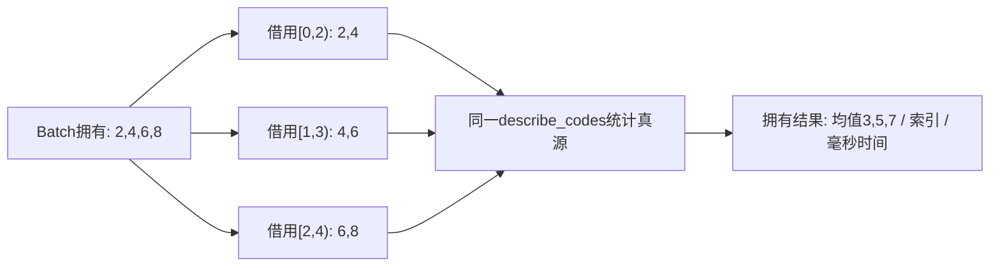
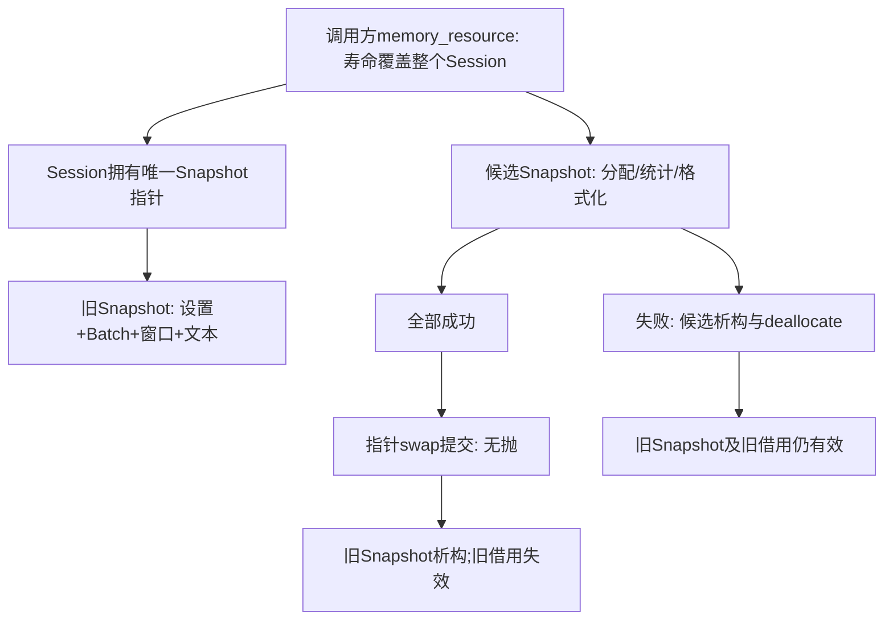

# 把测量报告做成可交付组件：窗口、文件、时间与失败提交

> 继续第 12 讲的同一 C++20 库、固定原码和标定合同。本讲完整交付**同步窗口报告**：命令行参数→文件输入→完整窗口统计→文本报告→错误退出，并在同一结果对象中验证逐点分配失败。既有并行归约仍可消费；生产有界任务、取消和关闭由下一讲继续；本讲先把每个同步任务的拥有和提交边界讲清。

## 为什么总均值还不够

一条 `[2,4,6,8] mV` 的记录总均值是 5 mV，却掩盖了上升趋势。若观察两个连续样本，窗口均值依次为 3、5、7 mV；它们分别对应原记录的 `[0,2)`、`[1,3)`、`[2,4)`。窗口不是把四个数复制成另一份无时间信息的数组，而是保留每个结果覆盖的索引和采样时刻。

定义窗口宽度 w、起点间隔 h（hop），两者都是正整数，至多 65536。原记录长度为 n，只输出**完整窗口**：当 n<w 时 K=0；否则 `K=1+floor((n−w)/h)`。第 k 个窗口的起点 `b=k·h`、终点 `e=b+w`，包含 b 到 e−1；不补零、不补齐、不输出不足 w 的尾部。h>w 可以跳过样本，这是接口允许的稀疏观察，不是计算遗漏。

| 默认记录，w=2、h=1、间隔1000 ms | 索引 | 首/末样本时间 | 均值 mV | 描述性方差 mV² | RMS² mV² |
| --- | --- | --- | --- | --- | --- |
| `[2,4]` | `[0,2)` | 0 / 1000 ms | 3 | 1 | 10 |
| `[4,6]` | `[1,3)` | 1000 / 2000 ms | 5 | 1 | 26 |
| `[6,8]` | `[2,4)` | 2000 / 3000 ms | 7 | 1 | 50 |

末样本时间是 `(e−1)·Δt`；e 的半开边界并没有对应本窗口内的最后样本。w 个样本从首到末跨越 `(w−1)·Δt`，不能把 w·Δt 自动叫作这段记录的首末时长。窗口之间重叠使结果相关；有三个窗口不等于获得三个独立实验。统计意义返回 [[电子电路/38-随机噪声与测量/01-RMS方差相关与谱密度#同一记录的中心与平方|中心与平方]]，不能把 RMS² 增加误读为随机噪声增加。

原 `describe(Batch)` 现在委托给 `describe_codes(span,calibration)`；窗口调用这个同一函数，不维护第二份方差公式。span 每次只在同步调用期间借用 Snapshot 的 Batch，窗口结果按值存储 Statistics，不保留输入 span。因此换掉旧报告不影响调用方先复制出来的结果值；若只保存结果 span，则仍须服从会话借用期。

## 把参数翻译成有意义的类型

应用 `measurement_report` 接收成对选项。唯一必需项是 `--input`；其他默认值仍对应能手算的记录。整数词由 `from_chars` 完整解析，拒绝 `250ms`、`1.2`、溢出及重复选项。随后构造原 Calibration、新 WindowSpec 和 ReportSettings，再尝试打开文件。语法成立、类型成立、范围成立、文件能够打开是四层检查。

| 选项 | 类型与范围 | 为什么这样定义 |
| --- | --- | --- |
| `--input` | filesystem::path | 保存平台路径语法，再由 ifstream实际打开 |
| `--output` | optional<path> | 无此项写stdout；有此项写指定文件并检查flush/close |
| `--window` / `--hop` | WindowSpec，各 `[1,65536]` | 0没有定义；K和边界由该合同推导 |
| `--gain-uv` / `--offset-uv` | 原Calibration | 单位和范围沿用第12讲，不把微伏默认为毫伏 |
| `--interval-ms` | chrono::milliseconds，`[1,86400000]` | 整数毫秒，避免每步浮点累加时间 |
| `--label` | 1–40个ASCII字母、数字、`_`、`-` | 一份简单可检查的报告文本协议，不自称通用CSV |

`milliseconds{250}` 转换成 `duration<double>` 再传给原 Batch 的 Seconds，值为约 0.25 s。报告的相对时间一直以整数毫秒乘索引，所以不把前面的浮点换算再累计回来。最晚样本索引 65535、最大间隔 86400000 ms，乘积小于 2^43 ms，在所用 chrono 整数表示中可容纳。它是相对第零个样本的时间；没有用 system_clock 的墙上时间冒充采样时刻，也没有加入时区。

`filesystem::path` 不保证文件存在或打开成功，也不保证不同系统使用相同文件名编码。CLI 直接构造 path 并尝试 ifstream；本机 UTF-8路径验证不构成 Windows 编码认证。文件输出使用 ofstream，显式检查打开、写入/flush和close；`--output` 会覆盖指定文件的内容，失败可能留下部分文件。本段的强异常保证只针对**内存中的报告会话**，不认证磁盘原子替换或断电持久性。路径与时间的标准边界见 [N4861 filesystems](https://timsong-cpp.github.io/cppwp/n4861/filesystems) 和 [time.duration](https://timsong-cpp.github.io/cppwp/n4861/time.duration)。

## 结果、资源与视图放在同一张图上

ReportSession维护一个 `unique_ptr<Snapshot,Deleter>`。Snapshot一起拥有参数、输入 Batch、`pmr::vector<WindowStatistics>` 和 `pmr::string` 报告。资源由调用方提供 `memory_resource*`，默认使用全局默认资源；资源必须覆盖 Session和其Snapshot的整个寿命。Session拒绝nullptr、禁止复制/移动，不让资源关系在未经定义的操作中隐式变化。

`replace` 先读入候选 Batch，再通过 `polymorphic_allocator<Snapshot>::new_object` 获取和构造 Snapshot。若对象构造失败，该分配路径释放对象存储；构造成功后尽快交给 unique_ptr。随后reserve窗口向量、计算窗口、构造全部文本，任何一步抛出都销毁候选。最后只交换两个带相同资源身份的拥有指针。它没有对两个不同资源的 pmr::vector直接swap，也没有调用可能分配的vector移动赋值来冒充无抛提交。[N4861 polymorphic_allocator成员合同](https://timsong-cpp.github.io/cppwp/n4861/mem.poly.allocator.mem) 与 [memory_resource合同](https://timsong-cpp.github.io/cppwp/n4861/mem.res) 是这条释放/构造证明的依据。

访问器 `settings()` 返回独立值，ReportSettings 的 `label()` 返回拥有string，因此临时settings取label不会产生悬垂视图。`windows()` 与 `text()` 返回借用，仅允许左值Session调用；成功替换或Session析构使旧借用失效，失败保留旧Snapshot和旧借用。请返回 [[计算机知识/10-编程语言/02-C++/10-系统课程/10-借用视图失效与异常提交#返回借用还是返回拥有值|返回借用还是返回拥有值]]，检查这一条规则如何同时覆盖临时对象、长任务与存入缓存的结果。

这是一条同步、单拥有者协议。资源指针和unique_ptr都没有把Session变成线程安全对象；多个线程同时读取/replace需要另建同步。现有并行归约只有函数内分块、join，并不意味着本Session已经具有发布协议。若以后把报告放入队列，返回 [[计算机知识/10-编程语言/02-C++/10-系统课程/11-原子发布线性化与回收边界#一次性发布的证明应该长什么样|发布证明]] 重新明确任务拥有者、入队、关闭、取消与等待。

## 逐点故障不是“抛一次异常看看”

测试内的 CountingResource转发给new_delete_resource并记live_blocks/live_bytes；第k次allocate可选择抛bad_alloc，deallocate按原bytes和alignment释放。先让一份64码、w=4、h=2的新报告真实成功，得到此环境中的分配次数A；不假设string扩容策略或A在所有标准库相同。再建立旧报告，对k=1…A逐次重新从同一输入构造候选并注入失败。

每次应同时验证：旧参数不变、旧窗口/文本不变、旧窗口借用地址不变，以及live_blocks/live_bytes回到旧值。末尾关闭故障开关让新报告真正提交，Session析构后计数都为0。测试会打印真实A；此环境A=10，检查均通过。资源计数证明已达到这些被注入路径的释放责任；没有用一个不会分配的例子宣称强保证。

**计数范围**是指定资源下的Snapshot对象、窗口结果vector和报告pmr字符串。原Batch的std::vector、解析string、path、label()返回string及测试辅助存储仍使用普通allocator；原PMR实验没有逐点注入它们；接续的独立普通分配实验将PMR转发到malloc并另计块/字节，在256码、40字符label、w4/h2的候选路径观察并重放普通vector/label请求。每点检查旧settings、窗口内容及地址、文本及借用，PMR回旧值、候选普通资源释放，Session析构后两域归零。进入[[计算机知识/80-实践/03-C++/05-测量分析组件/README#普通分配失败：候选、队列与线程分别保留什么|普通分配实验]]时携带旧Snapshot和长label的新候选，返回区分“旧结果保持”和“已经读取的流不回滚”；路径/文件内部申请仍不在该实验内。因此“本轮逐点资源验证”必须附这个边界，不能改写为整个进程的所有分配都已经认证。输入流位置也不回滚，读过的文件和外部写入不是旧Snapshot的一部分。

## 参考算法、复杂度与误差怎样接上

每个窗口调用原describe_codes，若K个窗口各w项，数值遍历是O(Kw)，没有按原码长度复制每个窗口的vector。输入拥有存储是O(n)，窗口结果O(K)，文本大小还随窗口数与数字表示增长。小w/K的参考实现清楚且容易核对；滚动和能减少重复扫描，但必须重建原码加减、边界和误差证明。本段没有凭一次计时承诺优化收益。

每个窗口继承第12讲的码/微伏范围及统计单位误差界，只需把该窗口的n、m、q代入；窗口之间重叠不改变单个结果的舍入合同，却会影响统计独立性的解释。参考整数和仍精确，没有把float归约结果拿来反算方差。w=1时描述性方差为0、样本方差为空；无完整窗口时报告windows=0，保留n与标定元数据，不伪造空TensorBuffer。

[[计算机知识/80-实践/03-C++/05-测量分析组件/README#窗口报告：完整应用参数与逐点资源故障|实践中的完整命令]]能从固定数据得到上表，也能改增益、偏置、时间和输出路径。安装后的第二个consumer只包含公开report.hpp并链接原导出库；第一个consumer继续验证旧API。新增的span统计入口只有一份实现，旧Batch的数值行为以原合同测试继续核对。

## 迁移题与参考答案

1. 原码`[2,4,6,8]`，gain=500 µV/码，offset=1000 µV，Δt=250 ms，w=2/h=1。前三个窗口均值、方差、末时刻是什么？答案：均值2.5/3.5/4.5 mV；描述性方差各0.25 mV²；末时刻250/500/750 ms。第一个RMS²=6.5 mV²，不能写成0.25。
2. n=5/w=3/h=2，输出几窗？n=4呢？答案：前者2窗`[0,3)`、`[2,5)`，后者1窗`[0,3)`；后一种尾部`[3,4)`不输出。Δt=1 s时前者末样本时刻2 s和4 s。
3. 留着old_text这个string_view；替换时第7次PMR分配失败，它能继续读吗？若替换成功呢？答案：失败保持旧Snapshot，所以可以；成功销毁旧Snapshot，应结束借用并重新取得。资源仍存活不足以证明旧对象仍存在。
4. 输入正确、内存报告构造成功，但输出路径不存在，是否说明内存强保证失效？答案：这是输出阶段的失败。会话里报告已提交，CLI返回2；文件错误不自动回滚内存状态。本轮不提供磁盘事务。
5. 把CountingResource改成monotonic_buffer_resource，按deallocate次数能断言物理内存立即释放吗？答案：不能；资源的回收策略不同。测试使用new_delete_resource的实际转发，必须保留该前提。

**回到入口**：[[计算机知识/10-编程语言/02-C++/10-系统课程/00-C++系统课程索引|唯一系统索引]] · **上一段**：[[计算机知识/10-编程语言/02-C++/10-系统课程/12-值类型泛型算法与数值应用|值类型与数值组件]]。[[计算机知识/10-编程语言/02-C++/10-系统课程/14-有界任务关闭取消与性能证据|下一讲]]交付有界生产/消费与本机性能观察；指定普通分配路径已有实践接续；单线程协程帧、同步动态C接口与named-module消费者分别已由第16/17/18讲交付。其他allocator/OS故障、异步事件与并发帧、跨编译器ABI/BMI、模块安装包仍需各自证据，不由同步报告构建自动认证。
