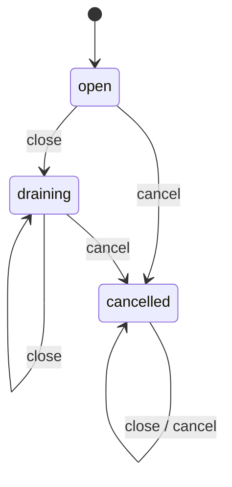

# 报告任务怎样有界地交付：关闭、取消、等待与性能证据

> 继续同一测量库的 ReportSession、窗口和文件流程。本讲把一份报告变成拥有数据的任务，再交付有界生产/消费、关闭、取消、任务失败和全部线程等待。数值实现仍消费第12/13讲的同一真源；性能记录是一组本机观察。模块、协程和跨编译器ABI仍有独立实验门槛。

## 为什么启动几个线程还不够

上讲一次调用拥有一份输入、结果和资源。当连续到达多份记录时，“每份记录都启动线程”会让线程数和内存随输入增长。让线程池无限排队只把问题移到内存。需要分别给工作线程、队列槽位、输入与保留结果定界，再明确队列停止以后谁释放数据、谁唤醒等待者、谁等待已开始的工作。

本库 `run_reports(vector<ReportTask>, RunOptions, stop_token)` 按值接管任务。ReportTask拥有原始string和ReportSettings；没有把调用方string_view保存在队列。1–3个工作线程，加调用线程最多4个；队列容量1–8；至多64个任务；每份输入至多512 KiB。每份保留报告至多32 MiB。任务少时，多线程启动成本可以比计算更贵，限额是资源合同而非吞吐承诺。

调用方可以复制任务vector传入，也可以move移交；复制发生在函数进入前，相应时间和分配属于调用路径。库无法限制调用方在进入前已经持有的任意其他对象。CLI在每次读取追加之前检查512 KiB，避免先把巨大文件读入再报超限。读完全部文件才运行任务：本段是有限批处理，尚非无限数据流服务。

## 同一把锁保护状态、容量和队列

`BoundedReportQueue`用mutex同时保护状态、deque和槽位判断。push等的是“状态已离开open，或者有空位”；pop等的是“状态已离开open，或者有任务”。条件变量通知不保存事实，事实保存在锁保护的数据中。wait使用谓词，重新取得锁后再看事实，因此虚假唤醒不会让空队列被取走，也不会把满队列继续塞满。标准规定的等待/通知机制见 [N4861 condition_variable](https://timsong-cpp.github.io/cppwp/n4861/thread.condition.condvar)。



| 状态 | push | pop | 为什么两侧都要被唤醒 |
| --- | --- | --- | --- |
| open | 有空位则接管；满时等待 | 有任务则取；空时等待 | pop释放槽位，push增加可取任务 |
| draining | 合法大小任务返回false | 继续FIFO取完已接收任务；随后空optional | close让满队列生产者退出，也让空队列消费者退出 |
| cancelled | 合法大小任务返回false | 空optional；队列中的拥有任务已销毁 | cancel不能留下等待空间或等待数据的线程 |

push先验证字节范围，非法超大任务仍抛length_error；合法任务才进入状态合同。成功入队、取出和状态转换均在同一mutex下完成，这是可解释的线性化点。close幂等地拒绝后续工作并排空；cancel幂等地清空待取任务并覆盖draining。直接使用队列时，拥有者必须让队列活过所有push/pop调用线程；close/cancel只唤醒、不join，析构前仍须等待这些调用结束。执行器run_reports在内部完成这项责任。snapshot只提供一次受锁保护的诊断快照，调用方不能凭一个旧快照省略push/pop中的实际状态检查。

## 取消不销毁已经运行的对象

外部stop_token由stop_callback接到queue.cancel：即使调用方尚在满队列的push中，取消也能通知它退出。对已经请求停止的token，注册回调会执行取消；机制来源是 [N4861 stop_callback](https://timsong-cpp.github.io/cppwp/n4861/stopcallback)。普通condition_variable不会因为jthread自己的stop请求而自动醒来，必须显式改变状态并通知。

工作线程成功pop后检查外部stop；看到false的这个检查定义本应用的“已开始”。此后到来的取消允许它把当前同步ReportSession做完。看到true或仍排队的任务保留默认cancelled结果。取消与开始并发时，已通过检查的任务可以完成；不承诺所有请求时尚未输出的任务都会被取消。直接调用队列cancel也不会撤回已经交给消费者的WorkItem。

每个工作线程单独构造ReportSession，使用new_delete_resource，避免共享一个调用方可能不支持并发的默认PMR资源。计算完成后把session.text()复制到TaskOutcome的拥有string，再销毁Session；跨线程交付的是拥有结果，span/string_view不跨过Session寿命。向量在启动前确定大小，此后不resize；管理线程唯一分配index，每个worker只写自己的不同元素，依据 [N4861容器数据竞争规则](https://timsong-cpp.github.io/cppwp/n4861/container.requirements.dataraces)。

结果位置按输入序号固定，工作完成顺序可以不同。管理线程join全部线程后才读取/返回结果；join完成与线程完成建立同步，见 [N4861 jthread](https://timsong-cpp.github.io/cppwp/n4861/thread.jthread.class)。因此调用方拿到返回值时不会有工作线程继续借用内部任务、队列或结果。没有detach，也没有“先返回，再由后台补结果”的寿命漏洞。

本应用是可复用的锁保护队列；按[[计算机知识/10-编程语言/02-C++/10-系统课程/11-原子发布线性化与回收边界#一次性发布的证明应该长什么样|一次发布的证明接口]]重新区分每次入队/取出、mutex同步与最后join，不能用单个ready flag替代全部任务协议。


这也是等待合同的代价：取消是协作请求，不是抢占。当前任务、分配器或系统调用若长时间不返回，join仍会等；本段不承诺停止延迟上界。cancel是noexcept，以正常可用mutex、条件变量和标准string析构为前提；它不是修复损坏同步对象的容错设施。

## 错误责任不能都压到一个catch里

| 失败发生在哪里 | 本应用协议 | 已运行的责任 |
| --- | --- | --- |
| 一个输入解析、报告构造、结果复制失败 | 本任务failed，继续其他任务 | 本地Session和输入由RAII清理；诊断截为159字节 |
| 启动第k个工作线程失败 | cancel队列、通知、join已启动线程，再向调用方重抛 | 之前等待空队列的线程先被唤醒退出 |
| 管理线程入队分配失败 | 同样cancel、join、重抛 | 不让队列/结果先于借用它们的线程析构 |
| 队列操作出现异常 | worker捕获、标记协议失败、cancel；join后调用方收到错误 | 不把未捕获异常送到线程入口触发terminate |
| 外部请求停止 | 队列取消，未开始结果cancelled；已开始可完成 | 返回前仍join全部工作线程 |

TaskOutcome的失败诊断是固定160字节数组。catch中不再分配另一段错误string，避免一次bad_alloc又引发报告错误所需的分配失败；error_message()在调用方读取时才返回拥有string。单任务异常有可观察结果，系统派发失败则是整次调用异常，两者不是同一层合同。

测试使用内部launcher缝隙，在第三次启动时抛system_error，前两次是真实jthread，检查它们均退出且join完才传播异常。另测返回非joinable线程的坏launcher。该头属于detail且不安装；公开消费者只用run_reports。

独立普通分配实验也从这个入口启动真实jthread：主线程按观察请求逐点失败，全部已启动线程退出且join后才接到bad_alloc；单工作线程按请求逐点失败，涵盖解析、默认PMR和最终TaskOutcome拥有文本复制，两个任务中只失败一个、另一个完成，返回前线程已退出。结果及执行器对象销毁后注入域活块/字节归零。进入[[计算机知识/80-实践/03-C++/05-测量分析组件/README#普通分配失败：候选、队列与线程分别保留什么|故障实验]]携带拥有Task、固定结果vector和等待责任，返回解释派发异常与TaskOutcome::failed是两种层次；线程局部独立编号避免拿随机跨线程分配次序作稳定合同。这是可复现的部分启动路径注入，没有宣称真的耗尽OS线程资源。

## 一条可运行的应用路径

在实践目录先执行README里的Debug/Release构建，再运行：

```bash
./build-release/measurement_batch --workers 2 --capacity 1 data/codes.txt data/invalid.txt data/codes.txt
```

它依输入顺序打印`task=0 completed`、`task=1 failed`、`task=2 completed`，每个成功任务接原窗口报告，整体退出2。三份合法输入全部成功时退出0。输出flush错误和读取失败由最外层诊断，未知、重复、缺值选项及完整整数错误退出2。此CLI按默认ReportSettings构造任务；自定义标定/窗口仍由公开ReportTask设置或上讲单报告CLI交付。

CLI尚未把OS信号变成stop请求；取消的实际入口是公开stop_token、独立consumer和测试中的真实stop_source。调用方若映射平台信号，需要安全地转交正常线程发出请求，不能在任意信号处理器里直接锁queue mutex。

安装后第三个独立consumer仅包含report_queue.hpp并find_package导出库，验证成功/失败/成功的顺序，以及预取消的cancelled结果。库仍复用原TensorBuffer与布局归约头；不复制同义数值实现。

## 有界队列不等于整个程序只占八份任务

队列只限制等待槽位Q。有限批次仍保留最多64份原始输入，最坏字节载荷32 MiB；移动入队不会复制string内容。已运行任务最多P份，每份本地解析数组、窗口、PMR文本另占内存；结果vector保留全部完成文本，字节载荷上限64×32 MiB=2 GiB。结果上限是在构造报告后、保存结果前检查，并非对中间所有分配的硬限额。对象、容器容量、分配器元数据和线程栈也不在这些载荷数字内。

本机基准远小于这些上限。若要长期流式生产，应该增加消费完成结果的接口、背压和丢弃/落盘政策，再证明整个应用内存；仅缩小Q无法消除64份保留结果。普通分配的指定解析、候选、队列推进及执行器路径现有独立逐点实验；全局进程峰值、其他allocator/OS耗尽仍未认证，第13讲原结果PMR计数域不因此扩大。

## 性能分布回答一个明确问题

[report_benchmark.cpp](../../../80-实践/03-C++/05-测量分析组件/src/report_benchmark.cpp)在同一实现上准备24份任务，每份2048码，w=32/h=16，所以每份127个完整窗口；队列容量2。对1、2、3个worker各先暖机一次，再测7次。steady_clock从run_reports调用前到所有结果拥有并join后计时，包含任务复制、线程启动、解析、O(Kw)扫描、格式化、结果复制与完整文本一致性校验，排除固定输入生成与控制台输出。每次都检查所有任务completed与报告全文和总字节一致。

本机Release的原始CSV和环境摘要由实践README链接。只报告最小/中位/最大值；7次样本不足以建立尾延迟保证或置信区间。观察到多个worker较快只能支持“在这份工作量和当前调度下”的判断；不能推出小任务、共享磁盘、多用户负载或其他机器同样加速。没有控制频率、线程亲和性或系统后台负载，也没有汇编/向量化报告、NUMA和跨平台性能认证。

线程数最多3个工作线程加调用线程；本次进程RSS高水位观察与输入规模都记录，远低于8 GiB。具体芯片型号查询在沙盒内未获允许，因此环境证据写macOS/arm64与实际AppleClang版本，不把用户给定M4环境当成工具已核验型号。

## 高级分支的准确接续接口

| 分支 | 从现有工程接哪里 | 要看到什么才算新增证据 |
| --- | --- | --- |
| 模块 | 用独立`wwl.measurement`接口单元导出测量/报告API，consumer导入；原实现仍一份 | 固定编译器/标准库/CMake版本的依赖扫描、模块与实现单元构建、独立consumer链接运行；文本包含与模块导入结果一致 |
| 协程 | 将单任务状态定义为created/running/suspended/completed/cancelled，拥有输入与结果的frame由明确owner销毁 | 调度器对resume/destroy互斥；挂起点的输入/Session借用仍有效；取消路径退出和帧资源归零；不能把本队列callback当成协程调度器 |
| ABI | 把跨边界配置与结果改为明确定义的C兼容结构或版本化协议，分配/释放归同一边界 | 独立动态库/consumer、版本与布局核对、错误传播与分配配对；静态同编译器消费不等于跨编译器兼容 |

本讲没有加入未验证的cppm或协程示例，也没有声称模块化与ABI实验已跑。先用[[计算机知识/10-编程语言/02-C++/10-系统课程/08-模块ABI协程与工程边界|第08讲的边界解释]]设计这些接口，再在明确工具链上完成各自实验。这些高级分支和未选allocator/OS故障仍是#244的真实未完成项，指定普通分配实验不能覆盖它们。

## 协程高级分支的本次范围

上节保留本讲线程交付时的高级接口与证据边界；现由[[计算机知识/10-编程语言/02-C++/10-系统课程/16-协程帧拥有暂停与取消|第16讲]]兑现其中单线程帧生命周期部分：move-only owner拥有帧，输入/设置按值，Session跨一次实际co_await挂起，结果复制为拥有string；恢复、取消、异常和各挂起点析构有独立安装消费者的Debug/Release实验。running只存在于同步resume内部，不是能让另一线程取消的对外状态；没有复用本讲queue回调充当调度器。外部事件注册撤销、多线程resume/destroy互斥、模块、跨编译器ABI仍不在这项协程证据内。普通allocator故障证据仍按其各自记录认定，不由帧计数扩大。

## ABI分支的实际接续

上段保留本讲原始批次的未完成边界；现在[[计算机知识/10-编程语言/02-C++/10-系统课程/17-动态C接口版本与释放边界|第17讲]]已为其中ABI分支提供独立动态库与纯C消费者：仍调用安装的ReportSession，以版本化结构、库内句柄和调用方缓冲接续。Debug/Release、两个C++编译器配AppleClang21 C消费者、实际安装dylib加载、版本/布局/错误与释放均有明确证据。该wrapper是同步单句柄接口，没有把本讲有界队列导出给C；若要异步化，输入拥有、取消、返回前等待与卸载时序仍需独立设计。其他高级分支的状态按各自接续页核验，不能从这份ABI结果推断完成。

## 模块分支的新增运行证据

上表模块接续已有[[计算机知识/10-编程语言/02-C++/10-系统课程/18-模块接口导入与构建边界|第18讲主解释]]和[[计算机知识/80-实践/03-C++/05-测量分析组件/advanced/modules/README|named-module实践]]：原统计/窗口真源只读，模块门面、实现单元与独立导入者分开构建；Homebrew Clang 23.1.0/libc++230100下P1689扫描、Debug/Release运行、包含/导入同输入结果和七类预期拒绝已跑。独立审阅在隔离Ninja1.13.2下完成CMake自动与指定增量构建，但没有安装模块包；它没有将表中ABI/协程或普通allocator故障一并认证。

## 改一个条件再预测

1. 队列容量1、已接收A，生产者正等待B；close之后会交付哪份？答案：A可被取完；B返回false，由生产者所持WorkItem析构。close不会承诺接收正在等待的B。
2. worker已经pop了A并看到stop=false，此刻request_stop；A必须cancelled吗？答案：不必须，A已开始可完成；仍排队的任务被丢弃。所有worker仍须join。
3. 第三个线程启动失败，只靠前两个jthread析构足够吗？答案：普通CV的空队列等待不会被它们的stop请求自动唤醒；先cancel并通知，再join，最后传播启动错误。
4. 把所有worker结果改为push_back到共同vector，原证明还成立吗？答案：不成立，改变容器结构是共享写入，需另行同步；当前方案预定大小、唯一index、不同元素写入。
5. 容量从2降到1，能断言结果内存减半吗？答案：不能，保留的结果数仍是整个批次；Q约束等待任务，结果载荷另有上限。

**回到入口**：[[计算机知识/10-编程语言/02-C++/10-系统课程/00-C++系统课程索引|唯一系统索引]] · **上一段**：[[计算机知识/10-编程语言/02-C++/10-系统课程/13-可交付组件与并发测量工程|窗口与资源失败提交]] · **运行真源**：[[计算机知识/80-实践/03-C++/05-测量分析组件/README#有界任务与性能观察|实践命令和观察数据]]。
