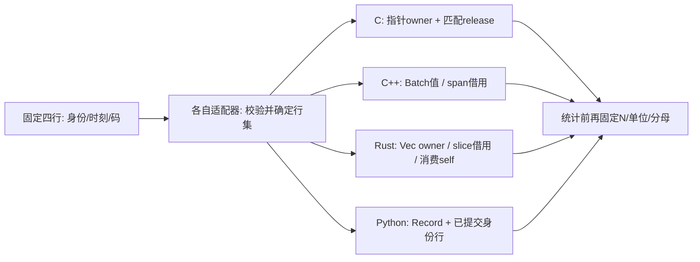

# 同码有限记录怎样迁移：类型、资源与统计语义

> C++20仍是本应用基线。这里对照具体工程接口，先固定同一份有效记录，再比较谁持有数据、什么错误保留旧状态、哪些统计量真正输出。语言并不替应用选择身份政策、采样解释或分母。各语言的理论与源码继续由各自主解释负责。

## 先把四个适配器投影到同一行集

共同对象是四项有限记录：身份a/b/c/d，码`[2,4,6,8]`，相对时间`[0,1000,2000,3000] ms`，标定1 mV/码、零偏置。把身份与时间投影为序号i时保留映射`a↔0,b↔1,c↔2,d↔3`，且声明`t_i=i×1 s`；否则裸码顺序不能恢复身份或真实时间戳。

| 本轮实际适配器 | 进入形式 | 哪个对象负责解释 |
| --- | --- | --- |
| C `ms_read_text` | `4 2 4 6 8`，首4是count | ms_samples保存码；ms_calibration用double的scale_mv=1、offset_mv=0、interval_s=1 |
| C++ `read_batch` | `2 4 6 8`，没有count前缀 | Batch拥有RawCode；Calibration用整数gain=1000 µV/码、offset=0；Seconds{1} |
| Rust `parse_codes` / `read_codes` | token序列；文件每行一项`2\n4\n6\n8` | Batch保存Record{SampleIndex,Millivolt}，固定1 mV/码/零偏置；单批序号对应相对秒 |
| Python `read_records`→`import_records` | CSV列sample_id,tick_ms,code，四行a/b/c/d | Record运行时校验身份/整数码/毫秒；SQLite主键与已提交事实决定最终行集；summarize固定1 mV/码 |

输入文件不能原字节互换：把C的count前缀送给C++会多出一个真实码4；把空格行送给Rust文件适配器不符合“一行一个token”；PythonCSV还包含身份和显式时刻。共同范围取交集：本例N=4、0..4095，满足C最多1000000、C++最多65536、Rust最多1024；Python导入器按批控制工作集，数据库总行数没有这三个常数的共同限额。

进入[[计算机知识/10-编程语言/03-C语言/10-系统课程/12-测量流工具的完整工程#一个有限对象，两个输入适配器|C有限对象与输入适配器]]，携带count前缀、码数组和标定单位，回来解释为什么`4 2 4 6 8`不是五个码。进入[[计算机知识/10-编程语言/01-Python/10-系统课程/11-记录流统计与数据语义#阶段零：先说清每个字段代表什么|Python字段语义]]，携带a-d和tick_ms，回来指出“顺序i”不能代替身份和时刻。上述映射只服务指定四行，不认证真实ADC或设备时钟。

带着a–d的身份↔序号映射与显式tick_ms进入[[计算机知识/10-编程语言/01-Python/10-系统课程/15-同码迁移中的身份单位与恢复边界#从已提交行导出同码有限对象|Python导出后的返程问题]]，回来检查码投影丢了什么：只有本例经核对的时间等间隔且从0开始；当前Python字段允许其他合法时刻，不能由数组下标补造采样事实。

## 复制同一条记录不等于复制一个拥有者

| 对同一对象做操作 | 实际资源/类型后果 | 不能省略的责任 |
| --- | --- | --- |
| C复制`ms_samples`结构 | 指针、长度和allocator/context被浅复制；没有新数组 | 禁止把两个副本都当owner销毁；解析out须初始化且空；context活到匹配release结束 |
| C++复制Batch / move Batch | vector值复制产生独立数组；move使目标取得值，源仍须按本接口合法状态使用 | 复制Batch不让旧span改指副本；原span仍服从原owner寿命。owner赋值/move/swap/replace后按合同重新取得，不能假设move源必空 |
| Rust `records()` / `into_records(self)` | 前者共享借用`&[Record]`；后者消费Batch并交付拥有Vec | 冲突修改在仍要使用借用时被编译器拒绝；Batch不实现Clone，records().to_vec()明确另分配数组 |
| Python `other=record` / 消费生成器 | 名字绑定同一Record；frozen字段是本接口的运行时规则；生成器逐项读取外部流 | 不因赋值复制采样事实；read_records借用流且不关闭，流owner必须活过实际迭代；connection关闭与数据库事务分开 |

C的uint16_t能表示5000，仍不满足0..4095码域；C++RawCode与Rust私有AdcCode构造/转换验证码域，单位标签也不能代替标定证明。PythonRecord显式拒绝bool充当code/tick_ms，类型注解本身不执行检查。C++的Millivolts与MillivoltsSquared把单位带到结果类型；Rust Millivolt(u16)只对应固定标定，不能未经改模型就移入C++的负偏置或分数mV；Python当前summarize也不是任意Calibration的通用实现。

进入[[计算机知识/10-编程语言/03-C语言/10-系统课程/12-测量流工具的完整工程#从对象寿命到失败出口|C owner与释放出口]]，携带ms_samples.data及allocator.context，回来画一次release责任。进入[[计算机知识/10-编程语言/04-Rust/10-系统课程/11-类型化数据管道与标准库实作#谁有数据，谁只是看一眼|Rust借用和消费self]]，携带Batch与records切片，回来解释同一次“移交”为什么会使原变量不可再用。再返回[[计算机知识/10-编程语言/02-C++/10-系统课程/10-借用视图失效与异常提交#返回借用还是返回拥有值|C++拥有值与借用主解释]]，判断自己的接口拒绝与完整寿命责任：C++ span不会自动复制Rust的借用检查规则。本轮只编译、不执行一段取codes视图后replace再读取的C++负例，编译器接受语法；对应Rust取records借用后push再读取的负例实际被E0502拒绝。前者仍违反应用合同，不能把“编译成功”解释为可运行。

## 相同数字还要核对输出字段与分母

原码总量20、平方和120。令N=4、x_i为mV，均值5，中心平方和`Σ(x_i−5)²=20 mV²`；描述性方差20/4=5 mV²，N−1口径20/3 mV²，RMS²=120/4=30 mV²，满足`30=5²+5`。这些是同一有效行集的数学量，不是四个库都输出了全部字段的声明。

| 实际公开结果 | N/和/均值 | 描述性方差与RMS² | N−1方差 |
| --- | --- | --- | --- |
| C ms_stats | 4 /20 mV /5 mV，double | variance_mv2=5，rms2_mv2=30 | 当前API没有此字段 |
| C++ Statistics | 4 /20 mV /5 mV，带单位值 | population_variance=5，rms_squared=30 | sample_variance为optional，非空值是20/3的double舍入 |
| Rust Summary | 4 /20 mV整数u64 /Some(5.0) | 当前API没有方差/RMS²；另有Low=1、Normal=2、High=1 | 当前API没有此字段 |
| Python summarize | n=4，sum整数20，mean字符串"5" | Fraction结果字符串"5"、"30" | Fraction结果字符串"20/3" |

C与C++的小例输出恰好精确，不承诺合法的任意标定都位级相同。Rust的整型和依1024×4095=4193280上界证明，均值用f64可能舍入；Python整数/Fraction在这份选择行上精确，不把精确算术自动延伸到NumPy固定宽整数、SQL AVG或float。

空集也不能只看打印0：C统计返回MS_EMPTY；C++describe返回空optional；Rust给count0/sum0/meanNone；Python汇总给n0/sum0且均值/方差为None。单项仍有均值与描述性方差0，N−1量未定义；C++与Python有单独空值表达，C/Rust尚无该字段。输入Error/空统计/未提供字段是三种状态。

带中心平方和20和两个分母进入[[计算机知识/10-编程语言/01-Python/10-系统课程/13-科学数组与独立统计对照#同一列，显式指定两个分母|同一行集的Fraction、SQL与NumPy]]，回来判断浮点容差到底约束哪组输入。再去[[数学/30-概率与统计/02-期望方差协方差与抽样#方差与标准差|统计主解释]]及[[电子电路/38-随机噪声与测量/01-RMS方差相关与谱密度#同一记录的中心与平方|中心与平方]]，携带单位mV²，回来解释N−1数值正确为什么不证明时间序列iid或无偏条件。

## 同码不保证同一行集或边界算法

在PythonCSV末尾重放`d,3000,8`，相同身份与内容按合同跳过：read5、inserted4、duplicates1，统计仍N4/和20/均值5。若把它投影成五个裸码`[2,4,6,8,8]`交给C/C++/Rust，三个接口没有sample_id，正常把它当第五个位置，N5/和28/均值28/5。相同码值不代表同一采样身份，也不能按值去重（两次独立采样完全可以都为8）。导出前须处理身份政策，再保存身份↔序号映射。

带“d是重放还是新观测”进入[[计算机知识/10-编程语言/01-Python/10-系统课程/13-科学数组与独立统计对照#缺失政策和身份政策必须分别执行|缺失与身份政策]]，回来说明缺失、重放与冲突分别改变哪一份行集；接口选型不替研究者决定丢弃政策。

C的ms_fir与Rust的Fir2从物理前值0开始，一项一输出、EOF不追加，默认码输出`[1,3,5,7] mV`；RustHalfMillivolt实际存两倍mV词`[2,6,10,14]`。C++ReportSession完整宽2/hop1窗只输出`[3,5,7] mV`，没有左边补零，结果末时刻1/2/3 s；它没有一个在0 s覆盖[-1,1)的完整窗。比较差异应先核初始条件与输出索引，不把不同边界算法误报为浮点误差。这里没有替RustSummary新增方差或替C++新增FIR。

## 失败时必须问保留了哪一层状态

C解析器要求空out，错误清临时数组并保持它为空；它不是替换已有非空owner的接口。C++replace先完整构造再swap，失败保持旧Batch；ReportSession按同一模式保留旧settings/结果/借用，成功才结束旧借用。Rustparse失败Drop局部候选、不交付部分Batch，原有别的Batch不受影响；Vec分配失败不因返回Result就自动成为本接口可恢复InputError。

Python导入器每批BEGIN/COMMIT，当前批错误ROLLBACK，但更早已提交批保留；回调产生的外部副作用不被SQLite回滚。记录Rejected、同内容重放和冲突各有不同计数/失败协议。流关闭、内存析构、数据库回滚、文件输出原子性不能用一个“自动释放”术语混合。

进入[[计算机知识/10-编程语言/01-Python/10-系统课程/12-可恢复导入器与安装交付#两行一批：失败之后，哪些数据已经存在|Python批提交与恢复]]，带“当前批失败但前一批已提交”的状态，回来确定可见记录集合。回到[[计算机知识/10-编程语言/02-C++/10-系统课程/13-可交付组件与并发测量工程#逐点故障不是“抛一次异常看看”|C++结果资源故障]]，携带旧Snapshot和指定PMR live计数，回来限定强保证对象：这两种失败都清理资源，但保留范围不同，不能互相充当全进程/外部副作用保证。

本轮对同码与重放算例使用实际C/C++/Rust公开接口与Python导入/汇总核对；完整工程的其他输入/资源路径沿各自实践证据核对。返回[[计算机知识/10-编程语言/02-C++/10-系统课程/00-C++系统课程索引|唯一C++索引]]时，读者应能回答：接口投影丢了哪些信息、谁拥有存储、失败保留哪层状态、当前API真正输出哪些统计量。跨编译器ABI、设备行为、真人理解仍需各自证据。
