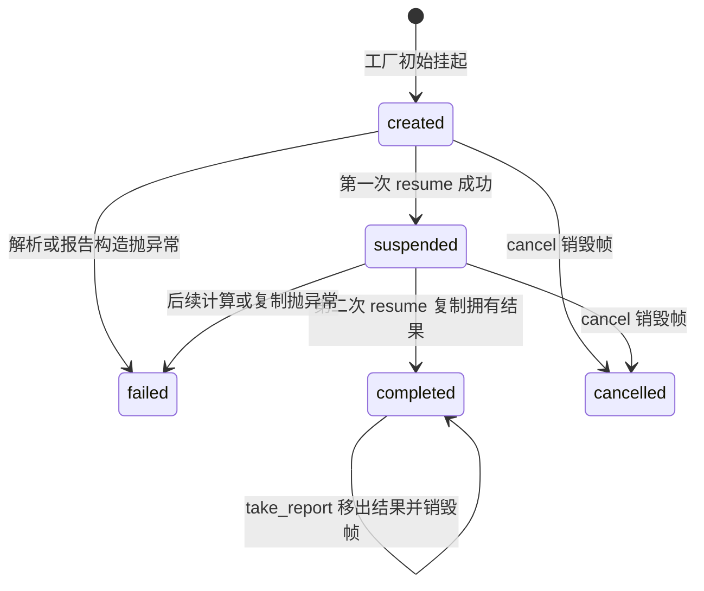
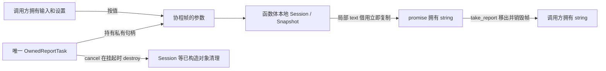

# 报告暂停以后谁还活着：协程帧、唯一拥有者与取消

第14讲用工作线程取得任务，完成同步 ReportSession，再复制结果并 join。本讲选择更窄的高级分支：**只在同一个线程上，把已经生成报告的任务暂停一次，再由调用方选择恢复或取消**。计算、标定、窗口算法与报告格式继续消费已安装的测量库；新增的是暂停前后的拥有关系。代码没有网络、后台线程或事件循环，因此也没有异步 I/O 或并行加速的证据。

## 为什么普通函数的局部变量规则还不够

普通函数返回后，局部 Session 已经析构。如果返回它的 string_view，地址看似还在，拥有者却已不在；第10讲的[[计算机知识/10-编程语言/02-C++/10-系统课程/10-借用视图失效与异常提交#返回借用还是返回拥有值|借用与拥有值合同]]仍适用。协程增加了第三种时刻：函数把控制权交回调用者，但自身尚未结束，暂停点作用域内的对象继续存活。

协程帧可以把 promise、按值参数和跨挂起点仍需要的局部状态保存到恢复之后。帧不等于“一定分配一个堆块”：实现可以在允许的条件下省略分配；本例的 live_frames 只数活着的 promise 对象。参数复制的初始化在 promise 构造之前，引用参数不会因此变成拥有者。语言依据是 [N4861 协程定义与参数寿命](https://timsong-cpp.github.io/cppwp/n4861/dcl.fct.def.coroutine)。

本例入口 `make_owned_report(std::string input, ReportSettings settings)` 是自由函数，两个参数按值进入帧。string 拥有文本，ReportSettings 自己保存标定、时间、窗口和固定 label 字符数组。调用方传左值时可以发生复制，传右值时可以移交；调用方对象在工厂返回后改写或析构，都不会让帧改去借用那个对象。这里没有捕获 lambda 的闭包寿命，也没有成员函数隐含的 this 寿命需要外部托管。

## 三次挂起有三个不同目的

阅读 [owned_report_task.hpp](../../../80-实践/03-C++/05-测量分析组件/advanced/coroutine/owned_report_task.hpp) 时，先区分 initial_suspend、函数体中的 co_await 和 final_suspend。

| 时刻 | 调用方看见的状态 | 仍然活着什么 | 下一步由谁决定 |
| --- | --- | --- | --- |
| 工厂返回；initial_suspend | created | 按值参数、promise；函数体还没执行 | owner 第一次 resume，或 cancel/析构 |
| 第一次 resume 完成解析和报告；函数体 co_await | suspended | stream、Session 及其 Snapshot、参数和 promise | owner 第二次 resume，或 cancel/析构 |
| 第二次 resume 复制拥有文本并 co_return；final_suspend | completed | promise 中的拥有结果、参数；函数体局部 Session/stream 已析构 | owner take_report 或析构 |
| 函数体异常进入 unhandled_exception 后；final_suspend | failed | promise 中的 exception_ptr、参数；已构造的函数体局部对象已清理 | owner 重抛/检查；最终析构 |

`std::suspend_always` 的 await_ready 为 false，挂起不会退出原作用域；恢复后才继续 await_resume 和后续语句。[N4861 await 协议](https://timsong-cpp.github.io/cppwp/n4861/expr.await)描述的就是这次控制权交还。第一次 resume 完成报告生成是同步工作，可能耗时；暂停发生在报告已经存在之后。这是为了使 Session 的跨暂停寿命可检查，并没有把解析变成可抢占分块操作。

co_return 的操作数先构造 `std::string(session.text())`，把借用内容复制成拥有值，再交给 promise。随后函数体局部对象退出作用域，最后停在 final_suspend。因此“结果已完成”和“帧已销毁”是不同事实；final_suspend 选择 suspend_always，帧必须由 owner 回收。

## 唯一拥有者怎样限制危险操作

`coroutine_handle` 是操作帧的句柄，本身不会自动承担唯一释放责任。OwnedReportTask 删除复制构造/赋值，移动时把句柄移走并把源置 empty；移动赋值先销毁目标原先拥有的帧。调用方拿不到裸句柄。单线程、没有用户回调/外部恢复注册的封闭实现，保证每次公开调用前后协程都处于某个挂起点。

empty 只表示默认对象或移动后的源；不是一个运行中的任务结果。任意状态的 owner 析构会销毁仍持有的帧。completed/failed 下重复 resume 返回 false，避免恢复 final suspend；empty/cancelled 下也返回 false，避免解引用空句柄。resume 的 true **只表示本次实际执行过恢复**，成功还是失败仍要查 state；函数体异常由 promise 保存，不会自动穿过 resume 重抛。

这里的 running 是 resume 调用内部短暂的执行区间，不是返回给调用者的可观察状态。没有锁、原子或重入防护；所有创建、诊断、恢复、取消、移动和析构必须在同一线程顺序发生。并发调用会违反合同，不能用这段代码替代第14讲的线程协议。[N4861 句柄恢复与销毁前提](https://timsong-cpp.github.io/cppwp/n4861/coroutine.handle.resumption)要求 resume 指向非最终挂起的协程，destroy 指向挂起的协程。

## 取消就是放弃继续执行，不是从暂停点跑到结尾

cancel 只接受 created/suspended：销毁帧，记录 cancelled，返回 true。再次 cancel 返回 false；completed/failed 保留原终态，也返回 false。尚未构造的局部对象不需要析构；已经构造并跨暂停存活的对象随 destroy 被清理。取消不执行暂停点之后的 `co_return`，因此不能把必须执行的清理只写在 co_await 后面，资源必须交给 RAII。

本例没有外部 I/O 请求、定时器、回调或队列保存这个句柄，所以销毁后无人再来恢复它。若未来 awaiter 向事件循环注册回调，取消就必须先撤销注册或建立“回调不再访问帧”的协议。只调用 destroy 会把后来到达的回调变成悬空使用；这项额外责任没有在本课实现。

Session 使用 new_delete_resource，其寿命覆盖帧中的 Session；没有把一个外部短命 memory_resource 指针藏进参数。promise 的 exception_ptr 保留异常，`rethrow_if_failed()` 和 `take_report()` 在 failed 时重抛。工厂调用之前的参数构造、帧分配或进入函数体之前的失败，可能直接使工厂抛出；那时没有可查询的 failed owner。当前没有逐点注入这些分配失败，也没有声称所有异常都能包装成 TaskState。

## 从安装包独立运行，观察同一份报告

运行入口是[[计算机知识/80-实践/03-C++/05-测量分析组件/advanced/coroutine/README|协程独立消费者]]。它只包含本地协程头与安装后的公开 wwl/report.hpp，通过 find_package 取得 WWL::measurement；不包含测量库的私有源码目录。

consumer 在内层作用域创建 `2 4 6 8` 和设置，然后修改输入、退出作用域。设置为 500 µV/码、偏置 1000 µV、间隔 250 ms、窗口2/hop1：电压是2/3/4/5 mV，三窗均值2.5/3.5/4.5 mV，描述性方差各0.25 mV²，末窗时间500–750 ms。原统计真源和[既有完整参考](../../../80-实践/03-C++/05-测量分析组件/data/report-calibrated-reference.txt)均不复制成新算法。

第一次恢复后必须 suspended；移动 owner，确认源 empty；第二次恢复得到 completed；take_report 返回完整 string 后 live_frames 为0，仍能打印完整结果。测试同时用同一安装包的同步 API 全文对照，固定字段再做手算检查。测试包含预取消、报告已经生成后的取消、早读/重复取结果、正常/失败终态禁止恢复、所有可达挂起点的析构、覆盖已有挂起目标的移动赋值、自移动、完成/失败后的移动。另一个测试专用协程在真实挂起后抛异常，验证后半段的异常保存；它不是对报告复制分配失败的逐点注入。

本次作者在 macOS arm64、Homebrew Clang 23.1.0、libc++ 头宏 `_LIBCPP_VERSION=230100`、运行时 `/usr/lib/libc++.1.dylib`（otool current version 2200.27.0）、CMake 4.4.3 上，从库外新目录分别构建/安装库，再构建独立 Debug/Release 消费者。两种配置各2/2 CTest通过，`live_frames=0 failures=0`；运行判断是显式计数，Release 的 NDEBUG 不会关闭。编译固定 C++20、无扩展、`-fno-fast-math -ffp-contract=off`。这是本机同工具链的生命周期实验；没有新增跨编译器 ABI、动态库、模块、性能或完整异步运行时证据。帧计数不测总分配次数或峰值内存，也不覆盖所有普通 allocator/OS 失败。

## 改一个条件再预测

1. 把 input 改为 const string&，仍在工厂返回后销毁调用方字符串，第一次 resume 安全吗？不安全：初始挂起发生在函数体之前，引用不会自动延长字符串寿命；必须改回拥有参数，或证明被引用对象活到最后一次使用。
2. 把 co_return 的 string 改成 string_view，Session 在正常完成时已经析构，final_suspend 能救这个 view 吗？不能。帧仍在不代表函数体所有局部对象仍在；本课唯一对外结果必须是拥有值。
3. 第一次 resume 已完成后 cancel，报告已经算出来，能再 take_report 吗？不能。任务协议尚未交付拥有结果，cancel 已销毁保存 Session 的帧，状态是 cancelled；此前计算成本已付出，取消不回滚时间。
4. 把 final_suspend 改为 suspend_never，却保留 owner 的 destroy，安全么？不安全。协程可能自行结束并释放帧，owner 仍保存悬空句柄；初末挂起策略必须与所有权协议一起改。
5. input 换成 `0 2 4`，沿用500 µV/码和1000 µV偏置、w2/h1、250 ms，预测输出再运行。两窗电压1/2与2/3，均值1.5/2.5 mV，方差各0.25 mV²，RMS²为2.5/6.5 mV²；时间0–250与250–500 ms。结果数值变化不改变两次 resume 和一次帧释放的责任。

**返回边界解释**：[[计算机知识/10-编程语言/02-C++/10-系统课程/08-模块ABI协程与工程边界|第08讲]] · **返回线程对照**：[[计算机知识/10-编程语言/02-C++/10-系统课程/14-有界任务关闭取消与性能证据|第14讲]] · **课程入口**：[[计算机知识/10-编程语言/02-C++/10-系统课程/00-C++系统课程索引|唯一系统索引]]。
