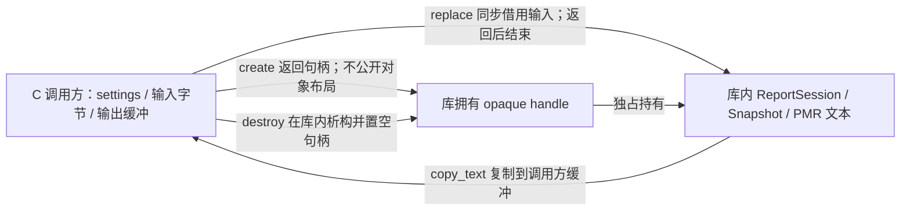

# 同一个窗口报告怎样交给 C 调用方：动态库、版本与释放

> 本分支继续已安装的 C++20 `ReportSession`。调用方只有 C11 头文件和一个动态库目标，能创建句柄、替换输入、取得报告并释放。原统计、窗口与强异常提交继续复用；读者需要补出的证明是：两边怎样解释参数、谁持有内存、失败后还能读到什么。

## 为什么可安装的 C++ 库还不足以交给 C

第13讲的调用方包含 `report.hpp`，编译器知道 `std::string`、`span`、类布局与 C++ 运行库。若一个 C 程序只想取得相同窗口报告，它既不认识这些类型，也不应承担与库一致的 C++ 对象析构规则。

在函数前写 `extern "C"` 只选择语言链接约定；它不会把 `std::string` 的布局、allocator 或异常变成跨平台合同。ABI 还依赖架构、平台调用约定、指针/`size_t` 宽度、对齐、加载器和运行库。本课缩小暴露面：固定宽度整数和固定字符数组表达配置，字节指针加长度表达输入/输出，不透明指针表示库内对象；C++ 类型只出现在实现里。[语言链接条款](https://timsong-cpp.github.io/cppwp/n4861/dcl.link)与[ABI 文档的范围说明](https://itanium-cxx-abi.github.io/cxx-abi/abi.html#intro)分别回答语言保证和平台二进制约定，不能用其中之一替代另一层。

## 把所有权画在实际调用上

输入无需以 NUL 结束，长度是可读字节数；设置中的 `label_bytes` 不含 NUL。`replace` 返回后，调用方可以修改或释放自己的输入；库没有保存它的裸指针。输出由 C 调用方分配与释放，已复制文本在下一次替换、甚至销毁句柄后仍有效。库内 Snapshot 的借用失效规则没有消失，而是由 wrapper 在一次同步 `copy_text` 内消费完。

`create(1,&h)` 要求 `h` 初始为空，成功才写入新句柄；已有句柄不能被悄悄覆盖。`destroy(&h)` 在创建它的库内释放，并把这个变量置空。再次对该空变量调用是成功的空操作，但复制到另一个变量里的旧地址不会同步变空；对悬空副本再次释放仍违反合同。实现没有声称能识别任意地址、修复野指针或捕获越界访问。

库内拥有对象，也要核对它借用了谁的分配器。生产句柄显式传入 `std::pmr::new_delete_resource()`；这个函数返回静态存储期的资源对象。不能默认构造 Session 并隐含捕获可由宿主修改的 `get_default_resource()`：宿主可能在 create 时临时设置一个 PMR pool，随后恢复默认并销毁 pool，但 C 句柄仍然有效。若库保留该指针，下一次 replace 就会访问已销毁资源。[程序级PMR资源合同](https://timsong-cpp.github.io/cppwp/n4861/mem.res.global)区分了稳定的new/delete资源与当前默认指针。实际回归在真实SHARED实现上执行“短命pool设为默认→create→恢复默认→销毁pool→replace/copy/destroy”，并用ASan核对这条寿命路径；仅在独立测试变体里使用自有资源不能覆盖它。

同一句柄的 `replace`、`copy_text` 和 `destroy` 必须由调用方串行化。查询尺寸和复制之间不能被另一线程替换报告。调用仍在执行、或句柄仍活着时不能卸载动态库。这里没有创建工作线程，也没有引入跨语言回调；若以后接第14讲的队列，必须重新规定异步借用和取消责任。

## 版本与尺寸为什么在字段读取之前

公开符号带 `_v1`，配置入口还接收独立的 `version` 和 `settings_size` 标量。顺序固定为：先检查 `version==1`，再检查 `settings_size==sizeof(wwl_report_settings_v1)`，然后确认非空指针，最后才读取配置字段。版本错误时即使配置指针为 NULL 也返回 `VERSION_MISMATCH`；正确版本但尺寸错误返回 `SIZE_MISMATCH`。这些是合法的短信封测试，完全不需要制造野指针。

本版采用**精确尺寸**。较大的结构也拒绝，不把“忽略新尾部”当作已经设计好的向前兼容。以后若增加字段或改变含义，发布新结构/符号并保留旧入口，分别实现兼容策略。动态库主版本 `SOVERSION=1` 帮助加载器区分库身份，但不会自动核验字段语义或证明向后兼容。

C 消费者用 `sizeof`、`_Alignof` 和每个 `offsetof` 对照库返回的布局诊断。本机配置结构为64字节、对齐4，七个字段偏移依次0、4、8、12、16、20、24。这个观察支持当前 arm64 原生 ABI 组合；结构本身含填充约定，函数仍使用原生指针和 `size_t`。禁止把它直接当网络包、磁盘格式或不同架构的字节协议。调用约定已经不一致时，连布局查询本身都没有可靠保证。

## 两次复制调用怎样避免越界和含糊结果

| 调用条件 | 返回及写入 |
| --- | --- |
| 新句柄还没有成功替换 | `NOT_READY`，`required=0`，输出不写 |
| `output=NULL, capacity=0` 且已有报告 | `BUFFER_TOO_SMALL`，返回所需字节数，包含最后的 NUL |
| 非空缓冲但容量不足，包括容量0 | 同上，整个缓冲保持原字节 |
| 容量恰好足够或更大 | `OK`，复制全文和 NUL；剩余尾部不改 |
| `output=NULL, capacity>0`，或没有 required 指针 | `INVALID_ARGUMENT`；不把空地址当可写缓冲 |

先询问 `required`，C 调用方再 `malloc(required)`，最后复制并 `free`。空输入可以生成 `count=0` 的报告；它与“从未生成报告”的 `NOT_READY` 是不同状态。输出 API 返回固定宽度状态码，没有另一个由库分配、调用方不知如何释放的错误字符串。

测试在目标缓冲前后放哨兵字节，并检查短缓冲**每一个字节**没变。只验证返回码会漏掉“已经写了一半才发现空间不够”的缺陷。容量是调用方的承诺，库无法判断一块真实只有4字节的内存是否被谎报为400字节；合法对象、足够存储、不重叠参数仍是调用前提。

## 一次失败怎样穿过边界而不损坏旧报告

每个 C 导出函数都经同一个 `try/catch` 边界执行。`bad_alloc` 映射为 `OUT_OF_MEMORY`，`invalid_argument` 为 `INVALID_ARGUMENT`，`length_error` 为 `LIMIT_EXCEEDED`，其余异常包括非 `std::exception` 对象为 `INTERNAL_ERROR`。catch 路径只返回整数，不创建可能再次分配失败的诊断字符串。

配置验证、输入副本和 `istringstream` 都在提交之前构造。最后仍调用原 `ReportSession::replace`，它先完成新 Snapshot，再以不抛异常的指针交换提交；wrapper 成功后只写一个 bool，没有追加可失败的工作。因此解析坏码、非法配置和结果 PMR 分配失败不会把成功旧报告换成半份新报告。内存保证的主推导回到 [[计算机知识/10-编程语言/02-C++/10-系统课程/13-可交付组件与并发测量工程|第13讲]]。

未安装的测试变体为同一实现加入测试缝隙：这份默认四码报告实际经过7个 PMR allocate 点，逐点注入后检查旧文本和存活块/字节数；结束时句柄、PMR块、PMR字节均归零。另在五个导出的边界分别注入五类异常，核对映射。后者证明 catch 路径，前者证明真实构造分支；两者都不冒充普通 allocator、全部 OS 失败或任意进程崩溃逐点覆盖。已安装动态库不含测试入口，独立 C 程序另验证实际发布变体。

## 静态实现怎样装进一个真正被加载的动态库

实践分三次配置：先把现有基库以 PIC 选项构建并安装，再通过 `find_package(WWLMeasurement 1.2)` 链入独立 `SHARED` wrapper，最后在另一个构建目录配置 `LANGUAGES C` 消费者。静态基库留在动态库内部；消费端只寻找 `WWLMeasurementABI`，既不包含 C++ 头，也不直接链接基库 archive。静态对象需显式启用 PIC；CMake 对 SHARED 的默认 PIC 不能追溯改变先前编译的 archive。[CMake 的 PIC 合同](https://cmake.org/cmake/help/latest/prop_tgt/POSITION_INDEPENDENT_CODE.html)

链接器仅导出五个 C 函数，避免将预编译 archive 内的 C++ 符号意外暴露为公开承诺。`otool -L` 的 `@rpath/libmeasurement_abi.1.dylib`、可执行文件的安装前缀 rpath、独立运行时实际加载的安装文件，以及 `nm -gU` 的五个符号共同支持本次动态边界；单看可执行文件运行成功还不能排除静态链接。

当前实测包含 AppleClang21 基库/ABI 配 AppleClang21 的 C 消费者，以及 Homebrew clang23 基库/ABI 配 AppleClang21 的 C 消费者；两种组合均有干净 Debug/Release。两套 C++ 头版本不同，实际动态库均加载 macOS 系统 libc++，不能写成“两种任意 C++ runtime 已互换”。精确版本、命令和当前证据范围见 [[计算机知识/80-实践/03-C++/05-测量分析组件/advanced/abi/README#实际观察与未覆盖范围|实践观察]]。Linux、Windows、其他架构、`dlopen` 插件发现和热卸载没有在此认证。

## 换一份输入，先预测再运行

把码改为 `[1,3,5]`，gain改为500 μV/码、offset为1000 μV，间隔250 ms，w=2/h=1。先回答：输出两窗的均值、描述性方差、RMS²与首末时间是什么？如果随后传入 `2 bad 8`，已复制到 C 缓冲里的文本和句柄里的报告各会怎样？

参考答案：标定电压为1.5、2.5、3.5 mV；两窗均值2、3 mV，描述性方差均0.25 mV²，RMS²为4.25、9.25 mV²，时间为0/250与250/500 ms。解析错误返回 `INVALID_ARGUMENT`，句柄仍有这份成功报告；调用方自己的旧副本也不变。测试实际覆盖这个变化，数值关系仍按原库的单位与分母解释。

再把尺寸参数改成 `sizeof(settings)-1`，不改指针：应在读取配置字段前返回 `SIZE_MISMATCH`。把输出容量改成 `required-1`：应返回 `BUFFER_TOO_SMALL`，哨兵和所有旧输出字节均保持。能解释这些差异，才算理解了接口；只背五个函数名不能建立跨边界生命周期证明。

**回到工程边界**：[[计算机知识/10-编程语言/02-C++/10-系统课程/08-模块ABI协程与工程边界|第08讲]] · **返回队列边界**：[[计算机知识/10-编程语言/02-C++/10-系统课程/14-有界任务关闭取消与性能证据|第14讲]] · **构建与源码**：[[计算机知识/80-实践/03-C++/05-测量分析组件/advanced/abi/README|独立动态库与 C 消费者]]。
