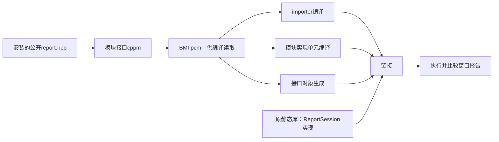

# 模块接口导入与构建边界：同一个窗口报告为什么要三种产物

接续[[计算机知识/10-编程语言/02-C++/10-系统课程/08-模块ABI协程与工程边界|第08讲的工程边界]]和[[计算机知识/10-编程语言/02-C++/10-系统课程/14-有界任务关闭取消与性能证据#高级分支的准确接续接口|第14讲的高级分支接口]]。本讲完成一个C++20 named-module分支：原ReportSession统计/资源实现不复制，独立使用者改为`import wwl.measurement;`；比较同一输入下的模块版与头文件包含版。[[计算机知识/80-实践/03-C++/05-测量分析组件/advanced/modules/README|可重建真源和本机运行输出]]提供全部命令与失败例。

## 从文本包含的问题出发

`#include`让预处理器把头文件文本带进当前翻译单元。头中的声明、模板/inline定义和宏配置受这一次预处理环境影响；包含保护通常只阻止同一个翻译单元重复展开，不阻止多TU重复分析，也不保证各TU看到一致的定义。比如两个TU用不同宏改变同一类布局，编译/链接可能通过，程序仍违反一致性要求。

Named module让使用者按模块名取得已处理的接口，`export`决定哪些声明经导入可见。模块名不是文件路径；`wwl.measurement.cppm`是本项目的约定文件名，C++语法不根据`.cppm`推导模块名。普通named-module导入也不是在importer当前位置重做一次头文件的文本展开，不能用导入者宏任意重配已构建接口。全局模块片段中的include和宏配置仍要受构建管理；本讲保留旧头的宏与ODR责任。[C++20模块条款](https://timsong-cpp.github.io/cppwp/n4861/module.unit)和[Clang标准模块说明](https://clang.llvm.org/docs/StandardCPlusPlusModules.html)规定/解释这两层。

收益是更明确的源码接口和可复用编译接口；代价是构建必须先知道导入图、生成匹配的接口产物、传递其位置，并处理头文件/编译选项改变后的重建。这里不测编译速度、运行速度或BMI大小，所以不能承诺模块必然更快。

## 接口声明、编译接口、链接实现分别存在

| 对象 | 本例 | 回答的问题 |
| --- | --- | --- |
| 模块接口源 | `wwl.measurement.cppm` | 要导出什么名字、对应什么语言实体？ |
| BMI | Clang本次的`wwl.measurement.pcm` | import的编译器如何读到处理后的接口？ |
| 模块对象 | 接口`.o`与实现单元`.o` | 链接器在哪里找到模块初始化及模块附属函数代码？ |
| 原库 | 已安装`libmeasurement.a` | 原ReportSession/统计函数实现在哪里？ |
| 使用者 | 独立`importer.cpp.o` | 谁消费接口、拥有Session、处理输出？ |

BMI（built module interface）是构建工具/编译器术语。标准不规定统一`.pcm`格式，也不保证不同编译器能互读。Clang的两阶段路径先`--precompile`生成PCM，再从PCM生成接口对象；接口源不是只生成PCM就结束。CMake常用一阶段编译安排，但仍需调度扫描。[Clang编译模型](https://clang.llvm.org/docs/StandardCPlusPlusModules.html#how-to-produce-a-bmi)、[CMake模块构建模型](https://cmake.org/cmake/help/latest/manual/cmake-cxxmodules.7.html)给出对应工具合同。



箭头是构建/链接依赖，不是对象拥有或借用。运行时仍是main作用域拥有Session，Session拥有Snapshot；`text()`返回的string_view只在这个对象和当前快照有效期内读取。模块没有给旧view延长寿命。成功replace后需重取、失败保留旧结果的合同继续由[[计算机知识/10-编程语言/02-C++/10-系统课程/13-可交付组件与并发测量工程|第13讲]]维护。

## 为已有库选择可检查的迁移边界

已有ReportSession声明/定义属于普通全局模块实体，旧库已经是可安装的头文件与静态库。本例使用[Clang官方export-using迁移形式](https://clang.llvm.org/docs/StandardCPlusPlusModules.html#export-using-style)：先在global module fragment（GMF，`module;`之后、named-module声明之前）包含公共头，再导出选定别名。`wwl::modules::ReportSession`仍是`wwl::ReportSession`，static_assert在包含/导入混用TU中检查类型身份。

<!-- code-sync: 计算机知识/80-实践/03-C++/05-测量分析组件/advanced/modules/wwl.measurement.cppm -->

```cpp
module;
#include <wwl/report.hpp>
export module wwl.measurement;

// Existing entities remain attached to the global module: one implementation,
// one type identity. These exported aliases are the named-module facade.
export namespace wwl::modules {
using ::wwl::RawCode;
using ::wwl::Calibration;
using ::wwl::Batch;
using ::wwl::Seconds;
using ::wwl::Statistics;
using ::wwl::WindowSpec;
using ::wwl::ReportSettings;
using ::wwl::WindowStatistics;
using ::wwl::ReportSession;
using ::wwl::describe;
using ::wwl::read_batch;
// This function is genuinely attached to wwl.measurement and is defined in
// an implementation unit; importing its declaration is not linking its body.
int interface_revision() noexcept;
}
```

这里`export module`声明主接口单元；`export namespace`中的using导出门面名字。旧头中出现的CommandOptions没有被加入门面，不是把整个头文件每个名字都自动导出。导入者显式include自己使用的chrono、fstream等标准库头；不把库的内部包含当作消费者对全部标准库名字的承诺。这个named module也不是`import <wwl/report.hpp>;` header unit，更没有用C++23的`import std`。

`interface_revision`则是真正附属于named module的新函数；其声明/定义有同一模块归属。它单独承担“接口已读到仍不等于实现已链接”的教学责任：

<!-- code-sync: 计算机知识/80-实践/03-C++/05-测量分析组件/advanced/modules/wwl.measurement.cpp -->

```cpp
module wwl.measurement;
namespace wwl::modules {
int interface_revision() noexcept { return 1; }
}
```

`module wwl.measurement;`是实现单元，并隐式导入主接口；无需重新export类型。这里没有给Statistics或ReportSession另写一份定义，也没有把旧统计.cpp放到named module内部重新编译来改变ABI。

## 从扫描得到正确的先后次序

本机P1689扫描结果中，接口`provides: wwl.measurement`，importer与实现单元各`requires: wwl.measurement`。因此必须先构建接口BMI；接下来二者可以独立编译；最后链接接口对象、实现对象、importer对象及旧库。只把cppm加入普通源文件列表然后并行编译，可能让importer在BMI存在之前就开始工作。

实践run.py读取真实scanner结果，核唯一provider、缺失依赖和循环，按扫描图拓扑调度；为每个require传精确`-fmodule-file=名称=PCM路径`。旧库从原源码新目录重建并安装，importer只消费这个prefix的公开界面。脚本每次全量重建，避免隐藏的旧PCM；它不实现增量缓存。CMake另用`CXX_MODULES` file set和目标链接传播自动扫描关系，命令见实践页。独立审阅在隔离venv的Ninja1.13.2、CMake4.4.3、Clang23.1.0下实际跑通自动路径：Debug/Release的module_header_same_report各1/1，外部add_subdirectory consumer各2/2；scratch接口/实现变化分别触发相应重编译和重链接，随后无变化构建报告no work to do。模块目标没有install/export规则，安装旧WWLMeasurement包的consumer各3/3通过，并不等于已安装named-module包。实际find_package(WWLMeasurementModule)仍失败；BMI不作为跨编译器可移植产物分发。

缓存至少与接口/其文本依赖、编译器版本、语言模式、目标架构、标准库和相关选项匹配；具体兼容判据是工具链合同。实验把C++20 PCM交给`-std=c++23`的Clang，实际报configuration mismatch。由这一个拒绝不能反推“凡编译器没有拒绝的BMI就是兼容”；正确选择是按构建系统依赖重建，而非手动把旧PCM复制到任意机器。

## 同一输入保留同一统计与失败合同

两consumer共享控制流程，分别使用`namespace api=wwl::modules`和`namespace api=wwl`，输入为文件、标定1mV/码、间隔1s、窗口w2/h1。`[2,4,6,8]`三窗均值3/5/7mV，描述性方差各1mV²，RMS²10/26/50mV²；末时间1/2/3s仍表示各窗最后一个样本，而不是半开区间end的时刻。模块输出与原reference全文相同。

新输入`[1,3,5,7]`得到均值2/4/6mV、方差各1、RMS²5/17/37；空输入count0/windows0；坏token两版相同退出2和stderr。Debug/Release都检查完整输出与返回码，NDEBUG不会让验证消失。两版一致说明本例消费同一算法；不扩大到所有输入位级相等，也不代替原PMR/并发的全部测试。

## 模块能检查什么，ABI与ODR仍要检查什么

API可见性、类型身份、二进制布局/符号和运行时拥有分别有责任。本例export using沿用原类型与实现，因此同工具链静态链接可行；这不是跨标准库、编译器或动态库的ABI证明。模块附属的interface_revision在本机符号诊断中带`@wwl.measurement`，原ReportSession保持旧符号。这也解释为何把include移到named-module purview之后可能改变归属与ABI，不能只“换个语法”而继续链接旧库。[Clang的ABI说明](https://clang.llvm.org/docs/StandardCPlusPlusModules.html#abi-impacts)具体讨论此变化。

ODR仍要求定义满足语言规则。两个实现TU各提供同一模块附属非inline函数定义，本机链接器报duplicate symbol；导入接口并不许可定义多份。传统可在多个TU重复定义的inline/模板还受特定ODR前提限制，其中“不附属于named module”是相关条件之一，不能把头文件惯例不加检查地搬进模块。GMF中旧头的宏配置/多TU一致性仍有风险。[C++20 basic.def.odr](https://timsong-cpp.github.io/cppwp/n4861/basic.def.odr)给出准确条件；[Clang ODR限制](https://clang.llvm.org/docs/StandardCPlusPlusModules.html#object-definition-consistency)说明诊断并不完善。

| 失败例 | 先失败的层 | 不能推出什么 |
| --- | --- | --- |
| 不提供BMI | 编译找不到模块 | 不说明库文件是否存在 |
| 使用未导出门面名字 | 编译名字查找 | 不说明旧包含接口没有该类型 |
| 临时Session取text | 编译借用API拒绝 | 不代表C++能静态检测所有悬空view |
| 漏模块对象/旧库 | 链接缺定义 | 不代表BMI能代替机器码 |
| C++23读本次C++20 BMI | 编译配置校验 | 不覆盖全部缓存兼容条件 |
| 两个非inline定义 | 本机链接重复符号 | 不保证所有ODR违例都被拒绝 |

## 带着改变的条件离开本页

1. 输入改为`[0,2,4,6,8]`，预测输出和时间，再用两版核对。答案：四窗均值1/3/5/7mV、描述性方差各1、RMS²2/10/26/50mV²；末样本时间1000/2000/3000/4000ms。
2. 保留PCM与旧静态库，删除模块实现对象，为什么importer仍不能链接？答案：interface_revision声明可见，其模块附属定义被删除。BMI可供编译读取不等于所有目标代码都参与链接。
3. 为消除所有头文件，把report.hpp放到`export module`后include，旧静态库是否必然可用？答案：不能这样保证。声明归属、标准库头的使用位置、符号/类型身份都要重新核对；本讲的GMF门面特意保持已有实体身份。
4. 修改旧ReportSession私有字段后只重编模块，保留旧库和importer，是否安全？答案：没有保证。字段布局是消费编译的一部分，module不抹去ABI；所有受影响依赖需重建，并核部署边界。
5. 保存`text()`到Session析构后再读，导入方式能解决吗？答案：不能。名字可见和借用有效期是不同合同；消费点必须持有owner，或在有效期内复制为拥有string。

返回[[计算机知识/10-编程语言/02-C++/10-系统课程/00-C++系统课程索引|唯一课程索引]]；构建去[[计算机知识/80-实践/03-C++/05-测量分析组件/advanced/modules/README|模块实践]]；窗口、借用与失败提交继续复用第13讲；动态ABI和协程另有各自证明义务。
