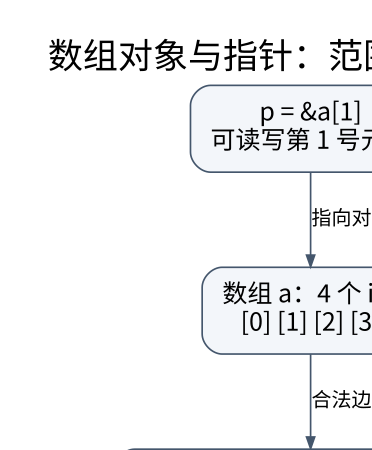

# 声明、数组与指针：用对象和边界解释复杂语法

> **学习位置**：[[计算机知识/00-开始/课程地图/01-C语言-课程地图|C语言课程地图]] · **适用边界**：ISO C17；C23 与 POSIX 扩展另行标识。



[PNG 备用图](../../../_assets/diagrams/round3/c-object.png) · [可编辑图源](../../../_assets/diagrams/round3/c-object.dot)

## 指针不是数组，地址也不是完整接口

`int a[4]` 创建一个包含四个整数的数组对象；`int *p` 创建一个保存指针值的对象。表达式中的数组在多数情况下转换为指向首元素的指针，但 `sizeof a`、取地址 `&a` 等场景保留数组属性。于是 `sizeof a` 是整个数组大小，`sizeof p` 是指针对象大小。

把数组传给参数 `int a[10]`，并不会让函数收到一个十元素数组副本，也不会强制调用方必须传十个元素；这种参数声明会调整为指针。需要长度时显式传入长度。标准提供 `int a[static 10]` 这种最低可访问元素数的契约写法，但它不是运行时边界检查。

```c
#include <stddef.h>
long sum(const int *values, size_t count) {
    long total = 0;
    for (size_t i = 0; i < count; ++i) total += values[i];
    return total;
}
```

这个简化函数还有一个隐藏前提：总和必须能由 `long` 表示。`const` 只表示不能通过 `values` 这条访问路径修改元素，并不证明别的指针不会修改同一对象。

## 声明从名字向外读，但先分清括号

`int *a[3]` 是三个指针组成的数组；`int (*p)[3]` 是指向三整数数组的指针。前者先看到名字后面的 `[]`，后者用括号让 `*p` 先结合。

`int (*f)(int)` 是函数指针；`int *f(int)` 是返回整数指针的函数。推荐用命名 typedef 降低接口噪声：`typedef int (*compare_fn)(const void *, const void *);`。typedef 不会创造新的名义类型，也不会自动加强所有权。

二维连续数组 `int matrix[2][3]` 会转换为 `int (*)[3]`，而不是 `int **`。`int **` 通常表示指向若干独立行指针的结构，内存表示不同。把前者强制转换为后者不会产生行指针，只会让后续解引用把整数误读为地址。

## 指针运算的合法范围由对象决定

如果 `p` 指向数组内元素，可以在同一数组内移动，或者形成恰好越过末元素的位置。尾后指针可以比较和作为迭代终点，不能解引用。跨不同数组做指针相减不能当成通用距离计算；地址数值看起来相邻也不赋予这样的语言语义。

`p+1` 前进的是一个所指类型对象的跨度，不是固定一个字节。要检查对象表示可通过字符类型访问；但把任意字节序列强制解释为任意结构体，还涉及对齐、有效类型和表示合法性。

空指针不是“可访问地址零”。空指针常量转换为指针后产生实现规定的空值，不能由此推出其所有表示位一定为零；`calloc` 的全零字节也不能在所有可移植语境下等同于把每个指针成员赋为 `NULL`。

## 字符串是约定，不是独立的内建容器

C 字符串通常是以零字节结尾的字符序列。`char s[]="abc"` 有四个元素，包括终止符；`char s[3]="abc"` 在 C 中可以形成没有终止符的字符数组，随后交给 `strlen` 就违背了接口契约。

`const char *p="abc"` 指向字符串字面量，不应修改。`char s[]="abc"` 是可修改的独立数组。这就是为什么“都是 `char*`”无法回答能不能写、需要谁释放的问题。

接口设计最好区分“带长度的字节区间”和“终止符字符串”：

```c
struct byte_view { const unsigned char *data; size_t length; };
```

`data==NULL && length==0` 是否允许，需要由接口明确规定；不要把某一标准库函数的规则推广到全部 API。`strlen` 不能探测内存是否合法，也不能验证输入缓冲区内是否确实有终止符。

## 写入字符串时，把容量计算完整

若已有长度 `len`，需要追加 `n` 字节并补终止符，总容量至少是 `len+n+1`。先检查两个加法会不会溢出，再检查是否超过实际容量。`strncpy` 不是通用的安全字符串复制：源过长时不一定写终止符，源短时又可能填充大量零字节。

一种易审计的策略是：外部输入始终携带长度；边界处决定是否拒绝内嵌零字节；需要标准字符串时单独分配 `n+1` 并明确补零；输出接口总是同时接收容量。UTF-8 的字节长度不等于字符数量，截断还必须避免把多字节编码从中间切开。

## 练习：解释而不是猜输出

令 `int a[2][3]`，`a+1`、`&a+1` 分别跨过多少字节？答案分别是 `3*sizeof(int)` 和 `6*sizeof(int)`，因为它们指向的类型不同。它们可能在某个表达式中打印出相同的起始地址，但类型仍决定运算单位。

为什么函数不该返回局部数组的指针？数组的自动存储期结束后对象不再存在。替代方案是让调用者提供缓冲区、返回带所有权的动态分配结果，或返回固定大小的结构体值；三种方案的释放和容量协议都不同。


<!-- ROUND4 DEPTH LINKS -->
## 继续推演本页难点

[[计算机知识/10-编程语言/03-C语言/10-系统课程/09-指针步长二维数组与接口形状|为什么连续二维数组不能传给 int **？]] 本专题补上对象形状、边界与可执行接口检查。

这不是替换本页：先掌握原理，再用补充页核对容易被一句话略过的条件。
<!-- END ROUND4 DEPTH LINKS -->

## 关联阅读

- [[计算机知识/10-编程语言/03-C语言/10-系统课程/04-动态内存与失败原子性|动态内存的核心不是 malloc，而是状态转移和失败恢复]]
- [[计算机知识/10-编程语言/02-C++/10-系统课程/01-对象生命周期与RAII|对象何时存在：初始化、析构和 RAII 的统一模型]]
- [[计算机知识/10-编程语言/04-Rust/10-系统课程/01-所有权借用与切片推演|所有权和借用：把编译错误还原成一张对象关系图]]

## 依据与继续查证

- [WG14：标准、勘误与工作草案入口](https://www.open-std.org/jtc1/sc22/wg14/)
- [POSIX.1-2024：标准 C 与 POSIX 接口边界](https://pubs.opengroup.org/onlinepubs/9799919799/idx/functions.html)

本页的例子、推演与练习为教学构造；语言契约、系统接口和版本相关结论应结合以上原始文档核对。

<!-- COURSE SEQUENCE -->
## 顺序导航与验证

[[计算机知识/10-编程语言/03-C语言/10-系统课程/00-C语言系统课程索引|本课程总索引]] · [[计算机知识/_labs/round3/C/C语言-实验说明|本课程实验]]

上一讲：[[计算机知识/10-编程语言/03-C语言/10-系统课程/01-整数表达式与可移植计算|从比特到表达式：整数提升为什么会改变答案]]

下一讲：[[计算机知识/10-编程语言/03-C语言/10-系统课程/03-结构体布局联合体与序列化|结构体不是文件格式：布局、别名和二进制协议]]
<!-- END COURSE SEQUENCE -->

<!-- ORIGINAL DEEP LINKS -->
## 与原有长篇专题衔接

- [[计算机知识/10-编程语言/03-C语言/02-指针数组字符串与生命周期|02-指针数组字符串与生命周期]]

新旧讲解采用的版本与模型可能不同，比较时先核对各自前提，不把教学简化当成实现细节。
<!-- END ORIGINAL DEEP LINKS -->
