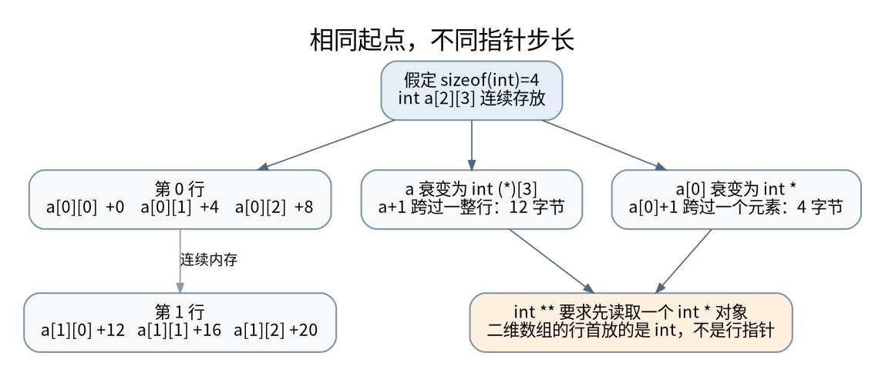

# 指针不是地址整数：步长、二维数组与接口形状

> **本页要解决**：为什么连续二维数组不能传给 int **？
>
> **先修**：[[计算机知识/10-编程语言/03-C语言/10-系统课程/02-声明数组指针与字符串契约|声明、数组与指针：用对象和边界解释复杂语法]]。
>
> **阅读入口**：[[计算机知识/10-编程语言/03-C语言/10-系统课程/00-C语言系统课程索引|本学科主索引]] · [[计算机知识/00-开始/全局导航/11-难点导读与研究证据|全局难点导读]]。

**版本、模型与证据边界**：C17 的对象与表达式合同；8 位字节和实现布局仅在明确标出的示例中假定。

## 从一个容易误判的调用开始

假设 `int m[2][3]` 保存两行三列。把它传给函数时，接收类型应该是“指向一行的指针” `int (*)[3]`，不是 `int **`。后者要求目标位置存放一个 `int *` 指针对象；前者要求目标位置是一整行的三个整数。两种表示即使都写成 `x[i][j]`，读取路径也不同。强制转换只会让编译器少提醒一次，不会把六个整数变成两根指针。[^c-array]

理解这一点需要同时追踪三个东西：对象的实际形状、表达式当前的类型，以及指针加一跨过的对象大小。不能只画一个十六进制地址就结束。



[矢量图](../../../_assets/diagrams/round4/c-stride.svg) · [可编辑图源](../../../_assets/diagrams/round4/c-stride.dot)

## 逐项推导类型和步长

```c
int m[2][3] = {{10, 11, 12}, {20, 21, 22}};
int (*row)[3] = m;
int *element = m[0];
```

`m` 本身的类型是 `int[2][3]`。在上面的初始化表达式中发生数组到指针转换，得到指向首元素的指针；外层数组的一个元素是 `int[3]`，所以转换结果是 `int (*)[3]`。`m[0]` 则是一行，在初始化 `element` 时转换为 `int *`。

因此 `row + 1` 跨过 `3 * sizeof(int)` 字节，`element + 1` 跨过 `sizeof(int)` 字节。这里没有假定 `int` 必须四字节；仅在四字节 `int` 的示例平台上，两个步长分别为 12 和 4 字节。`&m` 的类型是 `int (*)[2][3]`，其加一步跨过整个二维数组。

`sizeof m` 得到整个数组大小；`sizeof row` 得到指针对象大小。函数形参中写 `int a[10]` 会调整为指针形参，并不会让函数获得调用方数组的真实长度。把 `sizeof a / sizeof a[0]` 放进该函数，不是长度计算的可靠办法。[^c-array]

## 二维下标看起来相同，不代表内存布局相同

对连续布局，`m[i][j]` 可从 `*(*(m+i)+j)` 理解：第一次加法按行前进，解引用得到某一行，第二次加法再按整数前进。对 `int **p`，第一次解引用需要真的从内存中加载一个 `int *`，再沿该指针寻找某一行。

“行指针数组”允许每行单独分配、长度不同甚至为空；连续矩阵方便批量传递、顺序遍历和缓存利用。选择不只是语法偏好，它决定了分配次数、失败清理、缓存局部性，以及能否把整块数据交给外部接口。

### 跨越子数组边界的细节

不要因为底层布局连续，就用从 `&m[0][0]` 得到的 `int *` 任意遍历第二行。严格可移植的 C 指针算术要遵守所指数组对象的边界；第一行的 one-past 指针可以形成，但不能解引用成“第二行第一个元素”的通行证。二维遍历采用 `m[i][j]`；确实需要平坦接口时，从一开始就分配并建模为一个包含全部元素的一维数组。[^c-pointer]

这也是“数值地址正好相邻”和“语言允许这样访问”不能互相替代的例子。关联到 [[计算机知识/20-操作系统/02-操作系统原理/10-系统课程/09-页表写时复制与TLB失效|虚拟地址与页映射]] 时还要再加一层：OS 允许访问某页，不代表页中的任意对象访问在 C 中合法。

## 把形状写进接口，而不是留给注释猜

固定列数可以直接写：

```c
#include <stddef.h>

void fill_rows(size_t rows, int a[][3]) {
    for (size_t i = 0; i < rows; ++i) {
        for (size_t j = 0; j < 3; ++j) {
            a[i][j] = 0;
        }
    }
}
```

它要求调用者提供至少 `rows` 行且每行三列的可写存储，不自动验证实际分配容量。动态列数可以使用变长数组参数，例如 `int a[rows][cols]`，但 C11/C17 的实现可能不支持 VLA；维度求值、正长度和容量合同也必须单独处理。跨工具链的教学与库接口可优先使用平坦缓冲区、行数、列数和步幅。[^c-vla]

平坦接口访问 `(i,j)` 前应验证 `i < rows`、`j < cols`、`stride >= cols`。在计算所需总元素数时，先验证乘加不会溢出。零行、零列怎样表示应由接口明确规定，不能让“没有元素”偷偷变成非法 VLA。

```c
#include <stdbool.h>
#include <stddef.h>
#include <stdint.h>

bool dense_count(size_t rows, size_t cols, size_t *out) {
    if (out == NULL) return false;
    if (cols != 0 && rows > SIZE_MAX / cols) return false;
    *out = rows * cols;
    return true;
}
```

这个检查只证明元素数量乘法可表示。若随后 `malloc(count * sizeof(int))`，还要检查第二次乘法。即使两次都不溢出，分配也可能失败。

## 借用、所有权与别名是三份合同

传入 `int *` 默认不说明函数会不会释放、缓存指针或异步使用。接口应分别说明：谁拥有存储；借用有效到何时；能否修改；是否允许输入输出重叠；失败后输出是否改变。`const int *` 限制经该访问路径修改整数，不保证没有其他别名正在写，也不提供线程同步。

`restrict` 约束特定作用域内的实际访问关联，而不只是“两个地址必须不同”。两个只读输入指向同一数组不一定违反它；输出与一个输入重叠则需要按写访问的限定规则审计。不要把所有同址参数都统称为违法，也不要把 `restrict` 当运行时检查。详见 [[计算机知识/10-编程语言/03-C语言/10-系统课程/10-对象表示别名与二进制解析|对象访问与别名契约]]。

## 自测：把解释变成可反驳的预测

给出 `int m[4][5]`，预测 `sizeof m / sizeof m[0]`、`m+1` 的步长和 `&m+1` 的步长。答案分别为 4、`5*sizeof(int)`、`20*sizeof(int)`，不是三个相同的“地址加一”。

再把函数 `void f(int a[4][5])` 中的 `sizeof a` 与调用方的 `sizeof m` 对比。前者是调整后指针的大小，后者是整个数组大小。这一组预测可用本轮 C 实验验证；不会编译运行把二维数组强转为 `int **` 的未定义行为示例。

**迁移问题**：C++ `span` 和 Rust 切片都携带长度，但它们是否自动拥有底层存储？不拥有。长度信息解决边界表达的一部分，生命周期仍由 [[计算机知识/10-编程语言/02-C++/10-系统课程/10-借用视图失效与异常提交|视图合同]] 和 [[计算机知识/10-编程语言/04-Rust/10-系统课程/09-借用检查中的量词方差与重借用|借用合同]] 约束。

[^c-array]: C11 委员会草案 N1570 的 HTML 转录，§6.3.2.1、§6.7.6.3；本节使用同样适用于所选 C17 基线的数组转换和参数调整规则。[原始条文](https://port70.net/~nsz/c/c11/n1570.html#6.3.2.1)。
[^c-pointer]: N1570 §6.5.6，数组对象范围、指针加减及 one-past 的限制。[原始条文](https://port70.net/~nsz/c/c11/n1570.html#6.5.6)。
[^c-vla]: N1570 §6.7.6.2 与 §6.10.8.3，变长数组及条件特性宏。[原始条文](https://port70.net/~nsz/c/c11/n1570.html#6.7.6.2)。

## 知识连接：下一步应追问什么

先跟踪一个对象的形状，再比较“引用是否仍合法”由谁负责。

[[计算机知识/10-编程语言/03-C语言/10-系统课程/10-对象表示别名与二进制解析|从字节到对象：对齐、别名、字节序与可靠解析]]：为什么长度够、地址也没越界，强转读取仍可能不合法？

[[计算机知识/10-编程语言/02-C++/10-系统课程/10-借用视图失效与异常提交|值还在不等于引用有效：视图、容器与异常提交]]：vector 没扩容时，erase 为什么仍会使某些引用失效？

[[计算机知识/10-编程语言/04-Rust/10-系统课程/09-借用检查中的量词方差与重借用|把借用检查翻译成约束：重借用、方差与生命周期量词]]：为什么能缩短共享引用，却不能把长期引用槽位当短期槽位？

[[计算机知识/20-操作系统/02-操作系统原理/10-系统课程/09-页表写时复制与TLB失效|一张页经历了什么：多级页表、写时复制与 TLB 失效]]：fork 后父子都能读同一页，写入时为什么不互相污染？

## 本地核验与阅读顺序

[[计算机知识/_labs/round4/README|本轮实验：命令、检查范围与未执行项目]] 提供对应文件和记录。[[计算机知识/90-资源/维护/导入-com/_meta/round4/01-研究证据与版本边界|研究证据索引]] 区分规范、推演和实验；[[计算机知识/90-资源/维护/导入-com/_meta/round4/02-缺口回查与后续验证|仍需进一步验证的边界]] 不把概览或模型标成完整实现。

先完成主干，再按问题选择专题；不要求跳过第 1–8 讲。 下一专题：[[计算机知识/10-编程语言/03-C语言/10-系统课程/10-对象表示别名与二进制解析|从字节到对象：对齐、别名、字节序与可靠解析]]。
