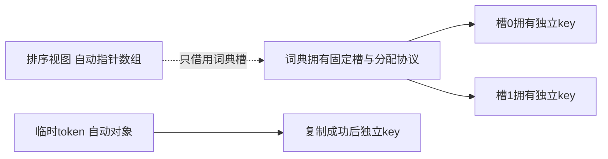

# 把容器、文本与排序连成一条可解释的程序

已经会调用 `malloc`、读一行和写比较器，为什么把它们接成词频工具仍然会丢数据、泄漏，或读到已经失效的键？本课把“某个调用合法”推进到“整组对象在成功和失败后仍然合法”。沿用 ISO C17 hosted，协议按 ASCII 字节定义；完整源码和固定输入位于 [[计算机知识/80-实践/09-C语言/01-测量流与有界数据结构/README|测量流与有界数据结构实践]]。实现另要求 8 位字节、所用精确宽度类型及 ASCII 兼容执行字符集，源码编译期检查宽度与关键字符值；C17 本身不承诺所有实现满足本格式。

会解释动态数组的 length/capacity、指针寿命和完整输入成功条件，可从下节开始。解释不清时回到 [[计算机知识/10-编程语言/03-C语言/10-系统课程/04-动态内存与失败原子性#用不变量描述一个可增长数组]]、同页“realloc 的两条结果路径”，以及 [[计算机知识/10-编程语言/03-C语言/10-系统课程/06-输入输出解析与错误模型#strtol 的完整成功条件]]。这些是机制的主解释，本课把它们用于一个完整对象。

## 先固定词、上限和可观察结果

词频练习接受 ASCII 字节文件，把 A–Z/a–z 的连续段当作词，大小写合并，其他 ASCII 字节作分隔符。任何非 ASCII 字节使整次处理失败；因此它统计 ASCII 词，不验证或分词 Unicode 文本。该政策在调用标准库前确定，不由 locale 决定。输入最多 1048576 字节，单词最多 63 个字母，不同词最多 256；超限整次处理失败。ASCII NUL 在本词频协议中是分隔符；测量整数文本协议则拒绝 NUL，两个工具的输入语法各有自己的合同。

参考输入 `Apple apple BANANA,banana! pear` 的排序结果是 `apple 2`、`banana 2`、`pear 1`。先按频次递减，再按规范化键的字典序递增；频次并列有确定的次序。空文件成功并输出空列表。超长词拒绝，不能截成 63 字母后冒充另一个合法词；文件末尾没有分隔符时仍提交最后一个词。`src/wordfreq.c` 是完整参考实现；不要把本课的局部推演当作全部错误处理。

## 键的所有者与排序的借用者

公开头文件 `include/wordfreq.h` 定义 `wf_table`：521 个固定槽，每槽为 key 和 count，used 是已占槽数，始终 used≤256。key 为 NULL 表示空槽；表不提供删除，因此无需墓碑。非空 key 指向单独分配且含终止符的规范化词，表负责用匹配 allocator 释放；调用者的 allocator context 须活到释放结束。输入 token 是临时自动对象，不能让槽指向它：下一词会覆盖它，函数结束也会结束它的寿命。

插入先从 `hash(word)%521` 找起；遇到已有相同键增加 count，遇到空槽才准备新 key。碰撞时逐槽探测并回绕，每次最多 521 次；used 上限使表始终有空位，但探测上限仍应明确。hash 内部结果转换到 `uint32_t` 使用模 2³² 的无符号值，与分配长度回绕应拒绝的意义不同。新增键先检查上限与 length+1，复制成功后才设置 key、count 并增加 used；分配失败不占槽。已有计数在加一前检查可表示上限。

`wf_read` 要求输出表已初始化且为空，先在临时表解析整份文件，全部成功才交付；失败销毁临时键并保持输出表不变。一个词插入成功不代表整个文件已成功，文件尾的坏字节仍能使整次读取失败。销毁逐个释放 key 并恢复空状态。按值复制表只是复制 key 指针，不能使两个副本都独立销毁；跨对象转移需要明确交付所有权。

固定槽地址不会因新词插入而移动；排序视图只借用这些槽，不拥有 key。参考输出在读取结束后构造视图，排序/打印期间不再插入或改变 count，结束后视图自动对象销毁，最后字典释放键。表销毁会使所有键借用失效；即使槽的地址仍可表示，原 key 指向的对象寿命已经结束。

数组顺序存储适合遍历和按索引访问；链表方便已知位置插删，却不自动改善按内容找词；哈希增加碰撞、探测和负载率协议。本练习固定 521 槽/256 键以获得资源上界，不承诺所有输入下常数时间。算法选择主解释见 [[计算机知识/50-数据结构与算法/10-数据结构系统课程/02-顺序链式结构与哈希设计]]；动态数组倍增总搬运账见 [[计算机知识/50-数据结构与算法/10-数据结构系统课程/01-抽象数据类型与均摊分析]]。测量数组按记录 count 一次准备，旧动态数组实验继续负责 realloc 失败原子性的专门验证；本工程固定表不会自动扩容。

资源上界可以逐项检查：键有效载荷最多 `256*(63+1)=16384` 字节，另有分配器开销；槽数组占 `521*sizeof(wf_entry)`，排序视图最多 `256*sizeof(const wf_entry *)`，token 缓冲 64 字节。`wf_read` 的临时表和调用者输出表会同时存在于读取阶段，不能只数一张表。固定上限不证明任何平台栈一定够用；小栈目标应移动存储位置并重新检查调用者的寿命合同。

## qsort 的比较器是在表达关系

比较器返回负、零或正，不要求返回差值本身。不要用 `(int)(b->count-a->count)`：无符号减法可能先回绕，缩窄到 int 又可能改变方向。先比较大小得到方向，频次相同时调用 `strcmp`。`strcmp` 只承诺返回值的符号，不能假定恰为 −1、0、1。

视图元素类型是 `const wf_entry *`，qsort 传入的是指针数组中元素对象的地址；比较器先按“指向该指针元素”的类型读取，再取记录。元素宽度写 `sizeof *view`，不是 `sizeof(wf_entry)`。每次比较只观察已经完成的词典，不改计数、不分配、不依赖变化中的全局排序模式。qsort 不保证相等项的相对顺序；次键让不同规范化词的输出可重复。

标准库没有指定 qsort 的稳定性或某一种算法复杂度。需要稳定排序时应实现并验证相应算法，不能因某个平台一次输出稳定就把它写进库契约。

## 把固定窗口看作另一个数据结构

测量流不需保存无限历史。`ms_ring` 借用调用者拥有的 slots，capacity=K>0，head 是最旧有效元素位置，len 是有效元素数。不变量 head<K、len≤K；有效逻辑索引 i 满足 0≤i<len。取值时令 remaining=K−head，物理位置为 `i>=remaining ? i-remaining : head+i`。后一分支 head+i<K，所以不先进行可能回绕的 head+i 再取模；前一分支差值也小于 K。

窗口未满时写逻辑尾部并增加 len；满时覆盖 head，再让 head 前进一步并在 K−1 处回到 0。K=2 时先加入 2，再 4，逻辑顺序为 [2,4]；再加 6，覆盖最旧的 2，逻辑顺序为 [4,6]。这是一组对象内的合法索引变化。

`ms_fir` 内部保存两项码值，ring 借用它自己的 slots，因此不能按值复制后继续使用原内部指针。初始化先放一个 raw0 作状态占位；首次计算对前物理值特别取 0 mV，不能因占位码 0 就擅自加标定偏置。之后窗口保存真实码，标定后才是物理量。

默认每码 1 mV、偏置 0，输入 [2,4,6,8]：每步取最新与前一物理值平均，输出 [1,3,5,7] mV。一次送入或按 [2]、[4,6]、[8] 三批送入，结果必须相同；批次是传输方式，不重置时间历史。若每批重初始化，第二批首项会错误地变成 2，第三批首项会错误地变成 4。

去 [[信号与系统/20-数字信号处理/01-FIR滤波设计与频率规格#先把输入、单位与合同固定]] 带回无量纲核、输入输出单位、零延拓和尾部规则；再读同页“手算核与迁移验收”。本工程每个实际输入输出一项，EOF 不排空，所以四点例只有四项；完整零延拓卷积还有尾项 4 mV。选择另一合同可以，但正文、源码和参考输出须同步。两抽头例验证状态与索引，不验证抗混叠频响规格。

## 把标准库调用接成资源协议

| 环节 | 标准库承担的工作 | 程序仍要承担的工作 |
| --- | --- | --- |
| 字节输入 | fgetc/fread、ferror | 上限、EOF 与截断、逻辑记录边界 |
| 数字解析 | 标准转换或显式逐位构造 | 语法、完整转换、业务范围与有限性 |
| 动态存储 | malloc/realloc/free | 所有者、乘加溢出、失败后状态 |
| 字符与比较 | 字符串比较与 qsort | 非 ASCII 政策、比较关系与借用寿命 |
| 输出与关闭 | fprintf/fwrite/fflush/fclose | 每次返回值、缓冲失败、保留主要错误 |

外部坏输入不能只用 assert 拦截，NDEBUG 可以移除断言。输入成功不证明后续分配成功；输出进入 stdio 缓冲不证明 fflush/fclose 成功，也不等于掉电持久化。每一环的失败要能回到清理路径，且不把失败写成成功退出。

## 迁移题：不给步骤，只验结果与理由

把不同键上限改为 257，把窗口容量改为 3，并把输入切成任意大小的块。你应交付哪些不变量、失败结果与参考算例？持有旧排序视图后增加一个词，即使槽地址固定，仍有哪些前提要核对？

> [!question]- 参考答案与接受标准
> 第 257 个不同键成功、第 258 个拒绝，固定槽数仍 521；核对 key 长度+1、计数、used 与视图 257 项容量，整次读取失败不留下临时键。固定槽地址保持不表示排序次序保持：改变 count 或增加词后旧视图不再代表新排序结果，输出应重新收集排序并避免并发修改。窗口 K=3 还须规定核，例如 [1/3,1/3,1/3]；零物理初态输入 [2,4,6,8] 的 no-tail 结果为 [2/3,2,4,6]，任何分块不重置。修改窗口不只是替换模数，初始化、尾部、单位和输出项数都应同步。

## 依据与下一步

公开 [WG14 N1570](https://www.open-std.org/jtc1/sc22/wg14/www/docs/n1570.pdf) 是 C11 工作草案，可定位 7.22.3 分配、7.22.5.2 qsort、7.21 stdio 和 7.24 字符串契约；它不是 C17 最终标准。课程执行采用 C17，相关澄清另查 [N2396](https://www.open-std.org/jtc1/sc22/wg14/www/docs/n2396.htm)。旧动态数组实验避免零长度 realloc 的历史歧义，本工程分配零样本时直接保持空对象。本页数据结构、上限和手算是教学构造。

下一讲 [[计算机知识/10-编程语言/03-C语言/10-系统课程/12-测量流工具的完整工程]] 把窗口、统计、解析和 CLI 接成同一个有限对象；返回 [[计算机知识/10-编程语言/03-C语言/10-系统课程/00-C语言系统课程索引|唯一课程索引]] 按已经能解释和验证的能力选择入口。
