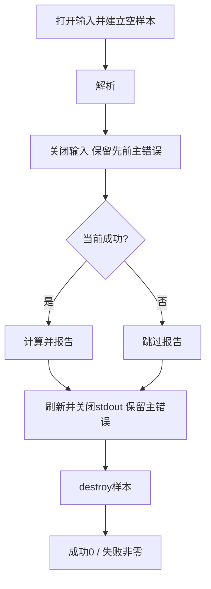

# 从有限码值到可复现的测量库与命令行工具

一个文件给出四个码值，怎样让“均值 5”同时意味着解析完整、对象有效、标定正确、统计对象明确，而且写入失败不会被报告为成功？本课沿用 C17 hosted，把计算、文本/二进制适配、输出和 CLI 分开。源码、测试与固定输入集中在 [[计算机知识/80-实践/09-C语言/01-测量流与有界数据结构/README|工程入口]]；正文解释合同与推导，完整源文件是实现真源。工程运行结果只认证实际运行过的版本与输入。

## 一个有限对象，两个输入适配器

项目对象是合成测量记录：整数码 q 范围 0..4095，样本数 N≤1000000。每码 s mV，偏置 b mV，采样间隔 Δt s，物理值 x[i]=s q[i]+b，i=0..N−1；第一项时间 0，后续时间 iΔt。默认 s=1、b=0、Δt=1。支持有限的 0<s≤10⁶、|b|≤10⁹、0<Δt≤10⁶；NaN、无穷与业务越界拒绝。码宽和标定由教学协议规定，不声称任何 ADC 的真实精度、时间或硬件传输行为。

文本先给十进制 count，然后恰好 count 个无符号码，ASCII 空白分隔，结尾只许空白。`4 2 4 6 8` 完整；`4 2 4` 截断；`4 2 4 6 4096` 非法；`4 2 4 6 8 9` 多余，不能悄悄取前四项。负号、加号、小数和嵌入 NUL 不属于该整数协议。每 token 最多 10 个十进制数字，含前导零；过长 token 返回 limit。总字节上限 16 MiB 同时限制超长空白，末尾无换行仍可成功。零字节文件缺 count，属于截断；`0` 是合法空记录，但统计返回 empty，不杜撰 0/0 结果。库借用的 FILE 应按二进制模式打开以保留精确字节；CLI 对两种格式均用 rb。输入字节计数用 uint32_t，下标和对象大小用 size_t，两种“数量”不能因都非负就任意交换类型。

二进制为 4 字节大端样本数，随后每项 2 字节大端码；前提 CHAR_BIT==8，具备 uint16_t、uint32_t、uint64_t，且执行字符集兼容 ASCII。源码检查宽度与关键字符值，完整 ASCII 兼容性仍是支持前提。默认例精确字节为 `00 00 00 04 00 02 00 04 00 06 00 08`，共 12 字节。只接受一个记录，尾随字节也非法。这是本工程的支持边界，不是所有 C 实现的性质。

`ms_decode(bytes,size,eof,allocator,out)` 借用调用者真实存储，size 须声明可读范围，足够大的数字不会创造存储。eof=false 且字节不足时 need_more；eof=true 仍不足时 truncated；超 count 上限时 limit；坏码或尾随字节 invalid。即使恰好够，尚未确认 EOF 也等待，以发现之后的垃圾。need_more 不是成功，不交付半份拥有对象；接口接收当前累计前缀，不是自动记忆此前分片的增量状态机。

去 [[计算机知识/10-编程语言/03-C语言/10-系统课程/10-对象表示别名与二进制解析#先构造值，再考虑优化]] 带回 unsigned char 读取和移位构造值合同，再解释为何同一记录从奇地址开始仍可解析：逐字节读取不借用不存在且可能未对齐的 uint16_t 对象。推导仍以前缀真实可读为前提。语法、字节长度与读取权限分别核对。

## 从对象寿命到失败出口

公开头文件为 `include/measure.h`，实现为 `src/measure.c`。ms_samples 拥有 data 数组，保存匹配 allocator 和 context；销毁通过同一个 release 释放，context 须活到释放结束。ms_samples_init 建立空状态；解析器要求 out 初始化且为空；失败保持这个空状态，临时分配由解析器清理。不能把已有数据的 out 直接当作覆盖目标。分配器须返回满足 uint16_t 对齐、指定大小且由相应 release 释放的存储；一个返回非 NULL 的任意指针不自动满足分配器合同。


按值复制 ms_samples 只复制 data 指针，不复制数组；两个副本都 destroy 会破坏所有权。ms_fir 内部 ring.slots 借用自身 slots，也不能直接按值复制；复制应另提供重绑内部指针的函数。ms_stats 只含数值，按值复制不会增加堆所有者。同样的赋值语法对应不同资源合同。

src/main.c 拥有输入 FILE，库函数只借用、不关闭。解析后 CLI 检查 fclose，再报告；前置失败仍走样本清理。输出回调返回非零表示整段字节已接收，零使库返回 io；可能已写出前几行，无法撤回。非零退出与错误诊断是失败合同，不承诺输出事务性。stdout 的 fflush 和 fclose 也检查，不能只看 fwrite 进入 stdio 缓冲成功。



打开失败时没有输入资源需要关闭；打开后无论解析成功与否都关闭输入。图表示决策关系，真实分支仍关闭已经取得的资源。关闭错误不覆盖较早的解析错误；主要错误指出最早阻断成功的原因。诊断本身若写失败，退出状态仍失败。纯 ISO stdio 没有一个通用函数让测试精确指定“输入 fclose 失败”。实践保留首批未注入故障的历史记录，后续以macOS funopen扩展实跑读取、输入关闭、输出写/flush/仅close故障及清理；见[[计算机知识/80-实践/09-C语言/01-测量流与有界数据结构/README#可控读取与关闭故障：2026-10-11 后续实验|受控FILE故障]]。这份独立签收覆盖列明分支，不扩为ISO统一机制或所有文件系统故障。

## 长度与整数：证明后才调用分配器

二进制长度 L=4+2N≤2000004 字节。先检查 N 业务上限，再检查 N≤(SIZE_MAX−4)/2，才在 size_t 中算 L；样本存储另查 N≤SIZE_MAX/sizeof(uint16_t)。这不是同一检查，小地址空间可能早于业务上限拒绝。分配 NULL 是另一条合法失败。零样本直接保持空数组，不调用零长度 malloc/realloc。

定义 S=Σq[i]、Q=Σq[i]²。N≤10⁶、q≤4095 给出 S≤4095000000、Q≤16769025000000。统计采用 uint64_t，平方前先宽化；不能让 16 位 int 先算 4095*4095 再转换。进一步 NQ 和 S² 都≤16769025000000000000，小于 UINT64_MAX=18446744073709551615。N 也先转 uint64_t，再参与乘法。

平方展开给 D=NQ−S²=NΣ(q[i]−S/N)²≥0，所以无符号相减不回绕。先在整数域算 D 再转 double，避免两个大浮点矩相减后出现负方差。这依赖 N 和 q 上限，扩大时重新证明，不能只修改宏。

## 统计字段怎样与单位相符

有限记录均值 m=sS/N+b，描述性方差 v=s²D/N²；偏置不改变方差。和 sS+Nb，RMS²=m²+v。程序字段为 sum_mv、mean_mv、descriptive_variance_mv2、rms2_mv2，平方量单位 mV²。N−1 估计量不属于默认对象；独立同分布、未知总体均值的估计目标需另核条件。

默认 q=[2,4,6,8]：S=20、Q=120、D=4*120−20²=80；sum=20 mV、mean=5 mV、v=80/16=5 mV²，RMS²=30 mV²。去 [[电子电路/38-随机噪声与测量/01-RMS方差相关与谱密度#同一记录的中心与平方]]，用 30=25+5 核对有限记录恒等式，再回工具字段。√30 mV 含直流，不能称噪声标准差；√5 mV 是本记录描述性标准差，也未证明随机过程平稳、白噪声或真实仪器指标。

|x|≤5.095*10⁹ mV，均方≤2.5959025*10¹⁹ mV²，总和绝对值≤5.095*10¹⁵ mV；这些界排除本计算 double 上溢，没有证明小 scale 不下溢或结果精确。大整数转 double 会舍入；很小 scale 平方可能成为零，偏置抵消也影响有效位。默认例只用于固定验收，不扩大为所有标定下的误差保证。当前 Python 测试使用 `math.isclose(rel_tol=1e-12, abs_tol=1e-10)`：差值不超过 `max(1e-10,1e-12*max(|got|,|expected|))`，mV 字段的绝对项单位为 mV，平方字段为 mV²；相对项无量纲。它是本测试选择，不是 C 对所有 double 实现的精度保证。条数、整数码和错误枚举精确比较，不用浮点容差掩盖。默认 fixture 文本还逐字节核对输出。

## 流式滤波：分批不能改变时间对象

h=[1/2,1/2] 无量纲，y[i]=(x[i]+x[i−1])/2，负时间物理输入 x[−1]=0 mV，每个真实输入一项输出，EOF 不排空。默认得到 [1,3,5,7] mV；全卷积另补尾项 4 mV。本工程选择四项，源码与固定输出按同一协议。

ms_fir 先存 raw0 作状态占位，第一次前物理输入单独取零；b!=0 时码 0 对应 b，不能当零物理输入。后续相邻码之和≤8190，先宽化求和，再乘 0.5s 加 b，不用整数除法丢半码。s=1、b=10 时真实输入 [12,14,16,18] mV，no-tail 输出 [6,13,15,17] mV；若前码也加偏置，首次会错成 11 mV。

同一记录标定不变是调用者前提；ms_report 固定同一个 c。分块调用 ms_fir_next 保留同一初始化对象，批次重置会伪造零历史。ring 保存码，标定后才是 mV。去 [[信号与系统/20-数字信号处理/01-FIR滤波设计与频率规格#手算核与迁移验收]] 带回索引、零延拓和尾部，再以任意分块一致性回到工程；两抽头例不承诺抗混叠频响规格。

## 从源文件到库、工具与诊断

在工程目录读 Makefile，再按 README 使用一个新的输出目录。静态库包含 measure.o 与 wordfreq.o，main 通过头文件调用，不 include 实现 c。编译处理翻译单元，ar 建立归档，链接解析定义。使用 clang/GCC 支持的 -std=c17 和警告，-Wconversion 帮助发现缩窄；编译接受不等于程序正确。

两个适配器读取 fixtures/samples.txt 与 fixtures/samples.bin，输出同一对象；源码中的接口可以由 tests/test_measure.c 单独调用，CLI 由 tests/test_cli.py 在临时输入上运行。所有命令与实际运行结果见工程 README。新输出目录避免误复用旧目标；本 Makefile 没有会删除任意 BUILD 路径的 clean 目标，重现从新命名输出目录开始。输入文件、源码与固定预期在源目录保留。

编译期未知类型/语法回到声明，链接期 undefined reference 检查目标文件/库和签名，运行 invalid/truncated/limit 检查协议，nomem 检查资源状态，io 检查输出返回与关闭。调试时在 ms_decode 或 ms_statistics 设置断点，观察 size、len、data 与 status，再沿返回路径检查谁释放；调试器命令和版本依本机工具，课程不把尚未实跑的调试会话记成证据。消毒器只发现部分执行路径的越界/未定义行为，不认证所有输入或设备可见性。正确反例通过拒绝坏输入展示，不执行越界/悬空读取来求固定答案。

## 用固定输入观察调试状态

在实践工程目录，用新输出目录构建便于逐句观察的版本；不复用原-O2或消毒器二进制：

```sh
mkdir -p /private/tmp/wwl-c-reader-debug
/usr/bin/clang -std=c17 -O0 -g3 -Wall -Wextra -Wpedantic -Wconversion -Werror -Iinclude src/main.c src/measure.c src/wordfreq.c -lm -o /private/tmp/wwl-c-reader-debug/measure
/usr/bin/lldb -- /private/tmp/wwl-c-reader-debug/measure text fixtures/samples.txt
```

以上路径是本机Apple工具链入口，其他宿主使用自己已有的编译器/调试器并记录身份。在LLDB输入：

```text
breakpoint set --name ms_statistics
run
frame variable s c
expression -- s->len
expression -- s->data[0]
expression -- s->data[3]
thread step-out
continue
```

在ms_statistics入口，应看到len=4、真实数组首/末码2和8，标定scale_mv=1、offset_mv=0、interval_s=1；s只借用CLI仍拥有的数组。step-out后回到报告路径，成功继续交付mean5/variance5/RMS²30，最后CLI销毁数组。错误输入仍通过明确拒绝观察，不在调试器里故意解引用已释放指针。断点定位、实际启动/暂停、查看变量与运行结束是不同验证层。2026-10-11新库外副本以Apple clang21.0.0、arm64-apple-darwin27.0.0和上述-O0 -g3构建；LLDB2103.0.34.103实际启动、停到ms_statistics，核len4、首2末8和c=(1,0,1)，step-out返回ms_report，continue输出20/5/5/30及FIR1/3/5/7，target退出0。首次受限环境启动以`process exited with status -1 (no such process)`失败；单次授权提升后才得到这份运行证据，未改系统调试设置。日志在本机库外本次运行目录，旧O2/消毒器/FILE/ABI证据没有冒称本次重跑；本次作者调试实跑仍由独立核查另行接受，不认证GCC/Windows/设备。

## 验收是几种证据，不是一句通过

| 输入或改变 | 必须观察的结果 |
| --- | --- |
| 默认文本与 12 字节 binary | sum20、mean5、variance5、RMS²30；FIR1,3,5,7 |
| 缺 count、缺末码、半个二进制码 | EOF 前 need_more 或 adapter 等待，EOF 后 truncated，out 保持空 |
| 4096、符号/垃圾、额外字节 | invalid，不交付半份数组，不成功退出 |
| count1000001、size_t 容量不足、文本超限 | limit，在危险乘加/分配前拒绝 |
| allocator 失败 | nomem，临时对象释放，out 不变 |
| 写回调第 k 次失败 | io；已写前缀可能保留，不能成功 |
| 同码分批 [1,2,1] | 与整批 FIR 相同 |
| s=1、b=10 | FIR6,13,15,17；mean15、variance5、RMS²230 |
| count0 | 解析合法，统计 empty，无 NaN 伪结果 |

报告实际编译器版本、目标、C 模式、命令、源码/输入版本和运行结果。首批真实输出故障、随后受控读取/关闭故障与仍未覆盖的真实文件系统分支分别记录；Obsidian 显示和设备也各有边界；旧 vector.c 结果不自动认证新工程。重要行为由未参与修改者独立核对，作者自查不等于独立审阅。

## 码值标定返回量化与整数状态

携带q、scale_mv、offset_mv进入[[数学/60-数值计算与量化/02-量化Scale-Zero-Point-Group与误差#返回有限测量记录：同一个码有哪种重建合同|仿射量化与语言返回]]，再去[[电子电路/42-转换器与采样时钟/01-采样保持量化与编码#三位的八个格子及端点|ADC八格子]]核阈值与重建：Δ=.375 V、q=0..7、输入1.9 V时，midrise码5重建2.0625 V；最近格点、z=0的同scale仿射规则码5重建1.875 V。相同整数不保证相同电压。C标定x=sq+b能表达不同重建映射，却没有实现模拟阈值/SAR、overload状态或噪声。默认1 mV/码的四点合成对象不能由此变成3 V量程的实测。

带整数存储、分块初态与舍入进入[[电子电路/45-混合信号与采集/05-数字滤波字长与极限环#一份可复算的整数合同|定点W/F合同]]：该页默认W16/F14，Δ=2⁻¹⁴ V，不能叫成Q15。若另取有符号16位/F15，尺度为2⁻¹⁵ V、范围为[−1,1−2⁻¹⁵] V，负数、一次舍入及饱和/回绕仍须重写；本工程unsigned原码与半码FIR没有自动获得那套整数控制算法。返回本页重新核每一个类型、单位和上界。

## 位置时间返回控制动作

携带i、声明的interval_s=Δt及四码记录进入[[控制论/10-系统课程/03-采样保持积分调节与实现边界#先规定测量、计算、保持和更新|控制的测量/计算/保持/更新]]。默认i=0..3与Δt=1 s只定义[0,1,2,3] s；C输入没有硬件时间戳，丢掉一项再连续编号会压缩原时间。0.5 s=500 ms，0.5 ms=0.0005 s；换标签不能代替参数换算。

返回时逐项规定本拍何时取得观测、读旧控制器状态、计算哪个uₖ、在哪个区间保持、何时写下一状态。热模型的x单位K、u单位W，不能把本工程mV字段直接代进去；须先定义传感器V/K及执行器W/V映射。有限离线统计/FIR只消费已给记录，不证明真实采样、闭环稳定或deadline。

## 不给步骤的迁移题与系统边界

改为每码 0.25 mV、偏置 −1 mV、间隔 0.5 s，输入仍 [2,4,6,8]；应交付哪些数值、输出长度与错误边界？有人把文件解释成 0.5 ms 采样的真实闭环证据，缺什么？

> [!question]- 参考答案与接受标准
> x=[−0.5,0,0.5,1] mV，sum1、mean0.25 mV、v0.3125 mV²、RMS²0.375 mV²；no-tail y=[−0.25,−0.25,0.25,0.75] mV，时间 [0,0.5,1,1.5] s。仍四项，前物理输入零、分块不重置，解析/资源规则不变。单位变更同步字段与标定，不能只改标签；真实闭环另缺实测采样时序、控制器/对象模型、设备接口与期限证据。

阶段0–3主线保持原有hosted边界；后续 [[计算机知识/10-编程语言/03-C语言/10-系统课程/13-线程固定缓冲与C接口边界|第13讲]]和[[计算机知识/80-实践/09-C语言/01-测量流与有界数据结构/stage4/README|阶段4实验]]已新增完整条件队列、freestanding固定核心与C++/Rust窄ABI消费。本机线程条件不支持，队列主体未编译/未跑；固定核心只做编译和宿主测试，实际驱动没有实现。已交的阶段4条件分支规定：线程规定锁、条件谓词、满/空、取消/结束和 join；条件等待用 while 复查谓词，原子计数不自动维护多字段队列不变量。先检查 __STDC_NO_THREADS__ 与实际库支持，缺少时记录该分支未运行，hosted 主线仍可使用。固定缓冲版本写清容量和启动/清理；设备/DMA 可见性、缓存维护按具体接口验证，volatile 不提供证明。窄 C ABI 明确宽度、布局、调用约定、长度、所有者与匹配释放，C++ 异常/Rust panic 不默认跨界；本机窄消费例已有实际调用与布局证据，不能扩大到所有目标或复杂异常接口互通。实时验收需要最坏期限与目标硬件，平均耗时和单次通过不足。

规范定位见 [WG14 N1570（C11 公开草案）](https://www.open-std.org/jtc1/sc22/wg14/www/docs/n1570.pdf)和 [C17 相关澄清 N2396](https://www.open-std.org/jtc1/sc22/wg14/www/docs/n2396.htm)。协议、上限和算例是教学构造。返回 [[计算机知识/10-编程语言/03-C语言/10-系统课程/00-C语言系统课程索引|唯一索引]] 核对完成的阶段，不把未实现分支写成已掌握。
