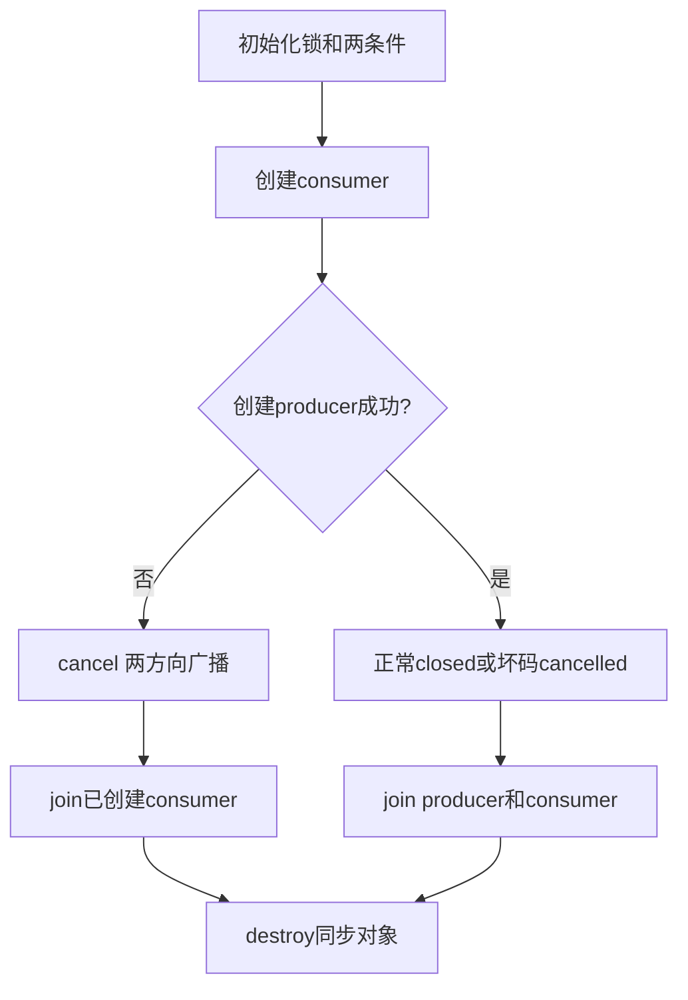

# 同一条测量流，三个不同的系统边界

单线程工具已经能解析、计算和清理，为什么增加一个生产者、拿掉堆分配或交给另一种语言调用，还需要重新写合同？改变的是谁拥有对象、谁能在什么时候看到状态，以及哪个运行环境提供服务。这里把原始码与数学对象保持清楚，分别完成条件支持的C11线程分支、固定缓冲核心和窄C ABI消费者。源码及真实运行见 [[计算机知识/80-实践/09-C语言/01-测量流与有界数据结构/stage4/README|阶段4实验]]；原hosted解析/统计源码沿用第12讲，没有因系统分支重写。

## 先区分四种“可以看见”

语言对象有效要求地址、对齐、类型、边界和寿命；线程可见性另需同步协议；设备可见性可能还需总线、DMA、缓存与驱动合同；实时期限要求目标上的最坏响应预算。源文件有volatile、atomic或固定数组，分别不能自动证明后面几层。去 [[计算机知识/10-编程语言/03-C语言/10-系统课程/08-标准库并发泛型与工程全景#嵌入式代码的额外前提|设备和实时边界]] 带回额外前提，再逐项核对本分支具体做了哪一层。

阶段4没有借合成1s记录冒充真实设备：队列搬运的是已合法的uint16_t码，固定缓冲采用零偏置/每码1mV的半码整数，ABI消费同一个有限记录统计对象。任何新单位、采样周期或硬件型号都需要相应的新定义与证据。

## 队列复合状态与条件谓词

完整thread_queue.c在支持C11 threads与atomics时建立capacity2队列，只有一个producer和一个consumer。queue中的head、length、slots、closed、cancelled是一组由同一mutex保护的状态。合法状态满足head∈{0,1}、0≤length≤2，逻辑首项位于head；未满插入尾部，满不覆盖未消费数据，而是等待。

producer等待谓词为“length==2且未closed、未cancelled”；consumer等待谓词为“length==0且未closed、未cancelled”。持锁进入while，cnd_wait等待时释放锁、返回前重新获得；再检查谓词，不能用一次通知代替状态本身。通知没有库存：若通知时没人等待，它不会给将来保存一张通行证。互斥锁和谓词共同避免在检查之后丢失必要的状态转移；多消费者或实现允许的唤醒情况更不能只用if。

正常producer完成后置closed并广播，consumer只在closed且empty时成功结束，所以剩余槽会排空。cancelled优先于length，消费线程停止并丢弃队列余项；向nonempty和nonfull都broadcast，解除可能在不同方向等待的工作者。取消不是正常EOF：不能把已消费前缀包装成完整记录成功输出。

原子published/consumed计数采用relaxed，仅记录诊断；它们不成为等待谓词或槽数据发布协议。队列发布与消费依靠mutex，consumer私有结果由main在join完成后读取。读到一个原子计数增加，不证明另一处非原子槽写完。返回 [[计算机知识/10-编程语言/03-C语言/10-系统课程/08-标准库并发泛型与工程全景#原子计数与复合状态|复合状态主解释]]，指出本例哪组状态需要锁、哪项独立计数可以原子。

## 线程的失败不是提前销毁共享对象

queue初始化按mutex、nonempty、nonfull顺序建立，失败逆序销毁已经建立者；没有工作者之前才可直接destroy。consumer创建失败时没有借用者；producer创建失败时consumer可能等空队列，必须cancel广播、join它，再destroy。正常和坏码取消同样join每个创建成功的线程。不能因main想返回就销毁仍有等待者的条件变量。

测试接口正常运行64个码并核对次序/FIR；坏码4096触发cancel；创建失败注入故意跳过producer的thrd_create，测试清理而不要求耗尽操作系统线程。初始化/创建失败可报告并回收；锁、等待、通知或join本身硬故障时，示例使用_Exit(1)的进程级fail-stop，避免在仍可能有借用的状态中强行destroy。它没有承诺可恢复库API或不丢失stdio缓冲内容。

最多main+两工作者=3线程，固定负载，没有无限队列或每条记录新分配。但系统默认线程栈、调度、公平性和等待上界来自实现，不能仅由capacity2证明低延迟或实时性。

## 支持检查与原子实跑的真实边界

probe.c分别检查__STDC_NO_THREADS__和__STDC_NO_ATOMICS__，原子可用时实跑初始化、fetch_add、load并报告atomic_is_lock_free；线程与原子都可用时另创建一线程、join并核对增计数。宏、头文件、链接与运行是不同层，不因编译器接受-std=c17就推断完整库支持。

本机Apple clang21与已有Homebrew clang23都报告threads_macro=0、atomics_macro=1；原子增计数通过，atomic_uint本机lock-free=1；线程探针和queue不支持入口返回77。没有安装组件、抹掉宏或用POSIX替代冒称C11。完整队列主体因此未编译、未运行，剩余支持目标验证明确保留；hosted原主线继续可用。这个结果满足“检查并报告条件支持边界”，不等于线程协议已得到运行验收。

## 宏、头文件与链接为什么要分别检查

上一节的条件probe能成功构建，因为实现明确不支持时它不会include threads.h。于是“编译成功、退出77”只证明不支持入口可用，不能证明锁、条件变量与队列主体曾被编译器检查。若换到另一台机器，头文件存在也只说明声明可见，还要确认运行库有定义、实际创建/等待/join可用，并重新验队列结束与失败协议。

实验新增thread_smoke.c直接包含标准线程/原子头文件；check_threads.py依次记录宏、编译、链接和实跑。小探针的main先持mutex再创建worker，while看到value=0而调用cnd_wait释放锁后，worker才可获得锁、发布42并signal；main复查后解锁、join、核返回值和原子诊断，再destroy。这个顺序要求至少一次真实等待，而不是让线程提前发布后跳过等待。它仍不证明所有唤醒次序、公平性或最坏期限。

| 可观察结果 | 这层能说明什么 | 下一层仍缺什么 |
| --- | --- | --- |
| __STDC_NO_THREADS__=1 | 当前编译配置声明不支持标准线程 | 直接诊断头文件与实际可用接口 |
| 无条件include threads.h报头文件不存在 | 当前工具链/SDK配置不能编译这个线程源 | 没有进入链接或线程运行，不能写“链接失败” |
| 有声明且编译通过，链接失败 | 对象生成成功，当前链接输入不足以建立可执行文件 | 检查实际目标运行库与链接约定，不能只改宏 |
| smoke创建/等待/join成功 | 小探针在列明目标完成了同步协议 | 完整队列容量、close/cancel/创建失败与顺序FIR |
| queue主体构建并运行判据成功 | 列明负载下完整分支有运行证据 | 未覆盖调度/同步硬故障、TSan或真实最坏期限 |

2026-10-11两套已安装工具链的直接结果均是宏不支持且threads.h不存在；不是发现一个新可用的C11线程库。check_threads显示UNSUPPORTED并返回77，队列主体仍未编译/未运行，链接层也未进入。完整可复现命令与编译诊断见 [[计算机知识/80-实践/09-C语言/01-测量流与有界数据结构/stage4/README#直接检查头文件、链接与队列主体|分层线程实验]]；不#undef宏、不安装组件、不用POSIX名称包装冒充C11。

不支持时也可完成对象与谓词推演：当队列已有两项、producer等待nonfull，此时主线程cancel应置哪个状态、唤醒谁、何时允许destroy？如果改成normal close，consumer是否仍应得到剩余两项？

> [!question]- 参考答案与接受标准
> cancel在持mutex时置cancelled并向nonempty/nonfull广播；producer复查后拒绝新push，consumer复查后优先cancelled，剩余两项不再作为完整成功记录交付。main仍join每个创建成功的工作者，再destroy。normal close则closed=1，消费者继续弹出剩余两项直到empty才成功结束；这要求读取返回0的条件是closed且empty。通知不储存状态，不得用“已经signal过”代替while谓词。此为源码合同推演，模型回答不能代填真实线程实验成绩。

## 固定缓冲：把分配风险变成容量合同

fixed.h/fixed.c不使用malloc、FILE、libm或线程。调用者建立wwl_fixed_state，提供input[n]与output[n]的真实存储；三者须不重叠。先检查容量、累计n≤1024和全部码0..4095，再进行写入，所以坏块不改变state或output。接口没有在调用之间保留input/output指针，state由调用者持续拥有；startup初始化责任也明确归调用者。

输出是`previous+code=2*y`，以半码整数保存两抽头结果。默认1mV/码、0偏置，输入[2,4,6,8]给[2,6,10,14]，再除2是[1,3,5,7]mV；输入首码1给整数1，即0.5mV，没有整数除法截断。分块保持previous，全部8种四点分块都应相同；EOF不添加额外样本。有限记录仍存sum与squares：N≤1024给sum≤4193280、squares≤17171481600，平方在uint64_t中进行。它没有实现任意标定、文本/二进制适配或设备Q15饱和规则。

本机两工具链以-ffreestanding -fno-builtin编译核心，普通对象nm未见外部未定义符号；宿主测试main链接它验证行为。这证明具体对象可无外部运行库引用地构建，并在宿主夹具下符合当前合同；它没有启动裸机，没有链接脚本、IRQ、DMA或设备时序证据。消毒器对象有额外运行库引用，不能再把它当零运行库依赖产物。

## 窄C ABI：值布局不传递所有权

cabi.h定义版本化wwl_c_measure_v1：调用者的uint16_t数组与uint32_t条数、double标定、native结果结构与uint32_t输出大小/错误。输入只借用，输出调用者拥有，没有库分配、跨侧释放、保留指针或回调；成功后写整份数值结果，失败保持旧结果。n和out_bytes只是合同参数，不证明地址真的属于调用者。库创建临时借用ms_samples，调用原统计接口，绝不destroy该借用。

C++ consumer使用extern C链接声明和standard-layout结果；Rust consumer使用repr(C)、extern C与逐个说明理由的unsafe。两者先以C提供的layout与本侧sizeof/alignof/offsetof对照，再实际调用同一个C静态库。布局一致、错误保持、单位/分母和数值结果分别检查；native结构体不是二进制协议，不能拷贝字节就当跨机格式。

本机结果结构大小40、对齐8、mean偏移16、rms2偏移32；C++和Rust真实调用均得到sum20、mean5、描述性方差5、RMS²30，并核坏码失败保持。C++还核空、超限、非法标定、输出大小与0.25/−1迁移。C++异常/Rust panic按本接口合同不得跨C边界；当前没有回调或Rust导出函数，Rust assert在C返回后运行。这是本目标的窄ABI消费验证，不是所有平台、编译器或复杂异常接口互通保证。

## 无操作提示的迁移题

把队列改成两个消费者，把固定接口允许input/output原地覆盖，并给ABI增加一份库分配的动态结果。哪些已有证明失效？怎样分别建立新的合同与检查？

> [!question]- 参考答案与接受标准
> 两消费者的弹出次序不自动成为完成次序，也不能各自拥有一半FIR时间历史；需要单一有序状态拥有者、序号重排或有证明的状态合并，结束广播/join覆盖全部工作者。原地覆盖会破坏fixed块先验证后读取的“不重叠”前提，尤其不同元素宽度可能覆盖尚未消费码；重新规定允许的具体布局/方向，不能泛称输入输出可以别名。库分配结果需显式匹配释放函数/分配器合同，C++/Rust不能自由cross-free。分别测试容量、失败保持、顺序、取消、布局和寿命。没有线程支持/硬件时交待相应接口与未验层，不将宿主单次结果扩为实时或设备验收。

## 规范与继续验证

[WG14 N1570（C11公开草案）](https://www.open-std.org/jtc1/sc22/wg14/www/docs/n1570.pdf) 可定位7.26条件等待/线程join和7.17原子；它不是C17最终标准。[N2396](https://www.open-std.org/jtc1/sc22/wg14/www/docs/n2396.htm)保留C17相关澄清，包括条件唤醒语义，不能将后续草案不加说明地倒用于C17。[Rust官方FFI说明](https://doc.rust-lang.org/nomicon/ffi.html)解释声明、unsafe与展开边界；具体接口、上限和失败政策是本课设计。

主机检查、线程条件不支持、freestanding编译、目标ABI实跑、设备/实时/真人未验分开记在 [[计算机知识/80-实践/09-C语言/01-测量流与有界数据结构/stage4/README|实验README]]。返回 [[计算机知识/10-编程语言/03-C语言/10-系统课程/00-C语言系统课程索引|唯一C索引]] 根据能解释和验证的能力选择下一步，不以新文件存在判整门课或真人学习完成。
