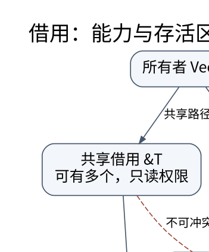

# 所有权和借用：把编译错误还原成一张对象关系图

> **学习位置**：[[计算机知识/00-开始/课程地图/03-Rust-课程地图|Rust课程地图]] · **适用边界**：Rust 2021 edition 兼容示例；2024 edition 差异另行标识。



[PNG 备用图](../../../_assets/diagrams/round3/rust-borrow.png) · [可编辑图源](../../../_assets/diagrams/round3/rust-borrow.dot)

## 先画所有者，再看变量在哪块内存

`String` 拥有 UTF-8 缓冲区，`&str` 借用一段合法 UTF-8。所有权主要回答谁负责维持资源及最终清理，不是“所有变量必须在栈上”。移动一个拥有值把使用与销毁责任交给新绑定；编译器可能消除实际搬运，语言层 move 不承诺必须执行某条内存复制指令。

```rust
let original = String::from("hello");
let owner = original;
let view: &str = &owner;
assert_eq!(view, "hello");
// println!("{original}"); // 故意错误：资源所有权已转移。
```

拥有者结束时调用相应清理逻辑；借用者不独立释放同一资源。`Copy` 类型允许隐式按值复制，`Clone` 是显式的克隆协议；克隆可能复制数据，也可能只增加引用计数，成本由具体类型决定。

## 借用冲突在防止哪条失败路径

假设持有 `let first=&v[0]`，随后对向量 `v.push(...)`。如果扩容移动底层存储，`first` 就会悬空。只要旧借用还会继续使用，安全 Rust 通常拒绝需要可变借用的操作。这不是编译器故意刁难，而是它看不到一个能保证所有输入都不扩容的接口契约。

非词法生命周期分析让借用可在最后一次实际使用后结束，不必始终占满整个块。合理修复包括先读取需要的值、记录下标后重新访问、缩短借用范围，或者重新设计数据结构。无条件 `clone` 虽然可能绕过冲突，但会改变复制成本和共享语义。

## 可变引用不是普通的可写指针

`&mut T` 表达一段受控制的独占访问能力。安全代码不能同时保留会冲突使用的共享与可变访问。内部可变性通过专门类型把一部分检查转到运行时或同步协议，并不是否定这个规则。

需要同时修改一个切片的两个不相交部分时，用 `split_at_mut` 表达不重叠证据：

```rust
let mut values = [10, 20, 30, 40];
let (left, right) = values.split_at_mut(2);
left[1] += 1;
right[0] += 2;
assert_eq!(values, [10, 21, 32, 40]);
```

两个普通下标看起来不同，不一定足以让借用检查器在任意复杂表达式里证明不重叠。应选择能把结构事实暴露给类型系统的 API，而不是立即转裸指针。

## 模式匹配也会移动或借用

从一个结构体或枚举匹配字段时，要问是按值取出、共享借用还是可变借用。部分移动后，未被移动的字段可能仍能使用，但整个值不一定还能作为完整对象使用；具有 `Drop` 的类型又有额外限制，不能任意拆走字段后让析构面对缺失状态。

`match &value` 通常用于借用检查状态，`match value` 可能转移内部拥有值。`Option::take` 用 `None` 替换原位置并取走拥有值，是维持容器合法状态的常见方法。它比 `unsafe` 地“偷出字段”更易证明。

## 字符串索引为什么刻意不简单

UTF-8 的字节长度、Unicode 标量值数量和用户感知字素数量不同。`"你好".len()` 返回 UTF-8 字节数；`chars()` 遍历标量值；组合附加符号和 emoji 序列可能仍包含多个标量。任意字节切片可能切断编码边界，`get(range)` 可以用 `Option` 表达失败。

算法应先定义处理单位。网络帧按字节计数，词法分析可能按字符解码，编辑器光标常需要字素规则。`&str` 保证 UTF-8 合法，不保证符合应用对姓名、标识符或规范化的要求。

## 练习与答案

一个函数想返回“输入字符串的前 n 个字节”，返回类型选什么？若需要任意字节，可以返回 `&[u8]`；若要求字符串，应检查 n 是字符边界，并返回 `Option<&str>` 或 `Result`。把 n 解释成字符数量又需要不同遍历逻辑。

另一个函数要返回把输入转成大写后的结果，为什么通常返回 `String`？因为新内容需要新所有者，不能返回指向局部临时缓冲区的借用。这个区分正是 C 中“谁分配、谁释放”合同在 Rust 接口上的显式表现。


<!-- ROUND4 DEPTH LINKS -->
## 继续推演本页难点

[[计算机知识/10-编程语言/04-Rust/10-系统课程/09-借用检查中的量词方差与重借用|为什么能缩短共享引用，却不能把长期引用槽位当短期槽位？]] 本专题补上所有者、量词与地址稳定性的具体边界。

这不是替换本页：先掌握原理，再用补充页核对容易被一句话略过的条件。
<!-- END ROUND4 DEPTH LINKS -->

## 关联阅读

- [[计算机知识/10-编程语言/03-C语言/10-系统课程/02-声明数组指针与字符串契约|声明、数组与指针：用对象和边界解释复杂语法]]
- [[计算机知识/10-编程语言/02-C++/10-系统课程/01-对象生命周期与RAII|对象何时存在：初始化、析构和 RAII 的统一模型]]

## 依据与继续查证

- [The Rust Programming Language](https://doc.rust-lang.org/book/)
- [The Rust Reference](https://doc.rust-lang.org/reference/)
- [Rust 标准库](https://doc.rust-lang.org/std/)

本页的例子、推演与练习为教学构造；语言契约、系统接口和版本相关结论应结合以上原始文档核对。

<!-- COURSE SEQUENCE -->
## 顺序导航与验证

[[计算机知识/10-编程语言/04-Rust/10-系统课程/00-Rust系统课程索引|本课程总索引]] · [[计算机知识/_labs/round3/RUST/Rust-实验说明|本课程实验]]

下一讲：[[计算机知识/10-编程语言/04-Rust/10-系统课程/02-生命周期方差与高级借用|生命周期不是倒计时：约束、方差与高阶借用]]
<!-- END COURSE SEQUENCE -->

<!-- ORIGINAL DEEP LINKS -->
## 与原有长篇专题衔接

- [[计算机知识/10-编程语言/04-Rust/02-所有权借用与生命周期推演|02-所有权借用与生命周期推演]]
- [[计算机知识/10-编程语言/04-Rust/04-错误处理模块测试与工程边界|04-错误处理模块测试与工程边界]]

新旧讲解采用的版本与模型可能不同，比较时先核对各自前提，不把教学简化当成实现细节。
<!-- END ORIGINAL DEEP LINKS -->
