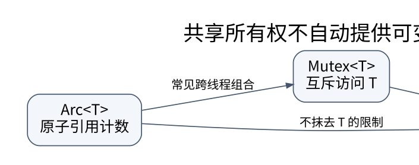

# 智能指针和并发：每一种能力都附带新的证明义务

> **学习位置**：[[计算机知识/00-开始/课程地图/03-Rust-课程地图|Rust课程地图]] · **适用边界**：Rust 2021 edition 兼容示例；2024 edition 差异另行标识。



[PNG 备用图](../../../_assets/diagrams/round3/rust-sharing.png) · [可编辑图源](../../../_assets/diagrams/round3/rust-sharing.dot)

## Box、Rc、Arc 不是三个性能档位

`Box<T>` 提供独占拥有；`Rc<T>` 让同一线程中的多个使用者共享所有权；`Arc<T>` 用原子引用计数支持满足相应约束的跨线程共享。选择取决于所有权关系，而不是越高级越安全。

`Arc` 管的是资源何时销毁，不自动让 T 的任意可变操作线程安全。`Arc<RefCell<T>>` 也不会因为外面加了 Arc 就获得适当的跨线程共享能力。引用计数环可能泄漏，`Weak` 可以表达不延长生命的观察边。

## 内部可变性把哪一项检查移到哪里

`Cell` 适合通过整体取值/替换等受控接口管理某些值；`RefCell` 在运行时追踪借用，违反共享/独占借用协议会导致失败，普通借用接口可能 panic。底层 `UnsafeCell` 是语言中内部可变性的基础，但它不自动同步线程。

`Mutex`、`RwLock` 用同步协议控制共享状态。读写锁不是“读多就必然快”：调度、写者饥饿、临界区长度和平台实现都影响结果。锁中毒也不是内存安全机制，恢复时要检查 panic 是否留下破坏业务不变量的状态，不能总是机械解包内部数据。

## Send 与 Sync

`Send` 表达值的所有权可以安全转移到另一线程，`Sync` 表达共享引用可以安全在线程间传递；后者与 `&T: Send` 的关系是核心定义。多数类型通过组成自动获得或不获得这些 auto traits，手写 unsafe 实现意味着作者承担额外的安全证明。

一个类型是 Send/Sync，不代表算法无死锁、请求必完成或结果满足业务事务。语言级数据竞争安全和系统级活性、线性化语义必须分别论证。

## 用作用域线程简化借用

作用域线程可以借用外层数据，因为作用域退出前会等待相关线程结束。这与要求任务可能在调用者之后继续存活的接口不同；后者通常需要拥有数据或满足静态约束。

```rust
let values = [1, 2, 3, 4];
std::thread::scope(|scope| {
    let worker = scope.spawn(|| values.iter().sum::<i32>());
    assert_eq!(worker.join().unwrap(), 10);
});
```

这里 `unwrap` 仅用于受控教学测试，生产应决定线程 panic 的处理策略。作用域保证借用数据活得足够久，不保证被借用的共享可变状态可以绕过锁。

## 消息传递减少共享，但需要背压

把拥有值送进通道，可以让消费者取得清晰所有权。无界通道却可能把“生产太快”转变为内存耗尽。使用有界通道时，发送可能阻塞或失败，需要防止持有另一个锁时等待队列空间而形成环形依赖。

关闭协议应写清：所有发送者释放后接收如何结束；接收者提前退出时发送者怎样知道；队列中尚未处理的数据丢弃还是落盘；任务成功与消息已接收是否等价。

## 原子操作适合小而清楚的状态

独立统计计数可以使用 relaxed 原子累加，因为它不承担发布其他数据的职责。发布—订阅状态需要 release/acquire 等适合的关系，跨多个字段的一致快照则需要更完整协议。不要把 Rust 的安全类型检查理解成自动证明每一种原子内存序选择符合业务意图。

高性能无锁结构还要处理 ABA、回收和进展保证。选择一个能解释清楚的锁方案，通常比未经证明的 unsafe 无锁链表更可靠。

## 练习与答案

把队列里的工作交给两个消费者，每项恰好执行一次如何验证？记录唯一任务 ID，检查没有缺失和重复；再加入消费者失败，明确重试是否可能重复外部副作用。语言所有权可以阻止同一内存值随意被两个线程同时拥有，但不能自动保证远程支付不会重复。

## 关联阅读

- [[计算机知识/10-编程语言/02-C++/10-系统课程/06-原子内存序与并发设计|从数据竞争到 happens-before：并发正确性怎样建立]]
- [[计算机知识/20-操作系统/02-操作系统原理/10-系统课程/03-同步条件变量与经典问题|同步、条件变量与经典问题：保护不变量，而不是保护几行代码]]
- [[计算机知识/35-计算机网络/10-系统课程/07-Socket分帧背压与排障|Socket 工程：分帧、背压、超时和可解释的失败]]

## 依据与继续查证

- [The Rust Programming Language](https://doc.rust-lang.org/book/)
- [The Rust Reference](https://doc.rust-lang.org/reference/)
- [Rust 标准库](https://doc.rust-lang.org/std/)

本页的例子、推演与练习为教学构造；语言契约、系统接口和版本相关结论应结合以上原始文档核对。

<!-- COURSE SEQUENCE -->
## 顺序导航与验证

[[计算机知识/10-编程语言/04-Rust/10-系统课程/00-Rust系统课程索引|本课程总索引]] · [[计算机知识/_labs/round3/RUST/Rust-实验说明|本课程实验]]

上一讲：[[计算机知识/10-编程语言/04-Rust/10-系统课程/04-错误处理模块与测试|错误作为数据：Result、模块边界和可验证的失败路径]]

下一讲：[[计算机知识/10-编程语言/04-Rust/10-系统课程/06-异步Future与Pin|Future、取消与 Pin：理解暂停之后还活着什么]]
<!-- END COURSE SEQUENCE -->

<!-- ORIGINAL DEEP LINKS -->
## 与原有长篇专题衔接

- [[计算机知识/10-编程语言/04-Rust/05-智能指针并发与异步取消|05-智能指针并发与异步取消]]

新旧讲解采用的版本与模型可能不同，比较时先核对各自前提，不把教学简化当成实现细节。
<!-- END ORIGINAL DEEP LINKS -->
