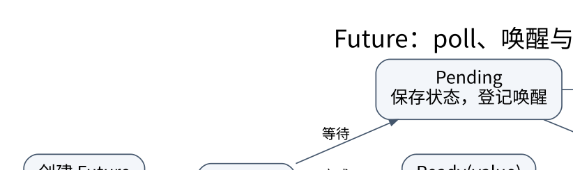

# Future、取消与 Pin：理解暂停之后还活着什么

> **学习位置**：[[计算机知识/00-开始/课程地图/03-Rust-课程地图|Rust课程地图]] · **适用边界**：Rust 2021 edition 兼容示例；2024 edition 差异另行标识。

[PNG 备用图](../../../_assets/diagrams/round3/future-state.png) · [可编辑图源](../../../_assets/diagrams/round3/future-state.dot)

## async 函数生成一个可推进的计算

调用 `async fn` 得到 Future，并不等于函数体已经完整执行，也不等于创建线程。执行器通过 `poll` 推进 Future；完成返回 Ready，暂时不能推进返回 Pending，并安排将来通过唤醒机制再尝试。

一个简化状态机可以有“尚未开始、等待 I/O、处理结果、完成”四个状态。跨挂起点仍需使用的变量进入协程状态；不需要继续使用的临时值可以提前结束。理解这些状态，比把 async 当作“自动并行”更重要。

## Waker 不是结果，也不是保证立刻运行

Waker 表达任务可能再次有机会推进，执行器决定何时 poll。Future 返回 Pending 后应与正确唤醒机制配合，不能无缘无故永远等待，也不能用无界忙轮询浪费 CPU。

同步 CPU 密集计算如果一直不返回控制权，会占住执行器工作线程；把函数签名改成 async 不会把循环自动切片。阻塞系统调用也不因 async 关键字变成非阻塞，需要运行时提供的适当接口或隔离到阻塞执行资源。

## `Send` 取决于挂起时保留的状态

某些执行器可以让任务在不同工作线程间迁移，因此要求 Future 满足 Send。若 Future 跨 await 保存了不能在线程间移动的值，它可能不满足这个约束。一个非 Send 临时值若在挂起前已经结束，结论可能不同。

这不是“所有异步都必须 Send”。单线程本地执行器可以运行非 Send 任务，但仍要遵守借用、取消和活性约束。运行时的选择应写进接口合同。

## Pin 约束的是特定值的移动

一些 Future 在被推进后可能包含依赖稳定位置的内部关系。`Pin
` 通过受约束的指针访问防止以安全方式随意移动所固定的 `!Unpin` 值。移动 Pin 包装器本身不必等于移动它所指的对象；堆地址稳定也不自动证明所有自引用都合法。

`Unpin` 表示类型无需依赖这种固定保证。对常见业务异步代码，应优先使用安全执行器与组合器；手写 Future、投影 pinned 字段或管理自引用时，才需要深入分析固定、析构和别名协议。

## 取消之前先确认谁拥有工作

丢弃自己实际拥有的 Future 值，会对该值执行正常的资源析构；但“丢弃任务句柄”不等于“丢弃运行时持有的任务”。例如 Tokio 的 `JoinHandle` 被丢弃后，任务通常成为脱离句柄的后台任务，仍可继续运行。`abort()` 是请求取消，调用它本身也不等于已经完成清理；需要观察结束时，应继续等待句柄结果。已开始的 `spawn_blocking` 任务以及不让出执行权的工作另有边界。参见 [Tokio JoinHandle 官方契约](https://docs.rs/tokio/latest/tokio/task/struct.JoinHandle.html)。

即使实际 Future 已经被丢弃，也不会必然撤销外部系统已经完成的动作。请求可能已被服务端执行，只是响应尚未收到；文件写入可能已经部分完成；队列元素可能已经取出却尚未放到新位置。

因此每个 await 都是一个审计点：此时丢弃任务会留下什么状态？是否丢失消息？锁是否释放？外部动作能否重试？需要把幂等键、事务、确认协议和补偿操作放在正确层次。

## 同步锁与异步锁

跨 await 持有锁可能扩大临界区并形成死锁或饥饿。异步锁使等待者能够让出执行资源，但不会让长临界区或锁顺序错误变正确。最佳修复往往是先复制或取出必要数据，释放锁，再 await，然后用明确的版本/状态检查提交结果。

若提交依赖“状态自读取后未变化”，必须显式验证版本或使用合适协议，不能把解锁后的旧判断当成仍然成立。

## 推演：超时的三个阶段

任务写入一条记录，分为“发起请求、服务端提交、客户端收到确认”。超时可能发生在任意间隔。只在客户端 abort，不能区分第二阶段是否发生。重试需要稳定操作 ID，服务端按 ID 去重，或者使用可查询的提交状态。

练习答案：把 timeout 当成“结果未知”，而不是一律当成“没有执行”。这一点和 TCP 断线、数据库提交确认丢失完全相连。异步代码的可靠性不止是避免内存错误，还包括外部世界的状态不确定性。

<!-- ROUND4 DEPTH LINKS -->
## 继续推演本页难点

[[计算机知识/10-编程语言/04-Rust/10-系统课程/10-Pin投影任务所有权与取消协议|丢弃 Future 与丢弃 JoinHandle 为什么不是同一件事？]] 本专题补上所有者、量词与地址稳定性的具体边界。

这不是替换本页：先掌握原理，再用补充页核对容易被一句话略过的条件。
<!-- END ROUND4 DEPTH LINKS -->

## 关联阅读

- [[计算机知识/10-编程语言/05-TypeScript/10-系统课程/05-事件循环Promise与取消|事件循环、Promise 与取消：顺序必须按任务推演]]
- [[计算机知识/10-编程语言/01-Python/10-系统课程/04-异步任务取消与结构化并发|异步任务、取消与结构化并发：谁负责等待谁]]
- [[计算机知识/55-数据库/10-系统课程/07-恢复复制与分布式事务|恢复、复制与分布式事务：提交成功意味着什么]]

## 依据与继续查证

- [The Rust Programming Language](https://doc.rust-lang.org/book/)
- [The Rust Reference](https://doc.rust-lang.org/reference/)
- [Rust 标准库](https://doc.rust-lang.org/std/)

本页的例子、推演与练习为教学构造；语言契约、系统接口和版本相关结论应结合以上原始文档核对。

<!-- COURSE SEQUENCE -->
## 顺序导航与验证

[[计算机知识/10-编程语言/04-Rust/10-系统课程/00-Rust系统课程索引|本课程总索引]] · [[计算机知识/_labs/round3/RUST/Rust-实验说明|本课程实验]]

上一讲：[[计算机知识/10-编程语言/04-Rust/10-系统课程/05-智能指针内部可变性与线程|智能指针和并发：每一种能力都附带新的证明义务]]

下一讲：[[计算机知识/10-编程语言/04-Rust/10-系统课程/07-Unsafe别名FFI与表示|unsafe 审计：安全封装必须让所有安全调用都成立]]
<!-- END COURSE SEQUENCE -->

<!-- ORIGINAL DEEP LINKS -->
## 与原有长篇专题衔接

- [[计算机知识/10-编程语言/04-Rust/05-智能指针并发与异步取消|05-智能指针并发与异步取消]]

新旧讲解采用的版本与模型可能不同，比较时先核对各自前提，不把教学简化当成实现细节。
<!-- END ORIGINAL DEEP LINKS -->
