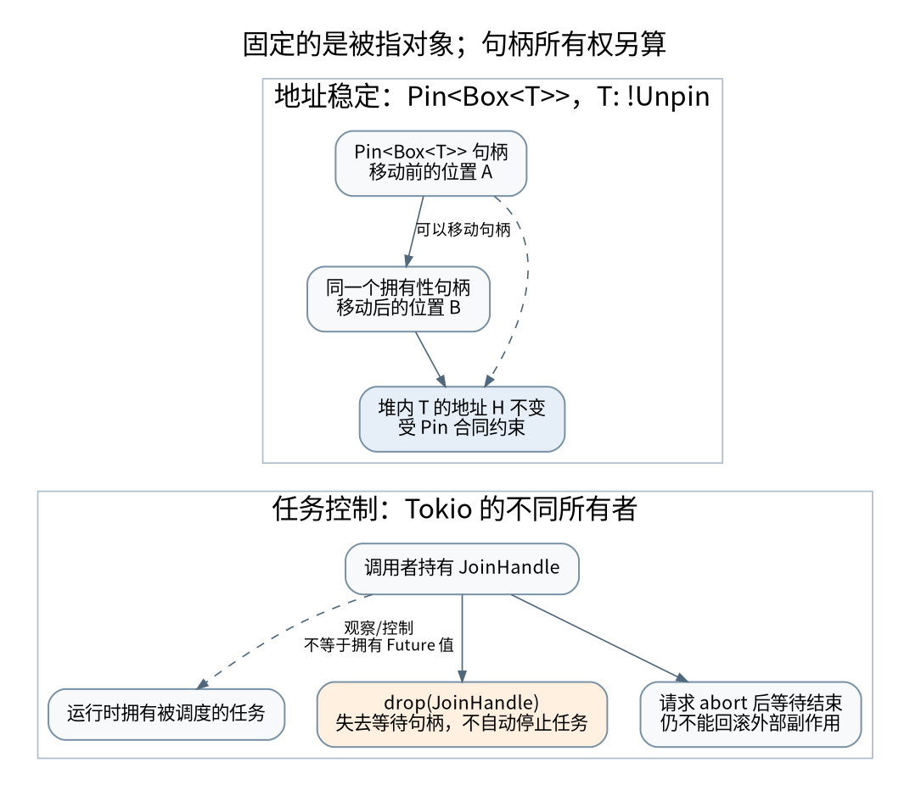

# Pin 固定谁，取消谁：地址稳定、任务句柄与外部副作用

> **本页要解决**：丢弃 Future 与丢弃 JoinHandle 为什么不是同一件事？
>
> **先修**：[[计算机知识/10-编程语言/04-Rust/10-系统课程/06-异步Future与Pin|Future、取消与 Pin：理解暂停之后还活着什么]]；[[计算机知识/10-编程语言/04-Rust/10-系统课程/07-Unsafe别名FFI与表示|unsafe 审计：安全封装必须让所有安全调用都成立]]。
>
> **阅读入口**：[[计算机知识/10-编程语言/04-Rust/10-系统课程/00-Rust系统课程索引|本学科主索引]] · [[计算机知识/00-开始/全局导航/11-难点导读与研究证据|全局难点导读]]。

**版本、模型与证据边界**：标准库示例兼容 Rust 2021 edition；本机无 rustc，未编译执行。Tokio 文档为检索时滚动版本。

## 先问哪一个对象不能移动

`Pin<Box<T>>` 的“固定”对象是 Box 所指向的 T，不是栈上的 Box 指针变量。把这个 Pin 包装器传参、返回或放进另一个容器，通常只移动指针包装，不把堆上的 T 搬家。相反，普通 `Box<T>` 虽然通常具有稳定堆地址，却允许把 T 移出，因此单靠“放在堆上”不足以形成禁止移动的接口合同。[^rust-pin]

[矢量图](../../../_assets/diagrams/round4/pin-owner.svg) · [可编辑图源](../../../_assets/diagrams/round4/pin-owner.dot)

`Pin<&mut T>` 本身也不是对象的所有者。把这个借用包装器 drop，不等于析构 T；其固定承诺需要在对象后来失效或销毁的过程中继续成立。对 `!Unpin` 类型，unsafe 构造 Pin 的调用者承担的责任不会因局部包装器离开作用域而自动解除。

## 固定不是禁写，也不等于生命周期检查

Pin 限制会破坏地址相关不变量的移动或失效行为，并不全面禁止修改字段。`T: Unpin` 表示类型不依赖这份额外固定保证，可安全恢复普通可变访问能力。`!Unpin` 也不表示该值从出生开始绝对不能移动，而是通过固定接口进入受保护状态后需要遵守合同。

自引用指针是否初始化正确、是否仍在分配范围内、访问是否符合别名规则，Pin 都不会自动替你证明。`PhantomPinned` 只是阻止自动获得 Unpin 的一种构造手段，不是让任意 raw pointer 代码安全的开关。[^rust-pin]

### 投影为什么危险

从 `Pin<&mut Outer>` 暴露 `&mut field`，如果 field 需要跟随外层保持固定，调用方就可通过 `mem::replace` 把它搬走，破坏保证。可固定字段应按投影协议暴露 `Pin<&mut Field>`，而哪些字段需要结构性固定、析构如何处理、能否实现 Unpin，都要一致设计。业务代码优先采用成熟抽象，教学不能用一个 `unsafe` 块跳过这些证明。

## Future 在哪里暂停，就要检查哪里留下状态

一个 async 操作可以经历“未开始、已发送、等待确认、完成”等状态。poll 返回 Pending 不代表什么也没做：网络请求可能已经发送，队列元素可能已经取出，临时文件可能已经创建。被丢弃的 Future 会停止继续推进并析构其拥有的状态，但外部动作不会自动撤销。[^rust-future]

例如从队列取走消息后，在将其持久化之前被取消：若消息的拥有责任只存在于这个 Future 中，取消可能使业务工作丢失。需要明确重新入队、确认后删除、事务或可恢复状态。这里的问题与内存安全不同，见 [[计算机知识/85-综合贯通/02-超时重试幂等与事务发件箱|幂等与事务发件箱]]。

## Future 和 JoinHandle 必须分开

在 Tokio 中，`spawn` 把任务交给运行时，并返回 `JoinHandle`。**丢弃 JoinHandle 会使任务脱离该句柄，不会因此取消已经生成的任务。** 等待这个句柄的 Future 被超时包装丢弃，也不能据此推断后台任务已经停止。这个行为属于具体运行时的 API 合同，不是所有执行器的一条语言定律。[^tokio-handle]

`abort()` 是取消请求，不是同步等待任务所有清理已经完成；需要按 API 进一步等待并处理 JoinError。已经开始运行的 `spawn_blocking` 工作通常不能靠 abort 强制停止，因此同步阻塞工作需要独立的合作式终止设计。不要把网络请求中途取消、异步任务取消和 OS 线程终止归成一个操作。

这也修正了“取消就是在某个挂起点停止拥有 Future”容易引发的误解：必须指出谁实际拥有正在执行的 Future，以及你丢弃的是它本身，还是仅仅一个等待它的句柄。

工程消费例见 [[计算机知识/10-编程语言/04-Rust/10-系统课程/12-Cargo组件工程与测量任务流#可选异步适配：谁持有 handle，谁确认结束|Tokio任务归属与完成观察]]：唯一sender由控制器持有，finish关闭后await；cancel发abort仍await；丢弃等待Future只请求取消，不能报告结束。返回本节核对“handle是否仍被拥有”与“任务是否确实完成”的区别。

## 取消安全由操作边界决定

对一个多路等待分支，取消后重建 Future 是否会丢失已经读出的部分字节？等待锁时取消是否只是离开等待队列，还是已经取得需清理的资源？取消安全不是函数名字里带 `async` 就获得的性质。

设计可采用：在 await 前只做可重复准备；需要跨 await 的中间状态由明确所有者保存；提交时用稳定 ID 或版本检查；任务树停止时先通知、再等待、最后在约定期限内升级处理。Tokio 的优雅关闭文档分别讨论决定关闭、通知任务和等待完成，这三个责任不应合成一次 drop。[^tokio-shutdown]

在 [[计算机知识/10-编程语言/01-Python/10-系统课程/10-异步取消异常组与有界流水线|Python TaskGroup]] 和 [[计算机知识/10-编程语言/05-TypeScript/10-系统课程/10-运行时边界状态机与取消安全|AbortSignal]] 中，语法与异常机制不同，但“谁负责等待孩子结束”“取消是否撤销副作用”仍是相同的设计问题。

## 一个可审计的检查表

审查每个 await 点时，用完整句子记录：当前拥有的资源是什么；取消会调用哪些同步析构；哪些清理需要异步等待；操作是否已经被远端接受；重复执行是否可能产生第二次效果；任务句柄由谁保留并最终等待。

**练习**：在任务中先向原子标志写入 `started=true`，等待一个控制信号后写入 `finished=true`。主任务 drop JoinHandle 后发出控制信号，运行时保持存活，是否应该看到 finished？按 Tokio 合同，原任务仍可能继续完成。若让主函数立即退出，运行时关闭会混淆实验，不能把结果误判为“drop 取消了任务”。

该 Tokio 场景在文中作为受版本约束的实验设计；本轮无需联网安装依赖。实际本地 Rust 测试使用标准库验证拥有状态与 drop，是否编译执行在报告中单独列出。

[^rust-pin]: Rust 标准库 [std::pin](https://doc.rust-lang.org/std/pin/index.html)，尤其 pinning pointer、Unpin、Drop guarantee 与 structural pinning 各节。访问日期 2026-09-06，滚动文档不代表本机编译器版本。
[^rust-future]: 标准库 [Future](https://doc.rust-lang.org/std/future/trait.Future.html)；Tokio [Select](https://tokio.rs/tokio/tutorial/select)。
[^tokio-handle]: Tokio 官方 API 文档，[JoinHandle](https://docs.rs/tokio/latest/tokio/task/struct.JoinHandle.html)，detach、abort 与 blocking task 的明确边界。
[^tokio-shutdown]: Tokio [Graceful Shutdown](https://tokio.rs/tokio/topics/shutdown)。

## 知识连接：下一步应追问什么

取消跨越任务、网络与事务之后，应追问谁仍拥有工作、谁已经产生副作用。

[[计算机知识/10-编程语言/04-Rust/10-系统课程/09-借用检查中的量词方差与重借用|把借用检查翻译成约束：重借用、方差与生命周期量词]]：为什么能缩短共享引用，却不能把长期引用槽位当短期槽位？

[[计算机知识/10-编程语言/01-Python/10-系统课程/10-异步取消异常组与有界流水线|让异步任务有负责人：取消、异常组与有界流水线]]：超时之后，哪些任务仍在运行，谁负责收尾？

[[计算机知识/10-编程语言/05-TypeScript/10-系统课程/10-运行时边界状态机与取消安全|从 unknown 到可信状态：校验、状态机与异步取消]]：声明成某个类型，为什么不能让网络数据自动可信？

[[计算机知识/85-综合贯通/02-超时重试幂等与事务发件箱|贯通案例：超时、重试、幂等与事务发件箱]]：请求已经执行但确认丢失，怎样避免第二次业务效果？

## 本地核验与阅读顺序

[[计算机知识/_labs/round4/README|本轮实验：命令、检查范围与未执行项目]] 提供对应文件和记录。[[计算机知识/90-资源/维护/导入-com/_meta/round4/01-研究证据与版本边界|研究证据索引]] 区分规范、推演和实验；[[计算机知识/90-资源/维护/导入-com/_meta/round4/02-缺口回查与后续验证|仍需进一步验证的边界]] 不把概览或模型标成完整实现。

上一专题：[[计算机知识/10-编程语言/04-Rust/10-系统课程/09-借用检查中的量词方差与重借用|把借用检查翻译成约束：重借用、方差与生命周期量词]]。 返回 [[计算机知识/10-编程语言/04-Rust/10-系统课程/00-Rust系统课程索引|课程与问题索引]]，用不看原文的复算检验是否真正理解。
