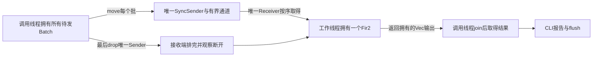
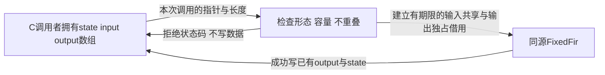

# 把测量管道交给标准库与另一个调用方

> **入口**：[[计算机知识/10-编程语言/04-Rust/10-系统课程/00-Rust系统课程索引|Rust 主索引]] · **工程**：[[计算机知识/80-实践/10-Rust/01-类型化测量任务/README|运行、测试与证据]]。先完成 [[计算机知识/10-编程语言/04-Rust/10-系统课程/11-类型化数据管道与标准库实作#谁有数据，谁只是看一眼|Batch 的拥有关系]]。
>
> 本讲交付阶段2–3中的串行组件：有界纯核心、标准库文件读写、FIFO批处理、公开调用方和本地包。接续段现已增加严格任务配置、threaded feature与有限单序列的同步任务流及关闭合同。高级接续现已增加共源固定缓冲核和窄C ABI；可选异步适配见末段；真实嵌入式运行仍未交付。前面的VecDeque仍只是串行队列。

## 先决定边界，才拆库和二进制

[src/lib.rs](../../../80-实践/10-Rust/01-类型化测量任务/src/lib.rs) 定义类型、解析、统计和 FIR，任何调用者都可复用；[src/main.rs](../../../80-实践/10-Rust/01-类型化测量任务/src/main.rs) 只决定 CLI 输入来自参数还是文件、怎样呈现错误、何时写 stdout。package 中库与二进制是不同 crate，二进制通过 `wwl_measurement` 的公开名字调用库，不能访问私有字段。`tests/contracts.rs` 也从公开 API 调用，因此能发现“只在库内部能用”的接口问题。

从第11讲的单文件检查点迁移时，先把 `classify` 及类型移到 lib，再在 main 用 `use wwl_measurement::...` 调用。随后加入验证构造、Batch、Summary 和 Fir2；最后加入 read_codes/write_report。每一步的读者问题分别是“谁判断合法”“谁持有记录”“谁保持前值”“谁承担 I/O 失败”。完整规范源码保存在工程中；不要求读者从正文片段拼凑最终工程。

## Trait 只放在真正需要多种实现的位置

`parse_codes<I,S>` 约束 `I: IntoIterator<Item=S>, S: AsRef<str>`，让数组借用、Vec<String> 和切片都进入同一个核心；`TryFrom<u16>` 返回验证后的 AdcCode，`From<AdcCode>` 做已证明无失败的单位转换。`read_codes<R: BufRead>` 可接受 BufReader<File> 或测试 Cursor；`write_report<W: Write>` 可接受 stdout 缓冲或测试 Vec<u8>。这些调用的具体类型编译时已知，选择泛型静态分派。

Level 和 InputError 是封闭枚举，适合列举已知分类/失败状态。没有运行时装载任意驱动的需求，所以不为了展示 `dyn` 强造插件架构。CLI 返回 `Box<dyn Error>` 统一多种顶层错误，代价是这里不再保留一个封闭的业务枚举；库仍暴露可匹配的领域错误，I/O 错误链保留 source。

回读 [[计算机知识/10-编程语言/04-Rust/10-系统课程/03-Trait泛型对象与关联类型#迭代器的所有权轨迹|iter 与 into_iter]]，再对照：summary 借用 records 遍历，`Fir2::process(batch)` 消费 Batch 后用 into_iter 取得记录。接收类型而非单个方法名字决定拥有关系。

## 集合如何服务确定输出与跨批状态

Batch 的 Vec 用来顺序存储。`BTreeMap<Level, usize>` 的 Entry 将“找桶并初始化再加一”集中为 `*levels.entry(level).or_insert(0) += 1`。Level 派生 Ord，变体声明顺序为 Low、Normal、High，输出稳定；桶不存在就不打印，不额外伪造0计数。换 HashMap 可以统计，却不能直接保证同样迭代顺序。

`drain_batches(&mut VecDeque<Batch>, &mut Fir2)` 从队首 pop_front，取得批的拥有权，再将其交给同一个处理器。队列清空，处理器仍有最后前值。VecDeque 支持双端，但本协议只从前端消费，因为 FIR 的前值依赖顺序。它没有输入总数防护，调用者自己构造的队列也可能无限添加；单批范围合同不等于全任务资源合同。主 CLI 是有限单批，有1024项上限。

练习：调换第二批与第一批，代码编译能否通过、输出还正确吗？答案：可以编译，但计算的是重排后的序列。newtype 保单位，借用保访问关系；它们不能证明序列顺序就是设备真实时间顺序。样本身份/时序合同需另行维护。

## 宏必须解决语法重复，而非替代函数

`tests/contracts.rs` 的 `level_cases!` 根据 `测试名: 输入 => 期待分类` 生成四个具名 `#[test] fn`。普通 classify 函数解决运行时分类，宏解决重复声明测试项的语法。以 `at_low_end: 3_u16 => Level::Low` 展开后，核心是：

```rust
#[test]
fn at_low_end() {
    let raw = 3_u16;
    let value = Millivolt::from(AdcCode::try_from(raw).unwrap());
    assert_eq!(classify(value), Level::Low);
}
```

输入表达式只在 `let raw = ...` 求值一次，没有为了构造期望和实际值重复求值。每个生成函数有独立作用域，宏引入的 raw/value 不捕获调用方同名局部；测试函数名字由调用方 token 提供。macro_rules 的卫生性是有规则的名称解析，并不是所有名字都被神奇改名。本例类型与 classify 在测试模块调用位置可见；若导出宏到别的 crate，要重新处理路径（如 `$crate`），不能把局部例子当作已验证的导出宏。

练习：输入表达式若带一次计数副作用，展开后应执行几次？答案一次；实际代码的4个输入均为常量，但展开能解释为何未来换表达式不会执行两次。

## BufRead 与 Write 把外部失败留在边界

文件每行一个码。`read_codes` 只去掉行尾 LF 与紧邻的 CR，不 trim 任意空格、不跳过空行；行长上限64字节包含换行，最多1024项。每次读取先用 `Read::take(...,65)` 截住增长，再 `read_until`，读到65字节立刻报 LineTooLong。直接无界 `lines()`/read_line 后再检查长度，可能已经为任意长输入分配内存。

这个上限控制本组件每行分配；调用者提供的 BufRead 本身可能事先持有巨大缓冲区。输入长度合法也不能保证文件句柄、stdout 或磁盘永远可用。错误分别保留行号、UTF-8、解析、I/O 原因；CLI 用 PathBuf 接收 `args_os` 的路径，不强求路径为 UTF-8。只在错误呈现时使用 path.display，其显示可能有损，文件打开仍用原 Path。

`write_report` 按固定顺序 writeln!，最后显式 flush，所有失败以 Result 返回。注入的 FlushBroken 允许先写成功再 flush 失败，测试验证调用者看到 Err 且字节已经存在。打印报告不是事务提交；flush 也不等于磁盘持久化、远端确认或业务回滚。

在工程根运行 `cargo run --locked -- --file fixtures/fixed.txt`，再运行 `--file fixtures/invalid.txt`、不存在文件路径。分别观察单位结果、带位置的范围错误、打开文件错误。输入失败发生在 write_report 前，所以输入失败没有部分报告；输出失败则可能有部分字节。这两种失败原子性来自执行顺序，不能混称“Result 自动回滚”。

## 独立调用方如何检验公开接口

`caller/` 是独立 package，用路径依赖 `wwl-measurement = { path = ".." }`。它只读公开 API：parse 得到 Batch，借用 summarize，随后消费 Batch 进入 Fir2。运行：

```sh
cargo run --manifest-path caller/Cargo.toml --locked --offline
cargo doc --locked --no-deps
cargo package --locked --offline --list
cargo package --locked --offline
```

调用方断言20/5与滤波值后打印结果。API 文档在本地 target/doc/wwl_measurement/index.html；它不是上传 docs.rs 的证据。默认库没有外部依赖，default feature为空；后续同步段定义threaded feature，末段async feature引入精确版本的可选Tokio依赖。

`Cargo.lock` 固定本 package 的依赖解析，当前包含自身、可选Tokio 1.52.3及pin-project-lite 0.2.17；锁文件中的解析集合不同于某次feature构建实际编译的依赖树，默认feature仍不编译这两个运行时依赖。独立 caller 有自己的锁文件，同样保留可选依赖解析。edition2021 决定语言兼容规则；rust-version1.89 是本次已验证的支持下限，不声称最早能编译的历史版本就是1.89。Cargo/rustc 实际为1.89.0，target 为 aarch64-apple-darwin。低于声明版本没有安装/验证；不因所用 API 较早存在就声称完整旧工具链兼容。

include 明确只装入 manifest、锁、README、src、tests、fixtures；`caller`、阶段0检查点、构建 target 与过程证据均不在 `.crate` 中，仍作为课程仓库中的伴随材料。打包会生成规范化 Cargo.toml 与 Cargo.toml.orig，README 所述包文件不能假装保留 caller。`publish=false` 防止误发布，打包是本地校验，不需要 registry 凭据；许可尚未为独立发布指定。本轮解包重新测试的是实际 archive 内文件，不能用源码目录成功代替这一结果。

## 严格配置与 feature 如何组成可执行边界

接续源码新增 [config.rs](../../../80-实践/10-Rust/01-类型化测量任务/src/config.rs) 和 [threaded.rs](../../../80-实践/10-Rust/01-类型化测量任务/src/threaded.rs)。先用默认构建运行配置路径，再启用同步分支；功能开关改变编译出的API与代码，配置改变一次任务的数值，不将两者混成同一种开关。

配置每行 `key=ASCII数字`，最多256字节，可用LF/CRLF；未知键、重复键、空值、空行、符号与空白都会拒绝。缺省字段取默认值；完全空配置使用全部默认值。三项为：

| 键 | 默认 | 合法范围与用途 |
| --- | --- | --- |
| capacity | 2 | 0..16，sync_channel容量，0为交接式同步 |
| batch_size | 2 | 1..1024，CLI从一个完整序列拆批的大小 |
| max_samples | 1024 | 0..1024，一次任务所有批累计的样本上限 |

TaskConfig字段私有，`try_new`和`parse_config`提供同一范围合同；构造返回拥有值，不借用配置文本。`read_config`先限制最多读取257字节，再判断256字节上限，错误保留配置行、键、值或I/O source。通过语法解析后仍要范围检查；newtype或私有字段不能自动代替构造验证。`max_samples=0`允许空任务，拒绝非空任务。

从工程根执行：

```sh
cargo run --locked --offline -- --config fixtures/task.conf
cargo run --locked --offline -- --config fixtures/invalid.conf
cargo run --locked --offline -- --threaded
cargo run --locked --offline --features threaded -- --config fixtures/task.conf --threaded
```

第一个命令使用配置限定的串行任务，输出仍是20/5；第二个命令因capacity=17退出2且无报告。默认构建请求--threaded会退出2，并给明确的重建命令；启用feature后第四个命令用同步任务得到相同输出。`--codes`消费余下全部参数，因此配置、feature选择和其他flag必须写在它前面；Cargo的`--features`在分隔符`--`前，程序flag在后。

库的config API始终存在，`#[cfg(feature="threaded")] pub mod threaded`只在该feature启用时存在。独立caller自己的`threaded` feature转发到依赖的feature；分别运行 `cargo run --manifest-path caller/Cargo.toml --locked --offline` 和同命令加 `--features threaded`，验证串行与同步两个公开消费路径。两个package均无新增依赖，锁文件解析不变。Cargo/rustc1.89.0实际测试了两种构建；仍不推断更老工具链兼容。

练习：只把配置里capacity改为16，默认构建是否出现线程？答案不会；运行时配置不能把编译时排除的模块带回来。若batch_size=0，不能“让循环自己结束”，必须在构造时拒绝，因为零大小分批会破坏推进条件。

## 有界同步任务流：一个状态所有者与全部等待责任

`split_batch`消费单个Batch，按配置拆成拥有的子批，保留原SampleIndex；需要任意批界时用`split_batch_at`。分别parse两个批会各自从0编号，不能伪装成同一连续序列。`process_threaded`在启动线程前验证：总项数不超过max_samples、批对象最多1024个（空批也计数）、所有索引依次为0..n-1。错误带期待/实际索引，范围合法并不意味着序列合法。

`write_report(&batch)`保留每条Record原有索引：切分后的右批[6,8]仍在t=2、3秒，不重标为0、1。该单批报告自己创建Fir2，故右批滤波为[3,7]；需要跨批连续结果[5,7]时，必须沿用同一处理器的状态。`write_summary_report`面向调用方提供的完整、从0开始的已验证流，按输出位置枚举时间；两个API的索引合同不能混用。

CLI先借用完整Batch计算summary，然后消费Batch分批，交给线程函数，最终将summary与线程输出写入同一报告。没有为保留报告而clone整个Batch。输出的时间按已验证的全局序号乘本例1s；这不是实际设备时间戳核验。公开`write_summary_report`先查summary数量与滤波输出长度一致，不能证明调用方自行拼凑的summary数值一定匹配同一原始数据；CLI/独立caller的同源构造负责这个业务关系。



发送使用try_send；Full时取回同一个Batch，再用阻塞send交接，没有丢弃或重复消费。capacity0没有排队槽位，send等待接收方交接；capacity>0限制已排队批数。这里只生成一个Receiver与一个worker，保持同一通道顺序和同一previous。标准库Receiver不能clone；增加工作者必须另设计分发与状态归属，不能照抄此方案宣称并行流仍是相同FIR。

正常路径：生产者发送每批，结束后drop唯一sender；worker把所有已接收批消费完，接收迭代在断开后结束；主线程join，拿到拥有结果，最后输出。send错误时，未发送的Batch和剩余批被Drop；关闭sender，仍join；worker的失败优先报告，避免只显示其导致的次生发送错误。worker panic时join返回错误，转成WorkerPanicked，没有成功输出。Builder.spawn的系统错误单独保留source，此时没有创建成功的任务需要等待。

| 情境 | 测试控制/观察 | 本实现结果 |
| --- | --- | --- |
| 空任务 | max_samples=0、无批 | 关闭sender，worker退出，join返回空输出 |
| 满队列 | 容量1，门控worker暂不接收，观察第二批try_send确为Full后放行 | 同一批阻塞交接，继续完成全部4项 |
| 满时worker失败 | 在上述Full节点放行失败分支并drop receiver | 阻塞send结束，producer关闭，join返回工作者失败 |
| 接收端提前成功退出 | 容量0，receiver先drop，worker返回空成功 | 发送失败仍返回ChannelClosed，不误报任务成功 |
| worker Err或panic | 私有测试执行器注入、保留handle | join后报告WorkerFailed/WorkerPanicked |
| 发送者克隆被保留 | drop原sender后try_recv为Empty，再drop克隆后Disconnected | 克隆足以延迟关闭；生产API不克隆sender |

测试通过控制通道确定执行节点，没有sleep或靠重复超时赌调度。私有测试执行器的故障注入用于检查正常计算worker的关闭框架；它不对外开放任意用户回调。工作者目前只做纯计算，所以错误丢弃部分内存结果即可；未来加入设备写入或文件提交，join完成和Err都不能撤销已发生外部动作。测试没有故意耗尽系统资源来触发spawn失败。

有限输入的活性论证依赖：验证已限定批和总项数；worker不等producer结束后才开始接收，也不等待其他任务；每次接收推进一批有限计算；sender结束即关闭；主线程先drop sender再join。这个具体依赖图没有“主等worker、worker等主仍持有sender”的环。它不是对任意新回调、OS调度公平性或设备实时期限的证明。

资源上限也要分开：通道容量限制队列批数；max_samples限制全任务记录和输出；1024个批对象上限防止仅靠空批绕过总项数；超限返回BatchCountLimit并报告实际批对象数，样本超限仍返回Limit并报告total samples。API输入Vec在调用前可能已由调用者大规模分配，库拒绝超限不能撤销外部分配。任务只用一个worker；CLI先解析有限输入再拆批，并非无限持续设备流。

迁移题：撤去实现提示，要求把输入分成`[2]、[4,6]、[8]`，容量改0，仍得到[1,3,5,7]并退出。答案：用同一Batch的拥有切分保留索引，由唯一通道按序送给同一Fir2，最后drop唯一sender再join。测试遍历全部8种非空连续分块，并插入空批，还测容量0/1/2/16；归纳理由是每条记录恰好一次、按原顺序进入同一step，批界不改变previous。

在 [[计算机知识/20-操作系统/02-操作系统原理/10-系统课程/10-条件变量丢失唤醒与活性证明#关闭协议是并发 API 的一部分|关闭协议]] 中回看非空、未满、已关闭谓词，再回本段解释剩余sender为什么影响退出。这里只把标准库channel当作实现了对应同步合同的组件，没有自行写条件变量。

## 固定缓冲核：同一数学状态与更窄的资源边界

高级分支复用同一个输入、标定和两点FIR。`fixed` feature公开 [fixed_core.rs](../../../80-实践/10-Rust/01-类型化测量任务/src/fixed_core.rs)，`FixedFir`只保存一个u16前值，process_into借用输入切片和调用方的可变输出切片。核不使用std/alloc、Vec、文件或线程；输出写入已有固定数组，仍是两倍mV的u16整数。每项≤4095、前值≤4095，和≤8190，所以不发生窄整数溢出。

函数先验证每次最多1024项、输出容量及全部码范围，验证全部成功才写输出并更新previous；任一Result错误都保留已有状态和输出。这里没有外部提交，“强失败”来自先验证后写，不是Result替你回滚。每调用限制1024项；跨很多调用的全任务总量仍由已签收任务组件或调用方控制。

`examples/fixed.rs`把[2,4]、[6,8]连续送入同一个FixedFir，输出两倍mV [2,6,10,14]，并与现有Fir2逐项对照。测试包含全部8种分块、4096个合法码的边界累加和失败不修改。若复制FixedFir，其状态会独立复制；复制不等于保持一个共享的算法前值。迁移题：第二次从default开始会怎样？答案恢复此前反例[1,3,3,7] mV，编译仍可通过。

```sh
cargo run --locked --offline --example fixed --features fixed
cargo test --locked --offline --all-features
cargo check --manifest-path nostd/Cargo.toml --locked --offline
```

`nostd/src/lib.rs`的crate根声明#![no_std]，通过相对路径使用**同一份**fixed_core.rs；这是伴随编译检查器，不另复制一套算法。主package仍使用std，不能因为其中一个核不使用std就称整个CLI/线程组件为no_std。本次check target是aarch64-apple-darwin，只证明该核可在本机的core环境编译；没有交叉安装芯片target、链接启动文件或运行固件。core提供的语言底座与完整std的职责不同，见 [core官方文档](https://doc.rust-lang.org/core/)。

## 窄 C ABI：谁拥有缓冲，什么检查不能替你完成

`ffi` feature包含fixed，并公开 [ffi.rs](../../../80-实践/10-Rust/01-类型化测量任务/src/ffi.rs)。C头文件ffi/wwl_measurement.h和实际调用方ffi/caller.c只传固定宽度整数、指针、size_t长度及三个uint32_t字段的结果，不传String、Vec、Rust切片或trait object。WwlResult用repr(C)，本机Rust检查与C _Static_assert核对大小12、字段偏移0/4/8；实际C程序链接Rust静态库并运行，进一步验证了函数调用与struct返回ABI。布局规则见 [Rust Reference](https://doc.rust-lang.org/reference/type-layout.html#reprc-structs)。

C调用者拥有previous、input和output的存储，previous初始化为0。函数只在本次调用中临时访问，不保存指针、不分配或释放C资源，因此没有“Rust替C free”的隐含转移。第二次调用传同一个previous，维持跨批状态；如果改传另一个零值，就重置算法。整个已导出staticlib包含std，固定核的无分配性质不把它自动变成裸机库。



输入/状态码范围0..4095，调用项数0..1024，输出容量≥项数。输出每个word是**两倍mV**，C程序验证[2,6,10,14]，解释成[1,3,5,7] mV。FFI边界使用原整数，Rust领域newtype的约束不会穿C ABI；返回错误的position从1开始，非样本错误为0，失败written为0。

| status | 含义 | 可行动信息 |
| --- | --- | --- |
| 0 | 成功 | written项数，调用方state已更新 |
| 1 | 空/未对齐/地址跨度溢出等指针形态错误 | 检查指针和声明长度 |
| 2 | state、输入、输出访问区重叠 | 使用独立缓冲，不把输入直接当输出 |
| 3 | 输入码超界 | position指出非法项 |
| 4 | 输入前值超界 | 重建或恢复合法previous |
| 5 | 输出不足 | 容量至少为输入项数 |
| 6 | 输入项数超限 | 分批处理且保持同一个previous |

检查顺序为项数、容量、指针形态/重叠、前值、全部输入；错误优先级按此固定。形态或重叠错误返回前不解引用，也不先创建引用再补查。非空输入/输出必须非空且对齐；空输入允许NULL input/output，本实现直接用空Rust切片，避免用NULL去构造哪怕长度0的Rust引用。previous总需有效初始化的可写u16。只有前n项输出属于本次访问区，容量字段仍应如实描述实际存储。

不重叠检查将原指针的整数地址只用于比较，checked跨度防止回绕；创建切片仍用原指针。它不能证明分配真实存在、长度位于同一分配内、全部内存初始化、对象仍活着、provenance正确，或没有另一线程/回调竞争。**这些是调用者保证**；伪造“看起来非空、对齐”的地址不是可恢复错误实验，可能产生UB。slice构造的额外合同见 [from_raw_parts](https://doc.rust-lang.org/std/slice/fn.from_raw_parts.html)。Rust unsafe签名让Rust调用者也必须承担此责任；实际负向编译用例确因缺unsafe而拒绝。

在同一native target上执行（本机Apple clang21与Rust1.89，arm64/aarch64 macOS）：

```sh
cargo build --locked --offline --features ffi
cc -std=c11 -Wall -Wextra -Werror ffi/caller.c target/debug/libwwl_measurement.a -liconv -o target/c-caller
./target/c-caller
```

-liconv是本次macOS std静态库链接所用系统库；其他平台需按其native-static-libs和target核对，不照抄为通用跨平台命令。双方工具链、架构、size_t/usize和ABI必须匹配；本次未测32位、Windows或C++调用方。头文件留extern C兼容写法，不代表C++运行已验。

## 同步返回、取消与剩余设备边界

此C函数是有限同步调用，没有Future、runtime或JoinHandle，不能通过drop某个句柄取消。正常返回时该次计算已结束；它不对调用线程被强制终止、异步信号重入或并发修改同一previous提供安全保证。公开kernel按输入上限与范围证明没有主动panic路径，但unsafe合同被破坏不能靠catch_unwind修复；不把Rust panic跨C边界传播作为错误协议。

本kernel只改调用方内存；之后把output写到设备或文件，是调用方另一项外部动作。函数返回成功、线程join或flush都不证明设备已接收，也不表示取消可以撤销设备命令。下方异步接续明确了runtime版本、handle拥有者及取消后完成观察，继续回 [[计算机知识/10-编程语言/04-Rust/10-系统课程/10-Pin投影任务所有权与取消协议#Future 和 JoinHandle 必须分开|Future与JoinHandle]] 核对，不能把同步C返回改名为异步取消。

## 后续任务流的验收门，而不是已有结果

共源fixed核和本机窄C调用已实现；异步适配见下方接续；仍未实现真实嵌入式启动/中断/DMA/设备任务与实时期限。继续复用 [[计算机知识/10-编程语言/04-Rust/10-系统课程/07-Unsafe别名FFI与表示|FFI主解释]] 与 [[计算机知识/10-编程语言/04-Rust/10-系统课程/08-集合宏工程与生态全景#no_std 与嵌入式|no_std主解释]]。迁移题：更换芯片但保留同一核源码，哪些证据不能搬过去？答案包含target/ABI、指针对齐和有效区、启动与panic、中断/缓存/DMA、真实采样时序、设备输出与闭环稳定；本轮native数组结果只认证同一算法和本机C路径。


## 可选异步适配：谁持有 handle，谁确认结束

旧瓶颈是同步sender.send在当前线程等待容量；当调用方本身是Future，需要把等待让给executor，但Fir2跨批状态不能因调度改变归属。src/asynchronous.rs复用原Batch/Fir2和TaskConfig，仅新增可选async feature。固定Tokio 1.52.3、rt/sync，示例使用current_thread runtime，存活覆盖整个任务；native Rust/Cargo1.89.0，edition2021，未将版本号当成全部平台兼容证明。命令、源码与故障运行在 [[计算机知识/80-实践/10-Rust/01-类型化测量任务/README#可选异步接续|异步工程接续]]。

拥有图是：调用方拥有runtime和AsyncTask；AsyncTask拥有唯一Sender及JoinHandle；spawn的Future拥有Receiver、持久Fir2和结果Vec。send(&mut self, Batch)借用控制器跨await并move输入，其他safe调用者不能同时发送或消费控制器。正常finish消费控制器，drop sender，receiver读完FIFO后观察EOF，await handle取得结果。这里不需要手写Pin投影，也不需要到处clone。

取消信号是handle.abort()；cancel_and_wait继续await同一handle，返回JoinError::is_cancelled表示任务取消已经完成。若任务先完成，可取得正常输出，不能把请求取消当作一定取消。Drop AsyncTask发abort却不能await；丢弃finish/cancel的Future同样不能声称退出已观察。实现把handle保留在self里直到await返回，防止中途丢弃等待Future后意外只detach任务。单批处理是有限同步计算，abort在runtime调度处生效；1024项上限并非取消延迟或deadline保证。对照 [[计算机知识/10-编程语言/04-Rust/10-系统课程/10-Pin投影任务所有权与取消协议#Future 和 JoinHandle 必须分开|Future和JoinHandle主解释]]。

有界队列最多16批，明确拒绝同步配置容量0；累计最多1024批对象及max_samples样本。样本身份连续从0开始，重复/乱序拒绝，不自作重排。预验证失败不入队，成功send之后计数才递增；等待send被丢弃则拥有的Batch丢失、计数不变。此API可用finish获取已接受前缀，不提供全计划事务。接收端关闭的send错误提示调用finish追查worker源；JoinError原样保存于source，取消与panic可区分。纯worker没有外部副作用；测试另外注入一个可观察原子计数，ack确认效果发生再abort/await，计数仍为1，以反例解释取消确认不等于回滚。

手算仍是sum20/mean5、FIR[1,3,5,7]mV；两批共用worker得到同一结果。满队列试验让worker等待oneshot，第一批填满队列，第二批poll为Pending，再丢弃其Future并核对计数；释放门后finish仅返回第一批。另测panic、abort完成观察、空输入、样本/对象上限与重复/乱序，runtime之外start返回NoRuntime。试验不使用固定sleep作为调度证明。

迁移题：若发送第二批的Future取消后仍调用finish，能否宣称4个输入全处理？答案：不能；它只返回第一批的结果。要保留待发送数据，可在拥有Batch前先reserve容量并设计明确重试合同；本接口故意暴露丢弃语义，不偷换成无损取消。若把unique sender公开clone，哪些关闭论证失效？答案：finish不再保证最后sender消失，EOF可能永远不到，必须增加句柄归属合同。

版本依据为 [Tokio 1.52.3 Sender::send](https://docs.rs/tokio/1.52.3/tokio/sync/mpsc/struct.Sender.html#method.send) 和 [JoinHandle::abort](https://docs.rs/tokio/1.52.3/tokio/task/struct.JoinHandle.html#method.abort)，并核对本机同版缓存源码。设备、实时、多runtime迁移、网络重试与事务提交未验。
