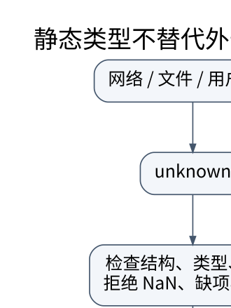

# 联合、收窄与运行时验证：把未知数据变成可信值

> **学习位置**：[[计算机知识/00-开始/课程地图/05-TypeScript-课程地图|TypeScript课程地图]] · **适用边界**：strict 模式；ES2022 运行语义；Node 与浏览器环境区分。



[PNG 备用图](../../../_assets/diagrams/round3/ts-boundary.png) · [可编辑图源](../../../_assets/diagrams/round3/ts-boundary.dot)

## 类型集合的直觉

可以把类型理解为允许值的集合。联合 `A | B` 允许任一集合的值；调用成员前要证明当前值落在支持该操作的部分。`unknown` 表示尚不知道具体能力，必须检查后使用；`any` 则绕过许多检查。`never` 表示在当前模型中不可能到达的值集合，适合检查分支是否穷尽。

```ts
type Result<T> =
  | { kind: 'ok'; value: T }
  | { kind: 'error'; message: string };

function unwrap<T>(r: Result<T>): T {
  switch (r.kind) {
    case 'ok': return r.value;
    case 'error': throw new Error(r.message);
    default: {
      const unreachable: never = r;
      throw new Error(String(unreachable));
    }
  }
}
```

判别字段把合法状态绑定在一起。若以后新增 `kind: 'pending'`，穷尽检查能提醒遗漏处理；若只是给一个对象添加很多可选属性，就难以表达“成功必须有值，失败必须有消息”。

## 外部边界必须实际执行检查

```ts
type Reading = { value: number };

function parseReading(x: unknown): Reading {
  if (typeof x !== 'object' || x === null || Array.isArray(x)) {
    throw new Error('需要对象');
  }
  const record = x as Record<string, unknown>;
  if (Object.keys(record).length !== 1 || !Object.hasOwn(record, 'value')) {
    throw new Error('字段必须恰好为 value');
  }
  const value = record.value;
  if (typeof value !== 'number' || !Number.isInteger(value) ||
      !Number.isFinite(value) || value < 0 || value > 1000) {
    throw new Error('需要 0 到 1000 的整数');
  }
  return { value };
}
```

这里断言只用于在已确认对象之后把属性值作为未知值读取；真正建立信任的是后续检查。例子针对解析后的普通 JSON 对象，不声称能安全检查任意恶意 Proxy 或带副作用 getter 的对象。返回新对象也避免把所有外部字段原样带入领域层。`Object.hasOwn` 需要相应 ES2022 运行支持。

## 收窄也有边界

`typeof`、相等比较、`in`、`instanceof` 和判别字段能提供不同证据。`in` 也会看到原型链属性；跨 realm 的 `instanceof` 不一定符合预期；`typeof x === 'object'` 还要排除 null。真值判断会排除 `0`、空串和 false，不能拿它代替“字段存在”。

用户自定义类型谓词 `x is User` 是开发者向检查器作出的承诺。即使函数始终返回 true，类型检查器也不自动证明内部检查正确。因此谓词和断言函数本身必须有反例测试。对象可变且存在别名时，之前检查过的属性之后可能变化；跨异步边界更应避免假设状态永久有效。

## 可选字段与缺失并非同义

开启 `exactOptionalPropertyTypes` 后，`x?: number` 更明确地区分“没有这个属性”与“属性存在但值为 undefined”，除非类型显式包含 undefined。该选项不由 `strict` 自动包含。`noUncheckedIndexedAccess` 也需单独开启，使一般索引读取暴露可能缺失的情况。编译严格程度要看完整配置，不是只看项目是否用了 TypeScript。

## 练习与答案

分别输入 null、数组、`{value: NaN}`、`{value: '3'}`、`{value: 3, admin: true}` 和 `{value: 0}`；本合同只接受最后一个。再修改合同允许未知字段，说明为何不能顺便信任未知字段里的权限标志。把 `Result` 增加第三分支并运行类型检查，穷尽检查必须报错；这项测试验证的是协议演化，而不仅是当前输出。


<!-- ROUND4 DEPTH LINKS -->
## 继续推演本页难点

[[计算机知识/10-编程语言/05-TypeScript/10-系统课程/10-运行时边界状态机与取消安全|声明成某个类型，为什么不能让网络数据自动可信？]] 本专题补上静态类型结果与运行时行为的分别验证。

这不是替换本页：先掌握原理，再用补充页核对容易被一句话略过的条件。
<!-- END ROUND4 DEPTH LINKS -->

## 关联阅读

- [[计算机知识/10-编程语言/01-Python/10-系统课程/07-类型协议数据边界与安全|类型、协议与数据边界：静态说明不能代替运行时验证]]
- [[计算机知识/10-编程语言/05-TypeScript/10-系统课程/03-泛型方差与API设计|泛型、方差与 API 设计：保留输入和输出的关系]]
- [[计算机知识/55-数据库/10-系统课程/08-数据库工程安全与扩展专题|数据库工程全景：迁移、安全、分析与综合项目]]

## 依据与继续查证

- [TypeScript Handbook](https://www.typescriptlang.org/docs/handbook/intro.html)
- [TypeScript TSConfig](https://www.typescriptlang.org/tsconfig/)
- [ECMAScript 2024（固定语言参考）](https://tc39.es/ecma262/2024/)

本页的例子、推演与练习为教学构造；语言契约、系统接口和版本相关结论应结合以上原始文档核对。

<!-- COURSE SEQUENCE -->
## 顺序导航与验证

[[计算机知识/10-编程语言/05-TypeScript/10-系统课程/00-TypeScript系统课程索引|本课程总索引]] · [[计算机知识/_labs/round3/TS/TypeScript-实验说明|本课程实验]]

上一讲：[[计算机知识/10-编程语言/05-TypeScript/10-系统课程/01-JavaScript语义与类型边界|JavaScript 运行语义与 TypeScript 类型边界]]

下一讲：[[计算机知识/10-编程语言/05-TypeScript/10-系统课程/03-泛型方差与API设计|泛型、方差与 API 设计：保留输入和输出的关系]]
<!-- END COURSE SEQUENCE -->
