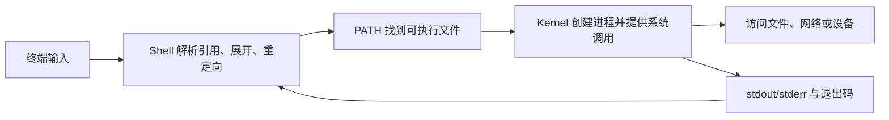

# Linux 基础 · MOC

<!-- ROUND3 NAV START -->
> [!info] 深化课程入口
> [[计算机知识/00-开始/课程地图/13-Linux-课程地图|Linux课程]]。原专题与实验在下方继续保留。
<!-- ROUND3 NAV END -->

Linux 学习不应退化成命令背诵。命令只是观察和改变系统状态的接口；真正可迁移的是对“启动、进程、文件、权限、设备、网络和软件包分别由谁管理”的理解。

> [!abstract] 学完后的能力
> 你将能画出 Linux 从固件到用户程序的分层，解释 kernel、systemd、shell 和发行版包管理器的职责；能安全操作文件、权限、进程、环境变量和服务；能按证据排错，并在虚拟机中完成一次有回退点的 Arch Linux 安装。

## 先记住四条安全规则

1. **先确认对象，再执行写操作**：路径、设备名、挂载点、分区和服务名称都不能靠示例猜测。
2. **先用只读命令收集证据**：`lsblk`、`findmnt`、`systemctl status`、`journalctl`、`ip` 通常先于修改命令。
3. **root 不是学习模式**：只有单条操作确实需要特权时才使用 `sudo`。
4. **Arch 安装先在虚拟机练习**：分区、格式化和 bootloader 错误会造成真实数据损失。

## 学习路线

| 顺序 | 课程 | 重点 | 完成后你能…… |
| --- | --- | --- | --- |
| 1 | [[计算机知识/20-操作系统/01-Linux/01-计算机系统与Linux分层\|计算机系统与 Linux 分层]] | 硬件、kernel、用户空间、系统调用 | 说清 Linux、发行版与用户程序的边界 |
| 2 | [[计算机知识/20-操作系统/01-Linux/02-启动链Kernel与systemd\|启动链、Kernel 与 systemd]] | UEFI、bootloader、kernel、initramfs、PID 1 | 追踪从开机到服务就绪的链条 |
| 3 | [[计算机知识/20-操作系统/01-Linux/03-目录结构挂载与文件系统\|目录结构、挂载与文件系统]] | FHS、inode、块设备、分区、文件系统、挂载 | 判断路径位于哪个文件系统和设备 |
| 4 | [[计算机知识/20-操作系统/01-Linux/04-Shell命令行与帮助系统\|Shell、命令行与帮助系统]] | terminal/shell/command、引用、管道、重定向 | 读懂命令并自己查帮助 |
| 5 | [[计算机知识/20-操作系统/01-Linux/05-文件目录与文本处理命令\|文件、目录与文本处理命令]] | 路径、复制移动、查找、过滤、归档 | 在临时目录安全组合常用命令 |
| 6 | [[计算机知识/20-操作系统/01-Linux/06-用户权限进程与作业控制\|用户、权限、进程与作业控制]] | UID/GID、rwx、信号、前后台、sudo | 解释访问失败与进程生命周期 |
| 7 | [[计算机知识/20-操作系统/01-Linux/07-环境变量Shell启动与PATH\|环境变量、Shell 启动与 PATH]] | `echo`、`printf`、`export`、继承、启动文件 | 判断变量何时生效、为何没有生效 |
| 8 | [[计算机知识/20-操作系统/01-Linux/08-pacman-apt-dnf与yum包管理\|pacman、apt、dnf 与 yum]] | 仓库、元数据、签名、事务、升级策略 | 不再混用不同发行版的包管理命令 |
| 9 | [[计算机知识/20-操作系统/01-Linux/09-设备驱动内核模块与udev\|设备驱动、内核模块与 udev]] | driver/module/firmware/device node | 沿设备链定位驱动问题 |
| 10 | [[计算机知识/20-操作系统/01-Linux/10-网络存储日志与故障排查\|网络、存储、日志与故障排查]] | IP/route/DNS/socket、块设备、journal | 按层收集证据，而不是随机改配置 |
| 11 | [[计算机知识/20-操作系统/01-Linux/11-ArchLinux安装前规划\|Arch Linux 安装前规划]] | UEFI、磁盘、分区、备份、ISO 验证 | 写出针对自己环境的安装计划 |
| 12 | [[计算机知识/20-操作系统/01-Linux/12-ArchLinux安装实战\|Arch Linux 安装实战]] | live ISO、mount、pacstrap、chroot、boot | 在虚拟机完成手动安装并逐阶段验收 |
| 13 | [[计算机知识/20-操作系统/01-Linux/13-ArchLinux安装后配置维护与安全\|安装后配置、维护与安全]] | 用户、网络、驱动、升级、AUR、备份、恢复 | 让系统可维护，而不是“能启动就结束” |
| 14 | [[计算机知识/20-操作系统/01-Linux/14-Linux开发容器与AI工作负载边界\|Linux 开发、容器与 AI 工作负载边界]] | 原生进程、容器、VM、cgroup、工具链与 GPU | 选择恰当的隔离层，并为开发或 AI 任务收集正确证据 |

> [!tip] 第一遍不必记住每个选项
> 先抓住每一层“由谁负责、用什么只读命令观察、改错后怎样恢复”。命令参数、目录清单和发行版差异可以随用随查；第 11—13 课包含写盘与系统配置操作，只在完成 01—10 后进入，并优先使用可回滚的虚拟机。

## 三条阅读路线

### 日常命令行路线

阅读 `01 → 03 → 04 → 05 → 06 → 07`，然后进入 [[计算机知识/80-实践/02-Linux/01-安全命令行练习|安全命令行练习]]。不需要先安装 Arch。

### 系统与排错路线

阅读 `01 → 02 → 03 → 06 → 09 → 10`，再完成 [[计算机知识/80-实践/02-Linux/02-系统观察与故障定位|系统观察与故障定位]]。

### Arch Linux 安装路线

必须先完成 `01—10` 的核心概念，再按 `11 → 12 → 13` 进入 [[计算机知识/80-实践/02-Linux/03-Arch虚拟机安装检查单|Arch 虚拟机安装检查单]]。执行当天重新阅读 [Arch 官方 Installation guide](https://wiki.archlinux.org/title/Installation_guide)，不要只依赖本 Vault 的快照。

### 开发、容器与 AI 工作负载路线

先读 `01 → 03 → 06 → 07 → 09 → 10`，然后进入 [[计算机知识/20-操作系统/01-Linux/14-Linux开发容器与AI工作负载边界|Linux 开发、容器与 AI 工作负载边界]]。它把 Python 环境、C++ 工具链、CUDA 驱动链、容器和 AI 推理服务放在同一张边界图里：它们相互配合，但谁也不能替代内核、驱动、包管理器、权限控制或备份。

## 一次命令执行发生了什么

遇到问题时，先判断故障位于哪一层：

- shell 没有按预期解析？
- PATH 没找到命令？
- 权限拒绝了访问？
- 服务没有启动或配置无效？
- kernel 没识别设备或缺 firmware？
- 网络地址、路由、DNS 或远端服务哪一层失败？

## 关键概念横向链接

| 概念 | 定义与观察 | 实际应用 |
| --- | --- | --- |
| Kernel / 用户空间 | [[计算机知识/20-操作系统/01-Linux/01-计算机系统与Linux分层\|系统分层]] | [[计算机知识/20-操作系统/01-Linux/02-启动链Kernel与systemd\|启动链]]、[[计算机知识/20-操作系统/01-Linux/09-设备驱动内核模块与udev\|驱动与模块]] |
| 文件 / 设备 / 挂载 | [[计算机知识/20-操作系统/01-Linux/03-目录结构挂载与文件系统\|目录与文件系统]] | [[计算机知识/30-计算机系统/12-VFS文件描述符Inode目录与路径解析\|VFS、FD、inode 与路径解析]]、[[计算机知识/30-计算机系统/13-文件系统布局日志CoW与一致性\|日志、CoW 与一致性]]、[[计算机知识/20-操作系统/01-Linux/10-网络存储日志与故障排查\|存储排错]] |
| 进程 / 服务 / 作业 | [[计算机知识/20-操作系统/01-Linux/06-用户权限进程与作业控制\|进程与作业]] | [[计算机知识/20-操作系统/01-Linux/02-启动链Kernel与systemd\|systemd 服务]]、[[计算机知识/20-操作系统/01-Linux/10-网络存储日志与故障排查\|日志证据]] |
| Shell 变量 / 环境变量 | [[计算机知识/20-操作系统/01-Linux/04-Shell命令行与帮助系统\|Shell 解析]] | [[计算机知识/20-操作系统/01-Linux/07-环境变量Shell启动与PATH\|echo、export 与 PATH]] |
| 发行版包 / Python 包 | [[计算机知识/20-操作系统/01-Linux/08-pacman-apt-dnf与yum包管理\|系统包管理]] | [[计算机知识/10-编程语言/01-Python/08-pip与PyPI依赖管理\|pip 与 PyPI]]、[[计算机知识/10-编程语言/01-Python/12-包管理器选择锁定与迁移\|工具职责矩阵]] |
| 配置变更 / 恢复 | [[计算机知识/20-操作系统/01-Linux/10-网络存储日志与故障排查\|最小变更排错]] | [[计算机知识/20-操作系统/01-Linux/13-ArchLinux安装后配置维护与安全\|维护、备份与恢复]] |
| 开发与 AI 工作负载 | [[计算机知识/20-操作系统/01-Linux/14-Linux开发容器与AI工作负载边界\|容器、cgroup 与证据链]] | [[计算机知识/10-编程语言/01-Python/09-venv与虚拟环境原理\|Python venv]]、[[计算机知识/10-编程语言/02-C++/01-编译链接与CMake\|C++ 工具链]]、[[计算机知识/40-并行与异构计算/01-CUDA/02-CUDA软件栈与Linux部署边界\|CUDA Linux 部署]]、[[AI/20-LLM/40-推理/04-推理显存量化与硬件路线\|AI 推理硬件路线]] |

## 包管理命令先看发行版

| 系列 | 低层格式/工具 | 常用高层入口 | 重要边界 |
| --- | --- | --- | --- |
| Arch Linux | Arch package / libalpm | `pacman` | 官方不支持 partial upgrade；AUR 不是官方仓库 |
| Debian / Ubuntu | `.deb` / `dpkg` | `apt` | `apt update` 更新元数据，`apt upgrade` 才处理升级 |
| Fedora / RHEL 系 | `.rpm` / RPM | `dnf` | `yum` 的含义随发行版代际变化，现场查官方文档 |
| Python 项目 | wheel/sdist | pip、uv 或 Conda 组合 | 不能替代发行版内核、驱动和系统服务管理 |

详细命令、缓存与恢复边界见 [[计算机知识/20-操作系统/01-Linux/08-pacman-apt-dnf与yum包管理|包管理课程]]。

## 配套实践与参考

- [[计算机知识/80-实践/02-Linux/00-Linux实验室|Linux 实验室]]；
- [[计算机知识/80-实践/02-Linux/01-安全命令行练习|安全命令行练习]]；
- [[计算机知识/80-实践/02-Linux/02-系统观察与故障定位|系统观察与故障定位]]；
- [[计算机知识/80-实践/02-Linux/03-Arch虚拟机安装检查单|Arch 虚拟机安装检查单]]；
- [[计算机知识/80-实践/06-计算机系统/05-文件系统原子替换与fsync/README|文件系统原子替换与 fsync 实验]]；
- [[计算机知识/90-资源/02-Linux目录与命令速查|Linux 目录与命令速查]]；
- [[计算机知识/90-资源/04-计算机系统与Linux术语表|计算机系统与 Linux 术语表]]。

## 完成标准

- [ ] 我能区分固件、bootloader、kernel、initramfs、systemd、shell 和应用。
- [ ] 我能解释绝对路径、挂载点、设备、分区和文件系统的关系。
- [ ] 我会使用帮助系统，而不是只收藏命令片段。
- [ ] 我能说明文件与目录的 `rwx` 为什么不同。
- [ ] 我能解释 `echo` 与 `printf`、shell variable 与 `export` 后环境变量的区别。
- [ ] 我不会在 Arch、Debian 和 Fedora 之间混用包管理命令。
- [ ] 我会从状态和日志收集证据，再进行一项可回退的小变更。
- [ ] 我只在完成备份和设备核对后执行分区或格式化，并已先在虚拟机练习。

---

**上一站**：[[计算机知识/20-操作系统/00-操作系统-MOC|操作系统 MOC]] · **下一站**：[[计算机知识/20-操作系统/01-Linux/01-计算机系统与Linux分层|计算机系统与 Linux 分层]] · **实验区**：[[计算机知识/80-实践/02-Linux/00-Linux实验室|Linux 实验室]]

<!-- revision-2-navigation -->
## 本轮课程定位与机制补充

课程顺序与原稿入口：[[计算机知识/00-开始/课程地图/13-Linux-课程地图|Linux · 课程地图]]。进一步的机制推演与反例：[[计算机知识/20-操作系统/01-Linux/15-Shell文件进程与可靠脚本边界|Linux 深化：Shell、文件和可靠脚本的边界]]。跨学科辨析：[[计算机知识/90-资源/11-跨学科概念辨析|跨学科概念辨析]]。
