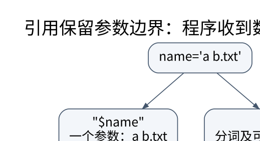

# Shell 不是字符串拼接器：展开、引用与失败处理

> **学习位置**：[[计算机知识/00-开始/课程地图/13-Linux-课程地图|Linux课程地图]] · **适用边界**：GNU/Linux；Bash 与 systemd 示例单独标明，命令先审计后执行。



[PNG 备用图](../../../_assets/diagrams/round3/shell-argv.png) · [可编辑图源](../../../_assets/diagrams/round3/shell-argv.dot)

## 命令行首先由 Shell 解释

输入命令后，Shell 进行语法分析及相应展开，处理重定向，再启动内建命令或外部程序。程序收到的是参数数组，不是用户原样输入的一整行字符串。空格、引号、通配符和 `$` 首先可能属于 Shell 的语法，而不是传给命令的普通字符。

单引号保护其中的字面内容；双引号仍允许参数与命令等特定展开，但通常抑制分词和路径名展开。变量中存着 `*.txt`，未引用使用时可能被再次分词并扩成文件列表；`"$name"` 保留为一个参数。`"$@"` 保留每个位置参数的独立边界，`"$*"` 则把它们拼成一个字符串，两者不能随意替换。

## 一个可复现的空格反例

```bash
name='a b.txt'
printf '<%s>\n' "$name"   # 一个参数：a b.txt
printf '<%s>\n' $name     # 通常分成两个参数；还可能发生通配符展开
```

不要用拼接字符串再 eval 来构造命令。Bash 数组能表达参数边界：

```bash
args=(--mode safe --input "$name")
printf '<%s>\n' "${args[@]}"
```

这里 printf 只演示参数，不执行外部修改操作。处理任意文件名时要考虑空格、换行和前导短横线；适用命令的 `--` 用来结束选项解析，NUL 分隔避免用换行冒充文件名边界。

## 重定向顺序是在修改描述符

`cmd >out 2>&1` 先让标准输出指向 out，再让标准错误复制该去向；`cmd 2>&1 >out` 先让标准错误复制旧标准输出，再改变标准输出，所以结果不同。管道连接字节流，不自动传递结构化对象。

`$(...)` 命令替换会去掉尾部换行，因此不适合无条件保存任意二进制或要求保留所有末尾换行的数据。子 Shell 中修改变量或目录通常不影响父 Shell；管道中某段是否运行在子 Shell 还与实现和选项有关，不应跨 Shell 假定行为完全一致。

## `set -e` 不是异常处理系统

`set -u` 检查某些未设置变量使用，`pipefail` 改变管道状态的选择，`set -e` 在特定失败情境退出，但有条件测试、列表和函数调用等上下文例外。关键操作应显式检查：

```bash
if ! cp -- "$src" "$dst"; then
    printf '%s\n' 'copy failed' >&2
    exit 1
fi
```

这只在 src/dst 已定义并已审查路径时使用。不要因为加了三行“严格模式”就认为删除、覆盖或权限操作已经安全。

## 临时文件和清理

使用 mktemp 创建独占临时位置，避免固定名称与竞态。trap 负责正常退出及可捕获信号后的清理，但不能保证 SIGKILL 或断电时执行。临时目录必须由脚本自己创建并保存其确切路径，清理不能对未经验证的空变量或用户路径递归删除。

Shell 适合协调命令；复杂数据结构、并发协议与大量错误分支往往更适合 Python 等语言。决定迁移的依据是可读性和可验证性，不是脚本长度的神秘阈值。

**练习**：为什么 `for f in $(ls)` 不适合遍历任意文件？命令替换、分词和通配符会破坏原文件名边界，还依赖 ls 的面向展示输出。使用合适的 glob、find 的 NUL 输出或其他保持边界的接口，并明确未匹配时的行为。

## 关联阅读

- [[计算机知识/20-操作系统/01-Linux/10-系统课程/02-文件描述符管道与进程控制|Linux 进程与文件描述符：用小实验理解共享状态]]
- [[计算机知识/10-编程语言/01-Python/10-系统课程/08-标准库工程与扩展全景|标准库、工程与扩展全景：从脚本走向可维护工具]]

## 依据与继续查证

- [GNU Bash Reference Manual](https://www.gnu.org/software/bash/manual/bash.html)
- [Linux man-pages](https://man7.org/linux/man-pages/)
- [systemd 官方手册入口](https://www.freedesktop.org/software/systemd/man/latest/)

本页的例子、推演与练习为教学构造；语言契约、系统接口和版本相关结论应结合以上原始文档核对。

<!-- COURSE SEQUENCE -->
## 顺序导航与验证

[[计算机知识/20-操作系统/01-Linux/10-系统课程/00-Linux系统课程索引|本课程总索引]] · [[计算机知识/_labs/round3/LINUX/Linux-实验说明|本课程实验]]

下一讲：[[计算机知识/20-操作系统/01-Linux/10-系统课程/02-文件描述符管道与进程控制|Linux 进程与文件描述符：用小实验理解共享状态]]
<!-- END COURSE SEQUENCE -->

<!-- ORIGINAL DEEP LINKS -->
## 与原有长篇专题衔接

- [[计算机知识/20-操作系统/01-Linux/15-Shell文件进程与可靠脚本边界|15-Shell文件进程与可靠脚本边界]]
- [[计算机知识/20-操作系统/01-Linux/07-环境变量Shell启动与PATH|07-环境变量Shell启动与PATH]]

新旧讲解采用的版本与模型可能不同，比较时先核对各自前提，不把教学简化当成实现细节。
<!-- END ORIGINAL DEEP LINKS -->
