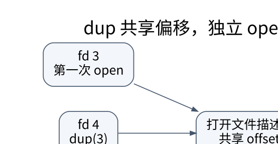

# Linux 进程与文件描述符：用小实验理解共享状态

> **学习位置**：[[计算机知识/00-开始/课程地图/13-Linux-课程地图|Linux课程地图]] · **适用边界**：GNU/Linux；Bash 与 systemd 示例单独标明，命令先审计后执行。



[PNG 备用图](../../../_assets/diagrams/round3/linux-fd.png) · [可编辑图源](../../../_assets/diagrams/round3/linux-fd.dot)

## 路径、inode、打开文件描述与 fd

路径是命名查找入口；inode 表示文件对象的元数据及相关存储信息；一次 open 创建或取得打开文件描述，记录偏移和状态标志等；进程 fd 表中的整数指向该打开文件描述。dup 复制描述符引用，fork 后继承的相应描述符也可以共享同一个打开文件描述，因此偏移可能共享。

两次独立 open 同一路径通常得到不同打开文件描述，偏移独立。`FD_CLOEXEC` 属于描述符层，`O_APPEND` 等状态位属于打开文件描述层；把它们混在一起会误判 dup 后的行为。

## 一个只用临时文件的观察

```python
import os, tempfile
with tempfile.TemporaryFile() as f:
    f.write(b"abcdef")
    f.flush()
    f.seek(0)
    other = os.dup(f.fileno())
    try:
        assert os.read(f.fileno(), 2) == b"ab"
        assert os.read(other, 2) == b"cd"  # 偏移共享
    finally:
        os.close(other)
```

实验只在缓冲状态已经同步后使用底层读取；随意交错高级缓冲 I/O 与 os.read 可能引入另一层缓存问题。文件名被 unlink 后，已打开的文件仍可能继续可读，直到相关引用释放；“目录看不到”不等于存储空间马上完全释放。

## 管道 EOF 取决于所有写端

管道是一种内核字节缓冲。读端在缓冲耗尽且**所有**写端引用关闭后才观察到 EOF。父子进程忘记关闭不使用的写端，消费者可能永远等不到结束。向没有读者的管道写入涉及 SIGPIPE/EPIPE，不能只按普通文件处理。

管道缓冲是有限的，大量输出可能阻塞生产者。若父进程先等子进程退出、子进程又因输出管道写满等待父进程读取，会形成实际死锁。应并发消费输出，或使用能正确管理通信的接口，并限制内存。

## fork、exec、wait 与信号

fork 创建新进程，exec 用新程序替换当前进程映像，不创建一个新 PID；wait 回收子进程退出状态。僵尸是已退出但状态尚未被回收的进程，不是仍在运行的“幽灵程序”；孤儿描述父子关系变化，不能与僵尸混称。

信号是异步通知。普通信号可能合并，处理器只能调用适合该上下文的接口；不要在 C 信号处理器中随意 printf、malloc 或持互斥锁。SIGTERM 提供协作退出机会，SIGKILL 不能被捕获清理。停止、继续、退出与终端作业控制也属于不同状态。

进程组、会话、控制终端和 job control 解释了 Ctrl-C 为什么通常影响前台作业组，而不只是某一个看起来正在运行的程序。nohup、后台运行、服务管理器和终端复用解决的问题不同。

**练习**：一个子进程关闭自己的写端后，为什么另一子进程仍读不到 EOF？检查父进程和所有兄弟进程是否还持有任何写端副本。用“引用计数归零”的对象图思考，比只查看某个进程的 close 调用更可靠。


<!-- ROUND4 DEPTH LINKS -->
## 继续推演本页难点

[[计算机知识/20-操作系统/01-Linux/10-系统课程/09-FD共享epoll与非阻塞状态机|dup 出来的两个 FD 为什么会共享读写位置？]] 本专题补上对象关系、系统调用合同与安全本地实验。

这不是替换本页：先掌握原理，再用补充页核对容易被一句话略过的条件。
<!-- END ROUND4 DEPTH LINKS -->

## 关联阅读

- [[计算机知识/20-操作系统/02-操作系统原理/10-系统课程/02-系统调用IPC与进程生命周期|系统调用、IPC 与进程生命周期：每个句柄背后都有共享关系]]
- [[计算机知识/10-编程语言/03-C语言/10-系统课程/06-输入输出解析与错误模型|输入不是可信整数：stdio、解析器与错误报告]]
- [[计算机知识/35-计算机网络/10-系统课程/07-Socket分帧背压与排障|Socket 工程：分帧、背压、超时和可解释的失败]]

## 依据与继续查证

- [GNU Bash Reference Manual](https://www.gnu.org/software/bash/manual/bash.html)
- [Linux man-pages](https://man7.org/linux/man-pages/)
- [systemd 官方手册入口](https://www.freedesktop.org/software/systemd/man/latest/)

本页的例子、推演与练习为教学构造；语言契约、系统接口和版本相关结论应结合以上原始文档核对。

<!-- COURSE SEQUENCE -->
## 顺序导航与验证

[[计算机知识/20-操作系统/01-Linux/10-系统课程/00-Linux系统课程索引|本课程总索引]] · [[计算机知识/_labs/round3/LINUX/Linux-实验说明|本课程实验]]

上一讲：[[计算机知识/20-操作系统/01-Linux/10-系统课程/01-Shell展开引用与可靠脚本|Shell 不是字符串拼接器：展开、引用与失败处理]]

下一讲：[[计算机知识/20-操作系统/01-Linux/10-系统课程/03-权限身份与最小授权|Linux 权限：文件能不能删，为什么不只看文件写位]]
<!-- END COURSE SEQUENCE -->

<!-- ORIGINAL DEEP LINKS -->
## 与原有长篇专题衔接

- [[计算机知识/20-操作系统/01-Linux/15-Shell文件进程与可靠脚本边界|15-Shell文件进程与可靠脚本边界]]
- [[计算机知识/20-操作系统/01-Linux/06-用户权限进程与作业控制|06-用户权限进程与作业控制]]

新旧讲解采用的版本与模型可能不同，比较时先核对各自前提，不把教学简化当成实现细节。
<!-- END ORIGINAL DEEP LINKS -->
