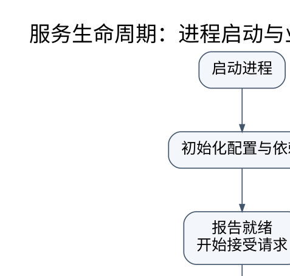

# 启动与服务管理：进程存在，不代表服务已经可用

> **学习位置**：[[计算机知识/00-开始/课程地图/13-Linux-课程地图|Linux课程地图]] · **适用边界**：GNU/Linux；Bash 与 systemd 示例单独标明，命令先审计后执行。



[PNG 备用图](../../../_assets/diagrams/round3/service-lifecycle.png) · [可编辑图源](../../../_assets/diagrams/round3/service-lifecycle.dot)

## 从固件到用户服务

常见启动链包括固件、引导加载器、内核与可选 initramfs、根文件系统和用户空间初始化系统。UEFI/BIOS、加密根盘、网络启动和嵌入式环境会改变具体步骤。Linux 是内核，不保证每个发行版都使用 systemd；容器中 PID 1 也可能是普通应用或专用初始化进程。

PID 1 需要处理其环境中的子进程回收和信号等责任。把传统服务后台化脚本直接放进容器，不一定能得到预期停止与重启行为。

## systemd 的依赖与顺序不是一回事

Requires/Wants 描述依赖拉起及相关关系，After/Before 描述排序。只写 After 不必然把另一个单元一并启动；只写 Wants 也不自动规定两者启动先后。Type=simple/exec/notify/oneshot 等描述启动完成的不同判断，不能把“fork 成功”当成“端口和数据库已准备好”。

以下是说明结构的模板，不自动安装到系统，也不承诺路径已经存在：

```ini
[Unit]
Description=Teaching service
After=network.target

[Service]
Type=exec
ExecStart=/opt/teaching/bin/server --config /etc/teaching/server.conf
User=teaching
Group=teaching
Restart=on-failure
RestartSec=3
NoNewPrivileges=true

[Install]
WantedBy=multi-user.target
```

需要创建相应专用账号、审核权限及依赖，并确认本机 systemd 支持所用选项。ExecStart 不是自动交给 Shell 解析的一段脚本，不能无说明依赖管道、重定向或变量展开。网络 target 的到达也不保证某个远端服务可连接，应用仍需明确重试和启动失败策略。

## 服务生命周期与日志

启动、就绪、存活和健康是不同状态。进程活着但线程池死锁，存活探针可能仍成功；过于激进的健康重启又可能让临时后端故障演变成所有实例反复重启。停止流程应停止接新请求、排空或拒绝在途任务、持久化必要状态，并设置明确总截止时间。

journalctl 等工具可按单元、时间、启动批次和优先级查询；不要只 tail 一个文件就忽略服务重启、权限错误和内核日志。日志要保留请求标识与错误上下文，同时脱敏凭据和用户数据。日志轮转、磁盘配额和保留策略属于可靠性设计。

## 资源约束与故障解释

进程限制、cgroup CPU/内存/进程数控制和系统级资源共同作用。内存压力可能来自应用泄漏、缓存、并发过高或配额过低，OOM 不等于“整台机器没有任何空闲字节”。应检查进程与所属 cgroup 的限额、事件和使用量，再决定优化或调整预算。

timer 与 cron 都能调度任务，但环境、工作目录、错过执行的处理和并发重入策略需要显式定义。脚本在交互终端成功，不代表在精简环境中也成功。

**练习**：After=database.service 是否保证数据库已经能处理 SQL？只能说明相应服务启动顺序在其完成判据下满足；还要核对数据库单元 Type、就绪协议及数据库本身状态。顺序依赖不能代替业务就绪验证。

## 关联阅读

- [[计算机知识/20-操作系统/02-操作系统原理/10-系统课程/01-进程线程与调度推演|进程、线程与调度推演：资源所有者和执行流不是同一件事]]
- [[计算机知识/20-操作系统/01-Linux/10-系统课程/07-性能观测与故障定位|Linux 性能排障：从症状到可证伪的瓶颈假设]]
- [[计算机知识/20-操作系统/01-Linux/10-系统课程/08-安全备份运维与综合实验|Linux 运维全景：把恢复能力当成系统功能]]

## 依据与继续查证

- [GNU Bash Reference Manual](https://www.gnu.org/software/bash/manual/bash.html)
- [Linux man-pages](https://man7.org/linux/man-pages/)
- [systemd 官方手册入口](https://www.freedesktop.org/software/systemd/man/latest/)

本页的例子、推演与练习为教学构造；语言契约、系统接口和版本相关结论应结合以上原始文档核对。

<!-- COURSE SEQUENCE -->
## 顺序导航与验证

[[计算机知识/20-操作系统/01-Linux/10-系统课程/00-Linux系统课程索引|本课程总索引]] · [[计算机知识/_labs/round3/LINUX/Linux-实验说明|本课程实验]]

上一讲：[[计算机知识/20-操作系统/01-Linux/10-系统课程/03-权限身份与最小授权|Linux 权限：文件能不能删，为什么不只看文件写位]]

下一讲：[[计算机知识/20-操作系统/01-Linux/10-系统课程/05-软件管理构建与可复现环境|软件与构建环境：区分安装成功、兼容和可重现]]
<!-- END COURSE SEQUENCE -->

<!-- ORIGINAL DEEP LINKS -->
## 与原有长篇专题衔接

- [[计算机知识/20-操作系统/01-Linux/15-Shell文件进程与可靠脚本边界|15-Shell文件进程与可靠脚本边界]]
- [[计算机知识/20-操作系统/01-Linux/10-网络存储日志与故障排查|10-网络存储日志与故障排查]]

新旧讲解采用的版本与模型可能不同，比较时先核对各自前提，不把教学简化当成实现细节。
<!-- END ORIGINAL DEEP LINKS -->
