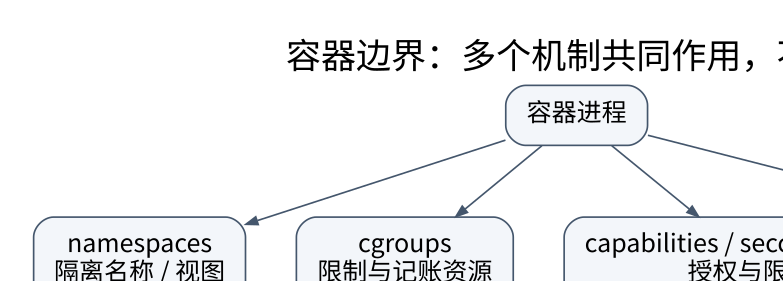

# Linux 网络与容器：把命名隔离和资源限制分开

> **学习位置**：[[计算机知识/00-开始/课程地图/13-Linux-课程地图|Linux课程地图]] · **适用边界**：GNU/Linux；Bash 与 systemd 示例单独标明，命令先审计后执行。

[PNG 备用图](../../../_assets/diagrams/round3/container-boundaries.png) · [可编辑图源](../../../_assets/diagrams/round3/container-boundaries.dot)

## 诊断网络先分清观察位置

同一宿主上的两个进程可能位于不同网络命名空间，看到不同接口、路由和端口。宿主能访问某地址，不证明容器内同样可达。先确认所在命名空间，再观察 `ip address`、`ip route`、`ss` 等只读信息，并记录 DNS 与代理配置。

路由表选择下一跳，邻居表解析链路地址，监听 socket 表示本地端点，防火墙及连接跟踪影响流量通过。每张表回答不同问题，不能以“端口没有占用”解释所有连接超时。

## namespace 与 cgroup 是两根轴

namespace 隔离名称与视图，常见类型涉及 mount、PID、network、IPC、UTS、user、cgroup、time 等，实际支持依内核与配置。cgroup 对一组进程进行资源控制和记账。一个进程可以看不到宿主全部 PID，却仍消耗大量共享 CPU；隐藏名称不等于限制资源。

user namespace 映射身份，使命名空间内部的 root 不必等同于宿主 root；但其安全性仍取决于内核、配置及授予能力。容器不是一个单独系统调用，而是多种机制、文件系统与运行时配置的组合。

## veth、bridge 与端口发布

veth 成对出现，一端发出的数据在另一端接收，常用于连接命名空间与宿主桥。Linux bridge 做二层转发，路由做三层选择，NAT 改写地址/端口。容器“发布端口”可能通过 NAT、代理或其他实现，不能只背一个固定路径。

示意路径：容器应用→容器接口→veth→宿主 bridge/路由与规则→物理接口。实际顺序及 hooks 依配置而变。排障时分别观察每个边界的地址、规则与计数器，避免在所有层同时乱改。

## 挂载与镜像不是万能沙箱

mount namespace 可以改变文件系统可见布局；bind mount 可能把宿主敏感目录重新暴露给容器。只读根文件系统限制一类修改，但可写卷、设备和内核接口仍需控制。把容器运行时 socket 挂入容器，通常会赋予非常强的宿主控制能力，不应当普通日志卷处理。

capabilities、seccomp、MAC 策略、只读挂载、资源限制和非特权身份是互补层。禁用一个 syscall 不自动证明整个攻击面消失；共享内核意味着内核漏洞仍是关键边界。

## 安全实验方式

本包默认不创建需要管理员权限的网络 namespace，不修改宿主防火墙，不拉取镜像或开放公网端口。学习时先用只读命令理解现有环境；创建拓扑的实验应在可丢弃虚拟机内，记录每条创建命令的逆操作，并有独立控制台避免切断自己访问。

**练习**：给容器设置 256 MiB 内存限制，是否等于它拥有一台独立的 256 MiB 计算机？不是。它仍共享内核和许多系统资源，内存记账、缓存、交换及 OOM 行为按 cgroup 和内核规则执行；虚拟机与容器的隔离模型不同。

## 关联阅读

- [[计算机知识/20-操作系统/02-操作系统原理/10-系统课程/08-虚拟化实时系统与安全|虚拟化、实时系统与安全：通用平均性能之外的约束]]
- [[计算机知识/35-计算机网络/10-系统课程/03-IP编址路由与IPv6|IP 编址与路由：从掩码计算到控制平面]]
- [[计算机知识/20-操作系统/01-Linux/10-系统课程/03-权限身份与最小授权|Linux 权限：文件能不能删，为什么不只看文件写位]]

## 依据与继续查证

- [GNU Bash Reference Manual](https://www.gnu.org/software/bash/manual/bash.html)
- [Linux man-pages](https://man7.org/linux/man-pages/)
- [systemd 官方手册入口](https://www.freedesktop.org/software/systemd/man/latest/)

本页的例子、推演与练习为教学构造；语言契约、系统接口和版本相关结论应结合以上原始文档核对。

<!-- COURSE SEQUENCE -->
## 顺序导航与验证

[[计算机知识/20-操作系统/01-Linux/10-系统课程/00-Linux系统课程索引|本课程总索引]] · [[计算机知识/_labs/round3/LINUX/Linux-实验说明|本课程实验]]

上一讲：[[计算机知识/20-操作系统/01-Linux/10-系统课程/05-软件管理构建与可复现环境|软件与构建环境：区分安装成功、兼容和可重现]]

下一讲：[[计算机知识/20-操作系统/01-Linux/10-系统课程/07-性能观测与故障定位|Linux 性能排障：从症状到可证伪的瓶颈假设]]
<!-- END COURSE SEQUENCE -->

<!-- ORIGINAL DEEP LINKS -->
## 与原有长篇专题衔接

- [[计算机知识/20-操作系统/01-Linux/10-网络存储日志与故障排查|10-网络存储日志与故障排查]]

新旧讲解采用的版本与模型可能不同，比较时先核对各自前提，不把教学简化当成实现细节。
<!-- END ORIGINAL DEEP LINKS -->
