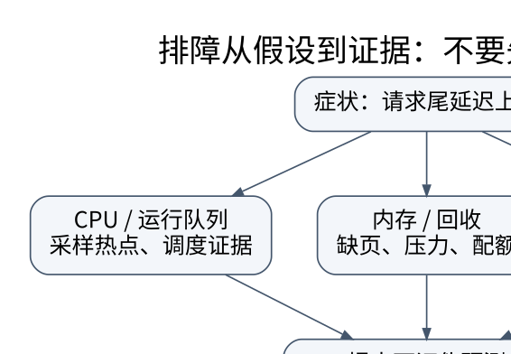

# Linux 性能排障：从症状到可证伪的瓶颈假设

> **学习位置**：[[计算机知识/00-开始/课程地图/13-Linux-课程地图|Linux课程地图]] · **适用边界**：GNU/Linux；Bash 与 systemd 示例单独标明，命令先审计后执行。

[PNG 备用图](../../../_assets/diagrams/round3/diagnosis-tree.png) · [可编辑图源](../../../_assets/diagrams/round3/diagnosis-tree.dot)

## 不从命令清单开始，从问题边界开始

先写清“什么变慢、何时开始、影响谁、与什么基线比较”。请求延迟高可能来自 CPU、运行队列、锁、内存回收、磁盘、网络或外部依赖；CPU 使用率低不等于机器空闲，因为进程可能都在等锁或 I/O。

把延迟拆成排队与服务，把吞吐、错误率、饱和度与资源使用同时记录。平均值掩盖尾延迟，短采样可能遗漏周期性尖峰；跨机器对齐日志要考虑时钟误差。

## CPU 与调度证据

用户态时间、内核态时间、等待与 steal 等指标需要按工具定义解释。load average 不等于 CPU 百分比，在 Linux 上还涉及特定不可中断睡眠任务。高 load、低 CPU 可能指向 I/O 等待，但还需进程状态与阻塞栈等证据，不能只凭两列数值定案。

perf 采样可定位热点，火焰图宽度通常代表样本占比，不是时间从左到右的执行轨迹。采样频率、权限、符号信息、内联和栈展开质量影响结果。硬件计数器测得的缓存失效、分支失误与 IPC 要结合微架构和工作负载，不做跨机器无条件比较。

## 内存与存储证据

VSZ 表示虚拟地址空间规模，RSS 表示驻留页的某种统计，PSS 分摊共享页；三者不等同于“这个进程独占的所有物理内存”。文件缓存可以是有益利用，free 很低并不自动意味着泄漏。观察回收、缺页、swap、内存压力与 cgroup 事件，再判断是否过度承诺。

iostat 等工具的吞吐、队列、延迟与利用率不能脱离设备并行能力解释。文件系统空间用尽与 inode 用尽是不同问题，已删除但仍打开的文件可能解释 df 与 du 的差异。强制清缓存会扰动生产系统，不应作为诊断第一步。

## 系统调用与网络证据

strace 观察系统调用和信号，可以揭示反复重试、短读写或卡在某接口，但跟踪有开销，看到系统调用耗时不代表所有时间都在内核执行。ss、连接计数、重传和应用日志帮助区分建连、传输与服务处理问题。

eBPF 提供更灵活的内核观测能力，但程序、权限、内核兼容和数据敏感性都要审查。观测工具本身也消耗资源，不能把采样后的系统完全当成未被扰动的原系统。

## 用实验排除混淆

假设“接口变慢是数据库连接池太小”。预测：高延迟时等待连接时间上升，数据库执行本身变化不大。收集分阶段时间后，如果主要变慢在查询执行或锁等待，便应拒绝最初假设。直接调大连接池可能把排队从应用搬到数据库，甚至恶化。

一次只改变一个主要因素，保留回滚点，重复测量并报告分布。基准要覆盖实际数据大小、并发和缓存状态；微基准上的 20% 加速不直接等于整站快 20%。

**练习**：CPU 热点占总时间 10%，即使优化到零，端到端最多快多少？Amdahl 上界为 $1/(1-0.1)=1.111\ldots$，约 11.1% 加速；若这部分不在目标请求关键路径上，收益还可能更小。

<!-- ROUND4 DEPTH LINKS -->
## 继续推演本页难点

[[计算机知识/20-操作系统/01-Linux/10-系统课程/09-FD共享epoll与非阻塞状态机|dup 出来的两个 FD 为什么会共享读写位置？]] 本专题补上对象关系、系统调用合同与安全本地实验。

这不是替换本页：先掌握原理，再用补充页核对容易被一句话略过的条件。
<!-- END ROUND4 DEPTH LINKS -->

## 关联阅读

- [[计算机知识/30-计算机系统/10-组成原理系统课程/07-一致性内存序NUMA与性能|一致性、内存序、NUMA 与性能：共享内存不是瞬时广播]]
- [[计算机知识/10-编程语言/01-Python/10-系统课程/06-测试属性验证与性能方法|测试、属性验证与性能方法：把结论变成可反驳的实验]]
- [[计算机知识/35-计算机网络/10-系统课程/07-Socket分帧背压与排障|Socket 工程：分帧、背压、超时和可解释的失败]]

## 依据与继续查证

- [GNU Bash Reference Manual](https://www.gnu.org/software/bash/manual/bash.html)
- [Linux man-pages](https://man7.org/linux/man-pages/)
- [systemd 官方手册入口](https://www.freedesktop.org/software/systemd/man/latest/)

本页的例子、推演与练习为教学构造；语言契约、系统接口和版本相关结论应结合以上原始文档核对。

<!-- COURSE SEQUENCE -->
## 顺序导航与验证

[[计算机知识/20-操作系统/01-Linux/10-系统课程/00-Linux系统课程索引|本课程总索引]] · [[计算机知识/_labs/round3/LINUX/Linux-实验说明|本课程实验]]

上一讲：[[计算机知识/20-操作系统/01-Linux/10-系统课程/06-网络命名空间容器与隔离|Linux 网络与容器：把命名隔离和资源限制分开]]

下一讲：[[计算机知识/20-操作系统/01-Linux/10-系统课程/08-安全备份运维与综合实验|Linux 运维全景：把恢复能力当成系统功能]]
<!-- END COURSE SEQUENCE -->
