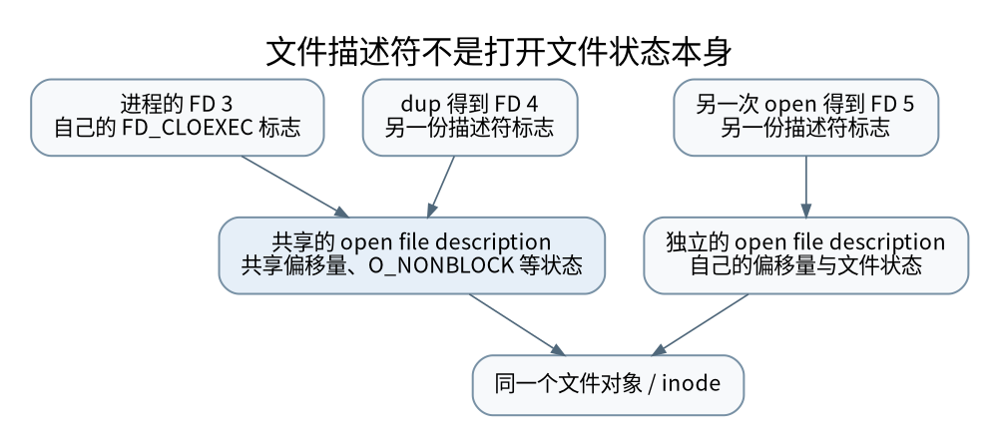

# 从 FD 到事件循环：共享偏移、epoll 与非阻塞状态机

> **本页要解决**：dup 出来的两个 FD 为什么会共享读写位置？
>
> **先修**：[[计算机知识/20-操作系统/01-Linux/10-系统课程/02-文件描述符管道与进程控制|Linux 进程与文件描述符：用小实验理解共享状态]]；[[计算机知识/20-操作系统/01-Linux/10-系统课程/07-性能观测与故障定位|Linux 性能排障：从症状到可证伪的瓶颈假设]]。
>
> **阅读入口**：[[计算机知识/20-操作系统/01-Linux/10-系统课程/00-Linux系统课程索引|本学科主索引]] · [[计算机知识/00-开始/全局导航/11-难点导读与研究证据|全局难点导读]]。

**版本、模型与证据边界**：安全本地实验使用临时文件、管道与无特权操作；路径、内核接口和 shell 的条件分别声明。

## 先分开三个对象：路径、FD、打开文件描述

路径是一次名称解析的输入；文件描述符（FD）是进程表中的小整数索引；打开文件描述（open file description，OFD）则保存一次打开所关联的偏移和文件状态。两个 FD 数字不同，不代表它们具有独立偏移；对这里的普通文件，两次成功的独立 `open` 会创建不同的 OFD，各自维护偏移。文件内容仍是同一个对象；偏移独立不等于复制了文件。[^open]

```text
fd1 = open("data", O_RDONLY)   → OFD-A，偏移 0
fd2 = dup(fd1)                 → 同一个 OFD-A
fd3 = open("data", O_RDONLY)   → 新的 OFD-B，偏移 0
read(fd1, 2)                   → OFD-A 偏移成为 2
read(fd2, 2)                   → 从位置 2 继续，而非从 0 开始
read(fd3, 2)                   → 仍从位置 0 开始
```

把上一讲临时文件中的 `abcdef` 代入这个序列，就能区分“复制引用”与“重新打开”。以下只跟踪成功的普通文件调用，期间没有其他读写者；一次读取两字节，初始偏移为 0。`fd1`、`fd2`、`fd3` 是变量名，实际返回的整数不要求固定。

| 已完成的操作 | 当前 FD 指向 | OFD-A 的下一读取位置 | OFD-B 的下一读取位置 | 本次读到的字节 |
| --- | --- | ---: | ---: | --- |
| 两次 `open` 与一次 `dup` | `fd1,fd2 → A`；`fd3 → B` | 0 | 0 | — |
| `read(fd1, 2)` | 同上 | 2 | 0 | `ab` |
| `read(fd2, 2)` | 同上 | 4 | 0 | `cd` |
| `read(fd3, 2)` | 同上 | 4 | 2 | `ab` |
| `close(fd1)` | `fd2 → A`；`fd3 → B` | 4 | 2 | — |
| `read(fd2, 2)` | 同上 | 6 | 2 | `ef` |

`dup` 新建的是当前进程 FD 表中的一项，指向已有 OFD，不创建第二个偏移；`close(fd1)` 则删除这一项引用，不把 A 的偏移重置为 0，也不关闭 `fd2`。因此表末的 `ef` 是前面共享偏移的继续。关闭 A 的最后一个相关引用后，才释放这份打开状态。[^dup]

这张表前四行对应既有 [偏移与标志测试](../../../_labs/round4/test_systems.py) 中的 `test_dup_offset_and_fd_flags`；上一讲的 [[计算机知识/20-操作系统/01-Linux/10-系统课程/02-文件描述符管道与进程控制#一个只用临时文件的观察|临时文件观察]] 只用一个 `dup`，得到 `ab`、`cd`。后两行是沿同一接口合同的教学推演，本轮没有重新运行这些程序；高级缓冲 I/O 与底层读取交错时仍需先同步缓冲状态。



[矢量图](../../../_assets/diagrams/round4/fd-sharing.svg) · [可编辑图源](../../../_assets/diagrams/round4/fd-sharing.dot)

如果在 A 的偏移为 4、尚未 `close(fd1)` 时 `fork`，子进程继承的 `fd1`、`fd2` 也指向 A；父子进程各有自己的 FD 表，共享的是这份打开状态。假定随后只有子进程通过 `fd2` 读两字节，它得到 `ef`，父进程再读取也要从偏移 6 开始；若父子并发读取，谁先拿到哪段字节取决于调用顺序，不能保证某个进程一定读到 `ef`。父进程关闭 `fd1`、`fd2` 后，子进程的对应引用仍可存活。[^fork]

标志也按这两层归属判断：`fcntl(fd, F_GETFL/F_SETFL)` 查看或修改文件状态标志，例如 `O_NONBLOCK`；`fcntl(fd, F_GETFD/F_SETFD)` 查看或修改描述符标志，例如 `FD_CLOEXEC`。通过 `fd1` 修改 A 的 `O_NONBLOCK`，共享 A 的 `fd2` 及 fork 继承者也看到变化，独立打开的 `fd3` 不跟着变；只修改 `fd1` 的 `FD_CLOEXEC`，则不修改其他 FD 项。`FD_CLOEXEC` 指成功 `exec` 时关闭该项，不禁止 `fork` 继承它。[^fcntl]

原始 `dup` 创建的新 FD 的 `FD_CLOEXEC` 为关闭状态；Python 等运行时可能主动设置“新 FD 不可继承”，不能把包装库策略误当原始调用默认值。普通文件上设置 `O_NONBLOCK` 也不承诺读写一定不会阻塞；下面的非阻塞解释针对支持该语义的管道或流式连接。[^dup][^open]

关闭 `fd1` 不必销毁对象，`fd2` 仍可能持有引用。已经打开的文件在路径被替换后仍可读原对象，名称和对象生命周期因此必须分别跟踪，见 [[计算机知识/20-操作系统/01-Linux/10-系统课程/10-路径解析权限竞态与可靠部署|路径解析与竞态]]。

## 非阻塞不是“永远立即拿到完整消息”

对普通非阻塞流式连接，读调用返回正数表示读到这些字节；返回零通常表示该流方向到达 EOF；`EAGAIN/EWOULDBLOCK` 表示此刻没有可立即读取的数据；`EINTR` 表示操作受到信号中断，需要按接口语义处理。对长度为零的读请求等特殊情况不能用“返回零必为对端关闭”一概解释。

写成功也可能只写入一部分。发送队列必须保存尚未写出的后缀，不能遇到一次短写就丢弃整个消息。应用层还要维护解码缓冲区，处理一条消息分多次读到和多条消息一次读到；TCP 是字节流，参见 [[计算机知识/35-计算机网络/10-系统课程/10-TCP窗口RTO与拥塞控制手算|序号与分帧边界]]。

```text
待发送: abcdef
write 返回 2   → 已发送 ab，剩余 cdef
write 返回 EAGAIN → 保留 cdef，等待可写
下次 write 返回 4 → 本次缓冲区才清空
```

一次 EPOLLOUT 只表示此刻有机会写，并不是内核替你完成了发送；应用成功写进内核缓冲区，也不是对端业务已提交。

## epoll 的边沿通知为什么会让初学者“莫名卡住”

epoll 维护关注对象和就绪信息。LT（电平触发）模式在条件仍成立时可以继续通知；ET（边沿触发）不能让你依赖“缓冲区里还剩数据，所以一定会再来一次通知”。收到可读事件后只读一小段，然后重新等待，可能把已有数据留在缓冲区里却等不到新边沿。[^epoll]

ET 的基本协议是：FD 设为非阻塞；收到可读事件后循环读取，直到 `EAGAIN`，途中累积、解析和保存状态；收到 EOF 或不可恢复错误则进入相应关闭状态。写侧同理。注册 `EPOLLONESHOT` 后，处理者必须适时重新激活，否则它不会自动恢复通知。

“读到 EAGAIN”与公平性也有冲突：一个高速连接一直有数据，可能独占线程。可以设置每轮字节或消息预算，但若预算用完时尚未读空，必须把该连接放进应用自己的待续队列，稍后主动继续处理，不能直接期待另一次内核边沿。这个队列和内核就绪队列是两回事。

LT 下无待发送数据还一直关注 EPOLLOUT，容易形成忙循环。可按发送缓冲区是否为空动态启停可写关注；ET 也有一次注册同时关注读写的工程策略，但仍要维护实际队列状态。不能把某一种注册策略写成所有模式唯一正确用法。

## 事件循环也是资源生命周期管理器

每条连接至少需要：输入解析状态、未完成输出、是否读 EOF、是否仍可写、超时截止时刻、唯一代际标识。FD 数字会被重复利用：旧连接 `fd=7` 关闭后，新连接可能也是 7；队列中尚未处理的旧任务不能因此操作新连接。用连接对象引用或 `fd+generation` 校验，和 [[计算机知识/10-编程语言/02-C++/10-系统课程/11-原子发布线性化与回收边界|ABA 与回收边界]] 有相似的“值相同不等于身份相同”问题。

半关闭也值得单独画状态：对端发送 FIN 后，本端读方向可到 EOF，但本端仍可能需要把响应写完。立刻把双向连接全部丢弃会破坏协议。收到 HUP/ERR 时也不能简单断言没有残留可读数据；应根据事件、读写结果和协议状态收尾。

epoll 的优势不应被压缩成“所有操作 O(1)”：注册、删除、内核同步、复制就绪事件、用户态协议解析都有成本。返回 k 个就绪事件至少要处理这些事件。测量前区分总连接数、活跃连接数、消息大小与每事件业务耗时，参见 [[计算机知识/85-综合贯通/03-从复杂度到尾延迟的性能证据链|性能证据链]]。

## 与异步语言的连接及边界

`await` 后挂起任务的语言运行时，可以把等待建立在事件通知上；但一个 `async` 函数里调用阻塞文件 I/O，仍可能阻塞事件循环。取消任务还必须解除注册、释放缓冲区并处理外部副作用，不能把“删了一个 Future”当成网络操作历史回滚。Python 任务管理见 [[计算机知识/10-编程语言/01-Python/10-系统课程/10-异步取消异常组与有界流水线|结构化并发与背压]]。

本地实验用临时文件验证 `dup` 的偏移共享和描述符标志独立，用非阻塞管道与 epoll 验证就绪、排空、EAGAIN 和 EOF；不连接公网、不监听开放端口、不改变系统配置。短写缓冲管理另用可控制的假写入器覆盖返回序列，避免用一次偶然写成功冒充全面验证。

## 自检

解释为什么 `dup` 不能让两个线程各自从文件开头读取；描述把读预算限制为 4 KiB 后必须新增哪种应用状态；列出“写入系统调用成功、TCP 对端确认、服务端数据库提交”三者分别能证明什么。能回答这三个问题，才算把 FD、I/O 和业务层分开了。

[^open]: Linux man-pages，open(2)，每次成功打开创建 OFD，记录偏移和状态标志，以及普通文件的 O_NONBLOCK 边界：https://man7.org/linux/man-pages/man2/open.2.html 。
[^fork]: Linux man-pages，fork(2)，继承的 FD 指向父进程对应 FD 的同一 OFD：https://man7.org/linux/man-pages/man2/fork.2.html 。
[^fcntl]: Linux man-pages，fcntl(2)，描述符标志与文件状态标志：https://man7.org/linux/man-pages/man2/fcntl.2.html 。
[^dup]: Linux man-pages，dup(2)，共享 OFD、偏移与状态标志，独立描述符标志：https://man7.org/linux/man-pages/man2/dup.2.html 。
[^epoll]: Linux man-pages，epoll(7)，ET/LT、EAGAIN、ONESHOT、公平性与就绪缓存讨论：https://man7.org/linux/man-pages/man7/epoll.7.html 。

## 知识连接：下一步应追问什么

文件描述符、就绪事件和应用帧处于不同状态机；把共享状态明确画出来再调试。

[[计算机知识/10-编程语言/01-Python/10-系统课程/10-异步取消异常组与有界流水线|让异步任务有负责人：取消、异常组与有界流水线]]：超时之后，哪些任务仍在运行，谁负责收尾？

[[计算机知识/20-操作系统/02-操作系统原理/10-系统课程/10-条件变量丢失唤醒与活性证明|不丢通知还不够：条件变量、不变量与活性证明]]：wait 为什么必须检查谓词，持锁通知能否保证公平？

[[计算机知识/35-计算机网络/10-系统课程/10-TCP窗口RTO与拥塞控制手算|从 ACK 到发送决策：TCP 窗口、RTO 与拥塞推演]]：接收窗口、拥塞窗口、在途量与超时分别限制什么？

[[计算机知识/20-操作系统/02-操作系统原理/10-系统课程/09-页表写时复制与TLB失效|一张页经历了什么：多级页表、写时复制与 TLB 失效]]：fork 后父子都能读同一页，写入时为什么不互相污染？

## 本地核验与阅读顺序

[[计算机知识/_labs/round4/README|本轮实验：命令、检查范围与未执行项目]] 提供对应文件和记录。[[计算机知识/90-资源/维护/导入-com/_meta/round4/01-研究证据与版本边界|研究证据索引]] 区分规范、推演和实验；[[计算机知识/90-资源/维护/导入-com/_meta/round4/02-缺口回查与后续验证|仍需进一步验证的边界]] 不把概览或模型标成完整实现。

先完成主干，再按问题选择专题；不要求跳过第 1–8 讲。 下一专题：[[计算机知识/20-操作系统/01-Linux/10-系统课程/10-路径解析权限竞态与可靠部署|路径不是对象身份：权限、竞态与可靠部署边界]]。
