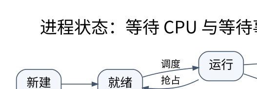

# 进程、线程与调度推演：资源所有者和执行流不是同一件事

> **学习位置**：[[计算机知识/00-开始/课程地图/08-操作系统-课程地图|操作系统课程地图]] · **适用边界**：通用操作系统模型；Linux 实现另外注明。

[PNG 备用图](../../../_assets/diagrams/round3/process-state.png) · [可编辑图源](../../../_assets/diagrams/round3/process-state.dot)

## 操作系统提供受控的共享

应用希望独占 CPU、内存和文件，现实机器却要让许多程序共存。操作系统用进程、虚拟地址、文件描述符等抽象隐藏部分资源细节，同时通过特权级、页表和权限限制相互干扰。机制负责“怎样切换和隔离”，策略负责“让谁运行、给多少资源”，两者应分开理解。

进程通常承载地址空间与资源集合，线程是其中的执行流。一个进程中的线程共享许多资源，但各有寄存器状态、栈和调度状态；具体内核模型可能以统一任务结构表示它们，不能把教科书框图当成所有系统实现。

## 状态变化要写触发事件

就绪表示可以运行但尚未获得 CPU；运行表示正在某个执行单元上执行；阻塞表示等待 I/O、锁或其他条件。时间片结束可使运行转就绪，等待资源可使运行转阻塞，事件完成使阻塞转就绪，而不是直接保证马上运行。终止后还可能保留供父进程收集的状态，僵尸进程不是继续执行的“幽灵程序”。

上下文切换保存与恢复执行状态；从用户态进入内核态不一定发生进程切换，系统调用也可能在同一任务中迅速返回。切换成本除了寄存器，还可能涉及调度、缓存局部性、TLB 和地址空间管理。

## 用同一工作负载比较策略

设 A、B、C 在时刻 0 到达，CPU burst 分别为 8、4、1，忽略切换开销。FCFS 按 A、B、C 执行，完成时间为 8、12、13，平均周转为 11，平均等待为 $(0+8+12)/3=20/3$。SJF 按 C、B、A 执行，完成时间为 1、5、13，平均周转为 $19/3$，平均等待为 2。

这展示短作业优先可改善该模型的平均等待，但现实不知道未来 burst，长任务也可能饥饿。轮转强调响应性，时间片很小增加切换开销，太大接近 FCFS。抢占式最短剩余时间、优先级、老化、多级反馈队列、彩票与步长调度分别对应不同目标与信息假设。

## 多核调度增加了放置问题

除了决定谁先运行，还要决定放在哪个核心。负载均衡、缓存亲和性、NUMA 数据位置、SMT 共享资源与迁移成本相互牵制。把所有核心利用率拉平未必使端到端延迟最小；迁移可能破坏局部性，固定绑定又可能造成资源闲置。

Linux 的公平调度实现具有版本边界。不能把旧 CFS 教材直接描述为所有当前内核：官方文档说明从 6.6 开始向 EEVDF 机制过渡，其核心在于从具备资格的任务中选择较早虚拟截止时间。[实现依据](https://docs.kernel.org/scheduler/sched-eevdf.html)。课程里的 FCFS/SJF/RR 模拟器用于理解目标，不声称复刻当前 Linux 调度器。

## 排队与性能指标

吞吐量是单位时间完成数，周转时间从到达到完成，响应时间到第一次获得服务，等待时间只计相应等待部分。稳态、口径一致且系统稳定时，Little 定律 $L=\lambda W$ 联系平均在系统任务数、到达率和平均停留时间。它不是对任意短瞬态数据都精确成立的预测器。

## 练习与答案

把例子的到达时间改为 A=0、B=1、C=2，分别画非抢占 SJF 与最短剩余时间时间线；不要沿用“全在 0 到达”的答案。再加入每次切换 0.1 单位成本，观察极短时间片的代价。验收时同时输出完成、等待、响应与周转，并验证每个任务实际获得的 CPU 总量等于它的 burst。

## 关联阅读

- [[计算机知识/30-计算机系统/10-组成原理系统课程/03-指令集寻址与数据通路|指令集、寻址与数据通路：从一条指令追踪数据]]
- [[计算机知识/10-编程语言/01-Python/10-系统课程/05-线程进程与解释器边界|线程、进程与解释器边界：GIL 不是同步设计]]
- [[计算机知识/20-操作系统/02-操作系统原理/10-系统课程/08-虚拟化实时系统与安全|虚拟化、实时系统与安全：通用平均性能之外的约束]]

## 依据与继续查证

- [OSTEP（作者开放教材入口）](https://pages.cs.wisc.edu/~remzi/OSTEP/)
- [Linux Kernel Documentation](https://docs.kernel.org/)
- [Linux man-pages（系统调用契约）](https://man7.org/linux/man-pages/)

本页的例子、推演与练习为教学构造；语言契约、系统接口和版本相关结论应结合以上原始文档核对。

<!-- COURSE SEQUENCE -->
## 顺序导航与验证

[[计算机知识/20-操作系统/02-操作系统原理/10-系统课程/00-操作系统系统课程索引|本课程总索引]] · [[计算机知识/_labs/round3/OS/操作系统-实验说明|本课程实验]]

下一讲：[[计算机知识/20-操作系统/02-操作系统原理/10-系统课程/02-系统调用IPC与进程生命周期|系统调用、IPC 与进程生命周期：每个句柄背后都有共享关系]]
<!-- END COURSE SEQUENCE -->

<!-- ORIGINAL DEEP LINKS -->
## 与原有长篇专题衔接

- [[计算机知识/20-操作系统/02-操作系统原理/01-进程线程调度与定量指标|01-进程线程调度与定量指标]]

新旧讲解采用的版本与模型可能不同，比较时先核对各自前提，不把教学简化当成实现细节。
<!-- END ORIGINAL DEEP LINKS -->
