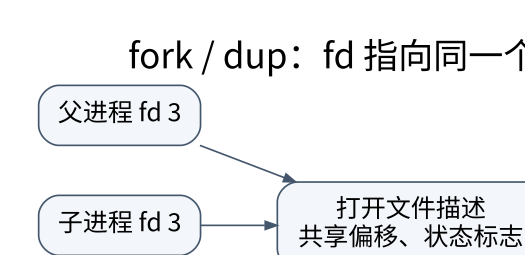

# 系统调用、IPC 与进程生命周期：每个句柄背后都有共享关系

> **学习位置**：[[计算机知识/00-开始/课程地图/08-操作系统-课程地图|操作系统课程地图]] · **适用边界**：通用操作系统模型；Linux 实现另外注明。

[PNG 备用图](../../../_assets/diagrams/round3/fd-sharing.png) · [可编辑图源](../../../_assets/diagrams/round3/fd-sharing.dot)

## 系统调用是受控入口

库函数与系统调用不是同义词。`printf` 可先写入用户态缓冲，之后才经系统调用输出；某些库操作不进入内核，某些操作会调用多个系统接口。系统调用通过规定的 ABI 传递参数与返回值，内核还要验证用户地址、权限和对象状态。

错误返回必须按接口合同解释。中断、短读写、非阻塞暂不可用和永久错误是不同情况；不能对所有错误无限重试，也不能假设一次 read 就取得指定长度。可观察到的系统调用轨迹有助于定位阻塞，但它不是完整应用语义。

## fork、exec 与 wait 分别负责什么

`fork` 创建子进程，`exec` 用新程序映像替换当前进程，`wait` 类接口收集子进程状态。exec 成功不会返回到旧程序继续执行。Linux 上 fork 通常利用写时复制避免立即复制所有物理页，但逻辑上父子私有内存的后续修改仍应隔离；共享映射另有共享合同。

父子继承的文件描述符可指向同一 open file description，因此可能共享文件偏移和状态标志。描述符编号相同不代表对象独立。多线程进程 fork 后，子进程只保留调用线程，但地址空间里的锁状态可能来自已经不存在的其他线程；exec 前可安全调用的函数有严格限制。[fork 原始接口说明](https://man7.org/linux/man-pages/man2/fork.2.html)。

## IPC 要按数据与故障语义选择

管道提供字节流，适合父子或命令组合；命名管道有文件系统入口；Unix 域 socket 支持本机通信并可在适当接口下传递描述符；网络 socket 跨主机但引入网络故障；共享内存减少复制，却要求额外同步与生命周期管理；消息队列提供消息边界，但容量和优先级规则依接口。

信号适合异步通知，不适合传递复杂大量数据。信号处理器可调用的函数受异步信号安全限制；在处理器中随意 printf、分配内存或加普通锁可能出问题。可以用简单标志或专门通知机制把工作转回正常上下文。

## 管道 EOF 取决于所有写端

读端只有在缓冲区已空且所有指向写端的描述符都关闭时，才读到 EOF。父进程忘记关闭自己不再使用的写端，会让读者一直等，即使真正生产数据的子进程已经退出。管道程序应明确每个进程保留哪些端、何时关闭，并在 exec 边界使用 close-on-exec 控制泄漏。[管道接口说明](https://man7.org/linux/man-pages/man7/pipe.7.html)。

### 三个进程如何把一个管道接好

用 POSIX/Linux 的 `producer | consumer` 作有限推演：父进程 P 只负责创建和回收，子进程 A 生产，子进程 B 消费。假定 P 的标准输入、输出、错误（0、1、2）已打开，`pipe` 返回读端 `r=3`、写端 `w=4`，所有列出的调用都成功。只有 P 连续创建 A、B，A 的分支不再创建 B；两个子进程都从 P 尚未关闭的 3、4 继承引用。FD 编号只是本例约定，系统实际返回值要从调用结果取得。

表中的 `3→r` 表示“该进程的 3 号 FD 引用这个管道的读端”，只列与管道有关的 FD；其他 FD 仍存在。写端数统计表内所有进程仍持有的写端引用，包括重定向后的 1 号 FD，不是统计生产者进程数。

| 已完成的步骤 | 父进程 P | 生产者 A | 消费者 B | 剩余写端引用数 |
| --- | --- | --- | --- | ---: |
| P 执行 `pipe` | `3→r, 4→w` | 尚未创建 | 尚未创建 | 1 |
| P 创建 A，再创建 B；先看尚未关闭的状态 | `3→r, 4→w` | `3→r, 4→w` | `3→r, 4→w` | 3 |
| A 执行 `close(3); dup2(4,1); close(4)` | `3→r, 4→w` | `1→w` | `3→r, 4→w` | 3 |
| B 执行 `close(4); dup2(3,0); close(3)` | `3→r, 4→w` | `1→w` | `0→r` | 2 |
| P 执行 `close(3); close(4)` | 无管道 FD | `1→w` | `0→r` | 1 |
| A 写完有限数据，关闭 1 或退出 | 无管道 FD | 无管道 FD | `0→r` | 0 |

表按一种便于看清关系的顺序列状态；实际父子调度可以交错，最终保留的端应相同。A 的 `dup2(4,1)` 先让 1 指向写端，关闭原来的 4 后仍保留 `1→w`；仅关闭 4 没有结束写侧。B 的 `dup2(3,0)` 同理保留 `0→r`。[dup2 接口说明](https://man7.org/linux/man-pages/man2/dup.2.html) 中的复制修改的是当前进程的 FD 表，不替其他进程关闭端。

假定 A 共写入 `hi` 两字节，B 用长度大于零的阻塞 `read(0, ...)` 循环消费。即使 A 已退出，B 仍先取得尚未读出的字节（一次或多次），缓冲耗尽后才返回 0；EOF 是“不会再有写者”的状态，不是管道中的一个结束字符。B 据此关闭读端并退出，P 才能完成对 B 的退出状态回收。

### 漏掉父进程的一次 close，为何连 wait 也不结束

现在只删去 P 的 `close(4)`，A、B 的关闭动作全部照旧。A 退出后，P 仍有 `4→w`，B 仍有 `0→r`。将 B 已读完 `hi` 的时刻列出来：

| 条件或操作 | 正确关闭时 | P 漏关 4 时 |
| --- | --- | --- |
| A 已退出，管道缓冲区为空 | 写端引用数为 0 | 写端引用数为 1，持有者是 P |
| B 下一次正长度阻塞 `read(0, ...)` | 返回 0，B 可退出 | 等待更多字节，尚无 EOF |
| P 执行 `waitpid(B, ..., 0)` | B 退出后返回 | B 等 EOF，P 等 B 退出，双方持续等待 |

这里 P 不打算再写，却仍向内核表明“写端还存在”。P 若计划等 B 退出后才关闭 4，就形成等待环；先关闭这个残留写端，B 才能走完 EOF→退出→回收。P 对已经退出的 A 执行 `waitpid(A, ..., 0)` 仍可返回，不能把“等待一个子进程”与“等整个流水线结束”混为一谈。`waitpid` 回收的是指定子进程状态，它不会替父进程关闭管道。[wait 接口说明](https://man7.org/linux/man-pages/man2/wait.2.html)。

若漏关的是 B 自己继承的 4，B 即使从不写也会用该引用挡住自己的 EOF；要检查的是所有副本。若读端设为非阻塞，缓冲空而写端仍存在时通常得到 `EAGAIN`，不是 EOF；若此刻还有缓冲数据，先返回数据。上表限定阻塞读、正请求长度以及无额外数据或中断的过程，不把“暂时没数据”说成“对端已结束”。

### 用已有程序对照，而不混淆三进程与两进程

[[计算机知识/80-实践/06-计算机系统/04-文件描述符pipe-dup与进程/README|文件描述符、pipe、dup 与进程]] 的 `fd_pipe_demo.cpp` 是两进程版本：子进程把写端复制到 1，父进程关闭自己的写端后执行 `read_all`，读到 EOF 再 `waitpid`。上面的 P/A/B 表多了一个独立消费者 B；原程序由父进程自己消费，所以漏关父写端时阻塞在父进程的 `read_all`，尚未走到 `waitpid`。对应地，[[计算机知识/_labs/round4/README|第四轮实验：推演、反例与独立参照]] 中的 `test_epoll_drain_eagain_and_eof` 验证排空、EAGAIN 与关闭最后写端后的 EOF，没有创建上述三进程。

两进程程序的输出与自检以实践页为准，并保留其中的单线程 fork、短读写和失败路径前提。三进程表是接口合同下的教学推演，本轮未执行该进程组合，也未重新运行两个已有实验。管道写满时，读者还必须与写者并发工作；“先等生产者退出再消费”可能让生产者等待空间，属于另一条等待环。

管道保证的某些小写入原子性不等于读操作保留消息边界。多个写者的大块输出可能交错，读者也可能分批收到；应用协议仍需分帧与上限。

## 生命周期与取消

杀死进程可能让文件、数据库或外部系统处在中间状态。优雅停止通常先请求退出、停止接收新任务、等待有限收尾，再按策略升级终止。子进程树、进程组和会话影响信号传播；只终止父进程不一定终止全部后代。

## 练习与答案

遮住上面的示范表，重新画出 `producer | consumer` 中 P、A、B 的管道描述符关闭表：从创建到两次 fork、重定向、写完、读完与回收，说明每一步还剩多少写端引用。再只保留 B 自己继承的 4，预测 A 退出后的 B 读取和 P 等待分别停在哪里；如果另一个案例只漏关 P 的读端 3，EOF 是否仍被阻止？写出理由后再核对示范中的条件。需要实际观察故障时，沿已有实践页在实验副本中按其范围和中止方式操作；本题的预测不算运行结果。

答案核对点：B 残留的 4 仍是写端，缓冲空后 B 等数据，P 等 B 退出；P 只残留读端 3 不增加写端引用，A 的最后写端关闭、缓冲读尽后，B 仍能得到 EOF（读端泄漏可能影响其他资源/写侧失败条件，但不是这个 EOF 条件）。

再把两个 fork 后的描述符指向同一打开文件，与两次独立 open 比较，解释为什么同一文件路径不意味着同一个打开文件描述。需要追踪共享偏移时，返回 [[计算机知识/20-操作系统/01-Linux/10-系统课程/09-FD共享epoll与非阻塞状态机#先分开三个对象：路径、FD、打开文件描述|从 FD 到事件循环：共享偏移、epoll 与非阻塞状态机]] 的 `abcdef` 状态表；该表解决普通文件打开状态共享，本页的表解决管道结束与进程等待。

## 关联阅读

- [[计算机知识/20-操作系统/01-Linux/10-系统课程/02-文件描述符管道与进程控制|Linux 进程与文件描述符：用小实验理解共享状态]]
- [[计算机知识/10-编程语言/03-C语言/10-系统课程/06-输入输出解析与错误模型|输入不是可信整数：stdio、解析器与错误报告]]
- [[计算机知识/35-计算机网络/10-系统课程/07-Socket分帧背压与排障|Socket 工程：分帧、背压、超时和可解释的失败]]

## 依据与继续查证

- [OSTEP（作者开放教材入口）](https://pages.cs.wisc.edu/~remzi/OSTEP/)
- [Linux Kernel Documentation](https://docs.kernel.org/)
- [Linux man-pages（系统调用契约）](https://man7.org/linux/man-pages/)

本页的例子、推演与练习为教学构造；语言契约、系统接口和版本相关结论应结合以上原始文档核对。

<!-- COURSE SEQUENCE -->
## 顺序导航与验证

[[计算机知识/20-操作系统/02-操作系统原理/10-系统课程/00-操作系统系统课程索引|本课程总索引]] · [[计算机知识/_labs/round3/OS/操作系统-实验说明|本课程实验]]

上一讲：[[计算机知识/20-操作系统/02-操作系统原理/10-系统课程/01-进程线程与调度推演|进程、线程与调度推演：资源所有者和执行流不是同一件事]]

下一讲：[[计算机知识/20-操作系统/02-操作系统原理/10-系统课程/03-同步条件变量与经典问题|同步、条件变量与经典问题：保护不变量，而不是保护几行代码]]
<!-- END COURSE SEQUENCE -->

<!-- ORIGINAL DEEP LINKS -->
## 与原有长篇专题衔接

- [[计算机知识/20-操作系统/02-操作系统原理/01-进程线程调度与定量指标|01-进程线程调度与定量指标]]

新旧讲解采用的版本与模型可能不同，比较时先核对各自前提，不把教学简化当成实现细节。
<!-- END ORIGINAL DEEP LINKS -->
