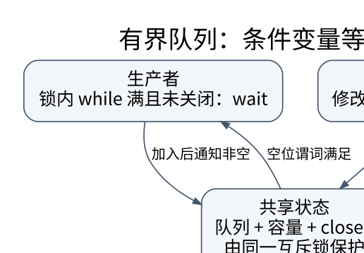

# 同步、条件变量与经典问题：保护不变量，而不是保护几行代码

> **学习位置**：[[计算机知识/00-开始/课程地图/08-操作系统-课程地图|操作系统课程地图]] · **适用边界**：通用操作系统模型；Linux 实现另外注明。



[PNG 备用图](../../../_assets/diagrams/round3/bounded-queue.png) · [可编辑图源](../../../_assets/diagrams/round3/bounded-queue.dot)

## 竞态比数据竞争更广

两个线程无适当同步地冲突访问同一内存位置可能构成数据竞争，语言可能因此不给正常语义保证。竞态条件更广：即使每次内存访问都有锁，若“检查余额”和“扣款”分属两个不连续临界区，其他线程仍可插入改变业务结果。正确同步单位应覆盖完整不变量。

互斥锁提供排他进入，读写锁区分读者与写者，信号量维护资源许可计数，条件变量等待状态谓词，屏障协调阶段，原子操作构建更细粒度协议。它们不是性能不同但功能相同的“锁的几种写法”。

## 有界队列的条件变量推演

队列不变量为 $0\le size\le capacity$。生产者在队列满时等待，消费者在队列空时等待；检查谓词和修改队列必须与同一互斥协议协调。

```text
put(x):
  lock(m)
  while size == capacity and not closed:
      wait(not_full, m)
  if closed: unlock(m); report_closed
  enqueue(x)
  notify(not_empty)
  unlock(m)

get():
  lock(m)
  while size == 0 and not closed:
      wait(not_empty, m)
  if size == 0 and closed: unlock(m); return_end
  x = dequeue()
  notify(not_full)
  unlock(m)
  return x
```

`wait` 必须把释放锁与进入等待的过程按接口语义协调，并在返回前重新取得锁。用 while 而不是 if，因为可能伪唤醒，也可能另一个消费者先拿走元素。通知不是状态本身，不应被当作永久保存的一张“有数据票”。关闭队列需要唤醒所有可能等待的相关工作者。

## 经典问题是不同不变量的训练场

生产者消费者关心容量与结束；读者写者关心允许的并发组合与饥饿；哲学家进餐揭示循环等待；理发师等模型关心有限等待席位与服务顺序。不要只背信号量初值，应从“哪些状态合法、哪种转移需要独占、谁负责唤醒”推导。

自旋锁适合预期持有很短且不能睡眠等特定场景；长等待会浪费 CPU。睡眠锁减少忙等但涉及调度开销。用户态 futex 类机制可在无竞争时主要在用户态工作，有竞争时求助内核；它仍需要正确的原子和等待协议。

## 进度保证与公平性

互斥只说明不会同时进入，不自动保证等待者终会进入。饥饿、活锁、优先级反转与死锁不同。高优先级任务等待低优先级持锁者，而中优先级任务不断抢占后者，会形成优先级反转；优先级继承或天花板协议可在相应模型下缓解。

无锁算法的 lock-free 表示系统整体有进展，不保证每个线程有限步完成；wait-free 要求更强的逐操作进度界。使用 CAS 不自动获得这些性质，也不解决节点回收。ABA 与释放后使用需要版本标记、危险指针、epoch/RCU 等额外协议。

## 练习与答案

把 get 的 while 改成 if，构造两个消费者被唤醒但只有一个元素的交错，第二个消费者会在条件已不成立时继续。再让生产者异常退出，验证关闭协议能让所有等待者结束。测试应使用同步点控制交错而不是靠 sleep 猜时序；有限测试仍不是所有并发执行的形式证明。


<!-- ROUND4 DEPTH LINKS -->
## 继续推演本页难点

[[计算机知识/20-操作系统/02-操作系统原理/10-系统课程/10-条件变量丢失唤醒与活性证明|wait 为什么必须检查谓词，持锁通知能否保证公平？]] 本专题补上状态转移、失败时间线及模型前提。

这不是替换本页：先掌握原理，再用补充页核对容易被一句话略过的条件。
<!-- END ROUND4 DEPTH LINKS -->

## 关联阅读

- [[计算机知识/10-编程语言/02-C++/10-系统课程/06-原子内存序与并发设计|从数据竞争到 happens-before：并发正确性怎样建立]]
- [[计算机知识/10-编程语言/04-Rust/10-系统课程/05-智能指针内部可变性与线程|智能指针和并发：每一种能力都附带新的证明义务]]
- [[计算机知识/10-编程语言/01-Python/10-系统课程/04-异步任务取消与结构化并发|异步任务、取消与结构化并发：谁负责等待谁]]

## 依据与继续查证

- [OSTEP（作者开放教材入口）](https://pages.cs.wisc.edu/~remzi/OSTEP/)
- [Linux Kernel Documentation](https://docs.kernel.org/)
- [Linux man-pages（系统调用契约）](https://man7.org/linux/man-pages/)

本页的例子、推演与练习为教学构造；语言契约、系统接口和版本相关结论应结合以上原始文档核对。

<!-- COURSE SEQUENCE -->
## 顺序导航与验证

[[计算机知识/20-操作系统/02-操作系统原理/10-系统课程/00-操作系统系统课程索引|本课程总索引]] · [[计算机知识/_labs/round3/OS/操作系统-实验说明|本课程实验]]

上一讲：[[计算机知识/20-操作系统/02-操作系统原理/10-系统课程/02-系统调用IPC与进程生命周期|系统调用、IPC 与进程生命周期：每个句柄背后都有共享关系]]

下一讲：[[计算机知识/20-操作系统/02-操作系统原理/10-系统课程/04-死锁银行家与资源分配|死锁、银行家算法与资源分配：不安全不等于已经死锁]]
<!-- END COURSE SEQUENCE -->

<!-- ORIGINAL DEEP LINKS -->
## 与原有长篇专题衔接

- [[计算机知识/20-操作系统/02-操作系统原理/02-同步条件变量死锁与并发证明|02-同步条件变量死锁与并发证明]]

新旧讲解采用的版本与模型可能不同，比较时先核对各自前提，不把教学简化当成实现细节。
<!-- END ORIGINAL DEEP LINKS -->
