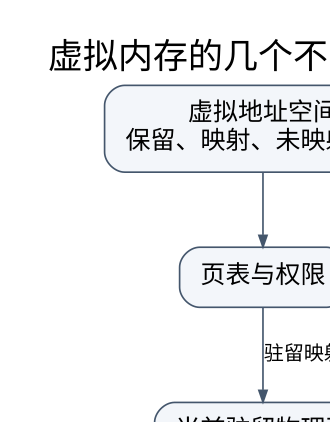

# 虚拟内存、置换与工作集：缺页的成本来自缺了哪一种页

> **学习位置**：[[计算机知识/00-开始/课程地图/08-操作系统-课程地图|操作系统课程地图]] · **适用边界**：通用操作系统模型；Linux 实现另外注明。

[PNG 备用图](../../../_assets/diagrams/round3/vm-layers.png) · [可编辑图源](../../../_assets/diagrams/round3/vm-layers.dot)

## 地址空间不等于已经占用同样多的物理内存

进程可以保留一段虚拟地址，实际物理页在首次使用或特定映射操作时分配。代码、共享库、匿名堆栈、文件映射和共享内存具有不同来源与回收方式。虚拟大小、常驻集 RSS、共享页计费和可回收缓存不能直接相加比较，观察工具口径必须一致。

分页把地址空间切成固定大小页，分段按逻辑区域组织，两者解决的粒度与保护方式不同。页表、TLB 与权限检查由硬件和内核协作；分配器在用户态管理小对象，又是在页之上的另一层，`free` 一个对象不保证立即把物理页还给 OS。

## 缺页异常有多种结局

合法匿名页首次访问可分配零页或建立相应映射；写时复制触发分配新页并复制；文件页缺失可能读取存储；权限错误或无效地址则可能终止进程。TLB miss 若页表映射有效，通常只是翻译缓存未命中，不应全部算成昂贵磁盘缺页。

Linux 等系统区分不同缺页统计口径，minor/major fault 反映是否涉及相应 I/O 等实现条件，不能只看计数名称推断应用错误。内存压力下回收可能发生在分配路径或后台，延迟抖动不一定出现在你认为的“读文件那一行”。

## 置换算法用访问历史预测未来

OPT 淘汰未来最晚使用的页，是离线基准，实际系统不知道完整未来。FIFO 按进入顺序，可能出现增加页框反而更多缺页的 Belady 异常；LRU 使用最近访问顺序，具有相应栈性质，但精确维护成本较高；Clock 用引用位近似近期使用，成本与精度取舍不同。

经典轨迹 `1,2,3,4,1,2,5,1,2,3,4,5`，FIFO 在 3 页框下缺页 9 次，在 4 页框下缺页 10 次。逐步列页框内容才能看见异常如何形成；它不是“更多内存一般更慢”，而是特定策略不具备单调保证。

下面队列统一按“最旧 → 最新”书写。FIFO 命中时不改变页的位置；把命中页移到最近使用端是 LRU 的规则。表中“装入”表示还有空页框，“换出”后再装入本次访问页。

**3 页框：**

| 步 | 页 | 结果 | 队列 | 累计缺页 |
| ---: | ---: | --- | --- | ---: |
| 1 | 1 | 装入 | `[1]` | 1 |
| 2 | 2 | 装入 | `[1,2]` | 2 |
| 3 | 3 | 装入 | `[1,2,3]` | 3 |
| 4 | 4 | 换出 1 | `[2,3,4]` | 4 |
| 5 | 1 | 换出 2 | `[3,4,1]` | 5 |
| 6 | 2 | 换出 3 | `[4,1,2]` | 6 |
| 7 | 5 | 换出 4 | `[1,2,5]` | 7 |
| 8 | 1 | 命中 | `[1,2,5]` | 7 |
| 9 | 2 | 命中 | `[1,2,5]` | 7 |
| 10 | 3 | 换出 1 | `[2,5,3]` | 8 |
| 11 | 4 | 换出 2 | `[5,3,4]` | 9 |
| 12 | 5 | 命中 | `[5,3,4]` | 9 |

**4 页框：**

| 步 | 页 | 结果 | 队列 | 累计缺页 |
| ---: | ---: | --- | --- | ---: |
| 1 | 1 | 装入 | `[1]` | 1 |
| 2 | 2 | 装入 | `[1,2]` | 2 |
| 3 | 3 | 装入 | `[1,2,3]` | 3 |
| 4 | 4 | 装入 | `[1,2,3,4]` | 4 |
| 5 | 1 | 命中 | `[1,2,3,4]` | 4 |
| 6 | 2 | 命中 | `[1,2,3,4]` | 4 |
| 7 | 5 | 换出 1 | `[2,3,4,5]` | 5 |
| 8 | 1 | 换出 2 | `[3,4,5,1]` | 6 |
| 9 | 2 | 换出 3 | `[4,5,1,2]` | 7 |
| 10 | 3 | 换出 4 | `[5,1,2,3]` | 8 |
| 11 | 4 | 换出 5 | `[1,2,3,4]` | 9 |
| 12 | 5 | 换出 1 | `[2,3,4,5]` | 10 |

第 7 步后，3 页框的队列是 `[1,2,5]`，第 8、9 步访问 1、2 都命中；4 页框的队列却是 `[2,3,4,5]`。在 4 页框中，第 5、6 步虽然命中 1、2，却没有把它们移到队尾，因此第 7 步仍换出 1，第 8 步访问 1 又换出 2，第 9 步访问 2 再换出 3，后续 3、4、5 也依次缺页。最终 3 页框为 9 次、4 页框为 10 次。差别来自 FIFO 的进入顺序，不能推广成更多物理内存通常更慢。

## 工作集与抖动

工作集描述某段近期活动真正需要的页集合。多个活跃进程的需求超过可用内存时，系统可能频繁换入换出而少做有效计算，称抖动。单纯增加并发任务可能使吞吐下降。局部置换与全局置换影响进程间干扰；负载控制、批量处理和更好的局部性可能比盲调换页参数更有效。

大页增加 TLB 覆盖，但可能带来内存碎片与整理成本。NUMA 页放置影响远端访问；内存压缩、交换、页缓存回收和 OOM 策略各有条件。不能把“空闲内存少”直接判定为内存不足，OS 可能在使用可回收缓存。

## 分配器与内核内存

伙伴分配器按二次幂块组织页级空间，便于拆分合并但存在内部碎片；slab 类分配器复用同类型内核对象；用户态 allocator 管理大小类别、空闲链和线程缓存。外部碎片、内部碎片、虚拟保留与物理常驻是不同现象。内存泄漏也可能表现为仍被缓存或容器引用的对象，而非无人引用的裸指针。

## 练习与答案

实现 FIFO、LRU、OPT 小模拟器，对经典轨迹确认 9 与 10 的 FIFO 结果，并检查 LRU 在增加容量时的单调性。另写顺序与跨页大步长访问程序，比较时间和缺页/TLB 相关证据，但明确硬件计数器权限与噪声限制。模型实验解释机制，不能替代真实内核回收策略的完整复现。

<!-- ROUND4 DEPTH LINKS -->
## 继续推演本页难点

[[计算机知识/20-操作系统/02-操作系统原理/10-系统课程/09-页表写时复制与TLB失效|fork 后父子都能读同一页，写入时为什么不互相污染？]] 本专题补上状态转移、失败时间线及模型前提。

这不是替换本页：先掌握原理，再用补充页核对容易被一句话略过的条件。
<!-- END ROUND4 DEPTH LINKS -->

## 关联阅读

- [[计算机知识/30-计算机系统/10-组成原理系统课程/06-虚拟地址TLB与存储系统|虚拟地址、TLB 与存储系统：翻译和取数据是两件事]]
- [[计算机知识/50-数据结构与算法/20-算法设计系统课程/06-随机近似与在线算法|随机、近似与在线算法：不同的不确定性要分开承诺]]
- [[计算机知识/20-操作系统/01-Linux/10-系统课程/07-性能观测与故障定位|Linux 性能排障：从症状到可证伪的瓶颈假设]]

## 依据与继续查证

- [OSTEP（作者开放教材入口）](https://pages.cs.wisc.edu/~remzi/OSTEP/)
- [Linux Kernel Documentation](https://docs.kernel.org/)
- [Linux man-pages（系统调用契约）](https://man7.org/linux/man-pages/)

本页的例子、推演与练习为教学构造；语言契约、系统接口和版本相关结论应结合以上原始文档核对。

<!-- COURSE SEQUENCE -->
## 顺序导航与验证

[[计算机知识/20-操作系统/02-操作系统原理/10-系统课程/00-操作系统系统课程索引|本课程总索引]] · [[计算机知识/_labs/round3/OS/操作系统-实验说明|本课程实验]]

上一讲：[[计算机知识/20-操作系统/02-操作系统原理/10-系统课程/04-死锁银行家与资源分配|死锁、银行家算法与资源分配：不安全不等于已经死锁]]

下一讲：[[计算机知识/20-操作系统/02-操作系统原理/10-系统课程/06-文件系统I_O与崩溃一致性|文件系统、I/O 与崩溃一致性：可见、写完和持久不是同义词]]
<!-- END COURSE SEQUENCE -->

<!-- ORIGINAL DEEP LINKS -->
## 与原有长篇专题衔接

- [[计算机知识/20-操作系统/02-操作系统原理/03-虚拟内存置换文件系统与崩溃边界|03-虚拟内存置换文件系统与崩溃边界]]
- [[计算机知识/20-操作系统/02-操作系统原理/04-保护安全虚拟化与系统知识全景|04-保护安全虚拟化与系统知识全景]]

新旧讲解采用的版本与模型可能不同，比较时先核对各自前提，不把教学简化当成实现细节。
<!-- END ORIGINAL DEEP LINKS -->
