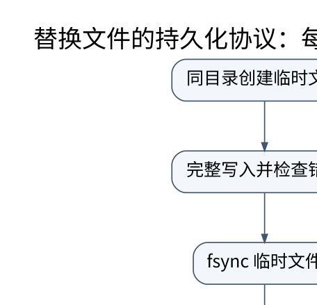

# 文件系统、I/O 与崩溃一致性：可见、写完和持久不是同义词

> **学习位置**：[[计算机知识/00-开始/课程地图/08-操作系统-课程地图|操作系统课程地图]] · **适用边界**：通用操作系统模型；Linux 实现另外注明。

[PNG 备用图](../../../_assets/diagrams/round3/durable-replace.png) · [可编辑图源](../../../_assets/diagrams/round3/durable-replace.dot)

## 文件名、inode 与打开状态

目录把名字映射到文件对象；inode 保存元数据与数据位置等信息；打开文件描述保存偏移和状态；进程的文件描述符表引用打开状态。硬链接是多个名字指向同一文件对象，符号链接保存待解析路径，二者的删除与跨文件系统能力不同。

删除一个名字不必立刻释放仍被打开的文件数据。重命名改变目录项可见性，不一定改变已打开描述符指向的对象。路径解析要考虑挂载点、符号链接、权限和并发替换，不能只看字符串前缀。

## 数据块怎样组织

连续分配利于顺序访问但不易增长，链式分配便于扩展但随机访问困难，索引分配通过指针定位块，extent 用连续区间压缩映射。空闲空间可用位图或其他结构管理。页缓存让重复访问免于设备 I/O，但也引入脏页回写与一致性边界。

块设备请求经历文件系统、块层、驱动、队列与设备；调度可合并或重排请求以改善吞吐。SSD 没有机械寻道，但仍有并行通道、内部垃圾回收和排队成本，不能把传统磁盘电梯算法经验无条件套用。

## 三个“完成”层次

`write` 成功可能只说明数据进入内核缓冲；`close` 不等于完整持久性承诺；`fsync` 请求把相关文件数据与必要元数据同步到持久存储，但具体硬件与文件系统仍有合同。目录项变化的持久化可能需要单独同步目录。[Linux fsync 接口依据](https://man7.org/linux/man-pages/man2/fsync.2.html)。

常见可靠替换思路是在同目录创建临时文件、完整写入、同步临时文件、原子重命名为目标，再按平台和文件系统要求同步父目录。它减少读者看到半文件的风险，并加强崩溃后的恢复保证；但跨文件系统 rename 不满足同样条件，设备虚假报告持久化也不由应用算法单独解决。

## 崩溃一致性为何需要协议

更新文件可能同时改变数据块、inode 和目录项。若只写了一部分就掉电，结构可能不一致。日志文件系统先记录恢复所需信息，再按协议提交；写时复制写到新位置并切换根或引用；fsck 扫描修复某些不一致，但不能凭空恢复从未持久化的数据。

元数据日志不自动保证所有用户数据具有同样原子性；数据库 WAL 与文件系统日志也不是重复功能。数据库维护事务级语义，文件系统维护文件/块结构，两层应以明确的同步接口协作。

## I/O 接口的两条坐标

阻塞/非阻塞描述调用是否可能等待，同步/异步完成描述完成如何通知，不能把两个坐标混为一谈。select/poll/epoll 常提供就绪通知，io_uring 等接口可提供提交与完成队列；具体操作支持、内核版本、缓冲区生命周期和取消语义需查接口。就绪不保证一次调用处理完所有数据。

## 练习与答案

在临时目录中打开文件后 unlink，验证已经打开的描述符仍可读取，而路径查找失败。再构造“写临时文件成功但重命名前崩溃”的模型，说明旧文件应仍可见，新临时文件可能残留。测试可以注入进程中止并检查可见状态，但没有真实断电和设备故障实验时，不应声称证明了端到端掉电持久性。

<!-- ROUND4 DEPTH LINKS -->
## 继续推演本页难点

[[计算机知识/20-操作系统/02-操作系统原理/10-系统课程/11-崩溃一致性与恢复状态机|rename 成功以后，断电重启一定还能看到新文件吗？]] 本专题补上状态转移、失败时间线及模型前提。

这不是替换本页：先掌握原理，再用补充页核对容易被一句话略过的条件。
<!-- END ROUND4 DEPTH LINKS -->

## 关联阅读

- [[计算机知识/55-数据库/10-系统课程/07-恢复复制与分布式事务|恢复、复制与分布式事务：提交成功意味着什么]]
- [[计算机知识/20-操作系统/01-Linux/10-系统课程/02-文件描述符管道与进程控制|Linux 进程与文件描述符：用小实验理解共享状态]]
- [[计算机知识/30-计算机系统/10-组成原理系统课程/08-总线DMA中断与系统全景|总线、DMA、中断与系统全景：处理器之外还有执行者]]

## 依据与继续查证

- [OSTEP（作者开放教材入口）](https://pages.cs.wisc.edu/~remzi/OSTEP/)
- [Linux Kernel Documentation](https://docs.kernel.org/)
- [Linux man-pages（系统调用契约）](https://man7.org/linux/man-pages/)

本页的例子、推演与练习为教学构造；语言契约、系统接口和版本相关结论应结合以上原始文档核对。

<!-- COURSE SEQUENCE -->
## 顺序导航与验证

[[计算机知识/20-操作系统/02-操作系统原理/10-系统课程/00-操作系统系统课程索引|本课程总索引]] · [[计算机知识/_labs/round3/OS/操作系统-实验说明|本课程实验]]

上一讲：[[计算机知识/20-操作系统/02-操作系统原理/10-系统课程/05-虚拟内存置换与工作集|虚拟内存、置换与工作集：缺页的成本来自缺了哪一种页]]

下一讲：[[计算机知识/20-操作系统/02-操作系统原理/10-系统课程/07-保护机制内核架构与分布式接口|保护机制、内核架构与分布式接口：边界决定故障传播]]
<!-- END COURSE SEQUENCE -->

<!-- ORIGINAL DEEP LINKS -->
## 与原有长篇专题衔接

- [[计算机知识/20-操作系统/02-操作系统原理/03-虚拟内存置换文件系统与崩溃边界|03-虚拟内存置换文件系统与崩溃边界]]

新旧讲解采用的版本与模型可能不同，比较时先核对各自前提，不把教学简化当成实现细节。
<!-- END ORIGINAL DEEP LINKS -->
