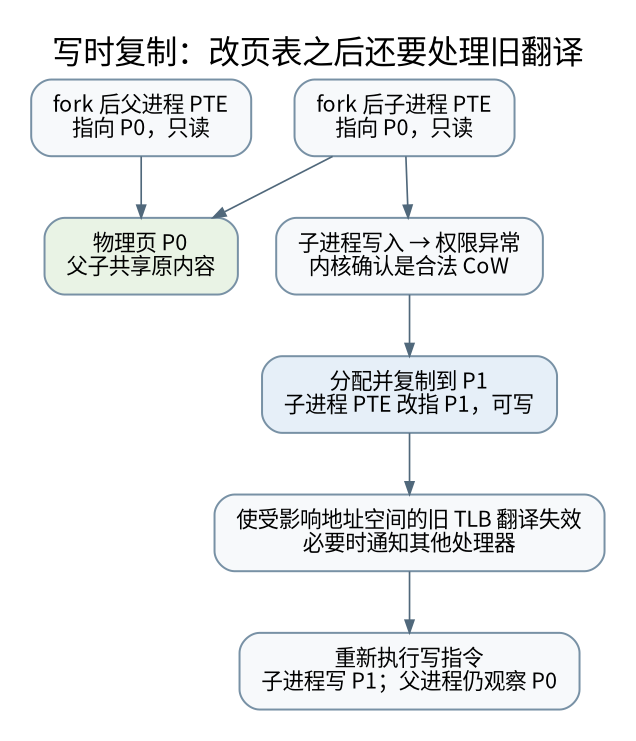

# 一张页经历了什么：多级页表、写时复制与 TLB 失效

> **本页要解决**：fork 后父子都能读同一页，写入时为什么不互相污染？
>
> **先修**：[[计算机知识/20-操作系统/02-操作系统原理/10-系统课程/05-虚拟内存置换与工作集|虚拟内存、置换与工作集：缺页的成本来自缺了哪一种页]]；[[计算机知识/30-计算机系统/10-组成原理系统课程/06-虚拟地址TLB与存储系统|虚拟地址、TLB 与存储系统：翻译和取数据是两件事]]。
>
> **阅读入口**：[[计算机知识/20-操作系统/02-操作系统原理/10-系统课程/00-操作系统系统课程索引|本学科主索引]] · [[计算机知识/00-开始/全局导航/11-难点导读与研究证据|全局难点导读]]。

**版本、模型与证据边界**：明确区分 POSIX/Linux 接口、RISC-V 翻译规则与小型状态模型；没有实际掉电或内核修改实验。

## 页表把地址、权限和身份联系起来

虚拟地址不是把物理地址加一个固定偏移。以 RISC-V Sv39、4 KiB 基页为具体教学基线，低 39 位分成三级 9 位索引和 12 位页内偏移；更高位还要满足符号扩展的规范地址条件。每个页表有 512 项，每项 8 字节，恰好占一页。[^riscv]

给定虚拟地址 `0x12345678`，三个索引从高到低为 0、145、325，页内偏移为 `0x678`。逐级找到有效叶子 PTE 后，若对应物理页号为 `0xABC`，在这个 4 KiB 叶子例子中物理地址为 `0xABC678`。这不是直接把整个虚拟页号写进物理地址，而是从映射表查出新的页号。

页表项还包含有效性、读写执行、用户访问等权限。地址存在映射，不代表当前访问方式被允许；无效映射与写保护都可能触发页故障，但 OS 的处理完全不同。

## 多级页表为什么省空间，也为什么仍有成本

若只映射一个孤立的 4 KiB 数据页，在需要全新三级路径的简化情况下，根、中间页表、叶页表本身占 12 KiB，数据页再占 4 KiB。映射稀疏并不意味着每个映射只花 8 字节。

若映射 1 GiB 对齐的连续区域、全部用 4 KiB 页且只涉及一个根索引，叶页表有 512 页，共 2 MiB；另需一个中间页表和一个根页表，共再加 8 KiB。大页可以减少页表和 TLB 压力，却增加对齐、内部浪费、拆分与回收粒度等要求。实际内核可能共用已有上层页表，上述是在明确边界下的独立计数。

TLB 命中避免每次都走完整页表。TLB miss 也不等于缺页：有效页表可直接完成硬件遍历；只有权限、存在性等检查失败，才进入相应异常路径。缺页也不一定读磁盘，需求零页、写时复制和已缓存文件页都可能无需磁盘 I/O。

## fork 后的私有页为什么可以先共享

对适合写时复制的私有可写页，fork 可以让父子页表指向同一物理页，并撤销双方普通写权限，记录后续写需要复制的语义。读共享内容没有问题；任一方写入时触发保护故障，内核分配新页、复制原内容、更新写者映射，再重试写入。

[矢量图](../../../_assets/diagrams/round4/cow-tlb.svg) · [可编辑图源](../../../_assets/diagrams/round4/cow-tlb.dot)

重要的是“原本允许私有写、现在为 CoW 保护”的页，不能把任意只读代码页的写故障都变成可写副本。页表权限之外，内核还需要虚拟内存区域的语义和页引用状态。并发故障、分配失败、页锁、共享映射和固定页等情况也要纳入协议。

这一描述不是说 fork 之后所有资源都独立。文件描述符仍可能引用相同 open file description，共享偏移；共享内存映射本来就允许跨进程看见写入。进程地址空间的私有页合同与 [[计算机知识/20-操作系统/01-Linux/10-系统课程/09-FD共享epoll与非阻塞状态机|FD 共享合同]] 必须分别看。

## 改了内存里的 PTE，不代表所有 CPU 都忘记旧映射

如果 CPU 仍缓存一个旧的可写 TLB 项，单改页表为只读可能不足以让它停止写。解除映射或把物理页回收给另一个对象时，旧 TLB 项更可能让旧地址错误地访问新的所有者。正确协议必须按架构和内核约定完成必要的失效与排序。[^tlb]

RISC-V 的 SFENCE.VMA 作用于执行它的 hart 所需地址翻译排序与缓存范围，不自动替其他 hart 执行同样的工作。跨核需要通知相关执行单元，并在必要时等待确认，再完成依赖旧映射已消失的回收动作。ASID 可以减少不同地址空间切换时的无差别失效，不取消同一地址空间映射变化时的责任。[^riscv]

映射建立、权限收紧、权限放宽、页表层次改变的最佳失效策略可能不同，不能用“每次都清空所有 TLB”作为实现细节的普遍答案；教学模型可以保守这样做，但应承认效率与真实平台差异。

## 一次 CoW 写入的完整合同

先确认故障地址属于可私有写区域，并稳定相关映射；再检查是否仍需要复制，处理可能的并发变化；准备新页内容；发布新 PTE 和相关元数据；执行所需 TLB 维护；最后让用户指令重试。实际内核为了性能可能组织为更细的锁和重检流程，这个顺序是职责列表，不是可以照抄的内核补丁。

复制失败不能让页表指向未初始化内存，引用计数也不能先减到可回收再发现别的读者仍在使用。这里与 [[计算机知识/50-数据结构与算法/10-数据结构系统课程/10-可持久化结构与回滚并查集|路径复制]] 的共同点是先准备新版本再发布，与 [[计算机知识/10-编程语言/02-C++/10-系统课程/10-借用视图失效与异常提交|异常安全提交]] 也相通；不同点在于跨核缓存和硬件权限必须参与正确性。

## 验证范围

本轮模型计算三级索引与页表空间，模拟父子共享、子进程复制和旧翻译项导致的错误访问，明确展示“更新 PTE”与“失效已缓存翻译”是两个步骤。它不修改宿主页表、不执行内核 fault 注入，不把 Python 模型当 Linux 内核实现验证。

**自测**：同一个物理页能在两个地址空间拥有不同虚拟地址和权限吗？可以。物理内容的共享与访问路径的权限是不同层次；这也说明仅凭两个虚拟地址不同，不能推出底层对象独立。

[^riscv]: RISC-V 官方 [Supervisor-Level ISA v1.13，v20260120 文档快照](https://docs.riscv.org/reference/isa/v20260120/priv/supervisor.html)，Sv39、页表项与 SFENCE.VMA。只采用本课涉及的基础机制，不默认所有系统使用 Sv39。
[^tlb]: Linux 内核官方 [Cache and TLB Flushing](https://docs.kernel.org/core-api/cachetlb.html)，映射变更、缓存维护及相应接口合同。

## 知识连接：下一步应追问什么

同样叫“复制”或“共享”，可能发生在版本树、进程页和文件描述符三个不同层次。

[[计算机知识/10-编程语言/03-C语言/10-系统课程/09-指针步长二维数组与接口形状|指针不是地址整数：步长、二维数组与接口形状]]：为什么连续二维数组不能传给 int **？

[[计算机知识/50-数据结构与算法/10-数据结构系统课程/10-可持久化结构与回滚并查集|保存历史的两种办法：路径复制与回滚并查集]]：为什么可持久化不等于落盘，回滚也不能照搬路径压缩？

[[计算机知识/30-计算机系统/10-组成原理系统课程/10-流水线乱序与精确异常推演|先算完不等于先提交：流水线、重命名与精确异常]]：较年轻指令先执行完，CPU 怎样仍报告精确异常？

[[计算机知识/20-操作系统/01-Linux/10-系统课程/09-FD共享epoll与非阻塞状态机|从 FD 到事件循环：共享偏移、epoll 与非阻塞状态机]]：dup 出来的两个 FD 为什么会共享读写位置？

## 本地核验与阅读顺序

[[计算机知识/_labs/round4/README|本轮实验：命令、检查范围与未执行项目]] 提供对应文件和记录。[[计算机知识/90-资源/维护/导入-com/_meta/round4/01-研究证据与版本边界|研究证据索引]] 区分规范、推演和实验；[[计算机知识/90-资源/维护/导入-com/_meta/round4/02-缺口回查与后续验证|仍需进一步验证的边界]] 不把概览或模型标成完整实现。

先完成主干，再按问题选择专题；不要求跳过第 1–8 讲。 下一专题：[[计算机知识/20-操作系统/02-操作系统原理/10-系统课程/10-条件变量丢失唤醒与活性证明|不丢通知还不够：条件变量、不变量与活性证明]]。
