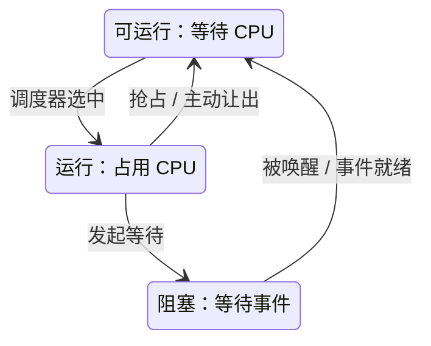

# 进程、线程、调度、同步与 IPC

## 本课目标

学完后，你应该能够：

- 把进程解释为资源与保护边界，把线程解释为共享这些资源的执行流；
- 区分运行、可运行、阻塞、唤醒、抢占和上下文切换；
- 说明 CPU affinity/cpuset、cgroup CPU quota 与拓扑如何改变“这个程序实际能用多少 CPU”；
- 分别说明互斥锁、条件变量、原子操作和内存顺序解决什么问题；
- 在 pipe、socket 和 shared memory 之间根据数据量、边界、拷贝、背压与失效模式做初步选择；
- 明确区分 POSIX 抽象、Linux 实现和 CPU/内存硬件事实，不把某个内核版本的策略当成永久契约。

适用场景：设计 C++ 线程池、排查 Linux 服务卡顿、评估多进程数据通道，以及理解 CPU 同步为什么不能直接套到 CUDA thread。

## 1. 先固定三层边界

| 层次 | 本课中它约定或决定什么 | 不应从它推出什么 |
| --- | --- | --- |
| POSIX 抽象 | 进程/线程接口、mutex/condition variable、pipe、socket、共享内存和部分调度语义 | 不规定某一版 Linux 如何组织运行队列，也不规定 CPU 缓存细节 |
| Linux 实现 | task、调度类/策略、每 CPU 运行队列、futex、文件描述符和各种 IPC 后端 | 实现会随内核版本、配置和架构变化；不是 POSIX 程序可依赖的全部对外契约 |
| 硬件事实 | 核心一次执行哪个指令流、中断/计时、特权级、原子指令、缓存一致性和内存顺序能力 | 缓存一致不等于程序已同步；硬件提供原语不等于语言中的数据竞争自动消失 |

POSIX 主要提供可移植的程序契约；Linux 把契约落到具体内核对象与算法；编译器和 CPU 还要把语言内存模型实现成指令与屏障。一个结论若跨过三层，必须指明跨层的契约，不能靠“我的机器上没出错”。

## 2. 进程是资源边界，线程是执行流

一个进程通常拥有或引用：

- 一个虚拟地址空间及其映射和权限；
- 文件描述符、当前目录、身份/权限、环境与进程级信号配置；
- 一个或多个线程。

同一进程的线程通常共享地址空间和大部分进程资源，但每个线程有自己的：

- 指令位置、寄存器状态和调度状态；
- 线程栈和 thread-local storage；
- 线程级的信号掩码等属性。

所以，“两个线程访问同一指针”通常真的在访问同一地址空间；“两个进程中指针数字相同”却不证明对应同一物理页。后一问题回看 [[计算机知识/30-计算机系统/02-进程虚拟地址空间与内存映射|进程虚拟地址空间与内存映射]]。

> [!note] Linux 的具体视角
> Linux 内核会把可调度执行实体统一表示为 task，用共享哪些内核资源来组合出类似“进程”或“线程”的关系。用户态线程库的可见抽象仍应依它的 API 契约理解，不要让某个内核结构体变成可移植设计的前提。

## 3. 调度发生在“可运行者”之间

可以先用三态模型建立直觉：



事件就绪只是重新具备运行条件；之后仍须被调度器选中，不能从阻塞直接跳到运行。

- **运行**：此时正在某个逻辑 CPU 上执行；
- **可运行**：已具备执行条件，但正在等 CPU；
- **阻塞**：等待数据、计时器、锁或其他事件，此时多给 CPU 也不能继续。

Linux 用多种调度类和策略处理普通分时、实时和其他任务，还要在多 CPU 间处理亲和性、负载均衡和唤醒。具体公平性算法、时间片和运行队列数据结构会变；可依赖的是所选 API/策略的文档，而不是“线程一定每 N ms 交替”。

### 可见 CPU 数不等于可持续使用的 CPU 预算

线程库或运行时可能报告机器的 logical CPU 数，但当前进程还可能受以下边界约束：

- **CPU affinity / cpuset**：进程只允许在某些 logical CPU 上运行；
- **cgroup CPU quota**：在一个计费周期内只允许消耗有限 CPU 时间，即使 cpuset 中可见很多 CPU，份额用完后仍可被 throttled；
- **SMT/拓扑与 NUMA**：logical CPU 不必等于完全独立核心，线程迁移还可改变 cache/TLB 热度与内存位置。

因此 `std::thread::hardware_concurrency()`、`os.cpu_count()` 或容器内某个 CPU 数字只是线索，不是线程池大小和可持续吞吐的直接答案。应同时记录 affinity/cpuset、quota/throttling、实际负载与尾延迟，再用代表性负载选线程数。

### 上下文切换是一条链，不是一条指令

从线程 A 切到 B，概念上可能包含：

1. 保存 A 恢复时必需的 CPU 状态；
2. 更新 A/B 的调度和计费状态；
3. 若跨进程，切换地址空间相关状态；
4. 恢复 B 的寄存器和执行位置；
5. B 继续执行，但它的缓存/TLB/分支预测热度可能与切换前不同。

第 5 点常是间接成本，受是否跨核心、是否跨地址空间和工作集影响。不要把“系统调用”、“进入内核态”和“切换到另一线程”当作同一件事：系统调用可能返回原线程，不必然伴随调度切换。

## 4. 互斥锁保护不变量

互斥锁的核心不是“让这行变快”，而是将一组必须一起成立的状态变化放进同一临界区。

```text
pseudocode: 账户转账的复合不变量

lock(accounts_mutex)
assert(source.balance >= amount)
source.balance = source.balance - amount
target.balance = target.balance + amount
unlock(accounts_mutex)
```

两个余额即使分别换成原子整数，也不会自动保持“总额不变”和“不允许透支”的复合规则。保护范围应围绕不变量设计，而不是“每个字段各有一把锁”。

常见死锁需要同时检查互斥、持有并等待、不可强制剥夺和环形等待等条件。工程上更实用的预防手段是统一锁顺序、缩小持锁范围、不在持锁时调用未知回调/阻塞 I/O，并让超时只作为失效控制而不是正确性证明。

**优先级反转（priority inversion）**不是死锁的同义词：低优先级线程持有高优先级线程需要的锁，中优先级工作又长时间占用 CPU，高优先级线程便可被间接拖住。priority inheritance/ceiling 等机制只在相应锁和平台契约中成立，不能从线程名义优先级自动推出尾延迟有上界。

## 5. 条件变量等待的是“谓词成立”

条件变量不存储业务状态；队列是否非空才是状态。正确模型是“在同一 mutex 下检查谓词，不成立则原子地释放锁并等待，唤醒后重新检查”：

```text
pseudocode: consumer

lock(queue_mutex)
while queue.is_empty() and not stopping:
    wait(condition, queue_mutex)  # 等待期间释放 mutex，返回前重新获得
if stopping and queue.is_empty():
    unlock(queue_mutex)
    return STOP
item = queue.remove_one()
unlock(queue_mutex)
return item
```

`while` 不能随意改成 `if`：等待可能伪唤醒，也可能在此线程重新获锁前已被其他 consumer 取走数据。“先在锁外查队列，再开始等待”还可能产生丢失唤醒窗口。

### 可观察的时间线

| 时刻 | producer | consumer | 共享谓词 |
| --- | --- | --- | --- |
| t0 | — | 持锁检查 | `queue.empty == true` |
| t1 | — | `wait` 原子地释放锁并入睡 | 仍为 true |
| t2 | 持锁入队 item，修改谓词 | 睡眠 | 变为 false |
| t3 | 发出通知并释放锁 | 变为可运行，未必立刻执行 | false |
| t4 | — | 重新获锁并再次检查 | false，可取 item |

这张表同时说明：**notify 不等于目标线程已运行**，只是使等待者具备竞争 CPU 和 mutex 的条件。

## 6. 原子性、顺序与可见性是三个问题

- **原子性**：某个操作不被观察为可交错的中间更新；
- **顺序**：编译器/CPU 可以如何重排或观察相关访问；
- **可见性**：某执行者何时必须看到另一执行者发布的数据。

语言内存模型用 happens-before 一类关系把这些问题连起来。例如，producer 先写 payload，再对 atomic flag 做 release 发布；consumer 对同一 flag 成功 acquire 后，才读 payload：

```text
pseudocode: publish/consume protocol

producer:
    payload = build_result()
    ready.store(true, RELEASE)

consumer:
    while ready.load(ACQUIRE) == false:
        pause_or_block()
    use(payload)
```

这里的关键是配对的发布/获取协议，不是“flag 是 atomic 所以所有数据都同步了”。若 flag 只是一个独立统计计数器，relaxed 可能足够；若它负责发布 payload，relaxed 就没有表达所需关系。

> [!warning] `volatile` 不是线程同步原语
> 在 C/C++ 中，`volatile` 主要约束某些编译器优化和特殊访问，不自动使复合操作原子化，也不建立线程间 happens-before。对设备寄存器的访问还有独立的平台/内核 API 和顺序规则，见下一课。

C++ 中 mutex、atomic 和对象不变量的落地见 [[计算机知识/10-编程语言/02-C++/08-线程锁与原子|线程、锁与原子]]。CUDA 的 block/grid scope、barrier、atomic scope 与 memory order 不能由 CPU 线程规则代替，见 [[计算机知识/40-并行与异构计算/01-CUDA/05-同步原子操作与分支发散|同步、原子操作与分支发散]]。

## 7. IPC 是边界选择，不是一张速度排名

| 机制 | 核心语义 | 适合什么 | 必须显式设计什么 |
| --- | --- | --- | --- |
| pipe | 通常是单向字节流；匿名 pipe 常由有关系的进程继承 FD | shell 风格串联、简单 producer–consumer | EOF 取决于所有写端是否关闭；字节流无自动消息边界；背压可阻塞写方 |
| stream socket | 双向可靠字节流，可用 Unix-domain 或网络协议 | 双向请求/响应、跨机通信 | framing、超时、部分读写、断开、身份与协议版本 |
| datagram socket | 保留报文边界，可能受大小限制；可靠性依协议/地址族而定 | 独立小消息、允许指定失效语义的场景 | 丢失/重复/排序假设、超限处理与身份边界 |
| shared memory | 多个进程映射同一底层页/对象 | 大数据、需减少中间拷贝的本机数据面 | 数据布局、同步、所有权、版本、崩溃恢复和资源回收 |

POSIX 对 pipe 的小块写提供与 `PIPE_BUF` 相关的原子性契约，但这不会把 pipe 变成通用消息队列：超过边界的写、多次读取、空间不足和非阻塞模式都有自己规则。应用协议仍应有长度/类型或其他 framing。

shared memory 只提供“共同看到哪些字节”，不提供“谁何时能读”。典型设计会用一个受审查的控制通道交换版本、句柄和生命周期，再用共享内存传大数据；数据面仍需进程共享的锁/原子或明确的单写者队列协议。

Linux 中 pipe、socket、eventfd 等都可通过文件描述符组合；这是 Linux/Unix 的统一 I/O 接口优势，不代表它们拥有相同的数据语义。基础 FD 模型见 [[计算机知识/20-操作系统/01-Linux/01-计算机系统与Linux分层|计算机系统与 Linux 分层]]，socket 观察边界见 [[计算机知识/20-操作系统/01-Linux/10-网络存储日志与故障排查|网络、存储、日志与故障排查]]。

## 8. 一条典型故障链：队列不再流动

```text
consumer 在 mutex 外检查“队列为空”
  → producer 在窗口期间入队并 notify
  → consumer 之后才进入 wait，错过已发生的通知
  → 队列明明非空，consumer 仍睡眠
  → 上游 pipe/socket 缓冲逐渐占满，写方受背压阻塞
  → 同一工作池的线程被堆满，服务表现为“CPU 不高但整体卡死”
```

定位时要沿链收集证据：共享谓词和锁的时间线、各线程的阻塞点、IPC 队列/缓冲占用与超时，而不是只调大缓冲区。调大缓冲可能只会延后故障暴露。

## 9. 一张选型问题清单

1. 参与者是线程、有亲缘关系的进程、本机无关进程，还是跨机服务？
2. 通道是字节流还是有消息边界？部分读写如何处理？
3. producer 比 consumer 快时，是阻塞、丢弃、降采样还是持久化？
4. 一方崩溃后，另一方怎样检测 EOF/断开、回收共享资源并拒绝旧版本数据？
5. 哪个同步操作建立了所需的 happens-before？如果答案只是“CPU 缓存一致”，协议还没设计完。

## 练习

1. 画出一个进程内两线程的资源图：标出共享的地址空间、FD 与堆，以及各自的栈、寄存器和 TLS。
2. 把一段“consumer 用 `if` 检查空队列后 wait”的伪代码改成谓词循环，并写出伪唤醒、多 consumer 竞争和停机条件。
3. 为“producer 写 payload，consumer 看到 ready 后读 payload”写出 release/acquire 协议；再说明为何 relaxed 计数器的正确性不能证明该协议正确。
4. 对“本机两个进程传输 4 GiB 张量，另外偶尔交换几十字节控制消息”，比较 pipe、Unix-domain socket 与 shared memory，设计控制面+数据面，并写明崩溃恢复。
5. 分析“进入内核态”、“线程被抢占”和“跨进程上下文切换”三者为何不是同义词。
6. 一个容器可见 32 个 logical CPU，cpuset 允许其中 8 个，CPU quota 只允许每个周期消耗约 2 个 CPU 的时间。解释为什么三个数字都不能单独决定线程池大小，并列出需要测量的吞吐、throttling 与尾延迟证据。
7. 画出低优先级线程持锁、高优先级线程等待、中优先级线程占用 CPU 的时间线；说明它为何是 priority inversion 而不必是 deadlock，并指出需要哪类平台/锁契约才能讨论 priority inheritance。

## 成功标准

- 你能从资源边界和执行状态两个角度区分进程与线程；
- 你能画出可运行→运行（调度）、运行→可运行（抢占/让出）、运行→阻塞（等待）、阻塞→可运行（事件就绪）四条转换，不再把阻塞线程说成“正在消耗 CPU 排队”；
- 你会同时核对可见 CPU、affinity/cpuset、CPU quota 和实测负载，不把一个 CPU 数字当成线程数答案；
- 你能把 priority inversion 与 deadlock 分开，并知道名义优先级本身不提供尾延迟上界；
- 你能说出 mutex 保护复合不变量、condition variable 等待谓词、atomic 保证指定操作的原子/顺序语义；
- 你不会用 `volatile`、缓存一致性或一次 notify 替代完整同步协议；
- 你的 IPC 设计明确了 framing、背压、部分读写、超时、生命周期与崩溃处理。

---

**上一站**：[[计算机知识/30-计算机系统/08-异常中断系统调用与特权级|异常、中断、系统调用与特权级]] · **下一站**：[[计算机知识/30-计算机系统/10-IO设备总线DMA与中断|I/O、设备、总线、DMA 与中断]] · **并发基础**：[[计算机知识/30-计算机系统/05-并发并行SIMD与加速器|并发、并行、SIMD 与加速器]] · **Linux 连接**：[[计算机知识/20-操作系统/01-Linux/06-用户权限进程与作业控制|用户、权限、进程与作业控制]] · **文件系统连接**：[[计算机知识/20-操作系统/01-Linux/03-目录结构挂载与文件系统|目录结构、挂载与文件系统]] · **返回**：[[计算机知识/30-计算机系统/00-计算机系统-MOC|计算机系统 MOC]]


<!-- revision-2-navigation -->
## 本轮课程定位与机制补充

课程顺序与原稿入口：[[计算机知识/00-开始/课程地图/08-操作系统-课程地图|操作系统 · 课程地图]]。进一步的机制推演与反例：[[计算机知识/20-操作系统/02-操作系统原理/02-同步条件变量死锁与并发证明|操作系统：同步、死锁与并发程序的证明单位]]。跨学科辨析：[[计算机知识/90-资源/11-跨学科概念辨析|跨学科概念辨析]]。
