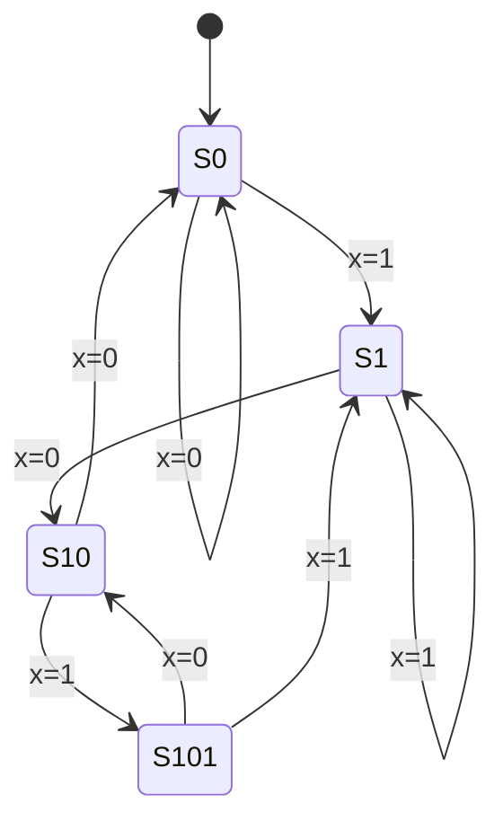

# 布尔逻辑与时序电路：数字抽象怎样建立在物理信号上

> **学习位置**：[[计算机知识/00-开始/课程地图/07-计算机组成原理-课程地图|计算机组成原理课程地图]] · **适用边界**：抽象同步电路与 RV32I 教学模型；不冒充具体芯片实现。

[PNG 备用图](../../_assets/diagrams/round3/sequential-path.png) · [可编辑图源](../../_assets/diagrams/round3/sequential-path.dot)

## 0 和 1 是约定，不是两种神奇电压

数字电路把电压范围解释为逻辑值，并用噪声容限隔离小扰动。组合电路输出由当前输入决定，但信号传播需要时间；时序电路还保存状态。CMOS 门用互补晶体管网络实现逻辑，实际功耗包括切换、短路和漏电成分，不能把“静态理想模型几乎不耗电”当成真实芯片零功耗。

从真值表到布尔式，再到门电路，是同一功能的不同表示。德摩根律让 AND/OR 与反相互相转换；卡诺图适合少量变量的人工化简，变量增加后通常需要算法工具。化简减少逻辑项不总是减少延迟或功耗，还要考虑扇出、布线、门级结构和毛刺。

## 用选择器构造功能

多路选择器根据控制位选择一路输入，译码器把编码展开成独热选择，编码器反向压缩但需要处理多个输入同时有效。加法器、寄存器写口和控制数据通路都可以从这些基本模块搭起来。

一位全加器输入为 a、b、进位 c，输出和与进位：

$$s=a\oplus b\oplus c,\qquad c_{out}=ab+ac+bc.$$

式中加号表示布尔 OR，不是整数相加。把若干全加器串联得到行波进位加法器，最高位等待低位进位逐级传播；超前进位通过组合生成与传递关系减少关键路径，但增加电路和布线成本。

## 寄存器把计算分成周期

触发器在时钟边沿采样，锁存器在某个电平窗口透明，二者不能混用。一个同步路径可抽象为“源寄存器 → 组合逻辑 → 目的寄存器”。忽略复杂时钟效应时，时钟周期必须覆盖源的 clock-to-Q、组合最大延迟和目的建立时间；实际还需加入时钟偏斜、抖动与裕量。

若三者分别为 40 ps、700 ps、60 ps，另留 100 ps 预算，周期至少约 900 ps，对应频率上界约 1.11 GHz。这只是教学时序预算，不是某工艺的性能测量。保持时间约束涉及最短路径，降低时钟频率不一定修复保持违例。

## 状态机把历史压缩成有限状态

有限状态机由状态、输入、转移和输出组成。Moore 输出依状态，Mealy 输出依状态与当前输入。以检测串行输入中是否出现 `101` 为例，状态记录已经匹配的最长有效前缀；遇到不匹配位时不一定回到初始状态，因为当前后缀可能仍是新匹配的开头。

状态编码可用二进制、独热等方式，影响触发器数量和转移逻辑复杂度。复位要定义进入哪个合法状态，以及同步或异步释放的要求。仿真中所有状态都合法不证明硬件永远不会受到瞬态错误或亚稳态影响。

### 从一句需求走到可检查的状态表

下面固定一个**允许重叠、在进入匹配态后输出 1 的 Moore 教学模型**。输入 `x` 每拍取 0 或 1；状态表示“到目前为止，输入后缀与模式 `101` 的最长前缀匹配到哪里”。

| 状态 | 已记住的有效后缀 | `x=0` 的下一状态 | `x=1` 的下一状态 | 输出 `y` |
| --- | --- | --- | --- | --- |
| `S0` | 空 | `S0` | `S1` | 0 |
| `S1` | `1` | `S10` | `S1` | 0 |
| `S10` | `10` | `S0` | `S101` | 0 |
| `S101` | 已匹配 `101` | `S10` | `S1` | 1 |

`S101 --0--> S10` 不是随意绕回：`1010` 的最长有效后缀是 `10`；这条边使下一位若为 1 时可以识别重叠的第二个 `101`。

> 图中节点是寄存器保存的抽象状态，边标签是当前输入；`S101` 的输出为 1。箭头不表示门电路没有传播延迟，也不规定真实芯片怎样编码状态。

若编码为 `S0=00, S1=01, S10=10, S101=11`，当前状态位为 `q1 q0`，D 触发器输入为 `d1 d0`，由上表可得一个化简结果：

$$d_0=x,$$

$$d_1=(q_0\land\lnot x)\lor(q_1\land\lnot q_0\land x),$$

$$y=q_1\land q_0.$$

方程只是这一种编码的结果；改变编码会改变组合逻辑，却不应改变状态表规定的可观察行为。

### 逐拍追踪 `10101`

约定在每个上升沿采样输入并更新状态，表中的输出是更新后状态的 Moore 输出：

| 上升沿编号 | 采样输入 | 沿前状态 | 沿后状态 | 沿后输出 |
| ---: | ---: | --- | --- | ---: |
| 0 | — | — | `S0`（复位） | 0 |
| 1 | 1 | `S0` | `S1` | 0 |
| 2 | 0 | `S1` | `S10` | 0 |
| 3 | 1 | `S10` | `S101` | 1 |
| 4 | 0 | `S101` | `S10` | 0 |
| 5 | 1 | `S10` | `S101` | 1 |

因此检测发生两次。若改用 Mealy 机，输出可定义在 `S10 --1--> ...` 的转移上；状态数可能更少，但输出对当前输入的组合路径更直接。二者的输出时刻必须先写清，不能只比较“用了几个状态”。

### 建立时间和保持时间约束不同路径

对“源寄存器 → 组合逻辑 → 目的寄存器”的单时钟域教学路径，先把符号方向固定下来：

- $t_{skew}=t_{capture}-t_{launch}$，也就是目的寄存器采样沿的到达时刻减去源寄存器发射沿的到达时刻；正值表示采样沿来得更晚；
- $u_{setup}$ 与 $u_{hold}$ 是分别留给抖动、片上变化和模型遗漏的非负不确定度，不能在两条式子里任意换符号。

在这个定义下，同一物理 skew 的建立时间与保持时间约束成对写成：

$$T_{clk}\ge t_{cq,max}+t_{comb,max}+t_{setup}+u_{setup}-t_{skew},$$

$$t_{cq,min}+t_{comb,min}\ge t_{hold}+u_{hold}+t_{skew}.$$

因此，正 skew 在这组约定下放宽 setup 预算，却收紧 hold 预算。若令 $t_{skew}=0$，并取 $t_{cq,max}=40\text{ ps}$、$t_{comb,max}=700\text{ ps}$、$t_{setup}=60\text{ ps}$、$u_{setup}=100\text{ ps}$，教学预算给出 $T_{clk}\ge900\text{ ps}$，频率上界约为 1.11 GHz。它只是在给定模型中的算术结果。

降低频率会拉长相邻上升沿间隔，却不会自动增加同一个采样沿之后的最短数据延迟，所以不能把降频当成保持违例的普遍修复。真实静态时序分析还要处理多个角、抖动、时钟树和片上变化。

## 跨时钟域不是多加一个 if

异步输入接近采样边沿变化可能引发亚稳态。同步器可降低错误传播概率，但不能给出绝对零风险；多位总线直接逐位同步可能得到混合版本，需要握手、Gray 编码或异步 FIFO 等协议。把软件锁的直觉搬到硬件时钟边界并不充分。

## 练习与答案

枚举全加器八组输入验证和位与进位；为 `101` 检测器输入 `10101`，允许重叠时应检测两次。把组合逻辑分成两级并插入寄存器，解释吞吐可能提高但单条数据要经过更多周期。最后区分功能仿真、时序验证和物理实现，三者提供不同证据。

进一步依据：[MIT 6.004 5.1 Sequential Logic annotated slides](https://ocw.mit.edu/courses/6-004-computation-structures-spring-2017/pages/c5/c5s1/) 的 D-register timing、setup/hold 与 single-clock timing 小节，以及 [6.1 Finite State Machines annotated slides](https://ocw.mit.edu/courses/6-004-computation-structures-spring-2017/pages/c6/c6s1/) 的状态图、转移表与实现步骤。本文额外加入的 skew 正方向、成对不等式和数值均是明示的教学模型，并非 MIT 课件中的芯片参数。

可用同一套状态表做三个反例检查：把 `S101 --0--> S0` 会漏掉重叠匹配；只给状态图却不声明输出在沿前还是沿后，会让波形相差一拍；异步复位解除若接近采样沿，功能表正确也不能证明不会出现亚稳态。

## 关联阅读

- [[计算机知识/30-计算机系统/10-组成原理系统课程/02-整数浮点与算术电路|整数、浮点与算术电路：位模式本身没有唯一含义]]
- [[计算机知识/70-编译原理/10-系统课程/01-形式语言正则与自动机|形式语言与自动机：把“能识别什么”变成可证明问题]]

## 依据与继续查证

- [RISC-V International：ISA 规范入口](https://riscv.org/specifications/ratified/)
- [RISC-V 非特权 ISA 手册](https://docs.riscv.org/reference/isa/unpriv/unpriv-index.html)

本页的例子、推演与练习为教学构造；语言契约、系统接口和版本相关结论应结合以上原始文档核对。

<!-- COURSE SEQUENCE -->
## 顺序导航与验证

[[计算机知识/30-计算机系统/10-组成原理系统课程/00-计算机组成原理系统课程索引|本课程总索引]] · [[计算机知识/_labs/round3/CO/计算机组成原理-实验说明|本课程实验]]

下一讲：[[计算机知识/30-计算机系统/10-组成原理系统课程/02-整数浮点与算术电路|整数、浮点与算术电路：位模式本身没有唯一含义]]
<!-- END COURSE SEQUENCE -->
