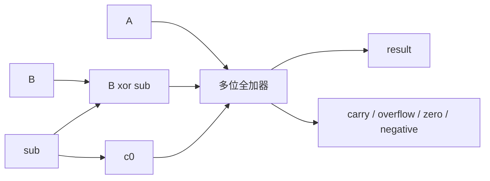

# 整数、浮点与算术电路：位模式本身没有唯一含义

> **学习位置**：[[计算机知识/00-开始/课程地图/07-计算机组成原理-课程地图|计算机组成原理课程地图]] · **适用边界**：抽象同步电路与 RV32I 教学模型；不冒充具体芯片实现。

## 同一串位可以解释成不同值

w 位无符号数范围为 0 到 $2^w-1$；常见二补码有符号范围为 $-2^{w-1}$ 到 $2^{w-1}-1$。位模式 `11111111` 在 8 位无符号解释下是 255，在二补码解释下是 -1。硬件加法器计算位与进位，语言规定这些结果何时可用、何时溢出构成错误或未定义行为，不能从硬件回绕推导 C 有符号溢出安全。

无符号加法的溢出可由最高进位反映；二补码有符号溢出发生在同号相加却得到异号结果等条件下。8 位中 127+1 得位模式 `10000000`，有符号数学结果超范围；255+1 的无符号结果模 256 为零。两个“溢出”判断不是同一个标志。

## 符号扩展与零扩展

把无符号数加宽时高位补零；二补码有符号加宽时复制符号位以保持值。截断只保留低位，不保证数学值保持。逻辑右移补零，算术右移复制符号位；具体语言对负数移位的合同要另查标准版本。

大端和小端描述多字节对象在地址上的字节顺序，不改变单个字节内部的位编号，也不直接决定网络协议字段如何解释。序列化应显式写入协议顺序，而不是直接把结构体内存发出去。

## 浮点把动态范围换成有限精度

IEEE 754 风格二进制正规数可写为

$$(-1)^s(1.f)_2\,2^{E-bias}.$$

非正规数不使用相同的隐含前导 1 规则；指数全零与全一也承担特殊编码。binary32 常见布局为 1 位符号、8 位指数、23 位显式小数位；有效精度还包括正规数的隐含位。NaN、无穷、带符号零与舍入模式都影响程序行为。

十进制 0.1 的二进制展开无限循环，因此通常需要舍入。数字越大，相邻可表示数间隔也越大。在 binary32 附近，$2^{24}+1$ 不能作为独立整数精确表示；这不是加法器“算错”，而是目标格式无法容纳该精度。

## 误差如何累积

加法先对齐指数再相加，较小数的低位可能丢失；相近数相减可能暴露输入已有误差。浮点加法不严格结合，因此并行归约与串行累加可能有不同结果。FMA 把乘加作为一次融合操作只进行一次最终舍入，可能与分开的乘法再加法不同。

比较浮点结果应根据问题误差预算使用绝对与相对容差。NaN 会让许多普通比较为假；只检查 `x < lower` 不足以保证合法有限值。数值稳定性还与算法形式有关，不能只换成更宽浮点就认为问题已经解决。

## 乘除与编码扩展

移位加法乘法、Booth 编码、阵列乘法器和树形压缩器在面积、延迟与功耗间取舍；除法可以通过迭代减法、恢复/不恢复算法或近似迭代实现。定点数把小数位位置固定，适合某些嵌入式和信号处理场景，但必须手算缩放、舍入与饱和边界。

BCD、字符编码、校验码也都是位模式解释协议。奇偶校验可检测奇数个位翻转但不能定位所有错误；Hamming 距离决定可检测和可纠正的错误数量。常见 SECDED 通过适当编码实现单错纠正、双错检测，但不覆盖任意多位损坏。

## 从全加器到共享加减数据路

一位全加器只接收三个位：`a_i`、`b_i` 和低位进位 `c_i`。它输出：

$$s_i=a_i\oplus b_i\oplus c_i,$$

$$c_{i+1}=(a_i\land b_i)\lor(a_i\land c_i)\lor(b_i\land c_i).$$

把四个全加器串起来，就得到 4 位行波进位加法器：

```text
c0 → [bit0] → c1 → [bit1] → c2 → [bit2] → c3 → [bit3] → c4
       s0              s1              s2              s3
```

> 箭头表示进位依赖，不是某颗 CPU 的布线。行波结构的高位要等待低位进位，位宽增加会拉长这条教学关键路径。

二补码减法利用 $A-B=A+(\lnot B)+1$。在共享数据路里，可以让控制位 `sub` 同时异或每个 `b_i`，并令 `c0=sub`：`sub=0` 做加法，`sub=1` 做减法。



### 三个 4 位手算

| 运算 | 逐位进位 `c0..c4` | 4 位结果 | 无符号解释 | 二补码有符号解释 |
| --- | --- | --- | --- | --- |
| `0111 + 0001` | `0,1,1,1,0` | `1000` | 7+1=8，无 unsigned carry-out | 7+1 超出 [-8,7]，发生 signed overflow |
| `1111 + 0001` | `0,1,1,1,1` | `0000` | 15+1 模 16 为 0，`c4=1` | -1+1=0，不发生 signed overflow |
| `0011 - 0101` | 等价 `0011+1010+c0`，`c0..c4 = 1,1,1,0,0` | `1110` | 常见“carry-out 表示 no-borrow”的约定下发生借位 | 3-5=-2，在范围内 |

对二补码加法，有符号溢出可用两种等价判据检查：同号输入得到异号结果，或最高位的输入进位与输出进位异或，即 $V=c_{w-1}\oplus c_w$。这个判据依赖固定二补码位宽；它不等于 C/C++ 对有符号溢出的语言合同。

`N` 常取结果最高位，`Z` 检查结果是否全零，`C` 与 `V` 分别服务无符号和有符号判断。具体 ISA 可以不提供传统条件码寄存器；例如 RV32I 用比较/分支指令表达条件，因此不能把这组标志写成所有 CPU 必有的架构状态。

### 超前进位只缩短某条依赖

定义每位生成 $g_i=a_i\land b_i$，传播 $p_i=a_i\oplus b_i$，则：

$$c_{i+1}=g_i\lor(p_i\land c_i).$$

展开到第二位可得 $c_2=g_1\lor p_1g_0\lor p_1p_0c_0$。超前逻辑并行形成这些项，减少逐位等待；代价是更多门、扇入、布线和功耗。真实加法器会使用分组、前缀树或其他实现，本页只要求看懂“减少进位依赖深度”这一机制。

## 练习与答案

将 -5 写成 8 位二补码 `11111011`，符号扩展到 16 位后值仍为 -5；零扩展则变成 251。计算 binary32 中相邻大整数为何开始合并，并用程序打印十六进制位模式验证。最后给定 4 个数据位，枚举单比特翻转，检查教学 Hamming 编码的综合校验是否能定位；不要据此宣称实际内存不会有不可纠正错误。

再为上述三个 4 位运算逐位填写 `a_i,b_i,c_i,s_i,c_{i+1}`。若答案只写十进制结果，没有固定 4 位位宽，就无法检查 carry 与 overflow。把 `0011-0101` 的 `c4=0` 直接叫作“CPU 的 borrow flag=1”也不够严谨，因为 ISA 对减法标志的命名与极性可以不同。


<!-- ROUND4 DEPTH LINKS -->
## 继续推演本页难点

[[计算机知识/30-计算机系统/10-组成原理系统课程/09-浮点舍入消去与数值稳定性|数学上相等的两个公式，为什么数值结果差很多？]] 本专题补上逐步数值或流水线状态推演。

这不是替换本页：先掌握原理，再用补充页核对容易被一句话略过的条件。
<!-- END ROUND4 DEPTH LINKS -->

## 关联阅读

- [[计算机知识/10-编程语言/03-C语言/10-系统课程/01-整数表达式与可移植计算|从比特到表达式：整数提升为什么会改变答案]]
- [[计算机知识/10-编程语言/01-Python/10-系统课程/01-对象图复制与数值语义|对象图、复制与数值语义：把名字和对象分开]]
- [[计算机知识/50-数据结构与算法/20-算法设计系统课程/08-数值几何并行与综合设计|数值、几何、并行与综合设计：算法还要面对表示误差]]

## 依据与继续查证

- [RISC-V International：ISA 规范入口](https://riscv.org/specifications/ratified/)
- [RISC-V 非特权 ISA 手册](https://docs.riscv.org/reference/isa/unpriv/unpriv-index.html)

本页的例子、推演与练习为教学构造；语言契约、系统接口和版本相关结论应结合以上原始文档核对。

<!-- COURSE SEQUENCE -->
## 顺序导航与验证

[[计算机知识/30-计算机系统/10-组成原理系统课程/00-计算机组成原理系统课程索引|本课程总索引]] · [[计算机知识/_labs/round3/CO/计算机组成原理-实验说明|本课程实验]]

上一讲：[[计算机知识/30-计算机系统/10-组成原理系统课程/01-布尔逻辑与时序电路|布尔逻辑与时序电路：数字抽象怎样建立在物理信号上]]

下一讲：[[计算机知识/30-计算机系统/10-组成原理系统课程/03-指令集寻址与数据通路|指令集、寻址与数据通路：从一条指令追踪数据]]
<!-- END COURSE SEQUENCE -->

<!-- ORIGINAL DEEP LINKS -->
## 与原有长篇专题衔接

- [[计算机知识/30-计算机系统/21-逻辑电路整数运算与CPU性能推演|21-逻辑电路整数运算与CPU性能推演]]

新旧讲解采用的版本与模型可能不同，比较时先核对各自前提，不把教学简化当成实现细节。
<!-- END ORIGINAL DEEP LINKS -->
