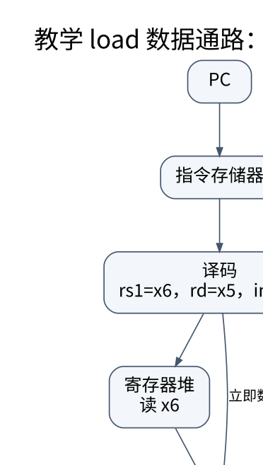
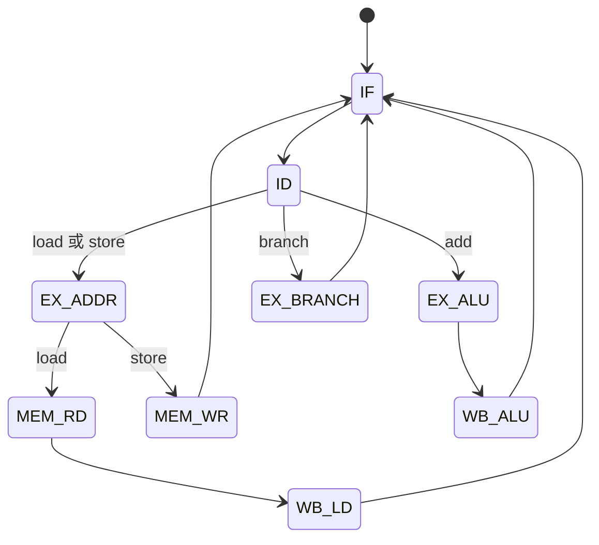

# 指令集、寻址与数据通路：从一条指令追踪数据

> **学习位置**：[[计算机知识/00-开始/课程地图/07-计算机组成原理-课程地图|计算机组成原理课程地图]] · **适用边界**：抽象同步电路与 RV32I 教学模型；不冒充具体芯片实现。

[PNG 备用图](../../_assets/diagrams/round3/datapath.png) · [可编辑图源](../../_assets/diagrams/round3/datapath.dot)

## ISA 与微体系结构的边界

指令集规定软件可观察的寄存器、指令、编码、异常等合同；微体系结构决定用单周期、多周期、流水线或乱序硬件实现。同一 ISA 可以有性能差异很大的处理器；同一高级语言也可编译到不同 ISA。ABI 进一步规定函数调用、寄存器保存、栈布局和二进制互操作，不能把它等同于 ISA。

以 RV32I 教学模型为例，整数寄存器宽 32 位，x0 读取为零；基本 load/store 架构通过显式访存指令在寄存器与内存之间传值。汇编伪指令可能展开成一条或多条真实指令，阅读性能时应看最终机器码，而不是只数源码行。

## 一条 load 的数据路径

`lw x5, 12(x6)` 的概念步骤是取出指令、译码并读 x6、把基址加符号扩展的偏移、读取有效地址处的数据、写回 x5。PC 同时按控制流规则更新。数据通路需要寄存器堆、ALU、存储接口、立即数生成与多个选择器；控制信号决定每个部件本次做什么。

`sw` 需要同样的地址计算，但数据来自源寄存器并写入内存，不写回普通目的寄存器。分支则比较条件并选择新 PC。画数据路径时分别用箭头标注数据流和控制流，避免把“控制器发出读命令”误画成控制器本身装着读取数据。

## 单周期与多周期的代价

单周期教学实现让每条指令在一个长周期内完成，时钟受最慢路径限制。短指令也要等待同样长周期。多周期把步骤分散到多个较短周期，复用部件，但不同指令占用周期数不同。性能应比较总时间，而不是只比较 CPI。

设单周期周期 800 ps、CPI=1；多周期周期 200 ps、平均 CPI=3，则平均每条指令分别为 800 ps 和 600 ps。多周期虽然 CPI 更高，仍可能更快。数字是假设例子，真实指令混合、存储延迟和控制开销必须测量。

## 寻址和调用约定

立即数、寄存器、基址加偏移、PC 相对等寻址方式表达不同来源。数组访问通常把下标乘元素大小再加基址；结构体字段使用布局偏移；栈帧通过约定寄存器定位。对齐要求、非对齐访问支持和陷阱行为依 ISA 与执行环境，不可由一台机器容忍非对齐就推广。

函数调用不仅跳转，还要保存返回地址和必要状态。调用者保存与被调用者保存寄存器约定使独立编译函数能够合作。叶函数可能不需要完整栈帧，优化也可能内联或尾调用，因此汇编中没有固定模板不表示错误。

## 异常与特权切换

同步异常由当前指令相关事件触发，例如非法指令或访问权限故障；异步中断来自外部事件。硬件记录足够状态并转移到处理入口，软件决定处理、重试或终止。系统调用是受控进入内核的接口，不是普通函数可以随意跳到某个内核地址。

## 控制器也是一个状态机

为了让“多周期”不只是一句口号，下面固定一个极简教学实现。它有架构可见的 `PC` 和寄存器堆，也有仅供实现使用的 `InstrPC`、`IR`、`A`、`B`、`ALUOut`、`MDR`。内存访问在本模型中是一个抽象接口；cache、TLB 和真实可变延迟稍后再学。

> 每个状态代表一个时钟周期内允许发生的一组组合计算和周期末更新。图没有表达 cache miss、异常或任意等待；真实控制器需要为这些事件增加握手或状态。

| 状态 | 本拍读取/组合计算 | 周期末允许更新 | 关键控制意图 |
| --- | --- | --- | --- |
| `IF` | `Mem[PC]`、`PC+4` | `InstrPC←PC; IR←Mem[PC]; PC←PC+4` | 取指 |
| `ID` | 解码 `IR`，读 `rs1/rs2` | `A←Reg[rs1]; B←Reg[rs2]` | 锁存操作数 |
| `EX_ADDR` | `A + signext(imm)` | `ALUOut←有效地址` | 地址生成 |
| `MEM_RD` | `Mem[ALUOut]` | `MDR←读取值` | 数据读 |
| `WB_LD` | `MDR` | `Reg[rd]←MDR` | load 写回 |
| `MEM_WR` | `B` 与 `ALUOut` | `Mem[ALUOut]←B` | store；不写普通目的寄存器 |
| `EX_ALU` | `A+B` | `ALUOut←和` | 算术执行 |
| `WB_ALU` | `ALUOut` | `Reg[rd]←ALUOut` | 算术写回 |
| `EX_BRANCH` | 比较 `A,B`；算 `InstrPC+imm` | 条件真时 `PC←目标` | 控制流选择 |

必须保留 `InstrPC` 或等价的“当前指令地址”，因为 `IF` 已把 `PC` 更新到顺序下一条；分支目标不能含糊地拿当前 `PC` 代替原指令地址。

### `lw x5, 12(x6)` 的逐周期账本

教学初值：`PC=0x1000`、`x6=1000`、`Mem[1012]=7`。假设指令读取与数据读取各在一个周期内完成。

| 周期 | 状态 | 周期末关键状态 |
| ---: | --- | --- |
| 1 | `IF` | `InstrPC=0x1000`，`IR=lw x5,12(x6)`，`PC=0x1004` |
| 2 | `ID` | `A=1000`；立即数字段解释为 12 |
| 3 | `EX_ADDR` | `ALUOut=1000+12=1012` |
| 4 | `MEM_RD` | `MDR=Mem[1012]=7` |
| 5 | `WB_LD` | `x5=7`；其余普通寄存器不因该写回改变 |

把 `lw` 改成 `sw x5,12(x6)` 时，第 4 拍是 `Mem[1012]←B`，没有第 5 拍寄存器写回。把它改成 `add` 时不应经过数据内存。控制表的价值就在于让这些“没有发生的更新”也能被检查。

### CPI 高不等于时间一定长

若单周期实现的周期为 800 ps、所有指令 CPI=1，平均每条为 800 ps；若上述多周期实现周期为 200 ps，某指令混合平均 CPI=3，平均每条为 600 ps。反例也成立：若内存状态必须等待多个周期或控制开销过大，多周期实现未必更快。比较对象始终是 `指令数 × CPI × 周期时间`，而不是孤立的 CPI。

## 练习与答案

手算 x6=1000 时上述 load 的有效地址为 1012，分别指出加法器输入、访存地址和写回目标。为一个三元素数组求和循环写伪汇编，标注循环变量、地址步长与分支条件。再比较源码、汇编、机器码和 ABI 文档各能回答什么，避免把编译器的一次输出当成语言标准唯一实现。

进一步检查：在上表中故意删掉 `MDR`，说明同步内存返回值要在哪里跨周期保存；再故意让 `sw` 进入 `WB_LD`，指出它会破坏哪个架构合同。教学控制 FSM 的正确不证明真实 RV32I 核的内部结构，只证明这一个明示模型对所选指令子集自洽。

## 关联阅读

- [[计算机知识/10-编程语言/03-C语言/10-系统课程/05-函数回调模块与构建边界|从函数到库：回调、封装、翻译单元和链接契约]]
- [[计算机知识/70-编译原理/10-系统课程/07-指令选择寄存器分配与后端|编译后端：把无限临时变量放进有限机器]]
- [[计算机知识/30-计算机系统/10-组成原理系统课程/04-流水线冒险与乱序执行|流水线、冒险与乱序执行：重叠工作不等于改变程序意义]]

## 依据与继续查证

- [RISC-V International：ISA 规范入口](https://riscv.org/specifications/ratified/)
- [RISC-V 非特权 ISA 手册](https://docs.riscv.org/reference/isa/unpriv/unpriv-index.html)

本页的例子、推演与练习为教学构造；语言契约、系统接口和版本相关结论应结合以上原始文档核对。

<!-- COURSE SEQUENCE -->
## 顺序导航与验证

[[计算机知识/30-计算机系统/10-组成原理系统课程/00-计算机组成原理系统课程索引|本课程总索引]] · [[计算机知识/_labs/round3/CO/计算机组成原理-实验说明|本课程实验]]

上一讲：[[计算机知识/30-计算机系统/10-组成原理系统课程/02-整数浮点与算术电路|整数、浮点与算术电路：位模式本身没有唯一含义]]

下一讲：[[计算机知识/30-计算机系统/10-组成原理系统课程/04-流水线冒险与乱序执行|流水线、冒险与乱序执行：重叠工作不等于改变程序意义]]
<!-- END COURSE SEQUENCE -->
