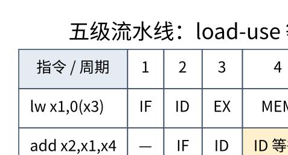

# 流水线、冒险与乱序执行：重叠工作不等于改变程序意义

> **学习位置**：[[计算机知识/00-开始/课程地图/07-计算机组成原理-课程地图|计算机组成原理课程地图]] · **适用边界**：抽象同步电路与 RV32I 教学模型；不冒充具体芯片实现。



[PNG 备用图](../../_assets/diagrams/round3/pipeline.png) · [可编辑图源](../../_assets/diagrams/round3/pipeline.dot)

## 流水线改善的是吞吐

把指令分为取指 IF、译码 ID、执行 EX、访存 MEM、写回 WB 五个教学阶段，每阶段一周期。理想情况下 n 条指令需要 $n+4$ 个周期，填满后每周期完成一条，但单条指令仍经过五个阶段。阶段延迟不均、流水寄存器开销和停顿都会降低理想收益。

若非流水实现一条指令总计 1000 ps，五阶段各 200 ps 再加 20 ps 寄存器开销，流水周期为 220 ps。大量指令的吞吐改善接近 1000/220，而非精确五倍；单条无停顿延迟为 1100 ps，甚至略增。

## 三种冒险要用不同机制解决

结构冒险来自多个操作争用同一硬件端口；数据冒险来自值尚未准备好；控制冒险来自下一条指令地址尚未确定。增加部件可以缓解结构争用，旁路可以转发结果，分支预测可以提前选择路径，但这些机制不能互相替代。

```text
add x3, x1, x2
sub x4, x3, x5
```

第二条需要第一条结果。若 ALU 结果在 EX 末尾可用，旁路可将它送到下一条 EX 输入，不必等写回再读寄存器。若前一条是 load，数据直到更晚的访存阶段才就绪，典型五级模型中的紧邻 load-use 仍需一个气泡。具体停顿数依实际时序和旁路网络，不是 ISA 固定属性。

## 分支预测承担可撤销的猜测

静态预测使用固定规则，动态预测从历史学习；两位饱和计数器比单次结果更不容易在循环退出时反复翻转。预测目标与预测方向是不同问题。预测错误后必须丢弃错误路径尚未提交的效果并恢复正确控制流。

错误路径执行可能改变缓存等微体系状态，即使架构状态被回滚，因此推测执行与侧信道防护有关。这里只讨论机制，防护要按具体硬件、内核和威胁模型核对，不能宣称“清空流水线就消除了所有信息泄漏”。

## 乱序执行如何保持依赖

真正的读后写依赖 RAW 代表数据关系，不能通过改名消除；写后读 WAR 与写后写 WAW 可能只是寄存器名称复用，可通过寄存器重命名消除。调度器在操作数和执行单元准备好时发射，重排序缓冲区等机制按架构顺序提交，以支持精确异常。

内存地址直到计算后才知道，load/store 依赖比寄存器更复杂，需要存储队列、转发、别名预测和必要的重放。编译器的重排规则、语言内存模型和处理器内存顺序是不同层，不能只观察乱序硬件就推断合法 C++ 并发行为。

## CPI 模型必须说明重叠

简单近似可写为基础 CPI 加各类停顿贡献。例如分支比例 20%、误预测率 5%、惩罚 10 周期，独立且不重叠模型下增加 $0.2\times0.05\times10=0.1$ CPI。现实中停顿可能重叠，乱序也可隐藏部分延迟，不能把所有计数器乘积直接相加当精确时间。

## 练习与答案

为 load 后立即使用画五阶段时间表，并标出插入气泡前后数据何时可用。再对三条使用同一架构寄存器的指令区分 RAW、WAR、WAW，说明哪些能改名、哪些必须等待。最后用相同指令数但不同依赖链的两个循环比较吞吐，解释为什么 IPC 不是程序正确性或算法优劣的独立指标。


<!-- ROUND4 DEPTH LINKS -->
## 继续推演本页难点

[[计算机知识/30-计算机系统/10-组成原理系统课程/10-流水线乱序与精确异常推演|较年轻指令先执行完，CPU 怎样仍报告精确异常？]] 本专题补上逐步数值或流水线状态推演。

这不是替换本页：先掌握原理，再用补充页核对容易被一句话略过的条件。
<!-- END ROUND4 DEPTH LINKS -->

## 关联阅读

- [[计算机知识/30-计算机系统/10-组成原理系统课程/03-指令集寻址与数据通路|指令集、寻址与数据通路：从一条指令追踪数据]]
- [[计算机知识/10-编程语言/02-C++/10-系统课程/06-原子内存序与并发设计|从数据竞争到 happens-before：并发正确性怎样建立]]
- [[计算机知识/70-编译原理/10-系统课程/07-指令选择寄存器分配与后端|编译后端：把无限临时变量放进有限机器]]

## 依据与继续查证

- [RISC-V International：ISA 规范入口](https://riscv.org/specifications/ratified/)
- [RISC-V 非特权 ISA 手册](https://docs.riscv.org/reference/isa/unpriv/unpriv-index.html)

本页的例子、推演与练习为教学构造；语言契约、系统接口和版本相关结论应结合以上原始文档核对。

<!-- COURSE SEQUENCE -->
## 顺序导航与验证

[[计算机知识/30-计算机系统/10-组成原理系统课程/00-计算机组成原理系统课程索引|本课程总索引]] · [[计算机知识/_labs/round3/CO/计算机组成原理-实验说明|本课程实验]]

上一讲：[[计算机知识/30-计算机系统/10-组成原理系统课程/03-指令集寻址与数据通路|指令集、寻址与数据通路：从一条指令追踪数据]]

下一讲：[[计算机知识/30-计算机系统/10-组成原理系统课程/05-缓存地址划分与AMAT|缓存地址划分与 AMAT：从一次地址访问算起]]
<!-- END COURSE SEQUENCE -->
