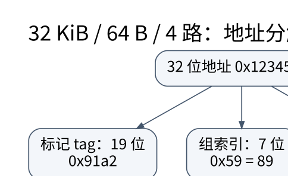

# 缓存地址划分与 AMAT：从一次地址访问算起

> **学习位置**：[[计算机知识/00-开始/课程地图/07-计算机组成原理-课程地图|计算机组成原理课程地图]] · **适用边界**：抽象同步电路与 RV32I 教学模型；不冒充具体芯片实现。



[PNG 备用图](../../_assets/diagrams/round3/cache-address.png) · [可编辑图源](../../_assets/diagrams/round3/cache-address.dot)

## 地址怎样找到缓存行

设字节寻址、地址宽 A 位、缓存数据容量 C 字节、每行 B 字节、相联度 E，则组数 $S=C/(BE)$。当 B 和 S 都为二的幂时，块内偏移位数为 $\log_2B$，组索引位数为 $\log_2S$，剩余为标记位。容量通常指数据区，不包含标签、有效位、脏位和替换元数据。

教学例子：32 位地址、32 KiB 数据缓存、64 B 行、4 路相联。共有 128 组，偏移 6 位、索引 7 位、标记 19 位。地址 0x12345678 的偏移为 0x38，组号为 0x59，标记为 0x91A2。计算时先取低 6 位，再取接下来的 7 位，而不是按十六进制字符整齐分段。

## 相联度决定冲突，不决定所有未命中

直接映射只有一个候选位置，组相联允许在同组多路中放置，全相联允许任意行。相联度提高可降低某些冲突，但增加比较、选择与替换成本。冷未命中来自首次访问，容量未命中来自工作集大于可容纳空间，冲突未命中来自映射限制；多核还可能有一致性相关失效。

两个数组若某些访问地址反复映射到同一小组，即使总大小看起来不大，也可能相互驱逐。分块改变访问顺序，让一小块数据被重复使用后再换下一块；预取则尝试提前搬运，但错误预取会消耗带宽并污染缓存。

## AMAT 的惩罚从哪里开始计时

单层串行近似为

$$AMAT=t_{hit}+m\,p_{miss},$$

其中 miss penalty 是已经付出命中检查时间后，未命中再增加的时间。若 L1 命中 1 ns、未命中率 5%，L2 查询 5 ns、L2 局部未命中率 20%、再访问内存增加 80 ns，则

$$AMAT=1+0.05(5+0.2\times80)=2.05\text{ ns}.$$

L2 局部未命中率以到达 L2 的请求为分母，全球未命中率以原始请求为分母；此例到内存的比例是 1%。把两个 20% 和 5% 不加区分直接相加会严重算错。模型假设串行层级且未计并行未命中、写回、预取与排队，适合概念推演而非真实处理器精确预测。

## 写策略与一致性责任

写直达及时向下层传播，写回先改缓存并标脏，驱逐时再写回。写未命中时可分配缓存行或绕过分配，组合选择影响带宽与局部性。CPU 执行 store 完成不自动表示数据已经到持久介质；存储缓冲、缓存层级和设备写缓存都有不同边界。

缓存替换策略如 LRU、伪 LRU、随机等有不同硬件成本。软件教程中的精确 LRU 模拟器不是对所有芯片实际策略的描述。

## 用一条地址轨迹检查映射与替换

下面固定 `4 sets × 2 ways × 16 B/line = 128 B` 的空 cache，并规定每组使用真 LRU 教学替换。offset 为 4 位、index 为 2 位：

```text
byte address: [       tag       | set(2) | offset(4) ]
block number = address >> 4
set          = block number mod 4
tag          = block number div 4
```

| 次序 | 地址 | block | set | tag | 结果 | 操作后该组 MRU→LRU |
| ---: | ---: | ---: | ---: | ---: | --- | --- |
| 1 | `0x00` | 0 | 0 | 0 | miss，填空 way | `[0]` |
| 2 | `0x10` | 1 | 1 | 0 | miss，填空 way | set 1: `[0]` |
| 3 | `0x40` | 4 | 0 | 1 | miss，set 0 尚有空位 | `[1,0]` |
| 4 | `0x00` | 0 | 0 | 0 | hit | `[0,1]` |
| 5 | `0x80` | 8 | 0 | 2 | miss，淘汰 LRU tag 1 | `[2,0]` |
| 6 | `0x40` | 4 | 0 | 1 | miss，淘汰 LRU tag 0 | `[1,2]` |

最后一次 `0x40` 不是首次访问；在一个同容量全相联、真 LRU 的教学 cache 中，四个唯一块仍能同时容纳，因此这里可归为 conflict miss。这个三分法是分析模型：预取、非阻塞 miss、替换近似和共享者都会让真实计数更复杂。

当行大小或组数不是 2 的幂时，不能机械地按整数位切片；真实硬件还可能散列索引或使用未公开映射。先写清教学参数，再做位运算。

## 写命中与写未命中要写完整配对

| 策略 | 写命中 | 写未命中 | 需要追踪的责任 |
| --- | --- | --- | --- |
| write-through + no-write-allocate | 同时写下一层 | 直接写下一层，不把整行装入 | 下层流量、写缓冲满 |
| write-back + write-allocate | 更新本层并置 dirty | 先取得行，再更新并置 dirty | dirty eviction、所有权、一致性 |

其他组合并非逻辑上不存在，但上表展示两种常见教学配对。无论哪种，CPU cache 的“写回”只表示向内存层级下一层转移责任，不能推出文件、设备 cache 或持久介质已经完成。

## 再算一次多级 AMAT

设 L1 hit time 为 1 ns，L1 local miss rate 为 10%；发生 L1 miss 后访问 L2 需 4 ns，L2 local miss rate 为 20%；发生 L2 miss 后再付出 80 ns 的主存额外代价。若本例把各项视为串行且不重叠：

$$AMAT=1+0.10\times(4+0.20\times80)=3\text{ ns}.$$

这里 L2 的 20% 是“在已经 L1 miss 的访问中又 L2 miss”的条件比例；相对于所有访问的 global L2 miss rate 是 $0.10\times0.20=2\%$。若资料给的是 global rate，就不能再次乘 L1 miss rate。乱序执行、memory-level parallelism 和预取会让程序观察到的停顿不等于这个串行平均式。

## 练习与答案

把相联度改成 8 路而容量和行大小不变，组数变 64、索引 6 位、标记 20 位，偏移仍 6 位。用短地址轨迹模拟直接映射和两路缓存，分类命中与驱逐。最后改变块大小，说明为什么空间局部性可能改善、可容纳行数却减少；不能只说“大行总更快”。

再把上面的地址序列改为 4-way、2-set、16-byte line 的同容量 cache，重新计算 index 位和替换过程。容量相同不保证冲突行为相同；相联度提高也可能增加命中路径成本，不能只凭这组短序列断言真实性能更高。

## 关联阅读

- [[计算机知识/50-数据结构与算法/10-数据结构系统课程/02-顺序链式结构与哈希设计|顺序、链式与哈希结构：代价来自访问路径]]
- [[计算机知识/55-数据库/10-系统课程/05-页布局索引与查询代价|数据库的物理组织：一条记录怎样落到磁盘页上]]
- [[计算机知识/30-计算机系统/10-组成原理系统课程/06-虚拟地址TLB与存储系统|虚拟地址、TLB 与存储系统：翻译和取数据是两件事]]

## 依据与继续查证

- [RISC-V International：ISA 规范入口](https://riscv.org/specifications/ratified/)
- [RISC-V 非特权 ISA 手册](https://docs.riscv.org/reference/isa/unpriv/unpriv-index.html)

本页的例子、推演与练习为教学构造；语言契约、系统接口和版本相关结论应结合以上原始文档核对。

<!-- COURSE SEQUENCE -->
## 顺序导航与验证

[[计算机知识/30-计算机系统/10-组成原理系统课程/00-计算机组成原理系统课程索引|本课程总索引]] · [[计算机知识/_labs/round3/CO/计算机组成原理-实验说明|本课程实验]]

上一讲：[[计算机知识/30-计算机系统/10-组成原理系统课程/04-流水线冒险与乱序执行|流水线、冒险与乱序执行：重叠工作不等于改变程序意义]]

下一讲：[[计算机知识/30-计算机系统/10-组成原理系统课程/06-虚拟地址TLB与存储系统|虚拟地址、TLB 与存储系统：翻译和取数据是两件事]]
<!-- END COURSE SEQUENCE -->

<!-- ORIGINAL DEEP LINKS -->
## 与原有长篇专题衔接

- [[计算机知识/30-计算机系统/22-缓存地址翻译一致性与存储层级推演|22-缓存地址翻译一致性与存储层级推演]]
- [[计算机知识/30-计算机系统/18-CPU拓扑缓存一致性NUMA与设备亲和性|18-CPU拓扑缓存一致性NUMA与设备亲和性]]

新旧讲解采用的版本与模型可能不同，比较时先核对各自前提，不把教学简化当成实现细节。
<!-- END ORIGINAL DEEP LINKS -->
