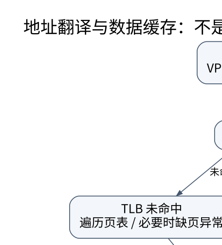

# 虚拟地址、TLB 与存储系统：翻译和取数据是两件事

> **学习位置**：[[计算机知识/00-开始/课程地图/07-计算机组成原理-课程地图|计算机组成原理课程地图]] · **适用边界**：抽象同步电路与 RV32I 教学模型；不冒充具体芯片实现。

[PNG 备用图](../../_assets/diagrams/round3/tlb-walk.png) · [可编辑图源](../../_assets/diagrams/round3/tlb-walk.dot)

## 页号与页内偏移

虚拟地址分为虚拟页号与页内偏移。页表把虚拟页映射到物理页框，并保存权限、存在状态和其他控制信息；页内偏移在翻译中保持不变。页大小 4 KiB 时偏移为 12 位，地址 0x12345 对应虚拟页 0x12、偏移 0x345。若该页映射到物理页框 0xABC，物理地址为 0xABC345。

TLB 缓存地址翻译，不缓存普通程序数据；数据缓存保存内存块。TLB 未命中不等于缺页：页表里可能已有有效映射，只需页表遍历。缺页异常则由具体页表状态与访问条件触发，可能需要分配、写时复制、从存储读取，或者因非法访问终止进程。

## 多级页表用稀疏性省空间

32 位虚拟地址、4 KiB 页、每页表项 4 B 的平铺页表需要约 4 MiB。多级页表把未使用大片地址空间对应的下层表省掉，但未命中翻译时可能需要多次访存。实际体系结构的地址位数、级数、页表项宽度和硬件遍历缓存各不相同。

大页提高 TLB reach，即条目数乘页大小覆盖的地址范围，并可能减少页表开销；代价包括内部碎片、分配连续性、迁移与权限粒度。进程切换与页表修改还涉及地址空间标识、TLB 失效和跨核 shootdown，不能只修改内存中的页表项就认为所有核心立即看到新映射。

## SRAM、DRAM 与持久存储

SRAM 常用于缓存，访问快但单位容量面积成本较高；DRAM 通过电荷保存状态，需要刷新，并具有行、列、bank 等组织。访问已经打开的行与切换行的成本可能不同，控制器通过调度和并行 bank 提高吞吐，但会引入排队与公平性权衡。

SSD 使用闪存页写入和块擦除，控制器通过映射层、垃圾回收、磨损均衡等管理物理介质。逻辑覆盖写不一定原地覆盖；写放大与可用空间、负载和控制器策略有关。顺序吞吐、随机 IOPS、延迟和耐久度是不同维度，不能用一个带宽数字概括。

## ECC 与故障模型

校验与纠错降低某些随机位错误风险，但不保证所有硬件、固件、供电或软件错误都能恢复。数据持久性还依赖写入顺序、缓存刷新、断电保护和文件系统/数据库协议。读到正确字节与知道它属于最新已提交版本是两种保证。

内存映射文件把文件内容暴露为虚拟地址，不意味着所有访问立即成为普通低延迟内存读；缺页、I/O 错误和回写依然可能发生。映射范围生命周期与文件截断等操作也可能影响访问安全。

## 练习与答案

手算上述 0x12345 的翻译，确认偏移不变。构造三种事件：TLB 未命中但页在内存、合法首次访问需要分配、访问无权限页；分别说明硬件和 OS 的职责。最后计算 64 项 TLB 在 4 KiB 页下名义覆盖 256 KiB，但说明相联冲突、多种页大小和工作集分布会使实际效果不同。

<!-- ROUND4 DEPTH LINKS -->
## 继续推演本页难点

[[计算机知识/20-操作系统/02-操作系统原理/10-系统课程/09-页表写时复制与TLB失效|fork 后父子都能读同一页，写入时为什么不互相污染？]] 本专题补上状态转移、失败时间线及模型前提。

这不是替换本页：先掌握原理，再用补充页核对容易被一句话略过的条件。
<!-- END ROUND4 DEPTH LINKS -->

## 关联阅读

- [[计算机知识/20-操作系统/02-操作系统原理/10-系统课程/05-虚拟内存置换与工作集|虚拟内存、置换与工作集：缺页的成本来自缺了哪一种页]]
- [[计算机知识/20-操作系统/01-Linux/10-系统课程/07-性能观测与故障定位|Linux 性能排障：从症状到可证伪的瓶颈假设]]
- [[计算机知识/30-计算机系统/10-组成原理系统课程/05-缓存地址划分与AMAT|缓存地址划分与 AMAT：从一次地址访问算起]]

## 依据与继续查证

- [RISC-V International：ISA 规范入口](https://riscv.org/specifications/ratified/)
- [RISC-V 非特权 ISA 手册](https://docs.riscv.org/reference/isa/unpriv/unpriv-index.html)

本页的例子、推演与练习为教学构造；语言契约、系统接口和版本相关结论应结合以上原始文档核对。

<!-- COURSE SEQUENCE -->
## 顺序导航与验证

[[计算机知识/30-计算机系统/10-组成原理系统课程/00-计算机组成原理系统课程索引|本课程总索引]] · [[计算机知识/_labs/round3/CO/计算机组成原理-实验说明|本课程实验]]

上一讲：[[计算机知识/30-计算机系统/10-组成原理系统课程/05-缓存地址划分与AMAT|缓存地址划分与 AMAT：从一次地址访问算起]]

下一讲：[[计算机知识/30-计算机系统/10-组成原理系统课程/07-一致性内存序NUMA与性能|一致性、内存序、NUMA 与性能：共享内存不是瞬时广播]]
<!-- END COURSE SEQUENCE -->

<!-- ORIGINAL DEEP LINKS -->
## 与原有长篇专题衔接

- [[计算机知识/30-计算机系统/19-容器虚拟机Namespace-Cgroup与虚拟IO|19-容器虚拟机Namespace-Cgroup与虚拟IO]]
- [[计算机知识/30-计算机系统/02-进程虚拟地址空间与内存映射|02-进程虚拟地址空间与内存映射]]

新旧讲解采用的版本与模型可能不同，比较时先核对各自前提，不把教学简化当成实现细节。
<!-- END ORIGINAL DEEP LINKS -->
