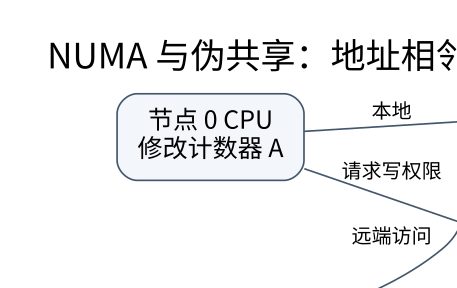
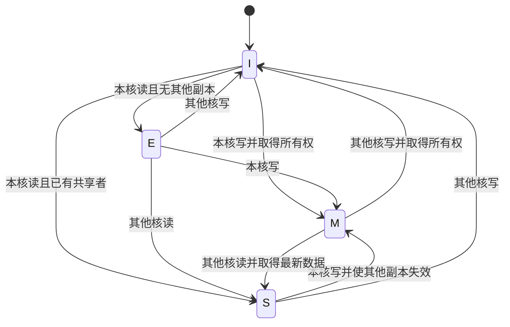

# 一致性、内存序、NUMA 与性能：共享内存不是瞬时广播

> **学习位置**：[[计算机知识/00-开始/课程地图/07-计算机组成原理-课程地图|计算机组成原理课程地图]] · **适用边界**：抽象同步电路与 RV32I 教学模型；不冒充具体芯片实现。



[PNG 备用图](../../_assets/diagrams/round3/numa-sharing.png) · [可编辑图源](../../_assets/diagrams/round3/numa-sharing.dot)

## 缓存一致性与内存一致性模型

缓存一致性协议协调同一地址或缓存行的多个副本，例如谁有写权限、谁必须失效。内存一致性模型描述不同内存操作在其他执行者眼中允许怎样排序。前者不自动赋予所有跨地址操作顺序一致性，后者也不能忽略语言层数据竞争规则。

MESI 的修改、独占、共享、无效状态是常见教学模型；实际处理器可能有更多状态、目录、探测过滤与复杂层级。协议通过消息和状态转换维护单写者等性质，而不是每次写入都立刻更新所有核心中的所有副本。

### 用一条 cache line 追踪 MESI 教学状态

本节只建一个最小模型：两个核心 `C0/C1`、同一物理 cache line `A`、写回 cache、初始两边均为 `I`。`E` 表示当前核心独占一份干净副本，`S` 表示可有多个只读副本，`M` 表示当前核心拥有唯一可写且相对下一层已修改的副本。



> 这是协议不变量的教学图。为避免线条遮蔽主路径，图省略了本核读 hit 在 `S/E/M`、本核写 hit 在 `M` 的 self-loop，也省略 eviction、替换和脏数据 writeback 转移；因此它不是完整 MESI 规范。真实系统还可能使用目录、snoop filter、Owned/Forward 等更多状态；“取得最新数据”也不规定由哪一级 cache 或内存响应。

| 步骤 | 事件 | `C0(A)` | `C1(A)` | 必须维持的事实 |
| ---: | --- | --- | --- | --- |
| 0 | 初始 | `I` | `I` | 无缓存副本 |
| 1 | `C0` 读 A | `E` | `I` | `C0` 有干净独占副本 |
| 2 | `C1` 读 A | `S` | `S` | 两个只读副本可共存 |
| 3 | `C0` 写 A | `M` | `I` | 写前取得所有权，`C1` 副本失效 |
| 4 | `C1` 读 A | `S` | `S` | `C1` 必须得到包含步骤 3 写入的数据 |
| 5 | `C1` 写 A | `I` | `M` | 唯一可写者变成 `C1` |

这张表检查的是单行的**单写者、多读者**关系。它不提供不同地址之间的全局源码顺序，也不说明语言是否允许两个线程这样访问。

### Store Buffering：先写清模型再枚举结果

初始 `x=y=0`，两个执行者分别做：

```text
P0: x=1; r0=y
P1: y=1; r1=x
```

在顺序一致（SC）的教学模型中，所有操作必须能排成一个保持各线程程序顺序的单一总序；`r0=0, r1=0` 要求两个 load 都排在对方 store 之前，会形成循环，因此不可能。

在 RVWMO 这类较弱硬件内存模型中，若没有形成所需 preserved program order，store→后续 load 的观察可以允许更弱结果；具体合法集合必须按所选 ISA 规范判断，不能只凭处理器“乱序”一词猜测。

在 C/C++ 中，若 `x/y` 是普通非原子对象且访问并发冲突，程序存在 data race，不能拿硬件 litmus 的结果集合替代语言语义。若改为 relaxed atomic，`r0=r1=0` 可以出现；若只把两个 store 标为 release、两个 load 标为 acquire，但 load 没有读到对应 release 写入，就没有因此自动建立跨线程 synchronizes-with。


> 箭头表示“上层合同需要由下一层实现”，不是说下一层 alone 就能证明上层程序正确。设备 DMA、MMIO 和 Linux 内核 barrier 还有各自 API 与配对规则。

## false sharing 是数据布局问题

两个线程分别更新不同计数器，逻辑上没有共享变量，但若计数器位于同一缓存行，该行写权限可能在核心间反复转移，造成性能下降。这叫伪共享。填充或按线程分片后归约可以减少争用，但增加内存与汇总成本，缓存行大小与对齐应按目标环境核对。

真正共享则来自线程确实读写同一状态，需要锁、原子或消息协议。把计数器移开不会修复业务竞态；把变量标成 volatile 也不是 C/C++ 线程同步方案。

## 发布数据需要跨层契约

在 C++ 中先写普通 payload，再对标志做 release store，另一个线程以 acquire load 读取到该发布值后，才能按语言规则建立对应可见性关系。编译器负责把语言合同映射到目标指令和屏障。不同体系结构可能产生不同汇编，但正确源程序语义应保持。

内核、设备 DMA 和用户态 C++ 原子使用不同接口与约束，不能把某个 `smp_*` 宏或硬件 fence 直接当成所有环境通用配方。[Linux 内存屏障文档](https://www.kernel.org/doc/html/latest/core-api/wrappers/memory-barriers.html) 也明确区分 CPU、编译器与设备相关顺序。

## NUMA 把距离带回内存模型

非统一内存访问系统中，不同 CPU 到不同内存节点的延迟和带宽不同。线程放置、首次触页策略、页迁移和共享模式会影响性能。把线程固定到某核但数据仍在远端，可能比不固定更差；过度复制也会增加一致性与内存成本。

SMT 让多个硬件线程共享核心内部资源，并不等于增加同样数量的完整核心。SIMD 对多个数据元素执行同类操作，GPU 适合大量并行工作但受内存访问、分支分歧和传输成本影响。核心数、线程数和向量宽度是不同维度。

## 用上界约束性能期待

Amdahl 定律限制串行部分带来的加速；Roofline 模型用运算强度 $I$ 与带宽上界 $B$ 给出性能上界 $P\le\min(P_{peak},B I)$。若每搬运 8 B 只做一次操作，运算强度低，增加算术单元未必有用。模型中的字节应对应讨论的存储层级，不能混用 L1 流量与 DRAM 带宽。

## 练习与答案

比较共享计数器、每线程独立但相邻计数器、每线程隔离计数器三种程序，检查正确性后测量扩展性。结果必须报告线程数、放置、数据布局和实际硬件；一次结果不能证明所有机器都存在同样瓶颈。再估算一个流式数组操作的字节数与浮点操作数，判断它更可能受带宽还是计算限制，并用计数器与计时验证猜测。

纸面复算先做两项：重放 `读0、读1、写0、读1、写1` 的状态表，任何时刻都不得同时出现两个 `M`；为 Store Buffering 枚举一个产生 `(r0,r1)=(1,0)` 的 SC 总序，再尝试为 `(0,0)` 排序并指出循环。可运行代码只能证明所测编译器、ISA 与运行条件下观察到的样本，不能证明未观察到的结果不合法。

## 关联阅读

- [[计算机知识/10-编程语言/02-C++/10-系统课程/06-原子内存序与并发设计|从数据竞争到 happens-before：并发正确性怎样建立]]
- [[计算机知识/10-编程语言/01-Python/10-系统课程/05-线程进程与解释器边界|线程、进程与解释器边界：GIL 不是同步设计]]
- [[计算机知识/20-操作系统/01-Linux/10-系统课程/07-性能观测与故障定位|Linux 性能排障：从症状到可证伪的瓶颈假设]]

## 依据与继续查证

- [RISC-V International：ISA 规范入口](https://riscv.org/specifications/ratified/)
- [RISC-V 非特权 ISA 手册](https://docs.riscv.org/reference/isa/unpriv/unpriv-index.html)
- [RISC-V RVWMO Memory Consistency Model 2.0](https://docs.riscv.org/reference/isa/unpriv/rvwmo.html)：硬件 litmus 采用该 ISA 模型语境，不把结果外推到所有 ISA。
- [C++ Working Draft N4950, 6.9.2.2 `[intro.races]` 与 33.5.4 `[atomics.order]`](https://www.open-std.org/jtc1/sc22/wg21/docs/papers/2023/n4950.pdf)：用于核对普通对象 data race 的未定义行为，以及 relaxed/release/acquire 与 synchronizes-with 条件。
- [Linux kernel memory barriers，“Abstract memory access model”“The things CPUs get up to”“Virtual machine guests”](https://docs.kernel.org/core-api/wrappers/memory-barriers.html)：用于核对内核、CPU 与设备屏障是不同合同；该文档也明确自身不是硬件规范。

本页 MESI 状态表与 Store Buffering 的 SC 排序证明为教学构造。RVWMO 合法性、C++ 抽象机和 Linux 内核屏障分别由不同来源约束；普通 C++ 数据竞争不属于“在硬件上跑一次 litmus 看见了什么”的问题。

<!-- COURSE SEQUENCE -->
## 顺序导航与验证

[[计算机知识/30-计算机系统/10-组成原理系统课程/00-计算机组成原理系统课程索引|本课程总索引]] · [[计算机知识/_labs/round3/CO/计算机组成原理-实验说明|本课程实验]]

上一讲：[[计算机知识/30-计算机系统/10-组成原理系统课程/06-虚拟地址TLB与存储系统|虚拟地址、TLB 与存储系统：翻译和取数据是两件事]]

下一讲：[[计算机知识/30-计算机系统/10-组成原理系统课程/08-总线DMA中断与系统全景|总线、DMA、中断与系统全景：处理器之外还有执行者]]
<!-- END COURSE SEQUENCE -->

<!-- ORIGINAL DEEP LINKS -->
## 与原有长篇专题衔接

- [[计算机知识/30-计算机系统/21-逻辑电路整数运算与CPU性能推演|21-逻辑电路整数运算与CPU性能推演]]
- [[计算机知识/30-计算机系统/17-通用内存分配器Arena碎片与驻留|17-通用内存分配器Arena碎片与驻留]]

新旧讲解采用的版本与模型可能不同，比较时先核对各自前提，不把教学简化当成实现细节。
<!-- END ORIGINAL DEEP LINKS -->
