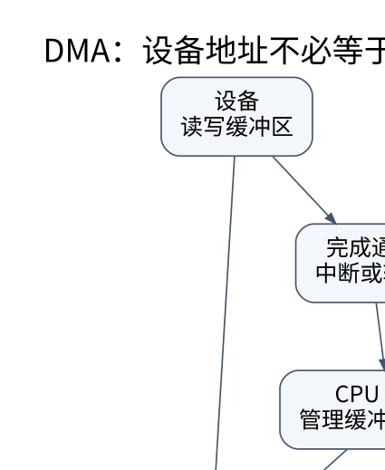

# 总线、DMA、中断与系统全景：处理器之外还有执行者

> **学习位置**：[[计算机知识/00-开始/课程地图/07-计算机组成原理-课程地图|计算机组成原理课程地图]] · **适用边界**：抽象同步电路与 RV32I 教学模型；不冒充具体芯片实现。

[PNG 备用图](../../_assets/diagrams/round3/dma-path.png) · [可编辑图源](../../_assets/diagrams/round3/dma-path.dot)

## CPU 与设备怎样交流

程序通过驱动与设备交互，驱动可能读写 MMIO 寄存器、提交描述符、映射缓冲区并处理完成通知。MMIO 地址看起来像内存地址，但访问具有设备副作用，缓存属性、宽度和顺序要求不同；不能用普通内存复制与任意优化替代设备接口。

总线与互连提供寻址、传输、仲裁和错误报告。同步或异步、串行或并行、共享总线或点对点交换结构都有不同吞吐与扩展特征。PCIe、USB、片上互连和内存总线解决的连接场景不同，不应只按“都是传数据”混成一层。

## DMA 把数据搬运交给设备

DMA 使设备直接访问映射给它的内存，减少 CPU 逐字节搬运，但 CPU 仍负责建立映射、描述符、同步与完成处理。CPU 虚拟地址、CPU 物理地址和设备使用的 DMA 地址可能不同；IOMMU 可以提供设备地址翻译和访问隔离。

一个接收流程可概括为：分配并映射缓冲区 → 把设备可用地址交给设备 → 按协议发布描述符 → 设备写入 → 完成通知 → 同步后 CPU 读取 → 回收或重新提交。非一致性平台可能需要显式缓存维护；即使一致性平台也不免除所有内存顺序要求。[Linux DMA 指南](https://docs.kernel.org/core-api/dma-api-howto.html) 是接口层的原始依据。

## 中断与轮询是负载相关的选择

中断让设备在事件发生时通知 CPU，低负载时避免持续空转；高事件率下，中断处理与上下文切换可能成为开销。轮询持续检查状态，可能降低某些延迟但消耗 CPU；混合策略在负载变化时切换或批量处理。

中断合并把多个完成事件一起通知，可减少中断次数，却可能增加单个请求等待时间。吞吐、平均延迟和尾延迟之间存在取舍，不能说“中断一定更高效”或“轮询一定更快”。设备队列深度也会影响并行度和排队。

## 从电源到启动链

系统启动涉及复位入口、固件、设备初始化、引导加载器、内核初始化和用户态服务。可信启动与测量启动解决不同信任问题；固件、微码、驱动与操作系统共同构成运行环境。电源管理通过频率、电压、休眠状态等调节性能与能耗，热限制会使同一程序在不同持续负载下表现不同。

虚拟化需要处理特权指令、地址翻译、中断与设备访问；容器主要共享内核并隔离资源视图，不等同于硬件虚拟机。加速器、持久内存、异构计算、可靠性与侧信道属于进一步分支，原库的 CUDA 和系统专题可继续深入。

## 综合项目：一个教学处理器的可观察执行

实现小型指令解释器，支持整数算术、load/store、条件跳转与 halt；定义地址边界、对齐和非法指令行为。对同一程序输出每步 PC、寄存器变化和访存记录。再在记录上模拟缓存与五级流水线，明确这是性能模型，不是真实硬件仿真器。

验收包括：指令语义单元测试、跳转边界、越界访存拒绝、负立即数符号扩展、缓存地址拆分、流水线依赖停顿和 CPI 计算。把“功能是否正确”与“性能模型是否合理”分别写报告。这样组成原理就能从逻辑门、位表示、ISA 一直连接到操作系统与性能分析，而不是孤立地背硬件名词。

## 关联阅读

- [[计算机知识/30-计算机系统/10-组成原理系统课程/03-指令集寻址与数据通路|指令集、寻址与数据通路：从一条指令追踪数据]]
- [[计算机知识/20-操作系统/02-操作系统原理/10-系统课程/06-文件系统I_O与崩溃一致性|文件系统、I/O 与崩溃一致性：可见、写完和持久不是同义词]]
- [[计算机知识/20-操作系统/01-Linux/10-系统课程/04-启动服务日志与资源管理|启动与服务管理：进程存在，不代表服务已经可用]]

## 依据与继续查证

- [RISC-V International：ISA 规范入口](https://riscv.org/specifications/ratified/)
- [RISC-V 非特权 ISA 手册](https://docs.riscv.org/reference/isa/unpriv/unpriv-index.html)

本页的例子、推演与练习为教学构造；语言契约、系统接口和版本相关结论应结合以上原始文档核对。

<!-- COURSE SEQUENCE -->
## 顺序导航与验证

[[计算机知识/30-计算机系统/10-组成原理系统课程/00-计算机组成原理系统课程索引|本课程总索引]] · [[计算机知识/_labs/round3/CO/计算机组成原理-实验说明|本课程实验]]

上一讲：[[计算机知识/30-计算机系统/10-组成原理系统课程/07-一致性内存序NUMA与性能|一致性、内存序、NUMA 与性能：共享内存不是瞬时广播]]
<!-- END COURSE SEQUENCE -->
