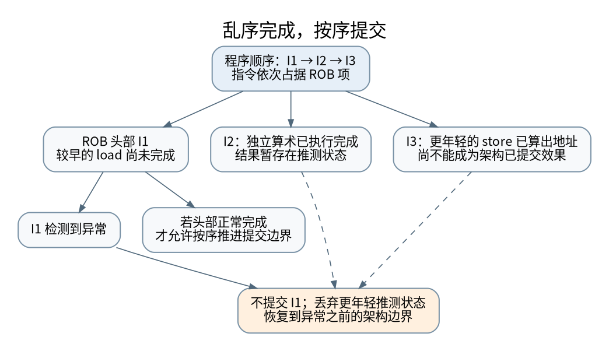

# 先算完不等于先提交：流水线、重命名与精确异常

> **本页要解决**：较年轻指令先执行完，CPU 怎样仍报告精确异常？
>
> **先修**：[[计算机知识/30-计算机系统/10-组成原理系统课程/04-流水线冒险与乱序执行|流水线、冒险与乱序执行：重叠工作不等于改变程序意义]]。
>
> **阅读入口**：[[计算机知识/30-计算机系统/10-组成原理系统课程/00-计算机组成原理系统课程索引|本学科主索引]] · [[计算机知识/00-开始/全局导航/11-难点导读与研究证据|全局难点导读]]。

**版本、模型与证据边界**：区分 ISA 可观察合同、特定微架构和教学模型；没有真实 CPU/存储硬件故障实验。

## 程序顺序、执行顺序、提交顺序不是一条线

程序以指令顺序定义架构可见结果，处理器却可以让独立指令提前执行，用来隐藏等待。乱序执行的核心不是“完全不按顺序”，而是保留依赖与可恢复状态，只放松允许放松的内部时序。

本节用一个简化的重命名、保留站和重排序缓冲区模型说明机制，不把具体周期数套给所有 x86 或 RISC-V 核。BOOM 的公开设计提供了一个实际 ROB 实现，可对照“忙位、异常信息和队首提交”的角色。[^boom]

## 真依赖不能靠换名字消除

假设 I0 写 r1，I1 读 r1，I1 需要 I0 的真实结果，这是 RAW 数据依赖。若 I0 读 r1、I1 写 r1，则是 WAR 名字冲突；两条指令都写 r1 则有 WAW 名字冲突。寄存器重命名为每次写分配新的物理寄存器，能消除后两种复用名字导致的约束，不能凭空提前得到真依赖的数据。

例如 I0 `r1=r2+r3` 分配物理 P10，I1 `r4=r1*2` 的源绑定 P10；I2 `r1=r5+r6` 再分配 P11。I2 即使先完成，也不会让 I1 误读 P11，因为 I1 在重命名时已捕获其应读取的版本。这与 [[计算机知识/70-编译原理/10-系统课程/10-活跃性不动点与抽象解释|SSA 与数据流]] 的“每次定义有独立身份”相似，但硬件物理寄存器仍需动态回收和异常恢复。

## 用页故障而不是含糊的“算错了”追踪精确异常

考虑三条指令：I0 从尚未完成地址翻译的地址加载 r1；I1 独立计算 r4；I2 把 r4 存到内存 q。I1 可以先完成，I2 可以先算出地址和待写数据，但不能在 I0 的可恢复性尚未确定时，让年轻 store 作为不可撤销架构效果越过它。

[矢量图](../../_assets/diagrams/round4/rob-commit.svg) · [可编辑图源](../../_assets/diagrams/round4/rob-commit.dot)

若 I0 最终报告页故障，处理器应呈现某个精确边界：更老指令的效果已提交，I0 的架构效果未完成，更年轻指令的架构效果未提交。异常处理程序可修复映射并重试适当指令，而不必猜“r4 是不是来自未来”。

这里特意不用“整数除零必然陷阱”作跨架构例子：有些 ISA 对整数除零规定返回值而不是异常。ISA 的异常合同与微架构实现必须分别查证，不能因为熟悉一个平台就泛化到另一个。

## ROB 的作用是保留可提交前缀

ROB 按程序次序记录未提交指令。执行完成时更新对应项的完成状态、结果位置或异常标记；提交逻辑从队首检查，只有条件满足的前缀才能退休。年轻指令即使完成，也可能等待一个较老的缓存缺失。[^boom]

寄存器重命名映射、空闲物理寄存器和 store 队列都有恢复要求。分支预测错误时，要丢弃错误路径上的年轻项，恢复正确路径的映射与资源状态。不能只把 PC 改回去，而留下错误路径产生的寄存器绑定继续流入后续执行。

精确异常并不意味着缓存、预测器等微架构状态都回到没有执行过的样子。推测访问可能留下时序可观察的痕迹，因此“架构结果没有提交”和“完全没有安全副作用”不等价。这个边界也解释了为何安全研究会关心推测执行。

## 内存依赖比寄存器依赖更晚才能确定

两个寄存器名字是否相同在译码后就清楚；两个内存地址是否相同可能要等地址计算完成。年轻 load 有时在较老 store 地址尚未确定时推测前进，后来发现冲突则需要重放。store-to-load forwarding 可以从较老待提交 store 提供正确数据，但要处理地址范围、部分覆盖与顺序要求。

CPU 支持乱序执行不等于语言允许数据竞争。[[计算机知识/10-编程语言/02-C++/10-系统课程/11-原子发布线性化与回收边界|C++ 内存模型]] 规定程序可观察行为，编译器与硬件共同实现它。cache coherence、内存一致性模型、单线程精确异常又各回答不同问题，不能把“有 ROB”当成所有线程都按顺序观察内存的证明。

## 用简化模型算性能时，先写不可重叠假设

若基础 CPI 为 0.8，分支占指令比例 0.18，分支错误率 0.04，每次错误附加 15 周期，并假设这些损失不互相重叠，则估计

$$
CPI\approx0.8+0.18\times0.04\times15=0.908.
$$

这里 0.04 是“分支中的错误比例”，不是所有指令中的比例。现实处理器中缓存缺失、分支恢复和资源等待可能重叠，简单相加只是指定模型下的近似。超标量机器也可有 CPI<1，不能把单发射五级流水线的吞吐上限当普遍规律。

ROB 扩大可以容纳更多在途指令，但收益受可用并行性、物理寄存器、访存队列、缓存和带宽限制。更大的窗口也有功耗和关键路径成本。性能调优应回到 [[计算机知识/85-综合贯通/03-从复杂度到尾延迟的性能证据链|测量与瓶颈证据]]，而不是假定每个硬件参数越大越好。

## 实验边界

本轮提供一个抽象 ROB 状态模型：让年轻指令先完成，再让队首出现异常，检查只提交更老前缀；另验证重命名版本不会被年轻同名写覆盖。这不是周期精确 CPU 模拟器，不验证真实处理器漏洞，也不声称覆盖内存模型全部允许执行。

[^boom]: Berkeley Out-of-Order Machine 官方 [The Reorder Buffer and the Dispatch Stage](https://docs.boom-core.org/en/latest/sections/reorder-buffer.html)，ROB 状态、异常与提交；本课时间线为简化教学模型。

## 知识连接：下一步应追问什么

提交顺序是架构可观察边界；语言内存序、TLB 和优化合法性要在各自模型中推导。

[[计算机知识/10-编程语言/02-C++/10-系统课程/11-原子发布线性化与回收边界|原子操作之间缺了什么：发布、线性化与内存回收]]：所有字段都是 atomic，为什么整体操作仍可能错误？

[[计算机知识/20-操作系统/02-操作系统原理/10-系统课程/09-页表写时复制与TLB失效|一张页经历了什么：多级页表、写时复制与 TLB 失效]]：fork 后父子都能读同一页，写入时为什么不互相污染？

[[计算机知识/70-编译原理/10-系统课程/10-活跃性不动点与抽象解释|从集合传播到安全近似：活跃性、不动点与抽象解释]]：不动点算出来了，为什么还不能自动证明优化正确？

[[计算机知识/85-综合贯通/04-跨层保证与反例矩阵|跨层保证辨析：类型、原子、隔离、一致性与持久性]]：一句“这是安全的”到底省略了哪一层前提？

## 本地核验与阅读顺序

[[计算机知识/_labs/round4/README|本轮实验：命令、检查范围与未执行项目]] 提供对应文件和记录。[[计算机知识/90-资源/维护/导入-com/_meta/round4/01-研究证据与版本边界|研究证据索引]] 区分规范、推演和实验；[[计算机知识/90-资源/维护/导入-com/_meta/round4/02-缺口回查与后续验证|仍需进一步验证的边界]] 不把概览或模型标成完整实现。

上一专题：[[计算机知识/30-计算机系统/10-组成原理系统课程/09-浮点舍入消去与数值稳定性|误差来自哪里：浮点舍入、消去与数值稳定性]]。 返回 [[计算机知识/30-计算机系统/10-组成原理系统课程/00-计算机组成原理系统课程索引|课程与问题索引]]，用不看原文的复算检验是否真正理解。
