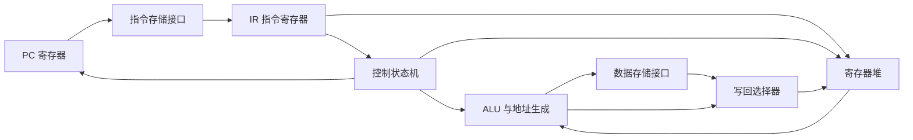

# 组成原理深化：从逻辑电路到 CPU 性能

> 阅读定位：教学模型与具体 ISA、微架构实现分开。返回 [[计算机知识/00-开始/课程地图/07-计算机组成原理-课程地图|计算机组成原理 · 课程地图]]；全域入口 [[计算机知识/00-开始/全局导航/00-总学习地图|计算机知识库 · 总学习地图]]。

> [!note] 本轮证据范围
> 已实际打开 MIT 6.004 Spring 2017 的课程模块目录，核对其从 digital abstraction、combinational/sequential logic、FSM、ISA、Building the Beta、cache 到 pipelining 的递进关系；本页新增的门延迟、三条指令、流水线罚时与 Amdahl 数字均为明示教学构造，并已逐式手算。未运行 HDL、ISA 模拟器或真实 CPU benchmark。

## 组合逻辑与时序逻辑

组合电路的输出由当前输入决定，例如加法器、多路选择器和译码器；时序电路保存状态，例如寄存器和有限状态机。时钟不是让组合逻辑瞬间完成，而是约束数据在寄存器之间传播、稳定和采样。建立/保持时间、传播延迟和时钟偏差决定可靠时序。

多位加法可以从全加器串联理解：每位同时处理两个数据位和进位。补码把加减法统一到模数表示中，但有符号溢出与无符号进位不同。两个正数相加得到负的补码结果可能发生有符号溢出；最高位产生进位本身则不足以判定有符号溢出。

乘法可理解为移位加法，除法为试减和移位等过程，Booth 等方法优化特定表示中的操作；真实硬件可能用更复杂并行结构。浮点加法还需对阶、尾数运算、规格化和舍入，NaN、无穷、次正规数和异常条件不应被忽略。

## 指令与数据通路

取指读取指令，译码判断操作，读寄存器与立即数，执行计算或地址生成，必要时访问内存，最后写回。控制器选择数据路径，多路复用器不是多余装饰，而是把同一硬件资源用于不同指令。ISA 定义软件可依赖的行为，微架构决定怎样实现它。

![[计算机知识/_assets/diagrams/cpu.svg]]

## 三个性能因子要同时看

简化的 CPU 时间为：

$$T=IC\times CPI\times T_{\mathrm{cycle}}=\frac{IC\times CPI}{f}.$$

IC 是实际执行指令数，CPI 为平均每条指令周期数，f 为时钟频率。某机器 1 GHz、IC=10^9、CPI=1 的模型时间为 1 秒；另一机器 2 GHz 却需要 CPI=3，若 IC 相同则为 1.5 秒。频率更高不保证程序更快，不同 ISA/编译选项还会改变 IC。

流水线改善稳态吞吐，不必改善单条指令延迟。假设五个阶段各 2 ns，单周期路径 10 ns；每阶段增加 0.2 ns 寄存器开销后，流水时钟至少 2.2 ns，单指令穿过五阶段约 11 ns，长序列理想吞吐却显著提高。数据、控制和结构冒险会引入停顿；转发不能消除所有依赖，分支预测也会失败。

## Amdahl 定律的真实含义

可加速比例 p、该部分加速 s，整体加速为 $1/((1-p)+p/s)$。若 p=0.9、s=10，整体约 5.26 倍，不是 10 倍；剩余串行部分与新增通信还会限制结果。公式要求比较的是同一任务与可分解的时间模型，不直接描述所有扩展规模实验。

练习：分别改变 IC、CPI、频率，解释为什么只统计汇编条数无法估计性能。列出流水线中相邻 load-use 依赖与分支错误的可能停顿来源，而不是直接背“几级流水快几倍”。

## 综合推演：零件怎样组成一台教学 CPU

前面的短课分别解释逻辑、算术、控制和流水线；本节只做组合，不重新发明第二套定义。固定一个 load/store 教学子集和以下模块：



> 粗箭头没有表示真实线宽；“指令/数据存储接口”也没有承诺是独立 cache。时钟边沿只更新寄存器状态，组合模块在边沿之间传播值。

给程序：

```text
I1: lw  x5, 0(x6)
I2: add x7, x5, x8
I3: beq x7, x0, target
```

在架构层，必须保持的只是：I1 把内存值写入 `x5`，I2 读取该值形成 `x7`，I3 按 `x7` 决定下一条 PC。多周期实现可用 `IR/A/B/ALUOut/MDR` 保存中间值；流水实现则用阶段寄存器保存对应版本。两者内部状态不同，却应给出相同架构结果。

| 指令 | 不能被后继绕过的真依赖 | 可以变化的实现选择 |
| --- | --- | --- |
| I1 → I2 | I2 使用 I1 产生的 `x5` | 等写回、旁路，或在乱序核中等待物理寄存器就绪 |
| I2 → I3 | 分支比较要使用新 `x7` | 预测方向和目标、何时解析、错时清空多少工作 |
| I1 访存 | load 必须获得该地址的合法值或异常 | cache/TLB 层级、未命中是否与其他请求重叠 |

## 从关键路径到周期时间

再固定一组**教学延迟**：IF 250 ps、ID 120 ps、EX 180 ps、MEM 400 ps、WB 100 ps，每个流水寄存器增加 30 ps。若单周期把五段串在一个周期内，最慢 load 路径至少约：

$$250+120+180+400+100=1050\text{ ps}.$$

若理想分成五级，时钟周期受最慢 MEM 阶段约束：

$$T_{pipe}\ge\max(250,120,180,400,100)+30=430\text{ ps}.$$

这不是“频率提高到 $1050/430$ 后所有程序都快同样倍数”。对三条指令，理想五级流水需要 $3+4=7$ 拍，即 3010 ps；单周期需要 $3\times1050=3150$ ps。若紧邻 load-use 停 1 拍、分支预测失败又丢弃 2 拍，流水总计 10 拍，即 4300 ps，反而更慢。

```text
理想时间表（每格一拍）
        1   2   3   4   5   6   7
I1 lw   IF  ID  EX  MEM WB
I2 add      IF  ID  EX  MEM WB
I3 beq          IF  ID  EX  MEM WB
```

> 时间表只展示理想占位；`add/beq` 是否真的经过 MEM/WB 以及分支罚时由教学流水规格决定。上面的 1+2 停顿是另加的假设，不是 RISC-V ISA 属性。

长序列更能摊薄填充/排空：100 条无停顿指令的理想流水约 $104\times430=44.72\text{ ns}$，单周期约 105 ns。但真实 IC、CPI、周期和内存停顿会一起变化；插入更多流水级可能升频，也会增加旁路、预测、恢复、功耗和寄存器开销。

## 用 Amdahl 检查“只优化 ALU”

若端到端时间中 ALU 相关可优化部分仅占 20%，即使让该部分无限快，理想整体加速也不超过：

$$\frac{1}{(1-0.2)+0.2/\infty}=1.25.$$

若优化同时增加寄存器、复制或 cache miss，真实收益更低甚至为负。Amdahl 的 `p` 必须来自同一任务和同一计时边界；不能用“ALU 在数据通路图里很显眼”估计占比。

## 组合页的验收问题

1. 从 I1 到 I3 标出架构状态、临时状态和控制状态；若三者都叫“寄存器”，说明还不够精确。
2. 修改 MEM 延迟为 600 ps，重新算单周期与五级流水周期；再解释为何这仍不是程序实测。
3. 给 I1 一个 page fault，指出异常/重试由 [[计算机知识/30-计算机系统/08-异常中断系统调用与特权级|异常、中断、系统调用与特权级]] 解释，本页不能把它当普通 1-cycle miss。
4. 解释“流水线吞吐提高”“单条延迟降低”“端到端程序更快”为什么是三条不同主张。

## 把知识接起来

[[计算机知识/30-计算机系统/22-缓存地址翻译一致性与存储层级推演|组成原理深化：缓存、地址翻译与一致性的定量模型]]；[[计算机知识/70-编译原理/20-数据流优化正确性与编译知识全景|编译原理深化：数据流、不动点和优化正确性]]；[[计算机知识/10-编程语言/03-C语言/01-程序执行类型与表达式|C：从一个程序理解类型、表达式与执行]]；[[计算机知识/50-数据结构与算法/23-正确性证明反例与复杂度边界|算法设计深化：证明、反例与复杂度边界]]。

先修零件主解释：[[计算机知识/30-计算机系统/10-组成原理系统课程/01-布尔逻辑与时序电路|布尔逻辑与时序电路]]、[[计算机知识/30-计算机系统/10-组成原理系统课程/02-整数浮点与算术电路|整数与算术电路]]、[[计算机知识/30-计算机系统/10-组成原理系统课程/03-指令集寻址与数据通路|指令集与数据通路]]、[[计算机知识/30-计算机系统/10-组成原理系统课程/04-流水线冒险与乱序执行|流水线、冒险与乱序执行]]。这些页定义零件，本页只负责组合与量纲检查。

## 规范与进一步核对

- [MIT 6.004 Computation Structures, Spring 2017](https://ocw.mit.edu/courses/6-004-computation-structures-spring-2017/)：本页使用课程目录中的 2/4/5/6（数字抽象、组合/时序逻辑、FSM）、9/13（ISA 与 Building the Beta）、14/15（cache 与 pipeline）作为知识顺序依据；没有把 Beta 数据通路冒充 RV32I 实现。
- [[计算机知识/90-资源/10-本轮权威资料与版本边界#组成原理|组成原理原始资料]] 保留更广的课程级来源入口。

正文中的 250/120/180/400/100 ps、30 ps 流水寄存器开销、1+2 拍罚时和 20% ALU 占比都是本库教学构造；它们只验证公式、单位和依赖关系，不自动等于某一实现。

<!-- ROUND3 BRIDGE -->
## 进一步推演与交叉核验

本页主题的补充机制、反例和练习：

- [[计算机知识/30-计算机系统/10-组成原理系统课程/07-一致性内存序NUMA与性能|一致性、内存序、NUMA 与性能：共享内存不是瞬时广播]]

阅读时对照两页的版本、模型与接口前提；教学简化模型不覆盖具体实现的全部行为。
<!-- END ROUND3 BRIDGE -->
