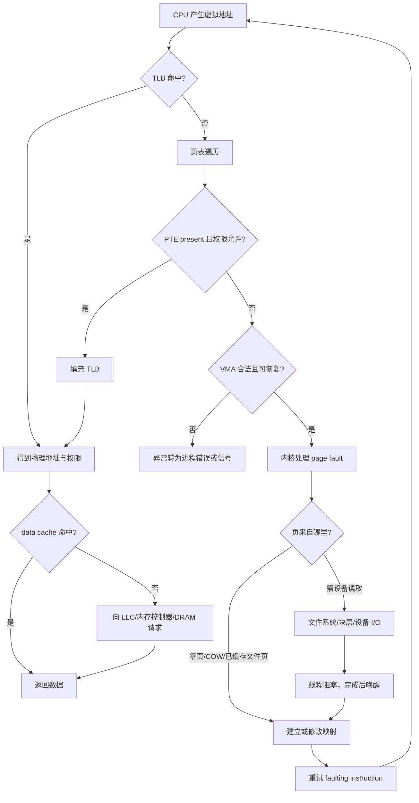

# 组成原理深化：缓存、地址翻译与一致性的定量模型

> 阅读定位：教学模型与具体 ISA、微架构实现分开。返回 [[计算机知识/00-开始/课程地图/07-计算机组成原理-课程地图|计算机组成原理 · 课程地图]]；全域入口 [[计算机知识/00-开始/全局导航/00-总学习地图|计算机知识库 · 总学习地图]]。

> [!note] 本轮证据范围
> 已实际打开 Linux 内核 `Page Tables` 文档，核对页表层级、折叠层级、huge pages 与 page fault 语境；cache 拆位、PFN 映射、6.2 ns 期望值和条件图是明示教学构造。未读取当前进程页表、性能计数器或设备 trace，也不把 Linux 软件对象当作所有 ISA/OS 的固定实现。

## 缓存利用的是局部性，不是神奇地扩大速度

时间局部性来自近期访问可能再次使用，空间局部性来自相邻地址可能很快使用。缓存按行搬运数据，直接映射、组相联和全相联限制一个块能放到哪里。命中要检查索引和标记；容量冲突、集合冲突和首次访问的未命中原因不同。

教学模型的平均访问时间为：

$$AMAT=H+mP.$$

H 为命中时间，m 为未命中率，P 为未命中后额外代价。若 H=1 ns、m=0.05、P=60 ns，则为 4 ns。这里 P 必须是额外代价，不能把已包含 H 的总时延再重复相加。多级缓存中各层未命中率要区分局部与全局定义。

## 地址分解手算

32 位虚拟地址、4 KiB 页，低 12 位是页内偏移，高 20 位是虚拟页号。若采用简单线性页表且每项 4 字节，完整页表约 4 MiB；多级页表只为需要的地址区域分配中间结构，代价是遍历与缓存设计更复杂。

TLB 缓存地址翻译；TLB miss 需要重新找翻译，不一定缺页。page fault 是体系结构异常，可能是缺少映射、写时复制、权限问题或需要调入数据，不是全部都访问磁盘。页表把虚拟页映射到物理页，缓存行组织数据访问，二者不能混成一个“内存缓存”。

![[计算机知识/_assets/diagrams/memory.svg]]

## 一致性与内存一致性模型

缓存一致性协议协调同一地址的数据副本，内存一致性模型约束多个读写在不同执行者看来可以是什么顺序。即使每个地址的副本一致，多个地址之间的操作仍可能出现语言程序员不期待的交错，需要适当同步。

false sharing 让不同变量因共享缓存行而相互干扰，NUMA 让访问不同内存位置具有不同成本。统一物理地址空间不等于统一访问时延。预取、乱序执行、写缓冲和推测执行改善性能，也使“源码上一句接一句”不能直接当作硬件时间线。

## 完整存储与 I/O 地图

SRAM 常用于缓存，DRAM 用作主存，刷新和行缓冲影响访问；闪存涉及擦除块、写放大与磨损管理；磁盘涉及寻道和旋转延迟。总线、PCIe、DMA、中断、轮询与设备队列组织数据搬运。ECC 处理特定错误模型，不能防止所有数据损坏；内存屏障也不能替代对存储设备持久化协议的理解。

练习：为行主序二维数组比较按行与按列遍历，先估计行访问和工作集，再测量。把页错误、TLB miss、LLC miss、设备读分别放到不同观察指标上，禁止用一个指标替代所有层次。

## 综合推演：一次 load 没有固定瀑布路径

对一条用户态 load，先问翻译是否存在，再问目标物理数据在哪一层。TLB miss、data-cache miss 和 page fault 是不同事件；它们也不保证按一条简单串行链每次全部发生。



> 图只表达条件与责任转移。页表遍历本身也会访问 cache/DRAM；data cache 查找可能与翻译部分重叠；设备 I/O 只在缺失页确实需要外部数据时出现。

## 同一个地址同时有两种拆分

教学条件：32-bit VA、4 KiB page；翻译结果把 `VA=0x1234abcd` 的 VPN `0x1234a` 映射到 PFN `0x0abcd`，因此 `PA=0x0abcdbcd`。页内 offset 是 `0xbcd`，翻译前后保持不变。

再假设 data cache 为 32 KiB、8-way、64 B/line，共 64 sets。对**物理索引、物理 tag 的教学 cache**：

- line offset：PA 低 6 位，为 `0x0d`；
- set index：再上 6 位，为 `0x2f`（47）；
- tag：PA 高于 bit 11 的部分，为 `0x0abcd`。

| 层次 | 输入名字 | 拆分 | 粒度/作用 |
| --- | --- | --- | --- |
| 页表/TLB | virtual address | VPN `0x1234a` + page offset `0xbcd` | page；翻译与权限 |
| data cache | physical address（本教学模型） | tag `0x0abcd` + set `0x2f` + line offset `0x0d` | cache line；数据副本 |

这个例子刚好有 `sets × line size = 4 KiB`，因此 set index 落在页内 offset 中。真实处理器可能使用 VIPT/PIPT、更多层级、不同页大小与别名处理；不能从本表推断某 CPU 的 cache 组织。

## 情形 A：页已驻留，只是 TLB/cache 未命中

假设页表项存在、权限允许，数据已在 DRAM。TLB miss 触发硬件或软件参与的翻译查找；翻译完成后 data-cache miss 再把目标 line 带入 cache。**不会因此进入块设备 I/O**。

给一个明确串行上界模型：基础命中 1 ns；TLB miss 率 1%，每次额外 20 ns；data-cache miss 率 10%，每次额外 50 ns。若暂时假设二者独立且额外代价不重叠：

$$E[T]=1+0.01\times20+0.10\times50=6.2\text{ ns}.$$

这是教学期望值，不是 CPU stall 实测。乱序执行、page-walk cache、memory-level parallelism、预取和 miss 相互相关都会破坏这些简化假设。

页表遍历也不是固定“读四次内存”：页表层数、huge page、walk cache、上级 PTE 的 cache 命中和 ISA 都会改变访问。[[计算机知识/30-计算机系统/16-地址翻译TLB页表遍历与大页|地址翻译、TLB、页表遍历与大页]] 是这部分的主解释。

## 情形 B：合法 file-backed 页尚未驻留

若 PTE 表示页当前不在内存，但 VMA 允许读取一个文件映射，CPU 报告 page fault。内核检查映射与权限；若 page cache 已有目标页，可建立映射后重试；若缺页需要存储读取，线程可能阻塞，设备通过队列/DMA 完成传输，内核唤醒线程，再重试原 load。

```text
faulting load
  → 同步异常入口
  → VMA/PTE/权限检查
  → page cache lookup
      ├─ hit: 建 PTE → 返回 → 重试
      └─ miss: 文件系统/块层/设备请求
                 → 当前线程阻塞
                 → DMA/完成通知
                 → 页变为可用，建 PTE
                 → 唤醒 → 返回 → 重试
```

这条路径可能跨微秒到更长数量级，但不能用一个固定设备延迟精确相加：队列、文件系统、介质、回收、调度和并发负载都会变化。`page fault` 也可能是匿名零页、COW、权限错误或无效地址，只有其中一部分需要设备读取。

## 把层次放回各自主解释

| 事件 | 主解释 | 本页只做什么 |
| --- | --- | --- |
| tag/index/offset、AMAT | [[计算机知识/30-计算机系统/10-组成原理系统课程/05-缓存地址划分与AMAT\|缓存地址划分与 AMAT]] | 把 data-cache 结果接到 load |
| DRAM bank/row/refresh | [[计算机知识/30-计算机系统/23-DRAM组织行缓冲刷新与ECC\|DRAM 组织、行缓冲、刷新与 ECC]] | 说明 cache miss 后仍有内部状态 |
| TLB/page walk | [[计算机知识/30-计算机系统/16-地址翻译TLB页表遍历与大页\|地址翻译、TLB、页表遍历与大页]] | 区分翻译 miss 与页不存在 |
| fault/异常入口 | [[计算机知识/30-计算机系统/08-异常中断系统调用与特权级\|异常、中断、系统调用与特权级]] | 串起暂停、处理和重试 |
| page cache/设备 | [[计算机知识/30-计算机系统/11-存储设备块层页缓存与持久化\|存储设备、块层、页缓存与持久化]] | 只画确需 I/O 的分支 |
| coherence/内存序 | [[计算机知识/30-计算机系统/10-组成原理系统课程/07-一致性内存序NUMA与性能\|一致性、内存序、NUMA 与性能]] | 提醒其他核心与设备也是观察者 |

## 自测：改变一个前提会走哪条边

1. TLB miss、PTE present、L1 miss：走 page walk 与下级 cache/内存路径，不走 page-fault handler；只有再声明相关下级 cache 也 miss，才能断言请求最终到 DRAM。
2. TLB miss、PTE not present、VMA 合法且 page cache hit：发生 page fault，但不必设备 I/O。
3. TLB hit，但 TLB 中缓存的权限不允许写：data cache 中即使有行，也不能把 cache hit 当成授权；该访问仍会触发相应权限异常。
4. `mmap` 文件页尚未访问：建立 VMA 不等于数据已驻留；首次 load 才可能触发 fault。
5. 把 4 KiB page 改成 huge page：VPN/offset 与 reach 改变，cache line offset 不因此变成页大小。

完成本页的标准是：能为一个 load 先选择条件路径，再用正确主解释计算每一层；不会把 TLB miss、LLC miss、page fault、major fault 和设备读合并成“缓存没命中”。

## 把知识接起来

[[计算机知识/20-操作系统/02-操作系统原理/03-虚拟内存置换文件系统与崩溃边界|操作系统：虚拟内存、置换与崩溃一致性]]；[[计算机知识/50-数据结构与算法/21-动态结构不变量与摊还分析推演|数据结构深化：从不变量推到摊还代价]]；[[计算机知识/55-数据库/05-页索引执行计划与查询优化|数据库：页、索引与执行计划的成本推演]]；[[计算机知识/10-编程语言/02-C++/13-并发内存模型与系统接口审计|C++ 深化：并发、内存模型与系统接口审计]]。

## 规范与进一步核对

- [Linux kernel “Page Tables”](https://docs.kernel.org/mm/page_tables.html)：用于核对 Linux 页表从 PGD 到 PTE 的层级、未启用层级可折叠、huge page 与 fault 语境；文档明确层级名称与数量受体系结构影响。
- [MIT 6.004 Computation Structures, modules 14 and 16](https://ocw.mit.edu/courses/6-004-computation-structures-spring-2017/)：用于把 cache hierarchy 与 virtual memory 放回同一组成原理课程的两个独立模块。
- [[计算机知识/90-资源/10-本轮权威资料与版本边界#组成原理|组成原理原始资料]] 保留更广的课程级来源入口。

正文的 VA/PFN、32 KiB 8-way cache 与 miss 率均为本库教学构造；一般模型不自动等于某一实现。

<!-- ROUND3 BRIDGE -->
## 进一步推演与交叉核验

本页主题的补充机制、反例和练习：

- [[计算机知识/30-计算机系统/10-组成原理系统课程/05-缓存地址划分与AMAT|缓存地址划分与 AMAT：从一次地址访问算起]]

阅读时对照两页的版本、模型与接口前提；教学简化模型不覆盖具体实现的全部行为。
<!-- END ROUND3 BRIDGE -->
