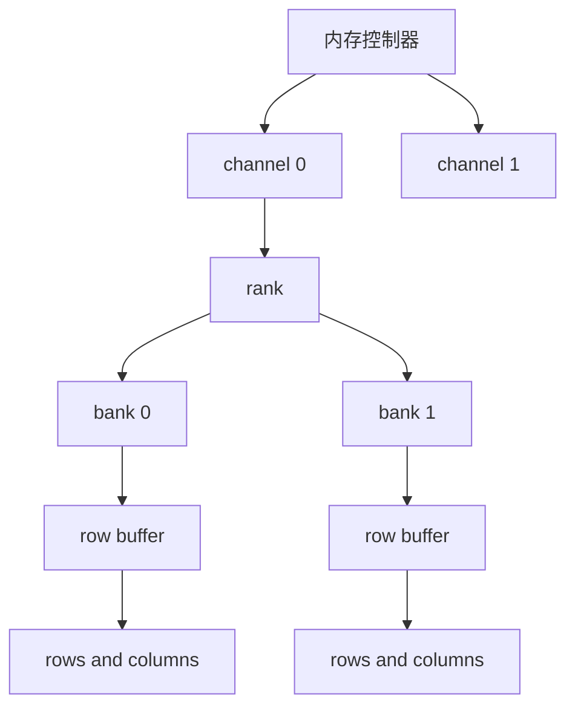
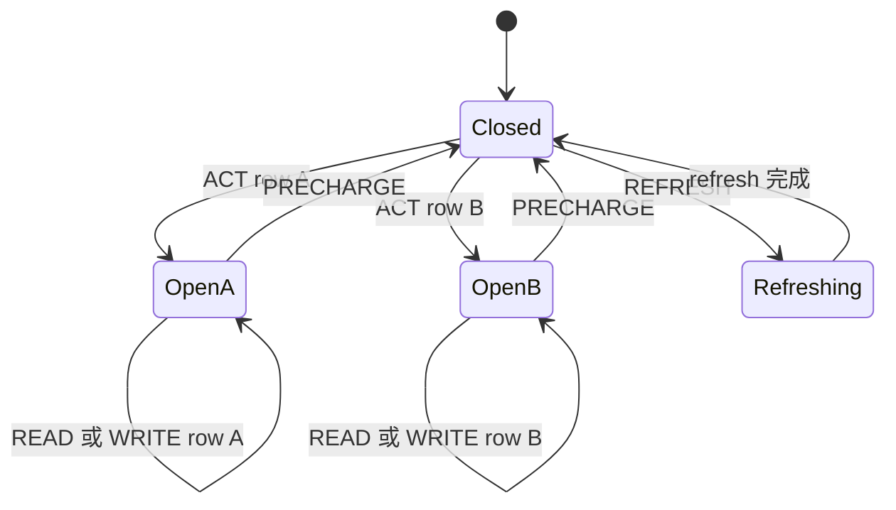

# DRAM 组织、行缓冲、刷新与 ECC

CPU cache miss 到“内存”以后，为什么两个地址可能延迟不同？本页用一个可手算模型把 channel、rank、bank、row、column、行缓冲、刷新和 ECC 接起来。它解释机制与边界，不猜当前机器未公开的物理地址映射，也不提供内存超频设置。

> [!note] 本页证据范围
> 已核对 AMD PG313 “DRAM Addressing”对同一 bank 开行、换行时 PRECHARGE→ACTIVATE 与跨 bank 重叠的说明，Micron DDR5 产品页“Advantages of migrating to DDR5”表中的 bank group/bank、PRECHARGE、REFRESH 与 on-die ECC 项，以及 Linux EDAC 文档的 DIMM、chip-select、channel 与 ECC 报告概念。地址映射、时序数字、bank 状态机和请求调度均为下文明示的教学构造；未对任何真实 DIMM、内存控制器或错误注入做实测。

## 先把“内存”拆成可工作的层级

一台具体机器的命名与映射会变化，但常用教学层级可以画成：



> 箭头表示命令、地址和数据经过的组织关系，不代表所有平台都有两个 channel、每个 rank 只有两个 bank，或控制器一定按图中的位切地址。

| 对象 | 读者可以先怎样理解 | 容易混淆的边界 |
| --- | --- | --- |
| channel | 一组可相对独立传输命令/数据的接口 | channel 数不等于 bank 数，也不保证请求完全并行 |
| rank | 一组协同响应同一命令的 DRAM 器件组织 | DIMM、rank、chip 不是同义词 |
| bank | 能维护自己打开行状态的一组存储阵列 | 同 bank 的不同行通常不能同时作为当前打开行 |
| row | 一次被激活到 row buffer 的大量单元 | row 大小不等于 CPU cache line 或 OS page |
| column | 从当前打开行选择传输位置 | 外部 burst 会一次传多个数据拍，不等于读一个单独 bit |
| row buffer | 当前 bank 已激活行的感放/临时状态 | 它不是软件可寻址 cache，也没有通用 LRU 接口 |

DRAM 单元以电荷保存信息，需要周期刷新。读取也依赖激活整行到感放，再从其中选择列传输。软件通常只发普通 load/store；控制器把请求变成符合器件时序的命令序列。

## 一个 bank 是小型状态机

为讲清先后关系，先忽略 bank group、总线 turnaround、burst、功耗状态和并发命令，只保留三个状态：关闭、打开 row A、打开 row B。



> `OpenA/OpenB` 只是“某一行已打开”的占位符。真实 DRAM 有大量行，命令必须满足器件规定的最小间隔；图中的箭头没有给出通用纳秒数。

AMD PG313 的 “DRAM Addressing” 明确说明：访问某个 DRAM row 前要先打开它；同一 bank 换 row 时，控制器先以 PRECHARGE 关闭当前 row，再以 ACTIVATE 打开新 row；一个 bank 同时只有一个打开 row，而不同 bank 的事务可重叠。基于这组结构性约束，同一个 bank 的三种教学路径是：

- **row hit**：目标就是当前打开行，可以在满足列命令时序后读取或写入；
- **closed-row access**：bank 关闭，先 ACTIVATE 目标行，再 READ/WRITE；
- **row conflict**：另一个 row 已打开，先 PRECHARGE 关闭旧行，再 ACTIVATE 新行，最后 READ/WRITE。

因此“都在 DRAM”并不意味着每次访问付出相同延迟。不同 bank 的请求可能重叠推进，这叫 bank-level parallelism；但它仍受 channel、命令总线、数据总线、refresh 和控制器队列约束。

## 教学地址映射：先声明，后拆位

下面**不是任何真实 CPU 的映射**。假设 16 位 byte address 按以下规则解释，并且 channel/rank 已固定：

```text
bits 15..8 : row
bits  7..6 : bank
bits  5..3 : column
bits  2..0 : byte offset in an 8-byte transfer
```

等价算式：

```text
offset = address & 0x7
column = (address >> 3) & 0x7
bank   = (address >> 6) & 0x3
row    = address >> 8
```

| 地址 | row | bank | column | offset | 与 `0x1234` 的关系 |
| ---: | ---: | ---: | ---: | ---: | --- |
| `0x1234` | `0x12` | 0 | 6 | 4 | 基准请求 |
| `0x123c` | `0x12` | 0 | 7 | 4 | 同 bank 同 row；若仍打开则是 row hit |
| `0x1274` | `0x12` | 1 | 6 | 4 | 不同 bank；可能与 bank 0 重叠 |
| `0x1334` | `0x13` | 0 | 6 | 4 | 同 bank 不同 row；若 row `0x12` 打开则冲突 |

真实控制器可能用 XOR/hash、交错粒度、rank/channel 选择和保留地址位；虚拟地址还必须先翻译成物理地址。用这张 toy 表只能验证拆位方法，不能推断用户机器的 rowhammer 邻接、NUMA 位置或最优访问排列。

## 用假设周期比较三条路径

固定教学参数：PRECHARGE 3 cycles、ACTIVATE 到允许 READ 3 cycles、READ 到首个返回数据 3 cycles；忽略排队和总线竞争。

| 初始 bank 状态 | 请求 | 命令序列 | 教学延迟 |
| --- | --- | --- | ---: |
| 已打开目标 row | `0x123c` | `READ` | 3 cycles |
| 关闭 | `0x1234` | `ACT → READ` | 6 cycles |
| 已打开 row `0x12` | `0x1334` | `PRE → ACT → READ` | 9 cycles |

数字用于展示依赖，不是 DDR4/DDR5/HBM 的共同参数。真实延迟还包含命令间隔、burst、队列、总线方向切换、频率域换算、controller policy 和 CPU 侧等待是否被其他工作隐藏。

```text
bank 0: ACT row12 ─ READ 1234 ─ READ 123c ─ PRE ─ ACT row13 ─ READ 1334
bank 1:             ACT row12 ─ READ 1274
```

第二行说明 bank 1 的工作可能和 bank 0 重叠；它不保证数据总线也能在同一拍传两份数据。提高并发可增加吞吐，也可能让单请求在控制器队列等待更久，平均带宽和尾延迟必须分别观察。

## Refresh 是保持数据所需的服务中断

DRAM 电荷会泄漏，系统必须按器件合同安排 refresh。Micron 的 DDR5 产品页明确区分 all-bank 与 same-bank refresh，并说明 `REFsb` 以每个 bank group 中一个 bank 为刷新范围。本页状态图进一步把“正在刷新的目标不同时承担普通读写”作为教学状态约束；具体允许的并发、前置状态和命令间隔必须回到目标器件数据表核对。

这带来三个边界：

1. refresh 是正确保存易失数据所需的机制，不是可随意关闭的性能选项；
2. 某个请求恰好碰到 refresh 窗口时，延迟可能比平均值高；
3. 不同 DDR 代际、容量、温度与模式有不同 `tREFI/tRFC` 等参数，必须读目标器件资料，不能把本页示例外推。

## ECC 保护的是明确 codeword 与故障模型

ECC 给数据添加冗余校验位，使接收端能从 syndrome 检测或纠正某些错误。若一个 code 有最小 Hamming distance $d_{min}$，通常最多可保证检测 $d_{min}-1$ 个 bit 错误，或纠正 $\lfloor(d_{min}-1)/2\rfloor$ 个 bit 错误；具体 decoder 还要定义如何处理超出模型的模式。

常见 SECDED 目标是 single-error correction、double-error detection。Linux EDAC 文档给出常见 64 data bits + 8 ECC bits 的 72-bit 组织例子，但这不是所有模块、SoC 或 on-die ECC 的统一布局。

| 观察 | 可以说明 | 不能自动说明 |
| --- | --- | --- |
| corrected error 计数增加 | 某层报告并纠正了其模型内错误 | 数据路径其他层没有损坏；DIMM 必须立刻报废 |
| uncorrected error | 当前保护层无法按其合同纠正 | 应用已经看到静默坏数据；平台会采用同一种恢复 |
| on-die ECC | 芯片内部可能修复部分单元错误 | CPU/OS 一定看到 syndrome；channel/link 也被保护 |
| 文件 checksum | 能检测相应文件块内容不匹配 | DRAM 瞬态、CPU cache、总线和备份问题都已解决 |

ECC、链路 CRC、cache parity、文件系统 checksum、复制与备份位于不同端点。真正的端到端完整性需要逐层说明谁生成冗余、谁检查、错误怎样上报、何时重试或隔离。

## 把知识接起来

- 先到 [[计算机知识/30-计算机系统/10-组成原理系统课程/05-缓存地址划分与AMAT|缓存地址划分与 AMAT]] 手算 CPU cache，再回本页理解 miss 之后的 DRAM。
- [[计算机知识/30-计算机系统/22-缓存地址翻译一致性与存储层级推演|缓存、地址翻译与存储层级推演]] 把 TLB、cache、page fault、DRAM 与设备路径放在同一次 load 的条件图中。
- [[计算机知识/30-计算机系统/18-CPU拓扑缓存一致性NUMA与设备亲和性|CPU 拓扑、缓存一致性、NUMA 与设备亲和性]] 解释哪个内存控制器离线程更近，但不会替你猜地址到 bank 的映射。
- [[计算机知识/30-计算机系统/11-存储设备块层页缓存与持久化|存储设备、块层、页缓存与持久化]] 讨论非易失存储；DRAM refresh 与 `fsync` 不是同一问题。

## 自测与成功标准

1. 按 toy 映射拆 `0x1234`、`0x123c`、`0x1274`、`0x1334`，解释哪些请求可能 bank-parallel。
2. 固定初始打开 row 后，用 `PRE/ACT/READ` 写出每个请求的合法状态转移；不能跳过 row conflict 的关闭步骤。
3. 把教学延迟全部乘二，检查三类路径的绝对时间变了，而依赖关系仍在；再说明现实排队为何可能改变观测顺序。
4. 分别为 ECC、文件 checksum 和备份写出保护端点；若答案都是“防数据丢失”，边界还没有说明白。

完成本页后，你应能画出 channel/rank/bank/row 关系，手算一组明示地址映射，区分 row hit、closed row、row conflict 与 refresh，并说明 ECC 只能兑现给定 codeword 和故障模型中的保证。

## 依据与版本边界

- [AMD PG313 Network on Chip, Version 1.1, “DRAM Addressing”](https://docs.amd.com/r/en-US/pg313-network-on-chip/DRAM-Addressing)，发布于 2026-06-23：用于核对开行、同 bank 换行的 `PRECHARGE → ACTIVATE` 顺序、每 bank 一个打开行与不同 bank 可重叠。它面向 AMD Versal NoC 集成内存控制器语境，支持结构机制，不提供本页 toy 地址映射，也不能把示例周期当作 DDR4、DDR5 或 HBM 的共同参数。
- [Micron DDR5 DRAM 产品页，“Advantages of migrating to DDR5”](https://www.micron.com/products/memory/dram-components/ddr5-sdram)：用于核对 DDR5 bank group/bank、PRECHARGE、all-bank/same-bank REFRESH 与 on-die ECC 的产品级差异表；它不是具体器件时序表。
- [Linux EDAC documentation](https://docs.kernel.org/driver-api/edac.html)：用于核对 Linux EDAC 的内存组织术语与错误报告边界；它不是任意平台的硬件规范。

正文的 16 位地址映射和 3/6/9-cycle 算例均为本库教学构造，未声称来自上述文档或代表当前机器。

---

**上一站**：[[计算机知识/30-计算机系统/10-组成原理系统课程/05-缓存地址划分与AMAT|缓存地址划分与 AMAT]] · **下一站**：[[计算机知识/30-计算机系统/22-缓存地址翻译一致性与存储层级推演|缓存、地址翻译与存储层级推演]] · **返回**：[[计算机知识/30-计算机系统/00-计算机系统-MOC|计算机系统 MOC]]
