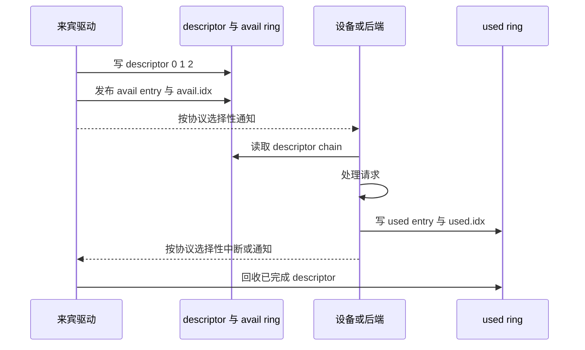

# 虚拟化执行、地址翻译与虚拟 I/O 推演

来宾程序执行一次 load，地址为什么可能经过两级翻译？它向“虚拟磁盘”提交请求时，数据又是否一定被复制、持久化或交给真实设备？本页用两个小模型追踪 CPU 与 I/O 路径，重点是分清地址空间、故障归属、队列所有者和完成含义。

> [!note] 本页证据范围
> 规范语境明确选为 **Linux KVM 的 x86 来宾，宿主硬件使用 two-dimensional paging（Intel EPT 或 AMD NPT）**。已核对 KVM x86 MMU 文档的 “Virtual and real hardware supported”“Translation”“Memory”“Reaction to events”，并核对 OASIS Virtio 1.3 的 2.7 Split Virtqueues，尤其 2.7.6、2.7.8、2.7.13。位宽、两级页表、页表内容、访问次数和队列事件均为下文明示的教学缩小模型；未启动虚拟机，未探测当前宿主机，也不把本页外推为 Arm Stage-2 或其他 hypervisor 的具体实现。

## 三个地址空间先分别命名


> 图中箭头表示本页所选 x86 KVM TDP 语境下的概念翻译。硬件可用 TLB、页表遍历缓存或合并后的转换结果减少真实访存；KVM 在不直接匹配 TDP 的配置中也可能维护 shadow page table，让硬件看到另一种编码路径。因此它不是“每次 load 必然顺序读两棵完整页表”的时序图。

| 名称 | 谁用它命名对象 | 它不自动等于什么 |
| --- | --- | --- |
| GVA，guest virtual address | 来宾进程和来宾内核 | GPA、HPA、宿主进程虚拟地址 |
| GPA，guest physical address | 来宾 OS 认为的物理地址 | 机器 DRAM 的最终物理地址 |
| HPA，host physical address | 宿主/硬件最终访问内存的位置 | 可由普通来宾直接观察的地址 |

来宾页表回答“这个来宾虚拟页属于哪个来宾物理页”；第二阶段映射回答“这个来宾物理页由哪块宿主内存承载”。两者的权限都会影响访问是否成功。

## 一个完整的两阶段手算

为了能在纸上算完，把上述 x86 KVM TDP 机制缩成一个**8 位 byte address、16-byte page、每阶段两级页表**的教学系统。真实 x86 的地址宽度、4 KiB 基页与通常更多页表级数没有被本例复刻；这里只保留“来宾页表结果继续作为 EPT/NPT 输入”的组合关系：

- page offset 为低 4 bit；virtual page number 为高 4 bit；
- 每阶段的 4-bit page number 再拆成 2-bit root index 与 2-bit leaf index；
- 所有页表项都已驻留且有效；权限允许读；先忽略大页、ASID/VMID 和缓存。

来宾执行 `load [0xAC]`：

```text
GVA 0xAC = 1010 1100₂
             └1010┘ └1100┘
              GVPN    offset = 0xC

GVPN 1010₂ → guest root index 10₂ = 2
             guest leaf index 10₂ = 2
guest page-table entry maps GVPN 0xA → GPN 0x5

GPA = 0x5C
GPN 0101₂ → stage-2 root index 01₂ = 1
            stage-2 leaf index 01₂ = 1
stage-2 entry maps GPN 0x5 → HPN 0x9

HPA = 0x9C
```

页内偏移 `0xC` 在两次翻译中都保持不变，所以可以用重组检查：

```text
(0x5 << 4) | 0xC = 0x5C
(0x9 << 4) | 0xC = 0x9C
```

| 步骤 | 输入 | 查表索引 | 输出 | 若失败，首先归谁处理 |
| --- | --- | --- | --- | --- |
| 来宾一级 | GVPN `0xA` | root 2 | 来宾二级表 | 来宾页表异常或实现定义的嵌套故障 |
| 来宾二级 | GVPN `0xA` | leaf 2 | GPN `0x5` | 来宾 OS 通常处理自己的缺页/权限错误 |
| 第二阶段一级 | GPN `0x5` | root 1 | 第二阶段二级表 | hypervisor/宿主补映射或终止访问 |
| 第二阶段二级 | GPN `0x5` | leaf 1 | HPN `0x9` | hypervisor/宿主处理 backing 与权限 |
| 最终访问 | HPA `0x9C` | offset `0xC` | 数据 | 仍可能遇到宿主内存、总线或设备错误 |

这张表刻意没有把所有失败都叫“来宾 page fault”。来宾页表不在场、第二阶段映射缺失、宿主 backing 尚未就绪和需模拟敏感操作的 VM exit 是不同事件；具体硬件会提供不同退出原因与错误注入方式。

## 为什么教科书会得到 9 次访问

若来宾页表有 $g$ 级，第二阶段页表有 $h$ 级，而且**完全没有 TLB/遍历缓存、每个来宾页表项自身的 GPA 也要走第二阶段**，则一个最终数据访问的最坏教学计数是：

$$
(g+1)(h+1)
$$

理由是：来宾的 $g$ 个页表项加最终数据，共有 $g+1$ 个 GPA；每个 GPA 需要读取 $h$ 个第二阶段页表项，再访问目标本身。取 $g=h=2$：

```text
(2 + 1) × (2 + 1) = 9 次宿主物理内存访问
```

这个数是用来暴露乘法依赖的上界模型，不是 VM 中每条 load 的实测成本。TLB 命中可直接复用最终转换；页表遍历缓存会复用中间节点；大页减少层数；硬件也能并发或流水化部分查找。若读者把“9”写成固定 CPI，就越过了模型边界。

## 虚拟 I/O：共享内存队列加两端协议

Virtio 的 split virtqueue 可抽象成三块共享数据结构：



> 箭头只描述可见性与所有权顺序，不给出真实纳秒。发布 index 之前必须先让 descriptor 对另一端可见；完成 index 也必须在结果可见之后发布。所需屏障由传输、体系结构和规范共同约束，不能用普通源码书写顺序替代。

固定 queue size 为 4，驱动提交由三个 descriptor 组成的请求：

| 时刻 | descriptor 状态 | `avail.idx` | `used.idx` | 谁可改什么 |
| --- | --- | ---: | ---: | --- |
| $t_0$ | 0、1、2 空闲 | 0 | 0 | 驱动拥有空闲 descriptor |
| $t_1$ | 0→1→2 构成 chain，内容已写 | 0 | 0 | 尚未发布，设备不应假定可见 |
| $t_2$ | avail ring 放 chain head 0 | 1 | 0 | 驱动发布后，设备可取请求 |
| $t_3$ | 设备读取 chain 并处理 | 1 | 0 | descriptor 仍在途，驱动不能复用 |
| $t_4$ | used ring 写 head 0 和长度 | 1 | 1 | 设备发布完成；驱动可回收 0、1、2 |

`idx` 是按规范宽度回绕的递增计数，不能只把数组槽位 `0..3` 当总完成数。通知也不是每次提交/完成都必须发生一次；双方可按协商机制抑制通知以减少退出和中断。

## “used” 只兑现协议定义的完成点

| 主张 | 单凭 virtqueue used entry 能否证明 | 还需追问 |
| --- | --- | --- |
| 后端已消费 descriptor | 在相应协议定义下可以 | 状态码、返回长度、错误字段是什么 |
| 数据完全没有复制 | 不能 | 映射、bounce buffer、IOMMU、加密和后端实现 |
| 请求已到真实硬件 | 不能 | 后端可能是软件模拟、宿主文件或远端服务 |
| 数据断电后仍存在 | 不能 | 设备特性、flush/barrier、宿主文件系统与硬件缓存 |
| 来宾线程从未退出到 hypervisor | 不能 | 通知、MMIO、缺页和调度都可能导致退出或切换 |

虚拟 I/O 的优势常来自批量、共享内存与减少模拟开销，但它不天然等于零复制、零 VM exit 或持久化。性能结论至少要记录 queue depth、batch、通知策略、后端类型、宿主缓存和完成定义。

## 把知识接起来

- [[计算机知识/30-计算机系统/16-地址翻译TLB页表遍历与大页|地址翻译、TLB、页表遍历与大页]] 是单一地址空间的主解释；本页只增加来宾与宿主之间的第二阶段。
- [[计算机知识/30-计算机系统/19-容器虚拟机Namespace-Cgroup与虚拟IO|容器、虚拟机、Namespace、Cgroup 与虚拟 I/O]] 负责容器/VM 总边界；本页把其中两个机制做成可复算过程。
- [[计算机知识/30-计算机系统/10-IO设备总线DMA与中断|I/O、设备、总线、DMA 与中断]] 解释物理设备路径。Virtio descriptor 中的地址仍需结合协商特性、传输和 IOMMU 解释。
- [[计算机知识/30-计算机系统/10-组成原理系统课程/07-一致性内存序NUMA与性能|一致性、内存序、NUMA 与性能]] 解释为什么“先写内容、后发布 index”需要可见性约束。

## 自测与成功标准

1. 把教学映射中的 guest leaf entry 改成 GPN `0x7`、stage-2 把 `0x7` 映射到 HPN `0x3`，复算最终 GPA/HPA；offset 必须仍是 `0xC`。
2. 分别删掉 guest leaf entry 与 stage-2 leaf entry，说明为什么两者不该被记录成同一个来宾缺页。
3. 令 $g=3,h=2$，按模型得到 12 次访问，并列出至少两种使真实次数下降的缓存机制。
4. 在 queue size 4 中提交第 5 个完成事件，说明 ring 槽位回绕和 `idx` 递增的区别。
5. 看到 used entry 后，分别回答“缓冲区能否复用”“是否已持久化”，并为后者列出仍缺的合同。

完成本页后，你应能手算 GVA→GPA→HPA、区分两阶段故障归属，解释嵌套翻译的最坏访问数为何呈乘法，并沿 virtqueue 的 descriptor→avail→used 顺序说明所有权与完成边界。

## 依据与版本边界

- [Linux KVM “The x86 kvm shadow mmu”](https://cdn.kernel.org/doc/html/latest/virt/kvm/x86/mmu.html)：`Virtual and real hardware supported` 确认 TDP 是 AMD NPT/Intel EPT 的中性称呼；`Translation` 明列 paging-enabled 时的 GVA→GPA→HPA；`Memory` 说明 guest memory 可由匿名、文件或设备内存承载；`Reaction to events` 区分 true guest fault、missing/protected translation 与 MMIO。正文 8 位地址与 9 次访问是独立教学推导。
- [Virtual I/O Device (VIRTIO) Version 1.3](https://docs.oasis-open.org/virtio/virtio/v1.3/virtio-v1.3.html)：2.7.6 定义 available ring 的单一写者与 chain head；2.7.8 规定 used `len`/数据先于 `used.idx`；2.7.13 规定 descriptor→avail→idx→notification 及 suitable memory barrier。used 只表示该 virtqueue buffer 已按设备协议使用，不被本文解释为存储持久化。

---

**先修**：[[计算机知识/30-计算机系统/16-地址翻译TLB页表遍历与大页|单阶段地址翻译]] · **相关主解释**：[[计算机知识/30-计算机系统/19-容器虚拟机Namespace-Cgroup与虚拟IO|容器、虚拟机与虚拟 I/O]] · **返回**：[[计算机知识/30-计算机系统/00-计算机系统-MOC|计算机系统 MOC]]
