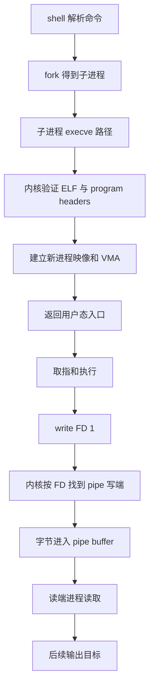

# 从可执行文件到一行输出的端到端执行链

在 shell 中运行一个只做 `write(1, "hi\n", 3)` 的程序，CPU 如何从磁盘上的 ELF 文件走到一行可观察输出？“程序启动”“第一条指令执行”“write 返回”“终端显示”“数据持久化”分别由谁保证？本页固定 Linux/POSIX 场景，从一次 `fork`/`execve` 和 stdout 路径逐层追踪。

> [!note] 本页证据范围
> 已核对 Linux man-pages 对 `execve(2)`、`write(2)` 与 `pipe(7)` 的接口边界，以及 ELF gABI 对 program header 与 process image 的定义。shell 的具体实现、动态链接器步骤、页错误数量、调度次序和设备路径会随系统变化；本页未运行 `strace`、未读取当前机器二进制，也不把 Linux 行为无条件外推到 macOS 或 Windows。

## 先固定场景和观察点

假设 shell 已经把标准输出接到一个 pipe 的写端，然后创建子进程；子进程调用：

```c
char *argv[] = {"hello", NULL};
char *envp[] = {NULL};
execve("./hello", argv, envp);
```

`hello` 最终发起等价于：

```c
write(1, "hi\n", 3);
```

这个场景有四个明确前提：目标是 ELF 可执行文件；`execve` 成功；FD 1 没有设置 close-on-exec；pipe 读端仍有消费者。任何一项改变，都可能让链条在不同位置失败。



> 箭头表示必要的责任交接，不表示每个节点只执行一次，也不表示 ELF 所有页在返回用户态之前就从存储读入。动态链接、缺页、调度、复制与终端/网络/文件后端会在对应节点插入更多工作。

## `execve` 更换程序映像，不创建新 PID

成功的 `execve` 用新程序替换调用进程的程序映像。它不会“返回到旧程序”；通常也不会创建一个新进程。这里的新子进程来自此前的 `fork`，而 `execve` 保留这个子进程的 PID，同时重建或重置规范规定的地址空间和进程属性。

| 执行前对象 | 成功 `execve` 后 | 边界 |
| --- | --- | --- |
| PID | 仍是调用 `execve` 的进程 PID | shell 若先 `fork`，父子从那时起已有不同 PID |
| 原代码、堆、栈映射 | 被新程序映像替换 | 不能从“同一 PID”推断旧指针仍有效 |
| 普通打开 FD | 通常保留 | 设置 `FD_CLOEXEC` 的 FD 会在成功 exec 时关闭 |
| `argv` / `envp` | 作为新栈/启动信息的一部分提供 | 大小、编码和安全处理有系统边界 |
| 旧用户态线程 | 不按原线程集合继续执行 | 多线程进程的 exec 语义需要单独核对 |

因此，若 FD 1 在 exec 前已由 shell 通过 `dup2` 指向 pipe 写端，而且没有 `FD_CLOEXEC`，新程序继承的数字 1 仍解析到那个内核打开对象。若误设 close-on-exec，程序启动可以成功，但 `write(1,...)` 会因 FD 无效失败。

## ELF program header 把文件区间变成进程映像

ELF 的 section 主要服务链接与工具；装载时更直接的合同是 program header table。`PT_LOAD` 等条目描述哪些文件区间映射到哪些虚拟地址、文件中有多少字节、内存中需要多少字节以及权限。

用一个教学条目说明字段关系：

| 字段 | 教学值 | 解释 |
| --- | ---: | --- |
| `p_offset` | `0x1000` | segment 在文件中的起点 |
| `p_vaddr` | `0x401000` | 进程映像中的目标虚拟地址 |
| `p_filesz` | `0x600` | 从文件提供的字节数 |
| `p_memsz` | `0x800` | 映像中占用的字节数 |
| flags | R-X | 映射的读/执行权限示意 |

这表示 `[0x401000,0x401600)` 的初值来自文件 `[0x1000,0x1600)`；额外的 `[0x401600,0x401800)` 在规范条件下以零初始化。它不是“把 section 名字逐个复制进 RAM”的指令，也不要求所有 0x800 bytes 在 `execve` 返回用户态前实际驻留。

内核可先建立 VMA/页表状态，在第一次取指或读数据时再因页不在场进入缺页处理。动态链接 ELF 还会把控制交给指定 interpreter，由它装入共享对象和完成重定位。静态与动态程序的节点数量不同，但都必须满足可执行格式、权限与 ABI 的合同。

## 第一条取指也可能走一次缺页路径

假设入口地址 `0x401080` 已被 VMA 允许执行，但相应页尚未驻留：

| 顺序 | 机制 | 成功后获得什么 | 失败例子 |
| ---: | --- | --- | --- |
| 1 | CPU 用虚拟 PC 查 TLB | 已缓存翻译，或开始 page-table walk | 页表权限禁止执行 |
| 2 | 页表遍历/异常检查 | 可用物理页，或触发 page fault | VMA 不覆盖该地址 |
| 3 | 内核处理文件支持页 | 从 page cache/文件系统取得页，安装 PTE | I/O 错误、映像被破坏 |
| 4 | 重试取指 | 访问 CPU cache/内存取得指令字节 | 硬件或内存错误 |
| 5 | decode/execute | 程序向前推进 | 非法指令、其他同步异常 |

TLB miss 不是 page fault；CPU cache miss 也不是 page fault。前者可能由硬件页表遍历解决，后者通常由 cache hierarchy/内存系统解决；只有翻译或权限需要 OS 介入时才发生相应 fault。

## `write(1, "hi\n", 3)` 的三层含义

用户态调用包装器把 FD、buffer pointer 和 count 放到 ABI 规定位置，再进入内核。内核先验证参数与 FD 权限，然后按 FD 1 指向的对象分派。对 pipe 而言，成功返回值是本次接受的字节数；它不是“人已经看见”或“数据已持久化”的确认。

下面先列 `write` 的**一般返回合同**，其中部分写可发生在普通文件、socket、pipe 等不同对象上；随后再用 pipe 的 `PIPE_BUF` 条件收紧本页固定案例：

```text
一般 write 请求 count bytes
  ├─ 返回 count：本次请求的 bytes 已被目标写路径接受
  ├─ 返回 1..count-1：部分写；调用者必须决定是否继续写剩余字节
  ├─ 返回 -1, EAGAIN：非阻塞 pipe 暂时没有足够空间
  ├─ 阻塞：阻塞模式等待空间或信号
  └─ 返回 -1, EPIPE，并可能收到 SIGPIPE：所有读端已关闭
```

对本页的 **3-byte pipe write**，若 `3 <= PIPE_BUF`：阻塞模式会等待到这次写可原子完成；非阻塞模式在空间不足时会返回 `EAGAIN`，不会按 `1/2 bytes` 部分接收。若调用被信号中断、count 大于 `PIPE_BUF`，或 FD 1 换成别的对象，返回集合要按 `write(2)` 与目标对象重新判断。健壮调用者仍必须检查返回值，而不能把这个小例外推广成“write 总写完”。

普通文件、pipe、socket、终端都可以占用 FD 1，但兑现的完成点不同：

| FD 1 指向 | `write` 成功通常说明 | 仍不能直接说明 |
| --- | --- | --- |
| pipe | 字节被 pipe 接受，读者之后可按字节流读取 | 读者已运行；一次 write 对应一次 read；永久保存 |
| regular file | 内核接受相应写入 | 断电后仍在；父目录/元数据均持久；每个观察者立即同样可见 |
| socket | 本地协议栈接受相应数据 | 对端应用已读；网络已交付；远端持久化 |
| terminal/PTY | 终端路径接受字节 | 像素已显示；人已经阅读；日志已保存 |

Linux pipe 是 byte stream，没有消息边界。某些足够小且满足条件的写入具有不与其他写者交错的原子性保证，但这仍不等于读端一次 `read` 恰好得到一条消息。生产协议必须自行定义 framing，例如长度前缀或换行，并处理部分读写。

## 逐步检查一次成功路径

| 检查点 | 可观察事实 | 它排除的故障 | 它没有排除的故障 |
| --- | --- | --- | --- |
| `execve` 成功进入新入口 | ELF、权限与初始装载合同至少已通过 | 路径不存在、格式立即拒绝 | 后续缺页、动态链接错误、程序崩溃 |
| 第一条用户指令执行 | 入口页已可取指 | 入口完全不可映射 | 后续数据页错误或系统调用失败 |
| `write` 返回 3 | 内核为当前 FD 接受 3 bytes | EBADF、当前这次部分写 | 消费者调度、最终呈现、持久化 |
| pipe 读端得到 `hi\n` | 相应字节到达读者 | 数据仍只在写端之前 | 读者后续处理成功 |
| 终端显示一行 | 某终端实现完成了当前呈现 | 未到达该呈现层 | 人已阅读、内容被记录或断电后保留 |

每个观察点只关闭一部分假设。把最终屏幕结果倒推成“中间每层都没有 fault/cache miss/调度”同样不成立，因为这些机制可能在透明处理后仍得到正确输出。

## 常见断链与反例

- `fork` 成功但 `execve` 返回 `ENOENT`：子进程存在，却没有进入新映像。
- `execve` 成功但 FD 1 带 `CLOEXEC`：程序运行，第一次写即可能 `EBADF`。
- 若把 FD 1 换成允许部分写的对象（例如某些 socket 状态），一般 `write` 请求 3 bytes 可能只返回 2；调用者忽略返回值会丢掉第三个 byte。这个反例已经改变本页固定的小 pipe 写前提。
- pipe 满且写端阻塞：CPU 和程序映像都正常，输出仍因背压停住。
- 所有读端关闭：写端遇到 `EPIPE`/`SIGPIPE`，不能把它归因于 ELF 装载。
- stdout 指向 regular file：write 成功不等于 crash-safe；持久化合同要继续读文件系统与设备页。

## 把知识接起来

- [[计算机知识/30-计算机系统/03-ABI调用约定与静态动态链接|ABI、调用约定与静态/动态链接]] 主讲调用约定与链接；本页从最终 ELF 的 program header 接着追踪。
- [[计算机知识/30-计算机系统/02-进程虚拟地址空间与内存映射|进程虚拟地址空间与内存映射]] 与 [[计算机知识/30-计算机系统/16-地址翻译TLB页表遍历与大页|地址翻译、TLB、页表遍历与大页]] 分别是 VMA 与地址翻译主解释。
- [[计算机知识/30-计算机系统/08-异常中断系统调用与特权级|异常、中断、系统调用与特权级]] 解释 `write` 如何进入内核；本页聚焦进入以后按 FD 分派的结果。
- [[计算机知识/30-计算机系统/09-进程线程调度同步与IPC|进程、线程、调度、同步与 IPC]] 与 [[计算机知识/30-计算机系统/12-VFS文件描述符Inode目录与路径解析|VFS、文件描述符、inode、目录与路径解析]] 是 `fork`、pipe 与 FD 对象的主解释。
- 输出目标若是文件或网络，继续读 [[计算机知识/30-计算机系统/11-存储设备块层页缓存与持久化|存储持久化]] 或 [[计算机知识/30-计算机系统/14-网络栈Socket与端到端数据路径|网络端到端路径]]。

## 自测与成功标准

1. 把 FD 1 从 pipe 改成 regular file，圈出不变节点与必须替换的完成含义。
2. 令教学 `PT_LOAD` 的 `p_filesz=0x600,p_memsz=0x500`，解释为什么这个条目应被拒绝或不能按原推导解释。
3. 分别给出 TLB miss、CPU cache miss、page fault 的最小反例，不能都写成“去内存找”。
4. 把 FD 1 改成允许部分写的对象，写出一个处理一般 `write` 部分成功的循环，并列出 `EINTR/EAGAIN/EPIPE` 应由哪层策略处理；不要把这项练习的返回集合套回固定的 3-byte pipe 分支。
5. 对“屏幕看到了 `hi`，所以 write 直接写显卡”指出至少三个中间对象或调度点。

完成本页后，你应能从 shell 的进程创建追到 exec、ELF 装载、按需取指、系统调用、FD 与 pipe，并为每个观察点说明它能证明什么、还缺什么证据。

## 依据与版本边界

- [Linux `execve(2)`, DESCRIPTION / Effect on process attributes / NOTES](https://www.man7.org/linux/man-pages/man2/execve.2.html)：用于核对成功 exec 替换程序映像且不返回、默认保留普通 FD、关闭 `FD_CLOEXEC` FD，以及“同一进程/同一 PID”边界。
- [Linux `write(2)`, DESCRIPTION / RETURN VALUE / ERRORS](https://www.man7.org/linux/man-pages/man2/write.2.html)：用于核对成功返回值、部分写、`EAGAIN`/`EPIPE` 等边界；未把成功返回解释为持久化或远端消费。
- [Linux `pipe(7)`, I/O on pipes and FIFOs / Pipe capacity / PIPE_BUF](https://www.man7.org/linux/man-pages/man7/pipe.7.html)：用于核对 byte stream、阻塞/非阻塞、无读端和有限范围内的写原子性；原子 write 不被本文解释成 read 消息边界。
- [System V ABI, Chapter 5 “Program Header”](https://refspecs.linuxfoundation.org/elf/gabi4%2B/ch5.pheader.html)：用于核对装载 segment、`PT_LOAD`、`p_filesz/p_memsz`、权限与 process image 的关系；教学地址不对应真实二进制。

---

**先修**：[[计算机知识/30-计算机系统/03-ABI调用约定与静态动态链接|ABI 与链接]] · **下一步**：[[计算机知识/30-计算机系统/15-性能分析可观测性与系统设计|性能分析与可观测性]] · **返回**：[[计算机知识/30-计算机系统/00-计算机系统-MOC|计算机系统 MOC]]
