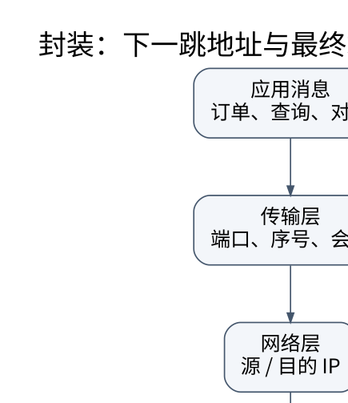

# 分层不是背协议名：从一次传输建立性能模型

> **学习位置**：[[计算机知识/00-开始/课程地图/09-计算机网络-课程地图|计算机网络课程地图]] · **适用边界**：分层模型与所引用 RFC；单位、时延及可靠性假设明确给出。

[PNG 备用图](../../_assets/diagrams/round3/network-layers.png) · [可编辑图源](../../_assets/diagrams/round3/network-layers.dot)

## 一次请求究竟经过哪些边界

应用把“查订单”编码成字节；传输层管理端到端会话与多路复用；网络层依据目的地址逐跳转发；链路层把数据交付给同一条链路上的下一站；物理层把比特映射为可传播的信号。接收端逆向解释这些约定。分层的价值是让一层改变实现时不必重写所有上层，而不是保证现实协议总能塞进唯一的格子。

帧中的目的 MAC 地址通常是下一跳，不一定是最终服务器；IP 地址面向跨网络交付；端口用于传输端点的区分。隧道会再套一层头，代理可能终止一条连接再建立另一条，因此“同一个请求”并不意味着“同一个 TCP 连接贯穿全程”。OSI 七层是参考模型，互联网实际教学常用五层或四层；层数不是协议正确性的判据。

## 把时延拆开，才知道该优化什么

一条链路的简化时延为

$$d=d_{\mathrm{proc}}+d_{\mathrm{queue}}+\frac{L}{R}+\frac{D}{v}.$$

这里 $L$ 为包长（bit），$R$ 为链路速率（bit/s），$D$ 为距离，$v$ 为传播速度。发送时延 $L/R$ 是把全部比特推入链路所需的时间；传播时延 $D/v$ 是一个比特走完路径的时间。提高带宽不会让光在光纤中跑得更快。排队时延取决于负载与突发，不能简单用固定常数概括。

设包长 1500 B、速率 100 Mbit/s、距离 1000 km、传播速度 $2\times10^8$ m/s：发送时延是 120 μs，传播时延是 5 ms。忽略处理与排队，一条链路约 5.12 ms。三段同样链路、整包存储转发、只传一个包，则约 15.36 ms；不能把此结果直接用于已流水化的一大批包。

## 带宽时延积与窗口

容量 100 Mbit/s、RTT 40 ms 的路径，带宽时延积是 4 Mbit，即 500000 B。为了让链路持续忙碌，需要允许大致相当于此量的数据在途。若发送方最多只保持 64000 B 未确认，理想窗口上界为 $64000/0.04=1.6$ MB/s，即 12.8 Mbit/s；真实速率还受拥塞、应用生产速度、丢包与协议开销限制。

吞吐量是单位时间交付的总数据，goodput 更关心有效应用数据；两者的测量层次必须说清。平均值还会掩盖尾延迟：100 次请求中 99 次为 10 ms、1 次为 10 s，均值约 109.9 ms，却既不像正常用户，也不像最差用户的体验。

## 从信号到链路的必要背景

基带与带通、调制与编码、多路复用、采样、噪声与信噪比决定物理信道能力。香农公式 $C=B\log_2(1+S/N)$ 是特定带限加性高斯噪声模型下的容量上界，不是插上线后必然得到的应用吞吐量。差错编码增加冗余来换可靠性；重传则付出额外往返时间。无线信道还受干扰、衰落和共享介质竞争影响。

电路交换预留资源，分组交换统计复用；后者利用率高，但竞争会产生排队。用 M/M/1 的 $W=1/(\mu-\lambda)$ 解释负载接近服务能力时延迟陡增，必须同时交代泊松到达、指数服务和稳态等假设，不能拿它精确预测任意生产系统。

## 练习与推演

**题目**：升级到 1 Gbit/s 后，上面的单链路单包时延会缩短十倍吗？

**解答**：发送时延降至 12 μs，传播仍为 5 ms，总计 5.012 ms；只比 5.12 ms 略低。大文件吞吐可明显提高，小请求的远距离延迟却可能主要受 RTT 支配。优化前应先判断瓶颈项，而不是只看网卡标称速率。

<!-- ROUND4 DEPTH LINKS -->
## 继续推演本页难点

[[计算机知识/35-计算机网络/10-系统课程/10-TCP窗口RTO与拥塞控制手算|接收窗口、拥塞窗口、在途量与超时分别限制什么？]] 本专题补上协议字段、时间线或可复算的数值条件。

这不是替换本页：先掌握原理，再用补充页核对容易被一句话略过的条件。
<!-- END ROUND4 DEPTH LINKS -->

## 关联阅读

- [[计算机知识/35-计算机网络/10-系统课程/04-传输层状态序号与拥塞|TCP 与 UDP：可靠字节流怎样在不可靠网络上成立]]
- [[计算机知识/30-计算机系统/10-组成原理系统课程/08-总线DMA中断与系统全景|总线、DMA、中断与系统全景：处理器之外还有执行者]]
- [[计算机知识/50-数据结构与算法/20-算法设计系统课程/08-数值几何并行与综合设计|数值、几何、并行与综合设计：算法还要面对表示误差]]

## 依据与继续查证

- [RFC 9293：TCP](https://www.rfc-editor.org/rfc/rfc9293.html)
- [RFC 9000：QUIC](https://www.rfc-editor.org/rfc/rfc9000.html)
- [RFC 9110：HTTP Semantics](https://www.rfc-editor.org/rfc/rfc9110.html)

本页的例子、推演与练习为教学构造；语言契约、系统接口和版本相关结论应结合以上原始文档核对。

<!-- COURSE SEQUENCE -->
## 顺序导航与验证

[[计算机知识/35-计算机网络/10-系统课程/00-计算机网络系统课程索引|本课程总索引]] · [[计算机知识/_labs/round3/NET/计算机网络-实验说明|本课程实验]]

下一讲：[[计算机知识/35-计算机网络/10-系统课程/02-链路层交换与差错检测|链路层：从 CRC 到交换机为什么会泛洪]]
<!-- END COURSE SEQUENCE -->

<!-- ORIGINAL DEEP LINKS -->
## 与原有长篇专题衔接

- [[计算机知识/35-计算机网络/07-安全排障与网络知识全景|07-安全排障与网络知识全景]]
- [[计算机知识/35-计算机网络/01-分层封装与性能模型|01-分层封装与性能模型]]

新旧讲解采用的版本与模型可能不同，比较时先核对各自前提，不把教学简化当成实现细节。
<!-- END ORIGINAL DEEP LINKS -->
