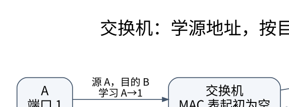

# 链路层：从 CRC 到交换机为什么会泛洪

> **学习位置**：[[计算机知识/00-开始/课程地图/09-计算机网络-课程地图|计算机网络课程地图]] · **适用边界**：分层模型与所引用 RFC；单位、时延及可靠性假设明确给出。

[PNG 备用图](../../_assets/diagrams/round3/switch-learning.png) · [可编辑图源](../../_assets/diagrams/round3/switch-learning.dot)

## 帧、差错和共享介质

链路交付单位是帧。接收方必须知道帧边界，并检查内容是否可能受损。字节计数、特殊分隔符配合转义、物理编码中的特殊模式都是边界设计方法。以太网 FCS 使用 CRC；它不是密码学认证，攻击者可以修改消息后重新计算 CRC。

把比特串看成系数属于 $GF(2)$ 的多项式，异或就是加减。设生成多项式为 $G(x)=x^3+x+1$（比特 1011），消息为 1101。先在末尾补三个 0，再做模 2 长除法，余数为 001，发送 1101001。接收端用同一生成多项式相除，余数为 0 才通过检查。错误也可能恰好是生成多项式的倍数而漏检，所以“通过”不等于数学上证明未损坏。

CRC 的突发错误检测能力来自多项式性质，需区分次数与具体生成式；奇偶校验只能可靠检出奇数个翻转，互联网校验和与 CRC 也不是同一种运算。

同一1101→1101001可去[[信号与系统/50-通信与反演/01-数字通信波形检测同步与均衡#净载荷 编码与符号账本|BPSK发送账本]]，带回4位净载荷、3位CRC、7个符号和两种样点网格的持续时间；CRC检查仍针对接收比特，不能把波形噪声、位错误、帧错误与CRC未检出的分母混用。

## CRC取余怎样变成商映射

这一节保留上面的同一比特例，只把“为什么能检出、为什么会漏检”展开。固定系数域 $GF(2)=\{0,1\}$，系数加减都按模2，所以 $1+1=1-1=0$，对应逐位 XOR；**不向相邻位进位或借位**。长度为 $n$ 的串 $b_{n-1}\cdots b_0$ 表示 $\sum_{i=0}^{n-1}b_ix^i$，最左位对应最高次位置。前导0保留帧的长度，但不改变多项式。

这里的教学合同是4位消息、3位校验、7位发送串，$G=x^3+x+1$ 写成1011；没有反射、非零初值或最后异或。这不是以太网或 TINY 的完整参数实现。把消息1101记作 $M=x^3+x^2+1$；在右边补3个0就是乘 $x^3$。带余除法给

$$x^3M=QG+A,\qquad \deg A<3,\qquad
C=x^3M+A.$$

因为 $A+A=0$，故 $C=QG$，可被 $G$ 整除。这里的 $A=\operatorname{rem}_G(x^3M)$ 是校验余式；$C$ 是系统编码，原消息仍是前4位。

| 消去哪个最高次项 | 当前7位余串 | 与它 XOR 的生成式移位 | 消去后 |
| --- | --- | --- | --- |
| $x^6$ | 1101000 | 1011000（$x^3G$） | 0110000 |
| $x^5$ | 0110000 | 0101100（$x^2G$） | 0011100 |
| $x^4$ | 0011100 | 0010110（$xG$） | 0001010 |
| $x^3$ | 0001010 | 0001011（$G$） | 0000001 |

所以 $Q=x^3+x^2+x+1$，余式 $A=1$ 写成固定3位001，$C=1101000\oplus0000001=1101001$。用整数长除法，例如把1101当十进制13再除以11，会算另一个对象；计算机可以用整数的**位操作**承载系数，不能用整数带进位算术替代 $GF(2)[x]$ 除法。去[[数学/25-高等代数/01-多项式整除Euclid算法与Bezout恒等式#为什么整数算法会出现在多项式中|带余除法]]，带入系数域、$x^3M$、$G$ 和余式次数条件，回来核每次为何一定降低次数。

整数视角的来回对照见 [[数学/28-数论/02-同余单位与中国剩余定理#同一位串，三个输入与基础环|数论三余数与单位条件]]：13除11余2、M除G余110、补零后的x³M除G余001，逐项区分系数运算与被除式改变。读完用本节G和后文的G′回答“[x]是单位”与“商是域”各需什么条件；位序、帧长和检错仍由本页维护。

### 余式压掉了哪一些错误方向

自然商映射

$$q:GF(2)[x]\longrightarrow GF(2)[x]/(G),\qquad f\longmapsto[f]$$

把差为 $G$ 倍数的多项式归到同一等价类。每个类有唯一次数小于3的余式代表；加法后取余，**乘法也必须取余**。例如 $[x^2]^2=[x^4]=[x^2+x]$，因为模 $G$ 有 $x^3=x+1$。次数小于3的普通多项式集合若仍用未经取模的普通乘法，会产生 $x^4$，就不是上述商环的运算。

商映射的核是理想 $(G)=\{HG:H\in GF(2)[x]\}$。限制到7位系数向量后，检查函数 $S:GF(2)^7\to GF(2)^3$ 给出3位余式（syndrome），它是线性的：$S(u+v)=S(u)+S(v)$。这是**向量空间的线性映射**，不把7位向量未经处理称为封闭的多项式环。它的核是该长度内 $G$ 的倍数，即 $HG$ 中 $\deg H<4$ 的16个元素，包含零；15个非零错误方向会漏检。每个不足3次的多项式都能作为输入得到自身余式，所以检查确实只保留3维信息。去[[数学/25-高等代数/12-环理想商环与同态基本定理#从同态到商结构|商映射与核]]核“类”和“代表”有什么不同，带回理想 $(G)$，解释为什么增加原消息长度不会让3位余式突然包含全部信息。[RFC 3385 §3](https://www.rfc-editor.org/rfc/rfc3385.html#section-3) 对应线性码及错误本身为非零码字时漏检的模型；这里没有指定真实误码分布，因此15个方向不是现实漏检概率。

携这个观察映射与核，去[[数学/45-复变函数/30-多复变量与复流形/01-多复变量全纯与Hartogs延拓#八个相同样点，两个不同的填入值|八点采样看不见的多项式]]比较：那里在 $\mathbb C[w]$ 上取 $S_Np=(p(\zeta_0),\ldots,p(\zeta_{N-1}))$，$\zeta_j=\rho e^{2\pi ij/N}$，核是 $(w^N-\rho^N)$；这里在 $GF(2)[x]$ 上取模 $G$ 的余式，核是 $(G)$。两者都压掉一个多项式的倍数，但输入与观察不同。带 $N=8,\rho=0.7$ 回来回答：八个精确样值唯一插值须先限次数≤7，不能把这一函数类约束直接换成CRC的单错定位或纠错保证；CRC还须本页的错误模型与位置条件。

令接收串为 $R=C+E$，$E$ 中的1表示该位翻转；由 $S(C)=0$ 和线性性，$S(R)=S(E)$。

| 错误 $E$ | 接收 $R$ | 3位 syndrome | 可得结论 |
| --- | --- | --- | --- |
| 0000001（$1$） | 1101000 | 001 | 校验不一致，检出 |
| 0001011（$G$） | 1100010 | 000 | 非零错误落在核里，漏检 |

第二行把三位翻转合成了生成式，不是“没有发生错误”。第一行的001也不唯一定位错误：$E=0001010$ 同样余001，因为它与0000001之差是 $G$。接收者只有 $R$ 和3位余式时，通常只能报告校验一致/不一致；还须错误模型、码距和译码算法才能讨论定位或纠错，不能把CRC余式自动当原消息的修复说明。

这个边界不等于“CRC结构绝不可能用于纠错”：若额外声明最多1位翻转并建立位置余式表，本例7位的单翻转syndrome互不相同，可另构造定位/纠错器；当前仅作检查的接口没有完成这个额外译码任务。去[[数学/50-信息论/10-信源信道与率失真/03-离散信道容量与编码定理#接回检测、压缩与网络|信道编码的检测与译码对象]]，带入同一码字与两个错误，区分未检出事件、译码消息块错误和码率/容量；没有指定误码分布时，不能用15个方向直接填概率。

### 单错位置的周期与帧长

为什么上面的7位单错可以定位，加一位却会失败？现在只把消息前补一个0，得到5位消息 `01101`、3位校验 `001` 和8位码字 `01101001`。前导0使多项式 $M$ 不变，所以校验余式也不变；但帧中可出错的位置多了一个。**帧长 $n$ 包含消息位与校验位**。仍从最右位起按 $x^0,x^1,\ldots,x^{n-1}$ 标位置；8位串从左到右就是 $x^7,\ldots,x^0$，这里不是按发送时间从首位编号。

记商环 $A=GF(2)[x]/(G)$、$\alpha=[x]$。对任意正次数 $G$，$\alpha$ 可逆**当且仅当** $G(0)=1$。充分性有直接构造：写 $G=1+xH$，则模 $G$ 得 $[x][H]=[1]$；等价的 Bézout 路线是 $\gcd(x,G)=1$。必要性也可检查：若 $G(0)=0$ 且 $[x][H]=[1]$，就有 $xH+QG=1$，代入0会得到 $0=1$，矛盾。本例 $H=x^2+1$，所以 $\alpha^{-1}=[x^2+1]$。这里能消掉的是已证明可逆的 $[x]$，并未声称环中任何非零元素都可逆。

单翻转 $E=x^k$ 的 syndrome 就是 $\alpha^k$ 的3位代表。从 `001` 开始，每步乘 $x$，即左移一位；出现 $x^3$ 时用 $x^3=x+1$ 化回次数小于3：

| 位置指数 $k$ | $x\operatorname{rem}_G(x^{k-1})$（未取模） | 化回3位后的 $\operatorname{rem}_G(x^k)$ |
| --- | --- | --- |
| 0 | 初值 $1$ | 001 |
| 1 | $x$ | 010 |
| 2 | $x^2$ | 100 |
| 3 | $x^3\equiv x+1$ | 011 |
| 4 | $x^2+x$ | 110 |
| 5 | $x^3+x^2\equiv x^2+x+1$ | 111 |
| 6 | $x^3+x^2+x\equiv x^2+1$ | 101 |
| 7 | $x^3+x\equiv1$ | 001（第一次回到初值） |

这条表回答的是位置周期，位序与上面的帧合同相同。$A$ 只有 $2^3$ 个元素，而 $\alpha$ 是单位；更一般地，次数 $r$ 的商有 $2^r$ 个元素，单位组成有限乘法群，因此某个正次幂必回到1。把最小正整数 $m$ 满足 $\alpha^m=1$ 称为 $\alpha$ 的**乘法阶**。本表在第1至6步都未回到1，所以这里 $m=7$。若 $d=qm+t$、$0\le t<m$，则 $\alpha^d=\alpha^t$；最小性给 $\alpha^d=1$ 当且仅当 $m\mid d$。

对恰好两个不同位置翻转，令 $E=x^i+x^j$，$0\le i<j<n$。因为 $\alpha$ 是单位，

$$G\mid E\ \Longleftrightarrow\ [E]=\alpha^i(1+\alpha^{j-i})=0
\ \Longleftrightarrow\ \alpha^{j-i}=1
\ \Longleftrightarrow\ m\mid(j-i).$$

所以在正次数、常数项1的合同内，**全部 $n$ 位双翻转都可检出，当且仅当 $n\le m$**：若 $n\le m$，位置差介于1与 $n-1<m$，不可能是 $m$ 的正倍数；若 $n>m$，位置0和 $m$ 已在帧内，$E=1+x^m$ 漏检。第一次失效就是 $n=m+1$。当 $n=1$ 时没有双错，前半结论按空集合成立。一般保证来自证明；下面的21/28项只是有限实例的核对。

| 同一 $G=1011$ | 7位 | 8位 |
| --- | --- | --- |
| 消息 → 码字 | 1101 → 1101001 | 01101 → 01101001 |
| 双错总数 $\binom n2$ | 21，全部检出 | 28，其中27检出、1漏检 |
| 首次相同单错 syndrome | 帧内没有 | 位置0与7均为001 |
| 首次双错漏检 | 帧内没有 | $E=x^7+1$，10000001 |

八位中 `01101001 XOR 10000001 = 11101000`，接收串余式为 `000`。这个错误的**翻转数为2，跨度为8，生成式次数为3**；它不在下节跨度≤3的保证内。八位内跨度1/2/3分别有8、7、$6\times2=12$ 个非零错误，共27个，仍全部检出。这里“27个短突发”与“27个可检双错”碰巧数量相同，成员集合不同：短突发允许内部再翻转，双错也可相隔很远。

还要分清检出、定位和恢复。所有单错的 syndrome 非零，所以任意帧长都能检出单错；在**额外声明至多一位翻转**时，位置表能唯一定位的条件才是 $n\le m$。7位中收到 `1101000`、syndrome001可定位 $x^0$，再翻回它得到 `1101001`；没有“至多一错”前提，原有 `0001010` 碰撞仍阻止这样推断。8位中，错误 `00000001` 和 `10000000` 都给001；仅给接收串 `01101000`，既可能从码字 `01101001` 翻右端得到，也可能从另一码字 `11101000` 翻左端得到，两个原码字的余式都为0。即使至多一错，也不能唯一定位或恢复。当前 CRC 接口仍只报告余式，没有实现这种额外译码器。

去[[数学/25-高等代数/13-域扩张有限域与代数数#CRC帧长如何消费一个元素的阶|有限域与元素的阶]]，带 $G=x^3+x+1$、$\alpha=[x]$ 和本表，核可选的 $\mathbb F_8^\times$ 解释；返回时仍用本节单位条件与位置差，不能把所有不可约生成式里的 $[x]$ 都称为原始元。实验见[[计算机知识/_labs/cross_crc_causality/CRC#同一生成式从七位延长到八位|七位／八位逐项核对]]，复用同一生成式和原输入。

> [!question]- 撤去位置表后，改生成式能否保住七位双错保证？
> 改用已有 $G'=x^3+1$（1001），不照抄上表，自己逐次乘 $x$ 求 $[x]$ 的阶；在7位中给出一个恰好两位翻转的漏检串。最后分别判断“单错可检”“单错可定位”“跨度≤3突发可检”，说明各自前提，再回到本节的一般等价式核原因。
>
> 模 $G'$ 有 $x^3=1$，前三个余式为001、010、100，第四个又为001，所以阶为3。$E=1+x^3$ 即 `0001001` 漏检；7位中的双错漏检位置对是 $(0,3),(1,4),(2,5),(3,6),(0,6)$。全部单错仍可检，至多一错时7位不能唯一定位，跨度≤3仍全检。可约商仍可有特定单位 $[x]$，阶3决定双错/定位的长度边界，次数3与常数项1决定短突发边界；下一节保留后者的一般证明。

### 短突发保证约束跨度，不约束任意翻转数

非零错误的**突发跨度**是首尾翻转位之间的位数，含两端，内部可以有0。把它写为 $E=x^kB$，其中 $k\ge0$，$B(0)=1$，跨度 $\ell=\deg B+1$。例如0001011的跨度是4，翻转数却只有3。

一般取首一生成式 $G$，$\deg G=r\ge1$ 且 $G(0)=1$。若 $1\le\ell\le r$，则 $\deg B<r$。常数项非零使 $x\nmid G$，因而 $\gcd(G,x)=1$。若错误漏检，就有 $G\mid x^kB$；用[[数学/25-高等代数/01-多项式整除Euclid算法与Bezout恒等式#互素为什么允许约分|Euclid 互素约分]]逐次消掉 $x$（或用 $\gcd(G,x^k)=1$），得到 $G\mid B$。但非零 $B$ 次数小于 $G$，与整除矛盾。因此任意总长度内的**单个**非零突发，只要跨度不超过 $r$，都可检出。几个相距很远的短突发合在一起，整体可能不再符合这个跨度条件。

在本例7位窗口里，跨度1有7种、跨度2有6种、跨度3有 $5\times2=10$ 种（两端固定1、内部1位任选），共23种。全部127个非零7位错误的有限枚举应检出这23种；它只核本实例，实现之外的一般保证来自上面的证明。跨度4的0001011恰好是 $G$ 的倍数，正好给出边界；它还反驳“次数3保证任意3个翻转都检出”。

### 能带余除法，不表示每一个商都成为域

改用 $G'=x^3+1$（1001），其次数仍为3、常数项仍为1，所以短突发证明仍适用。可是

$$G'=(x+1)(x^2+x+1),\qquad
[x+1]\,[x^2+x+1]=[0]\quad\text{于 }GF(2)[x]/(G').$$

两个因子次数都小于3，余式非零，故它们给非零零因子，商不是域。CRC 检错不要求所有生成式不可约；商是否为域须再核不可约性，见[[数学/25-高等代数/12-环理想商环与同态基本定理#素理想、极大理想的判别|不可约多项式与商域]]。本例系数域保证所有非零首项系数可逆，但“系数是域”不是每次带余除法的必要条件：首一除式在 $\mathbb Z[x]$ 上也可消去最高项，非首一除式则未必能这样做。整数同余的余数、系数整数的多项式、系数模2的多项式是三种对象，不能只看到“模”就替换运算。

### 从3位教具返回真实文件参数

带着“位序、覆盖、检查函数”去[[计算机知识/60-数据编码与媒体系统/03-二进制文件格式魔数字节序对齐与校验#从TINY参数返回多项式检错模型|TINY 参数与教学模型对照]]，核 width/poly/init/refin/refout/xorout 和校验字段字节序。这里无初末仿射处理的“完整7位串除以1011余0”，不能直接当带反射CRC32的验收规则。已有TINY完整格式、覆盖区间和公开check向量仍按原合同。

可复算接口见[[计算机知识/_labs/cross_crc_causality/CRC|固定输入、独立余式核对与真实CRC32对照]]。源码用最高置位的位置对齐 $G$，每次 XOR 消去最高次；oracle用系数数组逐列模2加法，另用标准库 zlib 核真实CRC32向量。文件与预期存在不表示实验已运行。

> [!question]- 不看上方表，检错、纠错和认证分别缺什么？
> 1. 为什么 `0001010` 与 `0000001` 给同一 syndrome？接收者能仅用它恢复原消息吗？
> 2. `0001011` 有3个1，为什么没有违反短突发保证？
> 3. `1001` 可约，是否因此不能做带余除法或检出跨度≤3的突发？
> 4. 一个可被同时重写消息与CRC的文件，通过CRC后证明了发送者身份吗？把CRC换成同文件内可重算的无密钥摘要就足够吗？
>
> 1. 两错误之差是生成式1011，所以余式相同；缺少足够定位信息和额外译码合同，不能唯一恢复。2. 跨度为4，大于次数3，保证从未覆盖此例。3. 都可以；带余除法依系数/首项可逆，短突发依常数项1与次数，商为域另需不可约。4. 不能；公开检查值可随消息重算，独自不给来源真实性。无密钥摘要与可信外部摘要比较仍有用途，不能由这个边界推成任何哈希都不安全；认证还须密钥/签名及可信验证条件。

## 交换机如何逐帧学习

假设交换机有三个端口，起初转发表为空。端口 1 收到源地址 A、目的地址 B 的帧：它先学到 A 在端口 1，再把未知目的 B 的帧从其他相关端口泛洪。B 从端口 2 回应后，交换机学到 B 在端口 2，此后 A→B 可定向转发。表项需要老化，因为主机可能移动。

交换机从**源地址学习**，按**目的地址转发**。广播、未知单播与已知单播不能混为一谈。MAC 地址也不是可信身份凭证。二层环路会让广播反复传播，生成树通过构造无环的活动拓扑解决经典桥接环路问题，但代价可能是部分链路闲置。

VLAN 把同一物理交换设施划成逻辑广播域；跨 VLAN 通信通常需要三层转发。标签、接入口和干道口描述不同边界，配置错误可能破坏预期隔离。VLAN 本身不提供端到端加密。

## ARP、邻居发现和网关

主机先用路由判断目的地址是否在本地链路；若需经过网关，则解析网关的链路地址，而不是广播询问远端服务器的 MAC。IPv4 使用 ARP；IPv6 邻居发现基于 ICMPv6，还承担路由器发现与可达性等功能。地址解析缓存和交换机 MAC 表属于不同设备、不同语义，不能互相替代。

传统半双工以太网用 CSMA/CD 处理碰撞；交换式全双工链路不按同样方式竞争介质。无线局域网主要采用避免碰撞的思路，还要处理隐藏节点、退避和链路层确认。不能把历史共享总线以太网的碰撞模型强套给每一条现代有线链路。

## 可靠交付不只一种粒度

停等协议一次只保持一个未确认帧；回退 N 帧与选择重传使用滑动窗口，在效率、接收缓存和确认复杂度之间取舍。有限序号空间必须足以区分新数据与旧重传：经典选择重传模型常要求序号空间至少为窗口大小的两倍，前提是发送和接收窗口采用相应的规范模型。

## 练习

A 向跨网段的服务器发送数据，下一跳网关为 G。交换机表里有 A 和 G，但没有服务器地址，会不会因此泛洪？**不一定，正常帧的目的 MAC 是 G，已知 G 的端口即可定向转发。** 服务器 IP 仍保留在网络层头部。此例检验的不是背地址名称，而是能否在封装中定位各地址的职责。

<!-- ROUND4 DEPTH LINKS -->
## 继续推演本页难点

[[计算机知识/35-计算机网络/10-系统课程/09-路由邻居发现分片与PMTU|IP 目的地很远，为什么以太网帧却发给本地网关？]] 本专题补上协议字段、时间线或可复算的数值条件。

这不是替换本页：先掌握原理，再用补充页核对容易被一句话略过的条件。
<!-- END ROUND4 DEPTH LINKS -->

## 关联阅读

- [[计算机知识/35-计算机网络/10-系统课程/03-IP编址路由与IPv6|IP 编址与路由：从掩码计算到控制平面]]
- [[计算机知识/35-计算机网络/10-系统课程/01-分层封装与网络性能|分层不是背协议名：从一次传输建立性能模型]]

## 依据与继续查证

- [RFC 9293：TCP](https://www.rfc-editor.org/rfc/rfc9293.html)
- [RFC 9000：QUIC](https://www.rfc-editor.org/rfc/rfc9000.html)
- [RFC 9110：HTTP Semantics](https://www.rfc-editor.org/rfc/rfc9110.html)

本页的例子、推演与练习为教学构造；语言契约、系统接口和版本相关结论应结合以上原始文档核对。

<!-- COURSE SEQUENCE -->
## 顺序导航与验证

[[计算机知识/35-计算机网络/10-系统课程/00-计算机网络系统课程索引|本课程总索引]] · [[计算机知识/_labs/round3/NET/计算机网络-实验说明|本课程实验]]

上一讲：[[计算机知识/35-计算机网络/10-系统课程/01-分层封装与网络性能|分层不是背协议名：从一次传输建立性能模型]]

下一讲：[[计算机知识/35-计算机网络/10-系统课程/03-IP编址路由与IPv6|IP 编址与路由：从掩码计算到控制平面]]
<!-- END COURSE SEQUENCE -->
