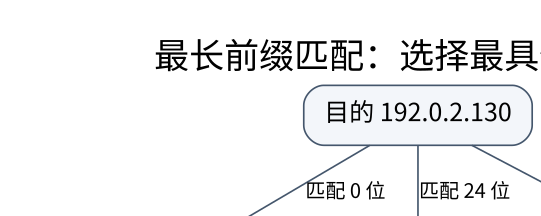

# IP 编址与路由：从掩码计算到控制平面

> **学习位置**：[[计算机知识/00-开始/课程地图/09-计算机网络-课程地图|计算机网络课程地图]] · **适用边界**：分层模型与所引用 RFC；单位、时延及可靠性假设明确给出。

[PNG 备用图](../../_assets/diagrams/round3/route-prefix.png) · [可编辑图源](../../_assets/diagrams/round3/route-prefix.dot)

## 地址分层与最长前缀匹配

IPv4 地址有 32 位，CIDR 的 `/p` 表示前 $p$ 位为网络前缀。地址 192.0.2.130/26 的掩码为 255.255.255.192，网络地址是 192.0.2.128，传统广播地址为 192.0.2.191。在普通广播子网语境中可用主机地址为 .129 到 .190；/31 点到点与 /32 主机路由不能机械套用“减二”。这里使用文档示例地址，不要求真实公网可达。

转发表含 0.0.0.0/0→G0、192.0.2.0/24→G1、192.0.2.128/25→G2。目的 .130 同时匹配三项，选择最长的 /25。不是选数值最大的下一跳，也不是最早写入的表项。转发平面执行查表，控制平面负责让表项反映拓扑与策略。

## 路由算法与互联网自治

距离向量让邻居交换到目的地的距离，更新式是 Bellman-Ford 的局部形式。链路状态让路由器传播链路信息，再各自计算最短路。二者都要面对消息延迟、拓扑变化和暂时不一致；距离向量中的“数到无穷”不是算术无穷，而是坏消息传播与依赖环导致的收敛问题。

自治系统内部常讨论 IGP；自治系统之间的 BGP 以路径和策略为核心。BGP 不是“把全互联网按最低 RTT 排序”的算法，商业关系、出口策略和可达性约束都可能改变所选路径。路由聚合缩小表规模，但必须确实拥有可共同宣布的前缀，不能仅为缩表就宣告不属于自己的地址。

## 分片、MTU 与 ICMP

MTU 限制某一链路可承载的网络层包大小；MSS 约束 TCP 数据部分，两者不相等。隧道头会降低内层可用空间。IPv4 在允许时可由路由器分片；IPv6 路由器不执行同样的中途分片，源节点承担分片工作。路径 MTU 发现需要处理过大包的反馈；粗暴屏蔽所有 ICMP/ICMPv6 可能导致“小包通、大包卡住”。

TTL/Hop Limit 防止转发环路使包无限存活，不是可靠的传输时间承诺。ICMP 传达网络错误与诊断信息，但无 ICMP 回应既不能证明主机不存在，也不能单独证明链路故障。

## IPv6 不只是地址变长

IPv6 地址有 128 位，基本首部固定 40 B，并使用扩展首部表达可选功能。地址压缩只能用一次 `::`，因为第二处零段长度会产生歧义。常见 /64 子网划分与 SLAAC 有联系，但“所有 IPv6 路由前缀都必须是 /64”是错误概括。IPv6 没有 IPv4 式广播，相关功能使用多播与其他机制。

SLAAC、DHCPv6、路由器通告、DNS 配置与重复地址检测分别解决不同问题；获取地址并不自动意味着已经知道默认路由或能够解析域名。双栈与隧道是迁移策略，不是同一协议的两种写法。

## NAT 的真实边界

NAT 改写地址或端口映射，缓解部分地址使用问题，却改变端到端可达性。它不是访问控制策略的同义词，更不是加密。连接跟踪、防火墙规则与地址转换常部署在同一设备上，因此容易被误认为一种机制。端口复用还会遇到映射超时、端口耗尽与多层 NAT 等问题。

**练习**：一个 `/24` 均匀划成 8 个子网，每个子网是什么前缀？8 是 $2^3$，借用 3 个主机位，得到 /27，每段 32 个地址；普通广播子网的传统可用主机数为 30。请再解释为何该“30”不是所有链路类型的通用定律。

<!-- ROUND4 DEPTH LINKS -->
## 继续推演本页难点

[[计算机知识/35-计算机网络/10-系统课程/09-路由邻居发现分片与PMTU|IP 目的地很远，为什么以太网帧却发给本地网关？]] 本专题补上协议字段、时间线或可复算的数值条件。

这不是替换本页：先掌握原理，再用补充页核对容易被一句话略过的条件。
<!-- END ROUND4 DEPTH LINKS -->

## 关联阅读

- [[计算机知识/50-数据结构与算法/20-算法设计系统课程/05-图算法网络流与匹配证明|图算法、网络流与匹配证明：残量边记录可以撤销的选择]]
- [[计算机知识/35-计算机网络/10-系统课程/02-链路层交换与差错检测|链路层：从 CRC 到交换机为什么会泛洪]]
- [[计算机知识/20-操作系统/01-Linux/10-系统课程/06-网络命名空间容器与隔离|Linux 网络与容器：把命名隔离和资源限制分开]]

## 依据与继续查证

- [RFC 9293：TCP](https://www.rfc-editor.org/rfc/rfc9293.html)
- [RFC 9000：QUIC](https://www.rfc-editor.org/rfc/rfc9000.html)
- [RFC 9110：HTTP Semantics](https://www.rfc-editor.org/rfc/rfc9110.html)

本页的例子、推演与练习为教学构造；语言契约、系统接口和版本相关结论应结合以上原始文档核对。

<!-- COURSE SEQUENCE -->
## 顺序导航与验证

[[计算机知识/35-计算机网络/10-系统课程/00-计算机网络系统课程索引|本课程总索引]] · [[计算机知识/_labs/round3/NET/计算机网络-实验说明|本课程实验]]

上一讲：[[计算机知识/35-计算机网络/10-系统课程/02-链路层交换与差错检测|链路层：从 CRC 到交换机为什么会泛洪]]

下一讲：[[计算机知识/35-计算机网络/10-系统课程/04-传输层状态序号与拥塞|TCP 与 UDP：可靠字节流怎样在不可靠网络上成立]]
<!-- END COURSE SEQUENCE -->
