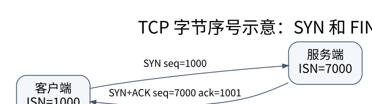

# TCP 与 UDP：可靠字节流怎样在不可靠网络上成立

> **学习位置**：[[计算机知识/00-开始/课程地图/09-计算机网络-课程地图|计算机网络课程地图]] · **适用边界**：分层模型与所引用 RFC；单位、时延及可靠性假设明确给出。

[PNG 备用图](../../_assets/diagrams/round3/tcp-sequence.png) · [可编辑图源](../../_assets/diagrams/round3/tcp-sequence.dot)

## 序号标记字节，不是第几个包

TCP 给两个方向分别维护序号空间。假设一方初始序号为 1000，SYN 消耗一个序号，第一段 500 B 数据从 1001 开始，完整连续接收后确认号为 1501。确认号表达“下一次期望的字节序号”，不是“最后收到了 1501”。FIN 也消耗序号，纯 ACK 则不按同样方式推进。

可靠性的关键不是永不丢包，而是能够识别遗漏、重复和乱序，并在允许的时间内重传或向应用报告失败。累积 ACK 对连续前缀确认；SACK 扩展帮助描述非连续接收区间。32 位序号循环使用，需要按协议的模运算与窗口约束解释，而不是普通无符号整数大小比较。

## 建连与关闭是两端状态的协调

三次握手交换初始序号与确认，使双方建立一致的连接上下文。不要把它简化为“第三次只是礼貌确认”：丢包、旧报文和半开状态才是状态机设计要处理的问题。TCP 全双工意味着两个方向可以分别结束，收到 FIN 不代表本方已不能继续发送；RST 表达异常终止，不是正常收尾的同义词。

TIME_WAIT 用于处理连接结束后的旧报文与最终确认相关问题；它不是“服务器固定等待某个秒数”，实际参数与实现需要查证。应用层读取返回 EOF、连接被复位、等待超时属于不同观察，应保留不同错误信息。

## 流量控制与拥塞控制不可互换

接收窗口 rwnd 保护接收端缓存，拥塞窗口 cwnd 调节对网络的施压。简化地说，在途数据要受两者约束，还受已发送未确认数据和应用可用数据影响。把 rwnd 调大不能直接消除网络拥塞；把 cwnd 调大也不能创造接收端消费能力。

以教学版 Reno 思路观察：慢启动阶段拥塞窗口按 RTT 大致指数增长，拥塞避免采用加性增；丢包反馈触发减小窗口。实际增长依赖 ACK 行为，恢复算法也有版本差异。CUBIC、BBR 等使用不同模型，不能把某一幅锯齿图当作全部 TCP 实现的精确轨迹。

RTT 估计需要平滑变化并考虑波动；重传后的 ACK 可能无法判断对应哪一次发送，这正是重传超时估计中需要谨慎取样的原因之一。超时过小会制造无谓重传，过大则拉长失败恢复。重传定时器与应用请求截止时间是不同层的预算。

## UDP 与 QUIC 的位置

UDP 保留数据报边界，但不承诺交付、顺序或自动重传。接收缓冲区不足、IP 分片失败与应用读取缓冲过小都会影响行为。没有 TCP 不等于可以无限速发送：应用协议仍需考虑拥塞控制、公平性、丢包与放大风险。

QUIC 在 UDP 上实现安全连接、多路复用和可靠流等机制。TCP 的单一字节流丢失某段会阻塞后续字节交付；QUIC 可使一个流的数据缺口不直接阻塞其他流的有序交付，但共享拥塞控制、连接级资源和应用依赖仍可能相互影响。“QUIC 消除了所有队头阻塞”过于绝对。

## 练习：成功到底到哪一层

`send` 成功是否说明服务端已经写入数据库？**不是。** 它通常只说明本地内核接受了这些字节。即使收到 TCP ACK，也不等价于应用已提交事务；应用提交后响应又可能丢失。需要应用层结果、幂等键和查询接口定义业务语义。这是从网络连接到分布式系统的关键桥梁。

<!-- ROUND4 DEPTH LINKS -->
## 继续推演本页难点

[[计算机知识/35-计算机网络/10-系统课程/10-TCP窗口RTO与拥塞控制手算|接收窗口、拥塞窗口、在途量与超时分别限制什么？]] 本专题补上协议字段、时间线或可复算的数值条件。

这不是替换本页：先掌握原理，再用补充页核对容易被一句话略过的条件。
<!-- END ROUND4 DEPTH LINKS -->

## 关联阅读

- [[计算机知识/35-计算机网络/10-系统课程/07-Socket分帧背压与排障|Socket 工程：分帧、背压、超时和可解释的失败]]
- [[计算机知识/35-计算机网络/10-系统课程/06-HTTP_TLS_QUIC与应用协议|HTTP、TLS 与 QUIC：把性能、安全和业务语义分开]]
- [[计算机知识/55-数据库/10-系统课程/07-恢复复制与分布式事务|恢复、复制与分布式事务：提交成功意味着什么]]

## 依据与继续查证

- [RFC 9293：TCP](https://www.rfc-editor.org/rfc/rfc9293.html)
- [RFC 9000：QUIC](https://www.rfc-editor.org/rfc/rfc9000.html)
- [RFC 9110：HTTP Semantics](https://www.rfc-editor.org/rfc/rfc9110.html)

本页的例子、推演与练习为教学构造；语言契约、系统接口和版本相关结论应结合以上原始文档核对。

<!-- COURSE SEQUENCE -->
## 顺序导航与验证

[[计算机知识/35-计算机网络/10-系统课程/00-计算机网络系统课程索引|本课程总索引]] · [[计算机知识/_labs/round3/NET/计算机网络-实验说明|本课程实验]]

上一讲：[[计算机知识/35-计算机网络/10-系统课程/03-IP编址路由与IPv6|IP 编址与路由：从掩码计算到控制平面]]

下一讲：[[计算机知识/35-计算机网络/10-系统课程/05-DNS命名与应用基础设施|DNS、邮件与服务发现：名字不是地址的简单别名]]
<!-- END COURSE SEQUENCE -->

<!-- ORIGINAL DEEP LINKS -->
## 与原有长篇专题衔接

- [[计算机知识/35-计算机网络/04-UDP-TCP可靠传输与应用分帧|04-UDP-TCP可靠传输与应用分帧]]
- [[计算机知识/35-计算机网络/07-安全排障与网络知识全景|07-安全排障与网络知识全景]]

新旧讲解采用的版本与模型可能不同，比较时先核对各自前提，不把教学简化当成实现细节。
<!-- END ORIGINAL DEEP LINKS -->
