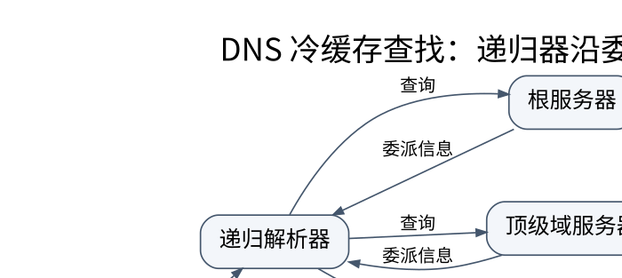

# DNS、邮件与服务发现：名字不是地址的简单别名

> **学习位置**：[[计算机知识/00-开始/课程地图/09-计算机网络-课程地图|计算机网络课程地图]] · **适用边界**：分层模型与所引用 RFC；单位、时延及可靠性假设明确给出。

[PNG 备用图](../../_assets/diagrams/round3/dns-chain.png) · [可编辑图源](../../_assets/diagrams/round3/dns-chain.dot)

## 一次 DNS 查询的知识链

应用先把名字交给本地解析设施，递归解析器可从缓存回答；缓存未命中时，再沿根、顶级域、权威服务器的委派关系寻找答案。真实查询可能因缓存省略多步，因此抓包只见一问一答不代表 DNS 没有层次结构。递归解析器替客户端完成查找，权威服务器对其管理的区域提供权威数据，两种角色不能混称。

域名按标签分层，域与区域也不完全相同：一个域下的子域可以通过委派成为独立管理的区域。A 与 AAAA 提供不同地址族记录；CNAME 是别名；MX 关联邮件交换；NS 表达委派；TXT 是承载文本的记录类型而不是可信身份本身。

## 缓存让系统可扩展，也让更新不是瞬时广播

TTL 给缓存的有效期提供约束，并不意味着“修改后全世界严格在 TTL 秒后同时切换”。不同缓存已有剩余寿命，客户端和应用也可能再缓存。负缓存使不存在的名字或记录也能被短期记忆，NXDOMAIN 与某类型无数据不是同一个结论。

设记录在 12:00 被解析器缓存，TTL 为 300 s，权威数据于 12:02 更新。该缓存仍可能在其有效期内返回旧值，直到约 12:05；而 12:03 首次查询、没有旧缓存的另一解析器可能已返回新值。迁移需要考虑重叠服务与回滚，不能把改 DNS 当成事务提交。

DNS 查询既可以使用 UDP，也可以使用 TCP；大响应、截断及实现策略会影响选择。EDNS 扩展能力不等于路径一定能承载任意大 UDP 数据报。DNSSEC 提供数据来源认证与完整性链，不加密查询内容；DoT/DoH 加密特定传输路径，不自动保证解析结果获得 DNSSEC 验证。隐私与数据真实性是两条轴。

## 服务发现、负载均衡与健康检查

同一名字返回多个地址，可以分散连接，但 DNS 缓存粒度与客户端选择会影响分布。四层负载均衡依据连接信息转发；七层代理能理解应用协议，也因此可能成为 TLS 终止点和新信任边界。健康检查只证明某个探针在某一时刻成功，不必然证明所有业务依赖正常。

负载均衡策略包括轮询、最少连接、加权与一致性哈希。后者减少成员变化时的重新映射，不提供数据一致性；名字相近不代表概念相同。会话粘滞可减轻状态迁移，但也可能造成热点与故障恢复困难。

## 邮件和其他应用协议的定位

SMTP 负责邮件传输，IMAP/POP 侧重访问邮箱；邮件格式、附件编码和传输协议应分开理解。SPF、DKIM、DMARC 对发信域授权、签名和处理策略提供不同机制，不应承诺其能消灭所有钓鱼。FTP 的控制与数据连接、SSH 的安全远程通道、NTP 的时间同步、DHCP 的配置租约都展示了不同状态与信任假设。

时钟同步不是全球同时钟。误差、漂移和网络不对称会影响时间估计；测量持续时间优先用单调时钟，不能简单假定墙上时钟永不回拨。

**练习**：DNS 能正常解析而 HTTPS 失败，下一步是否继续清缓存？先保留结果，再检查选定地址族、路由、TCP/QUIC 建连、证书主机名、系统时间和代理。名字解析只是链条的一段，不是整个网络诊断的终点。

补充规范：[DNS 概念 RFC 1034](https://www.rfc-editor.org/rfc/rfc1034.html)、[负缓存 RFC 2308](https://www.rfc-editor.org/rfc/rfc2308.html)、[DNSSEC 概述 RFC 4033](https://www.rfc-editor.org/rfc/rfc4033.html)。

## 关联阅读

- [[计算机知识/35-计算机网络/10-系统课程/06-HTTP_TLS_QUIC与应用协议|HTTP、TLS 与 QUIC：把性能、安全和业务语义分开]]
- [[计算机知识/20-操作系统/01-Linux/10-系统课程/07-性能观测与故障定位|Linux 性能排障：从症状到可证伪的瓶颈假设]]

## 依据与继续查证

- [RFC 9293：TCP](https://www.rfc-editor.org/rfc/rfc9293.html)
- [RFC 9000：QUIC](https://www.rfc-editor.org/rfc/rfc9000.html)
- [RFC 9110：HTTP Semantics](https://www.rfc-editor.org/rfc/rfc9110.html)

本页的例子、推演与练习为教学构造；语言契约、系统接口和版本相关结论应结合以上原始文档核对。

<!-- COURSE SEQUENCE -->
## 顺序导航与验证

[[计算机知识/35-计算机网络/10-系统课程/00-计算机网络系统课程索引|本课程总索引]] · [[计算机知识/_labs/round3/NET/计算机网络-实验说明|本课程实验]]

上一讲：[[计算机知识/35-计算机网络/10-系统课程/04-传输层状态序号与拥塞|TCP 与 UDP：可靠字节流怎样在不可靠网络上成立]]

下一讲：[[计算机知识/35-计算机网络/10-系统课程/06-HTTP_TLS_QUIC与应用协议|HTTP、TLS 与 QUIC：把性能、安全和业务语义分开]]
<!-- END COURSE SEQUENCE -->

<!-- ORIGINAL DEEP LINKS -->
## 与原有长篇专题衔接

- [[计算机知识/35-计算机网络/06-DNS-TLS-HTTP与端到端请求|06-DNS-TLS-HTTP与端到端请求]]

新旧讲解采用的版本与模型可能不同，比较时先核对各自前提，不把教学简化当成实现细节。
<!-- END ORIGINAL DEEP LINKS -->
